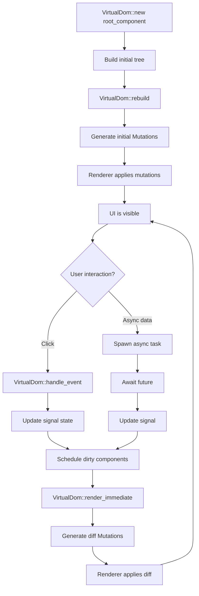
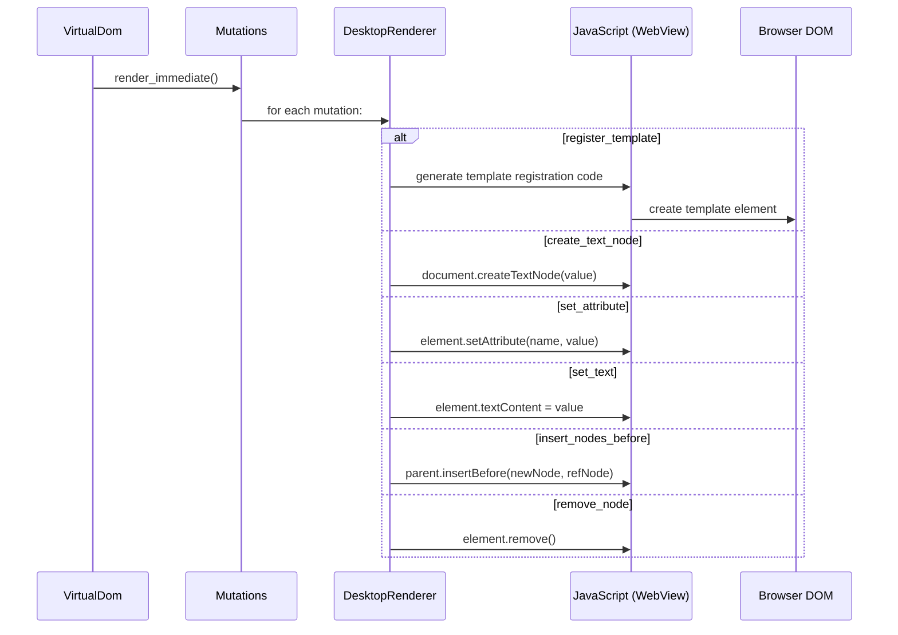

# Dioxus — Rust UI Framework with rsx! Macro

## Core Concept

Dioxus is a React-like UI framework for Rust. It provides a `VirtualDom` for efficient UI updates, an `rsx!` macro for declarative UI construction, and a `WriteMutations` trait for rendering to any target (desktop WebView, web browser, mobile, or server). Dioxus desktop uses tao for windowing and wry for WebView rendering, with taffy for layout computation.

The key insight is that Dioxus separates the UI description (VirtualDom + rsx!) from rendering (WriteMutations). The VirtualDom computes diffs between UI states. The renderer applies those diffs to the actual output target. This means the same UI code can render to a desktop WebView, a web browser, or a server-side HTML string.

## VirtualDom — The Core

```rust
// dioxus/packages/core/src/virtual_dom.rs
pub struct VirtualDom {
    /// The scope arena — stores all component instances
    pub(crate) scopes: Slab<ScopeState>,
    /// The dirty scope queue — ordered by scope priority
    pub(crate) dirty_scopes: BTreeSet<ScopeOrder>,
    /// The runtime for signal subscriptions and async task management
    pub(crate) runtime: Rc<Runtime>,
    /// Scopes that have been resolved since last render
    pub(crate) resolved_scopes: Vec<ScopeId>,
    /// Receiver for scheduler messages
    rx: futures_channel::mpsc::UnboundedReceiver<SchedulerMsg>,
}

impl VirtualDom {
    pub fn new(root: fn() -> Element) -> Self { ... }
    pub fn rebuild(&mut self) -> Mutations { ... }
    pub fn render_immediate(&mut self) -> Mutations { ... }
    pub fn render_with_deadline(&mut self, deadline: impl Future) -> Mutations { ... }
    pub fn handle_event(&mut self, event: &UserEvent) { ... }
    pub fn wait_for_work(&mut self) -> impl Future<Output = ()> { ... }
}
```

The VirtualDom is the heart of Dioxus. It manages:
1. **Component instances** — stored in a slab arena for O(1) access
2. **Dirty queue** — components scheduled for re-render
3. **Mutations** — the diff between old and new UI trees
4. **Runtime** — signal subscriptions and async task management



## rsx! Macro — Declarative UI

The `rsx!` macro is Dioxus's JSX-like syntax for building UI descriptions:

```rust
// dioxus/packages/rsx/src/rsx_impl.rs
#[component]
fn App() -> Element {
    let mut count = use_signal(|| 0);

    rsx! {
        div {
            class: "container",
            h1 { "Counter: {count}" }
            button {
                onclick: move |_| count += 1,
                "Increment"
            }
            button {
                onclick: move |_| count -= 1,
                "Decrement"
            }
        }
    }
}
```

The `rsx!` macro produces an `Element` — a description of the UI tree, not an actual rendered element:

```rust
// Expanded from rsx! (simplified)
fn App() -> Element {
    let count = use_signal(|| 0);

    Element::Ok(VNode {
        root: &[
            TemplateNode::Element {
                tag: "div",
                attrs: &[TemplateAttribute::Static {
                    name: "class",
                    value: "container",
                }],
                children: &[
                    TemplateNode::Element {
                        tag: "h1",
                        children: &[
                            TemplateNode::DynamicText { id: 0 },
                        ],
                    },
                    TemplateNode::Element {
                        tag: "button",
                        attrs: &[TemplateAttribute::Dynamic { id: 0 }],
                        children: &[TemplateNode::DynamicText { id: 1 }],
                    },
                ],
            },
        ],
        dynamic_nodes: [
            dioxus_core::DynamicNode::Text(count.read().to_string()),
            dioxus_core::DynamicNode::Text(format!("Decrement")),
        ],
        dynamic_attrs: [
            Attribute::new("onclick", Listener::move_closure(...)),
        ],
    })
}
```

The macro splits the template into static and dynamic parts. The static structure (element tags, class names) is hoisted into a `Template` that is computed once. The dynamic parts (text content, event handlers) are recomputed on each render. This is a key optimization: most of the template doesn't change between renders.

**Aha:** The `rsx!` macro's static/dynamic split is what makes Dioxus fast. React re-renders the entire JSX tree and diffs it with the previous tree. Dioxus only recomputes the dynamic parts. The static template structure is shared across all renders and even across component instances. This means less allocation, less comparison, and less work per render.

## WriteMutations Trait — Renderer Interface

```rust
// dioxus/packages/core/src/mutations.rs
pub trait WriteMutations {
    fn register_template(&mut self, template: Template) -> usize;
    fn append_children(&mut self, id: usize, children: StaticNode);
    fn assign_node_id(&mut self, path: &'static [u8], id: usize);
    fn replace_placeholder(&mut self, path: &'static [u8], m: StaticNode);
    fn create_text_node(&mut self, value: &str, id: StaticNode);
    fn create_raw_text_node(&mut self, value: &str, id: StaticNode);
    fn create_comment(&mut self, value: &str, id: StaticNode);
    fn set_attribute(&mut self, id: usize, field: &'static str, value: Dynamic, ns: Option<&'static str>);
    fn remove_attribute(&mut self, id: usize, field: &'static str, ns: Option<&'static str>);
    fn set_text(&mut self, value: &str, id: usize);
    fn insert_nodes_before(&mut self, id: usize, m: StaticNode);
    fn insert_nodes_after(&mut self, id: usize, m: StaticNode);
    fn remove_node(&mut self, id: usize);
    fn move_node(&mut self, id: usize, m: StaticNode);
}
```

Every Dioxus renderer implements `WriteMutations`. The trait has 15 methods covering all DOM operations. The desktop renderer implements these methods by generating JavaScript that manipulates the WebView DOM.



## Signals — State Management

Dioxus uses signals for reactive state:

```rust
// dioxus/packages/signals/src/signal.rs
pub struct Signal<T> {
    inner: GenerationalBox<Value<T>>,
}

impl<T> Signal<T> {
    pub fn new(value: T) -> Self { ... }
    pub fn read(&self) -> ReadableRef<Self, T> { ... }
    pub fn write(&self) -> WritableRef<Self, T> { ... }
    pub fn set(&self, value: T) { ... }
    pub fn update<F>(&self, f: F) where F: FnOnce(&mut T) { ... }
}

// Hook for components
pub fn use_signal<T: Clone + 'static>(
    initial_value: impl FnOnce() -> T,
) -> Signal<T> { ... }
```

Signals are reactive: when a signal's value changes, all components that read the signal are automatically scheduled for re-render. This is more efficient than React's `useState` because Dioxus tracks which components actually read which signals.

```rust
#[component]
fn Counter() -> Element {
    let mut count = use_signal(|| 0);

    // This component will re-render only when `count` changes
    rsx! {
        div {
            "Count: {count}"
            button { onclick: move |_| count += 1, "+" }
        }
    }
}
```

## Hooks — Component Lifecycle

Dioxus hooks are called within components and provide lifecycle functionality:

| Hook | Purpose |
|------|---------|
| `use_signal(initial)` | Create reactive state |
| `use_memo(value_fn)` | Derived state, recomputed when dependencies change |
| `use_effect(f)` | Side effect, runs when dependencies change |
| `use_resource(f)` | Async data fetching with loading/loaded/error states |
| `use_context()` | Access context provided by parent components |
| `use_context_provider(value)` | Provide context to child components |

```rust
#[component]
fn TodoList() -> Element {
    let todos = use_signal(|| vec!["Learn Dioxus".to_string()]);
    let filter = use_signal(|| "all".to_string());

    // Derived state — recomputed when todos or filter changes
    let filtered = use_memo(move || {
        let f = filter.read();
        todos.read().iter()
            .filter(|t| match f.as_str() {
                "all" => true,
                "active" => !t.done,
                "done" => t.done,
                _ => true,
            })
            .cloned()
            .collect::<Vec<_>>()
    });

    rsx! {
        ul {
            for todo in filtered() {
                li { "{todo.text}" }
            }
        }
    }
}
```

## Desktop Renderer — tao + wry

Dioxus-desktop renders to a desktop WebView:

```rust
// dioxus/packages/desktop/src/desktop_context.rs
/// DesktopContext is a type alias: Rc<DesktopService>
pub type DesktopContext = Rc<DesktopService>;

pub struct DesktopService {
    pub webview: WebView,             // from wry
    pub window: Window,               // from tao
    pub(crate) shared: Rc<SharedContext>,
    pub(super) query: QueryEngine,
    pub(crate) asset_handlers: AssetHandlerRegistry,
    // ...
}
```

The desktop renderer:
1. Creates a tao window
2. Creates a wry WebView with a custom `dioxus://` protocol
3. Runs the VirtualDom
4. Converts mutations to JavaScript that manipulates the DOM
5. Handles events by forwarding them from the WebView to the VirtualDom

```rust
// dioxus/packages/desktop/src/launch.rs
pub fn launch(
    root: fn() -> Element,
    config: Config,
) {
    let virtual_dom = VirtualDom::new(root);
    launch_virtual_dom(virtual_dom, config);
}
```

The desktop renderer:
1. Creates a tao window
2. Creates a wry WebView with a custom `dioxus://` protocol
3. Runs the VirtualDom
4. Converts mutations to JavaScript that manipulates the DOM
5. Handles events by forwarding them from the WebView to the VirtualDom

**Aha:** Dioxus-desktop generates JavaScript at runtime to apply DOM mutations. Instead of serializing mutations and sending them through the IPC bridge, the renderer generates JavaScript code that directly manipulates the DOM. This is faster because it avoids the serialization/deserialization overhead of the standard IPC path.

## Component Macro

The `#[component]` macro transforms a function into a Dioxus component:

```rust
// dioxus/packages/core-macro/src/component.rs
#[component]
fn Button(label: String, onclick: EventHandler<MouseEvent>) -> Element {
    rsx! {
        button { onclick: move |_| onclick.call(()), "{label}" }
    }
}
```

The macro wraps the function in a component type and handles props:

```rust
// Generated by #[component] (simplified)
struct ButtonProps {
    label: String,
    onclick: EventHandler<MouseEvent>,
}

impl Props for ButtonProps { ... }

fn Button(props: ButtonProps) -> Element {
    let label = props.label;
    let onclick = props.onclick;
    // ... body
}
```

Props are passed as a struct. The macro generates the struct definition, the `Props` impl, and destructuring code. Optional props use `Option<T>`.

## Router

Dioxus has a built-in router for multi-page applications:

```rust
// dioxus/packages/router/src/lib.rs
#[derive(Routable, Clone, PartialEq)]
enum Route {
    #[route("/")]
    Home {},
    #[route("/about")]
    About {},
    #[route("/user/:id")]
    User { id: i32 },
}

#[component]
fn Home() -> Element { rsx! { h1 { "Home" } } }

#[component]
fn About() -> Element { rsx! { h1 { "About" } } }

#[component]
fn User(id: i32) -> Element { rsx! { h1 { "User {id}" } } }

fn App() -> Element {
    rsx! {
        Router::<Route> {}
    }
}
```

The router uses the `#[derive(Routable)]` macro to generate route matching code. The `:id` syntax captures URL parameters as component props.

## Cross-Platform Rendering

Dioxus supports multiple rendering targets:

| Target | Renderer | Platform |
|--------|----------|----------|
| Desktop | `dioxus-desktop` | macOS, Windows, Linux (tao + wry) |
| Web | `dioxus-web` | Browser (wasm + web-sys) |
| Mobile | `dioxus-mobile` | iOS, Android |
| SSR | `dioxus-ssr` | Server-side HTML string |
| LiveView | `dioxus-liveview` | Server with WebSocket connection to browser |
| Fullstack | `dioxus-fullstack` | SSR + hydration (Axum server) |

The same UI code works across all targets because the VirtualDom and `rsx!` are target-independent. Only the renderer implementation changes.

## Cross-References

- [Taffy Layout](06-taffy-layout.md) — how Taffy provides layout for Dioxus desktop
- [Wry WebView](04-wry-webview.md) — how dioxus-desktop uses wry for rendering
- [Tao Windowing](05-tao-windowing.md) — how dioxus-desktop uses tao for windowing
- [Tauri Core](01-tauri-core.md) — Tauri and Dioxus can be used together
