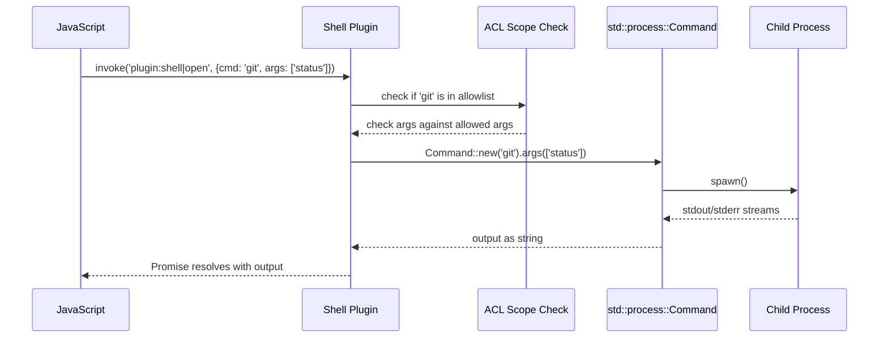
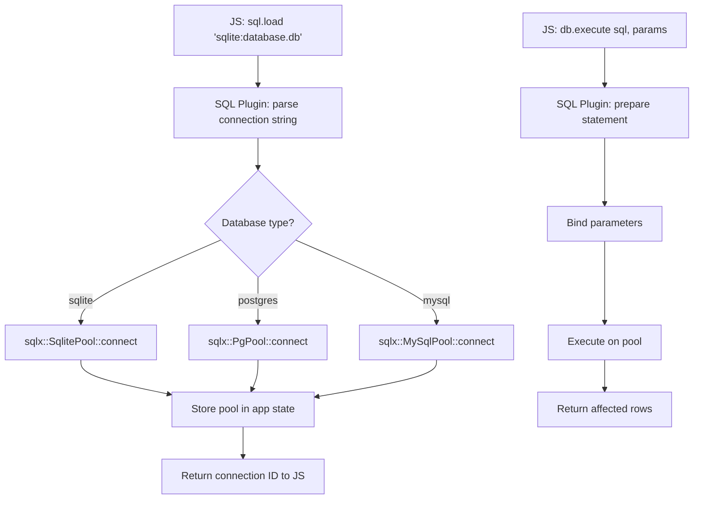
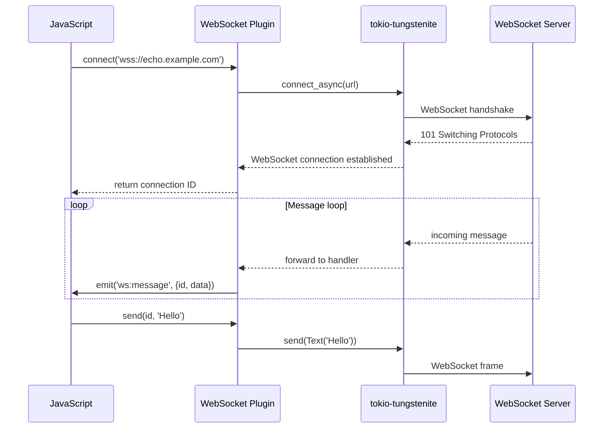

# Tauri Plugins — shell, fs, dialog, http, sql, websocket

## Core Concept

Tauri plugins extend the framework with pre-built functionality. Each plugin implements the `tauri::plugin::Plugin` trait and provides IPC commands, state management, and JavaScript API. Official plugins cover the most common desktop app needs: running shell commands, accessing the filesystem, showing dialogs, making HTTP requests, querying SQL databases, and communicating over WebSockets.

Plugins are the primary way Tauri apps access system resources. The ACL system gates every plugin command, so plugins are security-aware by design. A plugin command is only callable if the capability file grants the permission.

## Plugin Trait — The Extension Point

```rust
// tauri/src/plugin.rs
pub trait Plugin<R: Runtime>: Send {
    /// Unique name for the plugin
    fn name(&self) -> &'static str;

    /// Called once when the plugin is registered
    #[allow(unused_variables)]
    fn initialize(
        &mut self,
        app: &AppHandle<R>,
        config: JsonValue,
    ) -> Result<(), Box<dyn std::error::Error>> {
        Ok(())
    }

    /// JavaScript to inject before page load
    fn initialization_script(&self) -> Option<String> {
        None
    }

    /// Callback invoked when the window is created
    #[allow(unused_variables)]
    fn window_created(&mut self, window: Window<R>) {}

    /// Callback invoked when the webview is created
    #[allow(unused_variables)]
    fn webview_created(&mut self, webview: Webview<R>) {}

    /// Callback invoked when webview tries to navigate. Return false to cancel.
    #[allow(unused_variables)]
    fn on_navigation(&mut self, webview: &Webview<R>, url: &Url) -> bool {
        true
    }

    /// Callback invoked when the webview performs a navigation to a page
    #[allow(unused_variables)]
    fn on_page_load(&mut self, webview: &Webview<R>, payload: &PageLoadPayload<'_>) {}

    /// Callback invoked when the event loop receives a new event
    #[allow(unused_variables)]
    fn on_event(&mut self, app: &AppHandle<R>, event: &RunEvent) {}

    /// Extend commands to Builder::invoke_handler. Return true if handled.
    #[allow(unused_variables)]
    fn extend_api(&mut self, invoke: Invoke<R>) -> bool {
        false
    }
}
```

Plugins handle IPC commands through the `extend_api` method. When an IPC call matches the plugin's command prefix, the plugin's `extend_api` handler is called. The handler deserializes the arguments, executes the command, and returns `true` if handled.

## Shell Plugin

The shell plugin runs external commands:

```rust
// tauri-plugin-shell/src/lib.rs
pub fn init<R: Runtime>() -> impl Plugin<R> {
    Builder::default().build()
}

pub struct Builder {
    scope: ScopeConfig,
}

impl Builder {
    pub fn scope<F>(mut self, setup: F) -> Self
    where F: FnOnce(&mut ScopeConfig) {
        setup(&mut self.scope);
        self
    }
}
```

Shell commands are gated by an allowlist:

```json
{
  "identifier": "shell-capability",
  "permissions": [
    "shell:allow-open",
    "shell:allow-kill"
  ],
  "shell:allow-open": {
    "allow": [
      {
        "name": "bin/ls",
        "cmd": "ls",
        "args": true
      },
      {
        "name": "bin/git",
        "cmd": "git",
        "args": ["status", "log", "diff"]
      }
    ]
  }
}
```

The allowlist specifies which commands are allowed and what arguments are accepted. `args: true` allows any arguments; `args: ["status", "log"]` allows only those specific arguments.



Shell plugin features:
- Synchronous execution (waits for command to complete)
- Streaming output (optional, for long-running commands)
- Working directory configuration
- Environment variable control
- Kill command for running processes

## Filesystem Plugin

The filesystem plugin provides file and directory operations:

```rust
// tauri-plugin-fs/src/lib.rs
pub fn init<R: Runtime>() -> impl Plugin<R> {
    Builder::new().build()
}
```

Commands:
- `read_file` — read a file's contents as bytes or text
- `write_file` — write bytes or text to a file
- `read_dir` — list directory contents
- `create_dir` — create a directory
- `remove_dir` — remove a directory
- `remove_file` — delete a file
- `rename` — rename a file or directory
- `copy_file` — copy a file
- `exists` — check if a path exists
- `metadata` — get file metadata (size, modified time, etc.)

Scoped filesystem access:

```json
{
  "identifier": "fs-capability",
  "permissions": [
    "fs:allow-read-file",
    "fs:allow-write-file",
    "fs:allow-read-dir",
    "fs:allow-create-dir"
  ],
  "fs:default": {
    "allow": [
      { "path": "$HOME/documents/**" },
      { "path": "$APPDATA/**" }
    ],
    "deny": [
      { "path": "$HOME/documents/secret/**" }
    ]
  }
}
```

Path resolution supports variables:
- `$HOME` — user's home directory
- `$APPDATA` — application data directory
- `$APPDIR` — application installation directory
- `$DOCUMENT` — user's documents directory
- `$DESKTOP` — user's desktop directory
- `$DOWNLOAD` — user's downloads directory
- `$MUSIC` — user's music directory
- `$PICTURE` — user's pictures directory
- `$VIDEO` — user's videos directory
- `$PUBLIC` — user's public directory
- `$TEMP` — system temporary directory
- `$CONFIG` — platform config directory
- `$DATA` — platform data directory
- `$CACHE` — platform cache directory
- `$LOG` — platform log directory

**Aha:** The filesystem plugin's path variable system is a clever security feature. Instead of giving plugins raw filesystem access, Tauri resolves variables to known-safe directories. This prevents path traversal attacks where the frontend tries to read `/etc/passwd` or other sensitive files. Even if the ACL allows reading `$HOME/documents/**`, the plugin will never resolve a path outside the configured directories.

## Dialog Plugin

The dialog plugin shows native file/folder dialogs:

```rust
// tauri-plugin-dialog/src/lib.rs
pub fn init<R: Runtime>() -> impl Plugin<R> {
    Builder::new().build()
}
```

Commands:
- `open` — show file open dialog
- `save` — show file save dialog
- `message` — show message dialog
- `ask` — show confirmation dialog

```javascript
// Open a file
const file = await dialog.open({
    title: 'Open a file',
    multiple: false,
    directory: false,
    filters: [
        { name: 'Text', extensions: ['txt', 'md'] },
        { name: 'All', extensions: ['*'] }
    ]
})

// Save a file
const path = await dialog.save({
    title: 'Save file',
    defaultPath: 'document.txt',
    filters: [{ name: 'Text', extensions: ['txt'] }]
})
```

The dialog plugin uses the native OS dialogs:
- macOS: `NSOpenPanel`, `NSSavePanel`
- Windows: `IFileDialog` (COM)
- Linux: `GtkFileChooserDialog`

## HTTP Plugin

The HTTP plugin makes HTTP requests from Rust:

```rust
// tauri-plugin-http/src/lib.rs
pub fn init<R: Runtime>() -> impl Plugin<R> {
    Builder::new().build()
}
```

Commands:
- `request` — make an HTTP request
- `fetch` — simpler request interface

```javascript
const response = await http.fetch('https://api.example.com/data', {
    method: 'POST',
    headers: { 'Content-Type': 'application/json' },
    body: { key: 'value' },
    timeout: 30,
})
```

The HTTP plugin uses `reqwest` as the HTTP client. Features:
- All HTTP methods (GET, POST, PUT, DELETE, PATCH, etc.)
- Request/response headers
- JSON body serialization
- File upload/download
- Request timeout
- Cookie support
- Custom client configuration

**Aha:** The HTTP plugin makes requests from Rust, not from the WebView. This bypasses CORS entirely because the request doesn't go through the browser's network stack. The frontend can call any API without CORS preflight, and the response is returned through the IPC bridge. This is both a convenience (no CORS issues) and a security consideration (the ACL must gate which URLs are allowed).

## SQL Plugin

The SQL plugin provides database access via `sqlx`:

```rust
// tauri-plugin-sql/src/lib.rs
pub fn init<R: Runtime>() -> impl Plugin<R> {
    Builder::new().build()
}

// In tauri-plugin-sql/Cargo.toml
[dependencies]
sqlx = { version = "0.8", features = ["runtime-tokio"] }
```

Supported databases (via sqlx feature flags):
- SQLite (`sqlx-sqlite`)
- PostgreSQL (`sqlx-postgres`)
- MySQL (`sqlx-mysql`)

Commands:
- `load` — create a database connection
- `execute` — run a SQL query (INSERT, UPDATE, DELETE)
- `select` — run a SELECT query and return rows

```javascript
// Load a SQLite database
const db = await sql.load('sqlite:database.db')

// Execute a query
await db.execute('INSERT INTO users (name) VALUES ($1)', ['Alice'])

// Select rows
const rows = await db.select('SELECT * FROM users WHERE id = $1', [1])
```

The SQL plugin uses prepared statements by default. The `$1, $2, ...` syntax is positional parameters. The plugin automatically translates between JavaScript arrays and SQL parameters.



## WebSocket Plugin

The WebSocket plugin provides persistent WebSocket connections via `tokio-tungstenite`:

```rust
// tauri-plugin-websocket/src/lib.rs
pub fn init<R: Runtime>() -> impl Plugin<R> {
    Builder::new().build()
}

// In tauri-plugin-websocket/Cargo.toml
[dependencies]
tokio-tungstenite = { version = "0.28", features = ["rustls-tls-webpki-roots"] }
tokio = { version = "1", features = ["full"] }
url = "2"
```

Commands:
- `connect` — open a WebSocket connection
- `send` — send a message (text or binary)
- `close` — close the connection
- `ping` — send a ping frame

```javascript
// Connect
const ws = await websocket.connect('wss://echo.example.com')

// Listen for messages
ws.onMessage((message) => {
    console.log('Received:', message.data)
})

// Send a message
await ws.send('Hello, server!')

// Close the connection
await ws.close()
```

The WebSocket plugin manages connections with unique IDs:



The WebSocket plugin runs the message loop in a tokio task. Each connection has a background task that reads incoming messages and emits them as Tauri events. The JavaScript side listens with `ws.onMessage()`.

## Plugin Registration Pattern

Plugins are registered on the Tauri builder:

```rust
fn main() {
    tauri::Builder::default()
        .plugin(tauri_plugin_shell::init())
        .plugin(tauri_plugin_fs::init())
        .plugin(tauri_plugin_dialog::init())
        .plugin(tauri_plugin_http::init())
        .plugin(tauri_plugin_sql::init())
        .plugin(tauri_plugin_websocket::init())
        .invoke_handler(tauri::generate_handler![my_commands])
        .run(tauri::generate_context!())
        .expect("error while running tauri application");
}
```

Each `init()` function returns a type implementing the `Plugin` trait. The builder collects plugins in registration order. During `run()`, each plugin's `initialize()` method is called.

## Writing Custom Plugins

You can write custom plugins by implementing the `Plugin` trait:

```rust
use tauri::{
    plugin::{Builder, Plugin, TauriPlugin},
    Runtime, AppHandle, Manager,
};

pub fn init<R: Runtime>() -> TauriPlugin<R> {
    Builder::new("my-plugin")
        .invoke_handler(|invoke| {
            // Handle IPC commands
            match invoke.message.command() {
                "greet" => invoke_greet(invoke),
                _ => false,
            }
        })
        .setup(|app, _api| {
            // Initialize plugin
            app.manage(MyPluginState::new());
            Ok(())
        })
        .build()
}
```

Custom plugins follow the same patterns as official plugins:
- Define commands through the invoke handler
- Manage state through `app.manage()`
- Inject scripts through `on_page_load()`
- Define ACL permissions

## Cross-References

- [Tauri Core](01-tauri-core.md) — how plugins integrate with App<R>
- [IPC and ACL](02-tauri-ipc-acl.md) — how plugin commands are gated by the ACL
- [Build and CLI](03-tauri-build-cli.md) — how plugins are bundled and distributed
- [Cross-Cutting Concerns](10-cross-cutting.md) — plugin security review
