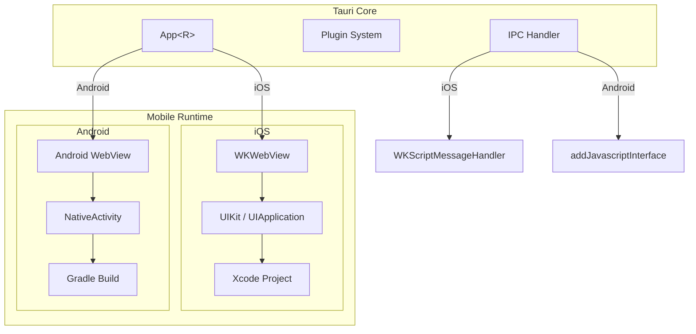
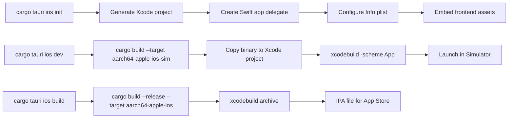
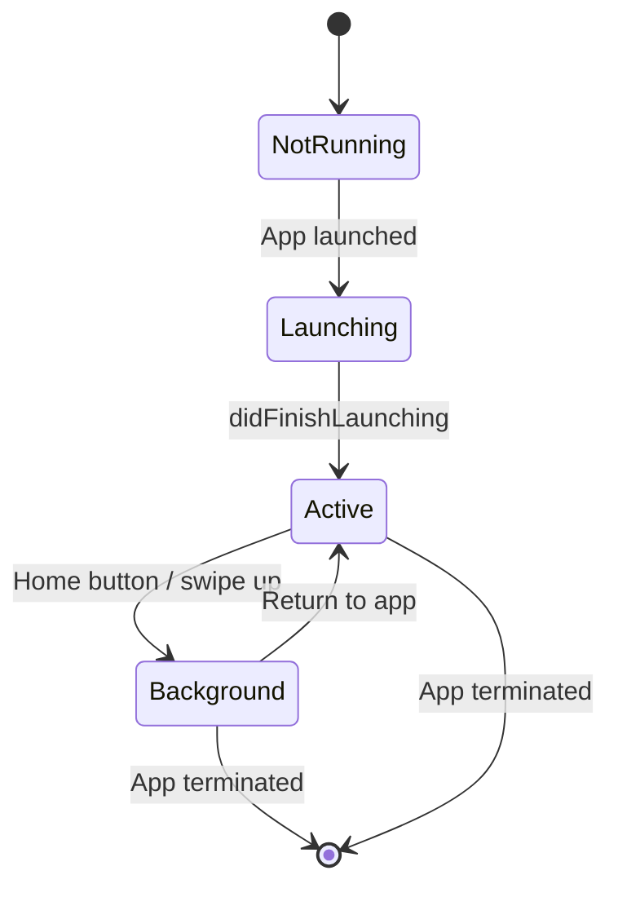
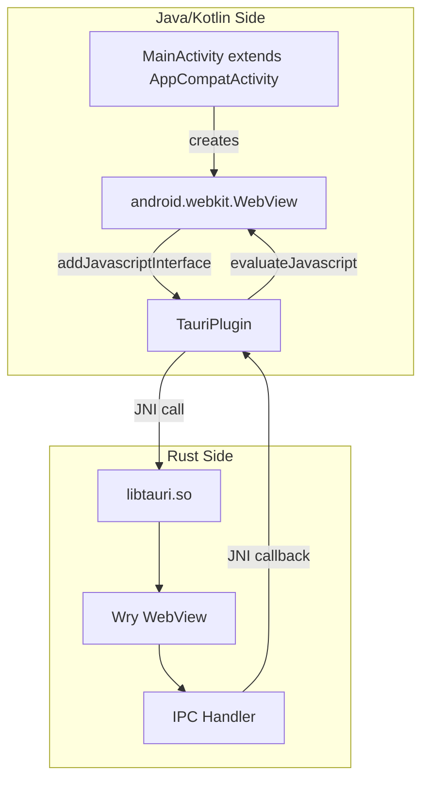
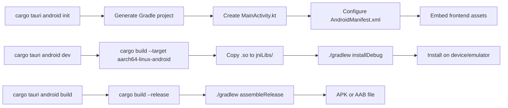
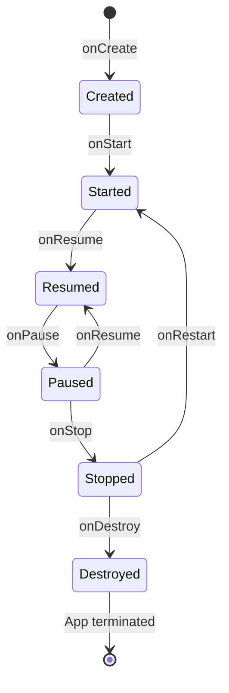

# Tauri Native and Mobile — iOS and Android Support

## Core Concept

Tauri supports mobile platforms (iOS and Android) by adapting its core architecture to mobile constraints. On iOS, the WebView is `WKWebView` (same as macOS). On Android, it's `android.webkit.WebView`. The windowing layer uses tao's iOS (UIKit) and Android (NativeActivity) backends. The build system produces Xcode projects for iOS and Gradle projects for Android.

The key difference from desktop: mobile apps have strict lifecycle management (background/foreground transitions), different input methods (touch vs mouse), and platform-specific build requirements (Xcode for iOS, Gradle for Android).

## Mobile Architecture



## iOS Support

### WKWebView on iOS

On iOS, Tauri uses `WKWebView` — the same WebView used on macOS. The code path is nearly identical:

```rust
// wry/src/webview/wkwebview/mod.rs — shared between macOS and iOS
#[cfg(target_os = "ios")]
mod ios {
    use objc2_ui_kit::{
        UIApplication,
        UIWindow,
        UIScrollView,
        UIView,
        UIResponder,
    };

    // The WKWebView creation is the same as macOS
    // Only the window integration differs
}
```

iOS-specific differences:
- `UIApplication` instead of `NSApplication`
- `UIWindow` instead of `NSWindow`
- Touch events instead of mouse events
- Safe area insets (notch, home indicator)
- Status bar management
- App lifecycle (background/foreground)

### iOS Build System

Tauri generates an Xcode project for iOS:

```
src-tauri/
├── iOS/
│   ├── App.xcodeproj/
│   │   └── project.pbxproj
│   ├── App/
│   │   ├── AppDelegate.swift
│   │   ├── Info.plist
│   │   └── Assets.xcassets/
│   └── assets/
│       └── index.html        ← Frontend assets
```

The build process:
1. `cargo tauri ios init` — generate the Xcode project
2. `cargo tauri ios dev` — build and run on simulator
3. `cargo tauri ios build` — build for distribution



### iOS Lifecycle

iOS apps have a strict lifecycle managed by the system:



Tauri handles lifecycle transitions through tao's iOS backend:
- `UIApplicationDelegate::applicationDidEnterBackground` — app is paused
- `UIApplicationDelegate::applicationWillEnterForeground` — app is resumed
- The WebView preserves state across transitions

## Android Support

### Android WebView

On Android, Tauri uses `android.webkit.WebView`. The integration is more complex because Android uses JNI (Java Native Interface) to bridge between Rust and the Java/Android runtime:

```rust
// wry/src/webview/android/mod.rs
use jni::{JNIEnv, objects::{JObject, JString, JClass}};

// Called from the Android side via JNI
#[export_name = "Java_app_tauri_plugin_TauriPlugin_handleMessage"]
pub extern "C" fn handle_message(
    mut env: JNIEnv,
    _class: JClass,
    message: JString,
) {
    let msg: String = env.get_string(&message).unwrap().into();
    let handler = get_ipc_handler();
    handler(msg);
}
```

The Android WebView integration has several moving parts:



### Android Build System

Tauri generates a Gradle project for Android:

```
src-tauri/
├── android/
│   ├── build.gradle
│   ├── settings.gradle
│   ├── gradle.properties
│   ├── app/
│   │   ├── build.gradle
│   │   └── src/
│   │       ├── main/
│   │       │   ├── AndroidManifest.xml
│   │       │   ├── java/
│   │       │   │   └── com/myapp/
│   │       │   │       ├── MainActivity.kt
│   │       │   │       └── TauriPlugin.kt
│   │       │   └── res/
│   │       │       ├── layout/
│   │       │       │   └── activity_main.xml
│   │       │       └── values/
│   │       │           └── strings.xml
│   │       └── main/
│   │           └── assets/
│   │               └── index.html
```

The build process:
1. `cargo tauri android init` — generate the Gradle project
2. `cargo tauri android dev` — build and run on device/emulator
3. `cargo tauri android build` — build an APK or AAB for distribution



### Android Lifecycle

Android lifecycle is more complex than iOS:



Tauri handles Android lifecycle through NativeActivity callbacks:
- `onCreate` — initialize the WebView and load the frontend
- `onResume` — resume the WebView
- `onPause` — pause the WebView
- `onDestroy` — clean up resources

## Mobile-Specific Considerations

### Input Handling

Mobile input is touch-based, not mouse-based:

| Feature | Desktop | Mobile |
|---------|---------|--------|
| Primary input | Mouse + keyboard | Touch + virtual keyboard |
| Hover events | Yes | No |
| Right-click | Yes | Long press |
| Scroll | Mouse wheel + trackpad | Touch drag |
| Zoom | Pinch (trackpad) | Pinch (touch) |

The WebView handles most input mapping automatically. Touch events map to mouse events. The virtual keyboard appears when a text input is focused.

### Permissions

Mobile apps require runtime permissions:

| Permission | iOS | Android |
|------------|-----|---------|
| Camera | Info.plist + runtime | Manifest + runtime |
| Microphone | Info.plist + runtime | Manifest + runtime |
| Location | Info.plist + runtime | Manifest + runtime |
| Storage | Not needed (sandboxed) | Manifest (scoped storage) |
| Notifications | Entitlement + runtime | Manifest + runtime |

Tauri mobile plugins handle permission requests through platform-specific APIs. The `requestPermission` command triggers the native permission dialog.

### Safe Area

Mobile screens have notches, home indicators, and rounded corners. The safe area is the region where content is visible without being obscured:

```javascript
// Handle safe area in CSS
body {
    padding-top: env(safe-area-inset-top);
    padding-bottom: env(safe-area-inset-bottom);
    padding-left: env(safe-area-inset-left);
    padding-right: env(safe-area-inset-right);
}
```

Tauri configures the WebView to respect the safe area:

```rust
// iOS: WKWebView configuration
configuration.underPageBackgroundColor = UIColor.systemBackground
webView.scrollView.contentInsetAdjustmentBehavior = .never
```

### App Size

Mobile Tauri apps are larger than desktop apps because:
- The Rust standard library must be statically linked
- Platform SDKs add overhead
- No system WebView dependency on Android (the WebView is the system component, but the app needs additional support libraries)

Typical sizes:
- iOS: 5-15 MB (IPA)
- Android: 5-12 MB (APK)
- Desktop: 2-10 MB (binary)

**Aha:** The mobile build process is fundamentally different from desktop. On desktop, the final binary is self-contained and runs directly. On mobile, Tauri generates a native project (Xcode/Gradle) that must be built with the platform's build system. This is because mobile platforms require signing, entitlements, provisioning profiles, and platform-specific packaging that cargo cannot do. Tauri bridges the gap by generating the project and invoking the platform build tool.

## Mobile Plugin Support

Not all plugins work on mobile. The plugin capability determines platform support:

| Plugin | Desktop | iOS | Android |
|--------|---------|-----|---------|
| shell | Yes | Limited | Limited |
| fs | Yes | Yes (sandbox) | Yes (sandbox) |
| dialog | Yes | Yes | Yes |
| http | Yes | Yes | Yes |
| sql | Yes | Yes | Yes |
| websocket | Yes | Yes | Yes |

The shell plugin is limited on mobile because iOS and Android restrict which commands can be executed. The filesystem plugin works but is sandboxed to the app's data directory.

## Mobile Debugging

Debugging mobile Tauri apps requires platform-specific tools:

### iOS Debugging

Safari's Web Inspector can debug WKWebView content:
1. Enable Web Inspector in iOS Settings > Safari > Advanced > Web Inspector
2. Connect the device to Mac via USB
3. Open Safari > Develop > [device name] > [app name]
4. Use the full Safari DevTools

### Android Debugging

Chrome DevTools can debug Android WebView content:
1. Enable USB debugging on the device
2. Connect via USB
3. Open `chrome://inspect` in Chrome
4. Find the app's WebView and click "inspect"
5. Use the full Chrome DevTools

Both platforms support remote debugging with the same tools used for web development. The Rust side is debugged with `lldb` (iOS) or `gdb`/`lldb` (Android) through the respective IDEs.

## Mobile App Distribution

### iOS Distribution

iOS apps are distributed through:
1. **App Store Connect** — Submit the `.ipa` to Apple for review
2. **TestFlight** — Beta distribution to up to 10,000 testers
3. **Enterprise** — Internal distribution for organizations (requires Enterprise Developer Program)
4. **Ad Hoc** — Distribution to specific device UDIDs (up to 100 devices)

The build process for App Store submission:
```bash
cargo tauri ios build --release --target aarch64-apple-ios
# Produces an .ipa file in target/ios/
```

Requirements for App Store acceptance:
- Valid provisioning profile with App Store distribution capability
- App icons in all required sizes
- Privacy description keys in `Info.plist` (NSCameraUsageDescription, etc.)
- No use of private APIs
- IPv6 network support (required since 2016)

### Android Distribution

Android apps are distributed through:
1. **Google Play Store** — Upload an `.aab` (Android App Bundle)
2. **F-Droid** — Open-source app repository
3. **Direct APK** — Side-load from any source

The build process for Play Store submission:
```bash
cargo tauri android build --release --target aarch64-linux-android
# Produces an .aab file in target/android/
```

Requirements for Play Store acceptance:
- Signed APK/AAB with a release keystore
- Target API level 34+ (as of 2024)
- 64-bit support (arm64-v8a)
- Privacy policy URL
- App content rating

## Mobile Performance Optimization

### WebView Optimization

Mobile WebViews benefit from specific optimizations:

```json
{
  "app": {
    "security": {
      "csp": "default-src 'self'; script-src 'self'; img-src 'self' data:; style-src 'self' 'unsafe-inline'"
    },
    "windows": [
      {
        "title": "My App",
        "width": 400,
        "height": 700,
        "resizable": false
      }
    ]
  }
}
```

Tips:
- Minimize JavaScript bundle size (mobile devices have less memory)
- Use `loading="lazy"` for images below the fold
- Avoid heavy CSS animations (mobile GPUs are less powerful)
- Use `will-change` sparingly (each layer uses memory)

### Rust Optimization

Compile with size optimizations for mobile targets:

```toml
# Cargo.toml
[profile.release]
opt-level = "z"      # Optimize for size
lto = true           # Link-time optimization
codegen-units = 1    # Better optimization
panic = "abort"      # No unwind tables
strip = true         # Remove debug symbols
```

These settings can reduce the binary size by 30-50%.

## Cross-References

- [Tauri Core](01-tauri-core.md) — App<R> works the same on mobile
- [Wry WebView](04-wry-webview.md) — wry's Android WebView backend
- [Tao Windowing](05-tao-windowing.md) — tao's iOS and Android backends
- [Plugins](08-plugins.md) — plugin platform compatibility
- [Build and CLI](03-tauri-build-cli.md) — mobile build commands
- [Cross-Cutting Concerns](10-cross-cutting.md) — mobile-specific security
