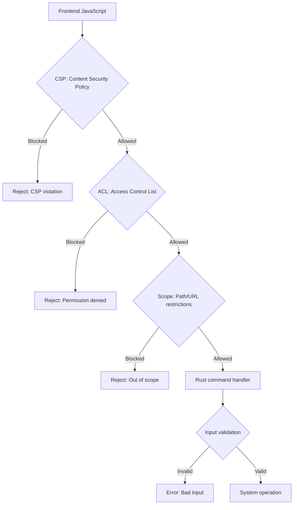
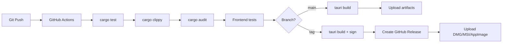

# Cross-Cutting Concerns — Security, Performance, Testing, Patterns

## Core Concept

This document covers concerns that span the entire Tauri ecosystem: security architecture, performance characteristics, testing strategies, and design patterns. These are the things that affect every layer — from the core app framework down to the WebView renderer.

## Security Architecture

Tauri's security model is defense-in-depth. Multiple layers protect the application from malicious or buggy frontend code:



### Content Security Policy (CSP)

The CSP is the first security layer. It controls what resources the WebView can load:

```json
{
  "app": {
    "security": {
      "csp": "default-src 'self'; script-src 'self'; style-src 'self' 'unsafe-inline'"
    }
  }
}
```

Tauri's default CSP is strict:
- `default-src 'self'` — only load resources from the app's own origin
- No `unsafe-inline` for scripts — no inline `<script>` tags
- No `unsafe-eval` — no `eval()` or `new Function()`
- No external origins — no CDN scripts

**Aha:** The CSP applies to the WebView, not to Rust. Rust code has full system access (within OS limits). The CSP restricts what the JavaScript frontend can do. This is the fundamental security boundary: the frontend is untrusted, the Rust backend is trusted. The ACL system adds a second boundary within the trusted Rust code.

### Access Control List (ACL)

The ACL is Tauri's primary security mechanism. See [IPC and ACL](02-tauri-ipc-acl.md) for the full specification. Key principles:

1. **Capability-based** — permissions are declared in capability files, not granted globally
2. **Webview-scoped** — each webview gets its own set of permissions
3. **Explicit allowlist** — nothing is allowed by default; everything must be explicitly permitted
4. **Scope-restricted** — filesystem and shell commands have path-based restrictions
5. **Compile-time validation** — capability files are validated at build time

### Remote Content

Tauri v2 supports loading remote content (external URLs) in addition to local content:

```json
{
  "identifier": "remote-capability",
  "local": false,
  "remote": {
    "urls": ["https://myapp.example.com"]
  },
  "permissions": [
    "http:default"
  ]
}
```

Remote content runs with restricted permissions. The `local` vs `remote` distinction is critical:
- Local content (bundled assets) gets full ACL permissions
- Remote content (external URLs) gets restricted permissions
- A capability can target local, remote, or both

## Performance Characteristics

### Binary Size

| Platform | Minimal Tauri App | Typical App |
|----------|-------------------|-------------|
| macOS (ARM64) | 2-3 MB | 5-10 MB |
| macOS (x64) | 3-4 MB | 8-15 MB |
| Windows (x64) | 3-5 MB | 8-15 MB |
| Linux (x64) | 3-4 MB | 7-12 MB |
| iOS | 5-8 MB | 10-20 MB |
| Android | 5-8 MB | 10-18 MB |

Binary size is dominated by:
- Rust standard library (statically linked, ~1-2 MB)
- Tauri framework code (~500 KB)
- Plugin code (varies by plugin)
- Frontend assets (varies)
- Icons and resources (~100 KB)

Comparison:
- Electron app: 150-200 MB (bundled Chromium + Node.js)
- Tauri app: 2-10 MB (uses system WebView)
- Native macOS app: 1-5 MB
- Native Windows app: 1-3 MB

### Memory Usage

| Component | Memory |
|-----------|--------|
| Rust runtime | 10-30 MB |
| WebView (WebKitGTK) | 50-100 MB |
| WebView (WKWebView) | 40-80 MB |
| WebView (WebView2) | 60-120 MB |
| Frontend app | 10-50 MB |
| Total | 110-280 MB |

The WebView is the largest memory consumer. WebKitGTK is the lightest; WebView2 is the heaviest (it runs a separate Chromium process).

### Startup Time

| Platform | Cold Start | Warm Start |
|----------|-----------|------------|
| macOS | 0.5-1.0s | 0.2-0.5s |
| Windows | 0.5-1.5s | 0.3-0.8s |
| Linux | 0.5-1.0s | 0.2-0.5s |

Startup time is dominated by:
1. Rust runtime initialization (~100ms)
2. WebView creation (~200ms)
3. Frontend loading (~200ms)

**Aha:** Tauri startup is fast because there is no bundled Chromium to initialize. Electron must initialize its own Chromium process (1-3 seconds). Tauri connects to the OS-provided WebView, which is already loaded into memory by the OS.

### IPC Throughput

IPC throughput depends on the message size and platform:

| Platform | Small messages (1 KB) | Large messages (1 MB) |
|----------|----------------------|----------------------|
| macOS | ~100,000/s | ~500/s |
| Windows | ~80,000/s | ~400/s |
| Linux | ~90,000/s | ~450/s |

Small messages are fast because they don't involve significant serialization overhead. Large messages are limited by JSON serialization/deserialization speed.

For high-throughput scenarios, consider:
- Using binary data transfer through custom protocols (avoid JSON)
- Batching small messages into larger ones
- Using shared memory for very large data (advanced)

## Testing Strategies

### Unit Testing Rust Code

Tauri app logic is standard Rust code. Unit tests work normally:

```rust
#[cfg(test)]
mod tests {
    use super::*;

    #[test]
    fn test_read_file() {
        let result = read_file("test_data/hello.txt".to_string());
        assert!(result.is_ok());
        assert_eq!(result.unwrap(), "Hello, world!");
    }

    #[test]
    fn test_read_missing_file() {
        let result = read_file("nonexistent.txt".to_string());
        assert!(result.is_err());
    }
}
```

### Integration Testing Commands

Test commands without the full Tauri runtime:

```rust
#[cfg(test)]
mod tests {
    #[tokio::test]
    async fn test_command_handler() {
        // Create a mock app state
        let state = AppState::new();

        // Call the command directly
        let result = my_command(state.clone(), "arg".to_string()).await;

        assert!(result.is_ok());
    }
}
```

### Frontend Testing

Frontend code is tested with standard web testing tools:

```javascript
// Vitest / Jest
import { describe, it, expect } from 'vitest'

describe('Tauri IPC', () => {
    it('should call invoke with correct args', async () => {
        // Mock window.__TAURI__
        window.__TAURI__ = {
            invoke: vi.fn().mockResolvedValue('result')
        }

        const result = await window.__TAURI__.invoke('read_file', { path: 'test.txt' })
        expect(result).toBe('result')
        expect(window.__TAURI__.invoke).toHaveBeenCalledWith('read_file', { path: 'test.txt' })
    })
})
```

### E2E Testing

End-to-end tests require the full Tauri app:

```rust
// tests/e2e.rs
use tauri::Manager;

#[test]
fn test_app_starts() {
    let app = tauri::Builder::default()
        .build(tauri::generate_context!())
        .expect("failed to build app");

    // The app should start without panicking
    // In practice, you'd use a testing framework like tauri-driver
}
```

## Design Patterns

### State Pattern

Use Tauri's managed state for shared application state:

```rust
struct AppState {
    db: Mutex<Database>,
    config: RwLock<Config>,
}

fn main() {
    tauri::Builder::default()
        .manage(AppState::new())
        .invoke_handler(tauri::generate_handler![
            get_config,
            update_config,
            query_db,
        ])
        .run(tauri::generate_context!())
}

#[tauri::command]
fn get_config(state: State<AppState>) -> Config {
    state.config.read().clone()
}
```

### Event Pattern

Use Tauri's event system for pub/sub communication:

```rust
// Rust emits events
window.emit("file-saved", &path)?;

// JavaScript listens
window.__TAURI__.event.listen('file-saved', (event) => {
    showToast(`File saved: ${event.payload}`)
})
```

### Plugin Pattern

Encapsulate functionality in plugins:

```rust
// my-plugin/src/lib.rs
pub fn init<R: Runtime>() -> TauriPlugin<R> {
    Builder::new("my-plugin")
        .invoke_handler(|invoke| { ... })
        .setup(|app, _api| {
            app.manage(MyState::new());
            Ok(())
        })
        .build()
}
```

### Async Pattern

Use tokio for async operations in command handlers:

```rust
#[tauri::command]
async fn fetch_data(app: AppHandle) -> Result<Data, String> {
    let handle = app.clone();

    // Run async operation
    let client = reqwest::Client::new();
    let response = client
        .get("https://api.example.com/data")
        .send()
        .await
        .map_err(|e| e.to_string())?;

    let data = response.json::<Data>()
        .await
        .map_err(|e| e.to_string())?;

    // Emit event when done
    handle.emit_all("data-fetched", &data)
        .map_err(|e| e.to_string())?;

    Ok(data)
}
```

## Common Pitfalls

### 1. Blocking the Main Thread

Never block the main thread in a command handler:

```rust
// BAD — blocks the event loop
#[tauri::command]
fn slow_operation() -> Result<String, String> {
    std::thread::sleep(Duration::from_secs(5));
    Ok("done".to_string())
}

// GOOD — use async
#[tauri::command]
async fn slow_operation() -> Result<String, String> {
    tokio::time::sleep(Duration::from_secs(5)).await;
    Ok("done".to_string())
}
```

### 2. Large IPC Messages

Avoid sending large data through IPC. Serialize to files and pass paths instead:

```rust
// BAD — 10 MB through JSON IPC
#[tauri::command]
fn get_large_data() -> Vec<u8> {
    load_10mb_file()
}

// GOOD — save to temp file, return path
#[tauri::command]
fn get_large_data(app: AppHandle) -> String {
    let path = app.path().temp_dir().join("data.bin");
    std::fs::write(&path, load_10mb_file()).unwrap();
    path.to_string_lossy().to_string()
}
```

### 3. Missing Error Handling

Always handle errors in command handlers:

```rust
// BAD — panics on error
#[tauri::command]
fn read_file(path: String) -> String {
    std::fs::read_to_string(&path).unwrap()
}

// GOOD — returns Result
#[tauri::command]
fn read_file(path: String) -> Result<String, String> {
    std::fs::read_to_string(&path)
        .map_err(|e| format!("Failed to read {}: {}", path, e))
}
```

### 4. Duplicate Command Names

Two handlers registering the same command name causes silent override:

```rust
// Plugin A registers 'greet'
// Plugin B registers 'greet'
// Plugin A's handler is silently replaced

// Solution: prefix command names with plugin name
// Plugin A: 'plugin-a|greet'
// Plugin B: 'plugin-b|greet'
```

### 5. Platform-Specific Assumptions

Don't assume all platforms behave the same:

```rust
// BAD — assumes file paths work everywhere
#[tauri::command]
fn get_config_path() -> String {
    format!("{}/.config/myapp/config.json", std::env::var("HOME").unwrap())
}

// GOOD — use Tauri's path resolver
#[tauri::command]
fn get_config_path(app: AppHandle) -> String {
    app.path().app_config_dir()
        .join("config.json")
        .to_string_lossy()
        .to_string()
}
```

## CI/CD Pipeline



Recommended CI/CD pipeline:
1. **PR checks** — `cargo test`, `cargo clippy`, frontend tests
2. **Main branch** — `tauri build` for all platforms
3. **Release tag** — `tauri build` + signing + GitHub release

## Cross-References

- [Tauri Core](01-tauri-core.md) — App architecture and state management
- [IPC and ACL](02-tauri-ipc-acl.md) — detailed security specification
- [Build and CLI](03-tauri-build-cli.md) — build pipeline and signing
- [Wry WebView](04-wry-webview.md) — WebView performance characteristics
- [Plugins](08-plugins.md) — plugin security and compatibility
- [Native and Mobile](09-native-mobile.md) — mobile-specific security
