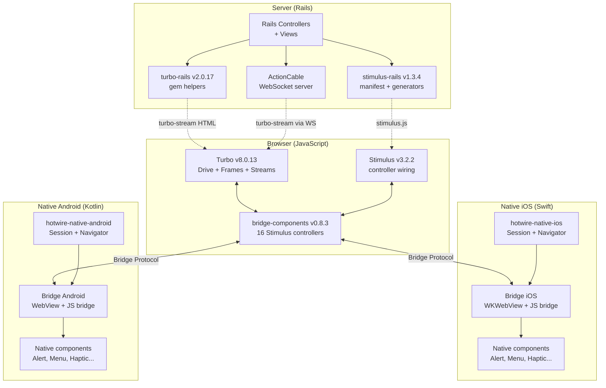
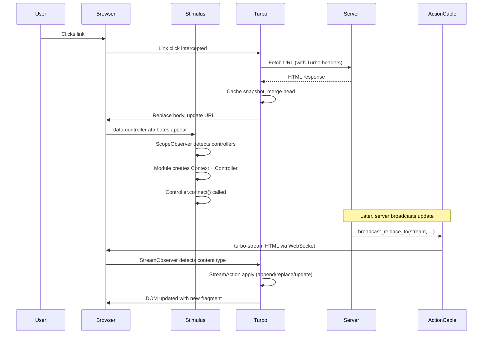

# The Hotwire Ecosystem: HTML Over the Wire

The Hotwire ecosystem is a collection of JavaScript, Swift, and Kotlin libraries that enable building interactive applications with minimal client-side JavaScript. Instead of shipping complex frontend frameworks to the browser, Hotwire returns HTML from the server and uses lightweight JavaScript to add interactivity. The ecosystem spans four layers: Stimulus (behavioral wiring via HTML attributes), Turbo (SPA navigation and partial updates), native SDKs (iOS and Android with shared web views and native navigation), and Rails integration gems.

## Philosophy

Hotwire is built on a single principle: the server owns the HTML. JavaScript adds behavior to elements that already exist in the DOM. Navigation replaces entire pages or targeted fragments. Live updates arrive as HTML fragments over WebSockets. Native apps reuse the same HTML through embedded web views. This approach eliminates the need for a separate API layer, a client-side router, and a frontend state management library.

The name "Hotwire" stands for "HTML over the wire." Every response from the server is HTML. Every update is HTML. Every partial is HTML. JavaScript does not manage state or render trees. It listens for events, reads and writes DOM attributes, and coordinates with native platform features through a bridge protocol.

## Ecosystem Architecture

The server layer generates HTML with Hotwire data attributes. The browser layer intercepts navigation, wires behavior, and receives live updates. The native layer wraps web views with native navigation and communicates with web content through a bidirectional bridge. Bridge-components provides the glue: Stimulus controllers on the web side that send messages to matching native components on iOS and Android.

## Version Map

| Component | Version | Repository |
|-----------|---------|------------|
| Stimulus | 3.2.2 | [github.com/hotwired/stimulus](https://github.com/hotwired/stimulus) |
| Turbo | 8.0.13 | [github.com/hotwired/turbo](https://github.com/hotwired/turbo) |
| stimulus-rails | 1.3.4 | [github.com/hotwired/stimulus-rails](https://github.com/hotwired/stimulus-rails) |
| turbo-rails | 2.0.17 | [github.com/hotwired/turbo-rails](https://github.com/hotwired/turbo-rails) |
| hotwire-rails | 0.1.3 | [github.com/hotwired/hotwire-rails](https://github.com/hotwired/hotwire-rails) |
| bridge-components | 0.8.3 | npm: `@joemasilotti/bridge-components` |
| hotwire-native-ios | Swift SPM | [github.com/hotwired/hotwire-native-ios](https://github.com/hotwired/hotwire-native-ios) |
| hotwire-native-android | Maven: dev.hotwire | [github.com/hotwired/hotwire-native-android](https://github.com/hotwired/hotwire-native-android) |

## Key Design Decisions

### Server-Rendered HTML as the Single Source of Truth

Every page, fragment, and update originates from the server. The browser does not maintain a virtual DOM or component tree. This eliminates the synchronization problem between server state and client state. The server generates the current state as HTML. The browser displays it.

### MutationObserver as the Primary DOM Detection Mechanism

Stimulus uses the browser native `MutationObserver` API to detect changes to `data-controller`, `data-action`, and `data-target` attributes. No framework-specific events or lifecycle hooks are needed. The observer fires when attributes change, and Stimulus responds by connecting or disconnecting controllers.

Aha: Stimulus does not scan the DOM on a timer. It does not use `setInterval` or `requestAnimationFrame`. The `MutationObserver` API provides exact notifications of what changed, which elements are affected, and whether the change was an addition, removal, or modification. This is why Stimulus controllers connect and disconnect instantly without polling.

### Session as the Central Coordinator (Turbo + Native)

Both Turbo (browser) and the native SDKs (iOS/Android) use a `Session` class as the central coordinator. The session owns the web view, manages visits, configures caching, and dispatches lifecycle events. In Turbo, `Session` orchestrates the `Navigator`, `History`, `PageView`, and ten observer instances. In native SDKs, `Session` wraps the platform web view and manages cold boot versus JavaScript visit flows.

### Path Configuration as the Navigation Rule Engine

Both native SDKs load a JSON file containing regex patterns and navigation properties. Each URL is matched against the rules to determine presentation style (push, pop, replace, modal), context (default, modal), and deep link URIs. This single JSON file controls the entire navigation behavior of the native app without any code changes.

## High-Level Data Flow

## Module Count Summary

| Module | Files | Lines | Language |
|--------|-------|-------|----------|
| Stimulus core | 30+ | ~5000 | TypeScript |
| Turbo core | 50+ | ~10000 | JavaScript |
| hotwire-native-ios | 50+ | ~8000 | Swift |
| hotwire-native-android | 89 (58 core + 31 nav-fragments) | ~12000 | Kotlin |
| stimulus-rails | 15+ | ~1500 | Ruby + JS |
| turbo-rails | 25+ | ~3500 | Ruby + JS |
| bridge-components | 37 (16 web + 10 iOS + 11 Android) | ~3000 | JS + Swift + Kotlin |

## Historical Context: Why Hotwire Exists

Hotwire emerged from Basecamp's experience building web applications since 2004. The team at 37signals (now Basecamp) built Basecamp, Hey, and other products using traditional server-rendered HTML with progressive JavaScript enhancements. When SPA frameworks like React and Vue became popular, they evaluated the trade-offs and concluded that the complexity of a separate API layer, client-side router, and state management library was unnecessary for most applications.

The key insight: modern browsers already support most of what SPAs need. `fetch()` replaces XMLHttpRequest. `history.pushState()` enables URL changes without reload. `MutationObserver` enables reactive DOM detection. WebSocket enables real-time updates. Custom Elements enable encapsulated behavior. Hotwire uses these browser-native APIs directly instead of wrapping them in framework abstractions.

Stimulus was extracted from Basecamp's internal JavaScript codebase in 2017. It replaced jQuery event handlers with declarative `data-action` attributes. Turbo was released in 2020, replacing Turbolinks (which had been in use since 2012). The native SDKs followed in 2021-2022, enabling the same HTML to power both web and native apps.

## The Data Attribute System

Hotwire communicates with the browser exclusively through HTML data attributes. There are no JavaScript APIs to call, no components to mount, and no build step required.

### Stimulus Attributes

| Attribute | Purpose | Example |
|-----------|---------|---------|
| `data-controller="..."` | Wires a controller class to an element | `data-controller="modal dropdown"` |
| `data-action="..."` | Binds an event to a controller method | `data-action="click->modal#close"` |
| `data-${id}-target="..."` | Marks target elements within a controller | `data-modal-target="body header"` |
| `data-${id}-*-outlet="..."` | References another controller's element | `data-modal-alert-outlet="#alert"` |
| `data-${id}-*-class="..."` | Maps a CSS class name to a controller variable | `data-modal-loading-class="is-spinning"` |
| `data-${id}-*-param="..."` | Passes parameters to an action | `data-modal-confirm-param="Are you sure?"` |
| `data-${id}-*-value="..."` | Stores typed values as attributes | `data-modal-count-value="5"` |

### Turbo Attributes

| Attribute | Purpose | Example |
|-----------|---------|---------|
| `data-turbo="false"` | Disables Turbo navigation on an element | `<a data-turbo="false" href="/external">` |
| `data-turbo-frame="..."` | Routes navigation to a specific frame | `<a data-turbo-frame="messages" href="/msg">` |
| `data-turbo-method="..."` | Converts a link to a form submission | `<a data-turbo-method="delete" href="/msg/1">` |
| `data-turbo-confirm="..."` | Adds a confirmation dialog | `<a data-turbo-confirm="Delete?">` |
| `data-turbo-permanent` | Preserves an element across page loads | `<video data-turbo-permanent>` |
| `data-turbo-temporary` | Marks elements to remove before caching | `<flash data-turbo-temporary>` |
| `data-turbo-preload` | Preloads a page on hover | `<a data-turbo-preload href="/next">` |
| `data-turbo-action="..."` | Controls history behavior | `<a data-turbo-action="replace">` |

Aha: The attribute system is intentionally flat. There are no nested configuration objects, no JSON-in-attributes, and no component props. Every attribute is a simple string that Stimulus or Turbo parses directly. This makes the HTML readable, debuggable with browser DevTools, and compatible with any server-side template engine. You do not need a build system to generate Hotwire-compatible HTML.

## Comparison with SPA Frameworks

Hotwire takes a fundamentally different approach from React, Vue, and Angular.

| Aspect | Hotwire | React/Vue/Angular |
|--------|---------|-------------------|
| Rendering | Server generates HTML | Client generates virtual DOM |
| State | Server state = HTML state | Client state managed by framework |
| Navigation | XHR + body replacement | Client-side router |
| Updates | HTML fragments over WebSocket | State change -> re-render |
| JavaScript | Behavior wiring only | Full application runtime |
| API layer | None (HTML is the API) | REST/GraphQL JSON API |
| Build step | Optional | Required (bundlers, transpilers) |
| SEO | Native (server-rendered) | Requires SSR setup |
| Bundle size | ~50KB (Stimulus + Turbo) | 100-500KB+ (framework + app) |
| Native apps | Same HTML via embedded WebView | Separate native app or React Native |

Aha: The trade-off is not "Hotwire vs React" -- it is "server-rendered with enhancement vs client-rendered application." Hotwire works best when the application is CRUD-heavy with real-time updates. SPA frameworks work best when the application has complex client-side state, offline capabilities, or rich interactive components (canvas, video editing, etc.). Hotwire excels at the 80% of applications that are primarily data entry and display.

## Developer Experience

A developer using Hotwire writes:

1. **Ruby ERB templates** that generate HTML with data attributes
2. **Stimulus controller classes** (TypeScript or JavaScript) that respond to events
3. **Rails controller actions** that respond with HTML or turbo-stream HTML
4. **Path configuration JSON** that controls native app navigation
5. **Bridge component classes** (Swift/Kotlin) that implement native platform features

There is no client-side router configuration. No state management store. No API endpoints to maintain. No build step for the frontend (unless using TypeScript or a module bundler by choice). The Rails asset pipeline or importmap handles JavaScript loading.

## Documentation Map

This documentation set covers every layer of the Hotwire ecosystem:

| Document | Covers | Key Concepts |
|----------|--------|-------------|
| [00-overview](00-overview.md) | Ecosystem overview | Architecture, philosophy, version map |
| [01-stimulus-core](01-stimulus-core.md) | Stimulus foundation | Application, Module, Scope, Context |
| [02-stimulus-observers](02-stimulus-observers.md) | DOM detection | MutationObserver chain, pause mechanism |
| [03-stimulus-blessing](03-stimulus-blessing.md) | Typed accessors | Shadow constructors, blessing functions |
| [04-turbo-drive](04-turbo-drive.md) | SPA navigation | Session, Visit, SnapshotCache, Bardo |
| [05-turbo-frames-streams](05-turbo-frames-streams.md) | Partial updates | Frames, Streams, morphing, WebSockets |
| [06-native-ios](06-native-ios.md) | iOS SDK | Session, Navigator, Visitable, routing |
| [07-native-android](07-native-android.md) | Android SDK | Session, Navigator, Fragments, WebView |
| [08-bridge-protocol](08-bridge-protocol.md) | Web-native bridge | Message format, lifecycle, JSON converter |
| [09-rails-integration](09-rails-integration.md) | Rails gems | stimulus-rails, turbo-rails, broadcastable |
| [10-bridge-components](10-bridge-components.md) | Bridge components | 16 controllers, native parity, registration |
| [11-cross-cutting](11-cross-cutting.md) | Shared patterns | Observers, delegates, sessions, path config |

## How the Pieces Fit Together

1. **Stimulus** wires JavaScript behavior to HTML elements. You write a controller class, add `data-controller="my"` to an element, and Stimulus creates an instance. The controller reads and writes attributes, listens for events, and calls server endpoints. See [Stimulus Core](01-stimulus-core.md) for details.

2. **Turbo** intercepts link clicks and form submissions. It fetches the response via XHR, caches the current page snapshot, and replaces the body. This gives SPA-like navigation without a client-side router. See [Turbo Drive](04-turbo-drive.md) for details.

3. **Turbo Frames** divide the page into independent sections. Clicking a link inside a frame only updates that frame. See [Turbo Frames & Streams](05-turbo-frames-streams.md) for details.

4. **Turbo Streams** broadcast HTML fragments over WebSockets. When a model changes on the server, ActionCable sends a `<turbo-stream>` element that Turbo applies to the DOM. See [Turbo Frames & Streams](05-turbo-frames-streams.md) for details.

5. **Native SDKs** embed web views in native apps. The native navigation stack controls which URL is loaded. The web view shares state across screens. See [Native iOS](06-native-ios.md) and [Native Android](07-native-android.md) for details.

6. **Bridge Protocol** enables web-to-native and native-to-web messaging. Web controllers send messages to native components. Native components reply with data. See [Bridge Protocol](08-bridge-protocol.md) for details.

7. **Rails Integration** gems provide helpers, generators, and ActionCable integration. See [Rails Integration](09-rails-integration.md) for details.

8. **Bridge Components** provide 16 Stimulus controllers with matching native implementations for alerts, haptics, menus, forms, search, share, theme, and toast. See [Bridge Components](10-bridge-components.md) for details.

## Next

Start with [Stimulus Core](01-stimulus-core.md) to understand the Application, Module, Scope, and Context classes that form the foundation of the behavioral wiring system.
