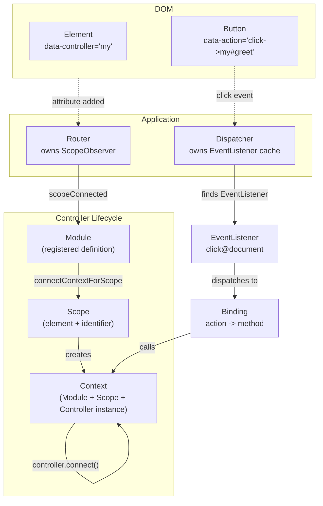
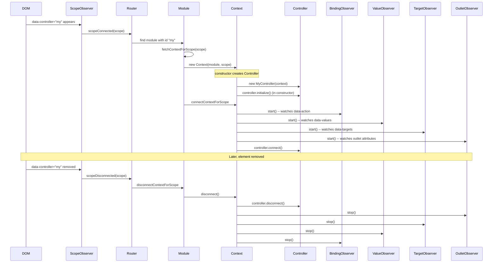

# Stimulus Core: The Module/Scope/Context Triad

Stimulus wires JavaScript controller classes to DOM elements using HTML data attributes. The core architecture consists of four classes: `Application` (the entry point), `Module` (a registered controller definition), `Scope` (a DOM element with a controller identifier), and `Context` (the runtime instance connecting a Module to a Scope). These four classes form the backbone of how Stimulus discovers, instantiates, and manages controllers.

Source: `src/core/` in [hotwired/stimulus](https://github.com/hotwired/stimulus) v3.2.2.

## Application: The Entry Point

The `Application` class is the single entry point for a Stimulus-powered page. It wraps `document.documentElement` (or a custom root element), creates a `Dispatcher` and a `Router`, and provides the `register()` and `load()` methods for adding controller definitions.

Source: `src/core/application.ts` -- `class Application`

```typescript
// src/core/application.ts
export class Application {
  readonly element: Element
  readonly schema: Schema
  readonly dispatcher: Dispatcher
  readonly router: Router
  readonly actionDescriptorFilters: ActionDescriptorFilters
  logger: Logger = console
  debug = false

  static start(element?: Element, schema?: Partial<Schema>): Application
  constructor(element = document.documentElement, schema = defaultSchema)
  async start()                                   // waits for DOMContentLoaded
  stop()
  register(identifier: string, controllerConstructor: ControllerConstructor)
  registerActionOption(name: string, filter: ActionDescriptorFilter)
  load(...definitions: Definition[])
  unload(...identifiers: string[])
  get controllers(): Controller[]
  getControllerForElementAndIdentifier(element: Element, identifier: string): Controller | null
  handleError(error: Error, message: string, detail: object)
}
```

The `Application.start()` factory method creates an instance, calls `start()`, and returns it. The `start()` method waits for `DOMContentLoaded` (if not yet fired), then calls `this.router.start()` and `this.dispatcher.start()`. This activates the `ScopeObserver` (which watches for `data-controller` attributes) and enables event delegation.

The `schema` object defines the attribute names Stimulus looks for. The default schema is:

Source: `src/core/schema.ts`

```typescript
// src/core/schema.ts:4
export const defaultSchema: Schema = {
  controllerAttribute: "data-controller",
  actionAttribute: "data-action",
  targetAttribute: "data-target",           // deprecated, legacy
  targetAttributeForScope(id: string): string { return `data-${id}-target` },
  outletAttributeForScope(id: string, outlet: string): string { return `data-${id}-${outlet}-outlet` },
  keyMappings: { enter: "Enter", tab: "Tab", esc: "Escape", space: " ", /* ... */ }
}
```

The schema supports customization. You can change `controllerAttribute` to `"data-stimulus-controller"` to avoid conflicts with other libraries. The `keyMappings` object maps keyboard event keys to normalized names used in action descriptors like `keydown.enter->my#submit`.

## Router and Dispatcher: The Two Pillars

The `Application` owns two subsystems that work independently but cooperatively.

**Router** (`src/core/router.ts`) watches for `data-controller` attributes appearing and disappearing in the DOM. When an attribute appears, the Router creates a `Scope` for that element and connects it to a matching `Module`.

**Dispatcher** (`src/core/dispatcher.ts`) handles DOM events. It maintains a cache of `EventListener` objects (one per unique `eventTarget + eventName + eventOptions` combination) and dispatches events to the appropriate controller bindings.



The Router handles controller lifecycle. The Dispatcher handles event routing. They never call each other directly. The `Context` class bridges them: it holds both the `Module` (for controller access) and the `Dispatcher` (for event binding registration).

## Module: A Registered Controller Definition

A `Module` represents one controller definition registered with the application. It is created when you call `application.register("my", MyController)`. The Module stores the identifier and the controller constructor, blesses the constructor, and manages `Context` instances for each `Scope` that matches.

Source: `src/core/module.ts`

```typescript
// src/core/module.ts
export class Module {
  readonly application: Application
  readonly definition: Definition
  private contextsByScope: WeakMap<Scope, Context>
  private connectedContexts: Set<Context>

  constructor(application: Application, definition: Definition) {
    this.application = application
    this.definition = blessDefinition(definition)  // blesses the controller constructor
  }
  get identifier(): string { return this.definition.identifier }
  get controllerConstructor(): ControllerConstructor { return this.definition.controllerConstructor }
  get contexts(): Context[] { return Array.from(this.connectedContexts) }

  connectContextForScope(scope: Scope): void {
    const context = this.fetchContextForScope(scope)
    this.connectedContexts.add(context)
    context.connect()  // calls controller.initialize(), controller.connect()
  }
  disconnectContextForScope(scope: Scope): void {
    const context = this.contextsByScope.get(scope)
    if (context) {
      this.connectedContexts.delete(context)
      context.disconnect()  // calls controller.disconnect()
    }
  }
  private fetchContextForScope(scope: Scope): Context {
    let context = this.contextsByScope.get(scope)
    if (!context) {
      context = new Context(this, scope)
      this.contextsByScope.set(scope, context)
    }
    return context
  }
}
```

Aha: The Module uses a `WeakMap<Scope, Context>` so that the same DOM element always gets the same `Context` instance. If a `Scope` is garbage collected (the element is removed from the DOM), the `Context` is automatically reclaimed. This prevents memory leaks when elements are dynamically added and removed. The `connectedContexts` Set tracks which contexts are currently active, enabling `module.controllers` to return only the live instances.

The `blessDefinition()` function calls `bless()` on the controller constructor. This generates typed accessor properties for targets, values, classes, and outlets at runtime. See [Stimulus Blessing](03-stimulus-blessing.md) for the full mechanism.

## Scope: A DOM Element with a Controller Identifier

A `Scope` wraps a DOM element that has a `data-controller` attribute. It provides typed access to the element's targets, classes, data, and outlets through helper objects.

Source: `src/core/scope.ts`

```typescript
// src/core/scope.ts
export class Scope {
  readonly schema: Schema
  readonly element: Element
  readonly identifier: string
  readonly guide: Guide  // deduplicates deprecation warnings
  readonly outlets: OutletSet
  readonly targets: TargetSet
  readonly classes: ClassMap
  readonly data: DataMap

  constructor(schema: Schema, element: Element, identifier: string, logger: Logger) {
    this.schema = schema
    this.element = element
    this.identifier = identifier
    this.guide = new Guide()
    this.outlets = new OutletSet(this.element, this.identifier)
    this.targets = new TargetSet(this.element, this.identifier, this.guide)
    this.classes = new ClassMap(this.element, this.identifier)
    this.data = new DataMap(this.element, this.identifier)
  }
  findElement(selector: string): Element | undefined
  findAllElements(selector: string): Element[]
  containsElement(element: Element): boolean
  private get controllerSelector(): string {
    return attributeValueContainsToken(this.schema.controllerAttribute, this.identifier)
  }
}
```

The `Scope` is a read-only view of the DOM element's Stimulus-related attributes. The `ClassMap`, `DataMap`, `TargetSet`, and `OutletSet` objects provide typed access to `data-${identifier}-*` attributes:

| Helper | Reads | Method | Returns |
|--------|-------|--------|---------|
| `ClassMap` | `data-${id}-foo-class` | `.get("foo")` | `"css-class-name"` |
| `DataMap` | `data-${id}-key` | `.get("key")` | `"value"` |
| `TargetSet` | `data-${id}-target` | `.find("foo")` | `Element | undefined` |
| `OutletSet` | `data-${id}-foo-outlet` | `.find("foo")` | `Element | undefined` |

The `ClassMap` reads `data-${identifier}-foo-class` attributes and returns CSS class names. The `DataMap` reads `data-${identifier}-key` attributes and returns arbitrary string values. The `TargetSet` reads the space-separated `data-${identifier}-target` attribute and returns matching elements. The `OutletSet` reads `data-${identifier}-foo-outlet` attributes and returns matching elements.

## Context: The Runtime Instance

The `Context` class is the glue between `Module`, `Scope`, and the user's `Controller` instance. It is created by the `Module` when a `Scope` connects. The `Context` creates the controller instance, starts all observers, and calls `controller.connect()`.

Source: `src/core/context.ts`

```typescript
// src/core/context.ts
export class Context implements ErrorHandler, TargetObserverDelegate, OutletObserverDelegate {
  readonly module: Module
  readonly scope: Scope
  readonly controller: Controller
  private bindingObserver: BindingObserver
  private valueObserver: ValueObserver
  private targetObserver: TargetObserver
  private outletObserver: OutletObserver

  constructor(module: Module, scope: Scope) {
    this.module = module
    this.scope = scope
    this.controller = new module.controllerConstructor(this)
    this.bindingObserver = new BindingObserver(this, this.dispatcher)
    this.valueObserver = new ValueObserver(this, this.controller)
    this.targetObserver = new TargetObserver(this, this)
    this.outletObserver = new OutletObserver(this, this)

    try {
      this.controller.initialize()    // called in constructor, before observers start
    } catch (error: any) {
      this.handleError(error, "initializing controller")
    }
  }

  connect(): void {
    this.bindingObserver.start()    // watches data-action for this controller's actions
    this.valueObserver.start()      // watches data-${id}-* for value attributes
    this.targetObserver.start()     // watches data-${id}-target for target elements
    this.outletObserver.start()     // watches outlet attributes

    try {
      this.controller.connect()     // user override point
    } catch (error: any) {
      this.handleError(error, "connecting controller")
    }
  }

  refresh(): void {
    this.outletObserver.refresh()
  }

  disconnect(): void {
    try {
      this.controller.disconnect()  // user override point
    } catch (error: any) {
      this.handleError(error, "disconnecting controller")
    }

    this.outletObserver.stop()      // stop in reverse order
    this.targetObserver.stop()
    this.valueObserver.stop()
    this.bindingObserver.stop()
  }

  get application(): Application { return this.module.application }
  get identifier(): string { return this.module.identifier }
  get schema(): Schema { return this.application.schema }
  get dispatcher(): Dispatcher { return this.application.dispatcher }
  get element(): Element { return this.scope.element }
  get parentElement(): Element | null { return this.element.parentElement }

  handleError(error: Error, message: string, detail: object = {}): void {
    const { identifier, controller, element } = this
    detail = Object.assign({ identifier, controller, element }, detail)
    this.application.handleError(error, `Error ${message}`, detail)
  }

  logDebugActivity = (functionName: string, detail: object = {}): void => {
    const { identifier, controller, element } = this
    detail = Object.assign({ identifier, controller, element }, detail)
    this.application.logDebugActivity(this.identifier, functionName, detail)
  }

  targetConnected(element: Element, name: string): void {
    this.invokeControllerMethod(`${name}TargetConnected`, element)
  }

  targetDisconnected(element: Element, name: string): void {
    this.invokeControllerMethod(`${name}TargetDisconnected`, element)
  }

  outletConnected(outlet: Controller, element: Element, name: string): void {
    this.invokeControllerMethod(`${namespaceCamelize(name)}OutletConnected`, outlet, element)
  }

  outletDisconnected(outlet: Controller, element: Element, name: string): void {
    this.invokeControllerMethod(`${namespaceCamelize(name)}OutletDisconnected`, outlet, element)
  }

  invokeControllerMethod(methodName: string, ...args: any[]): void {
    const controller: any = this.controller
    if (typeof controller[methodName] == "function") {
      controller[methodName](...args)
    }
  }
}
```

When `connect()` is called, four observers start watching for attribute changes:

1. **BindingObserver** watches `data-action` attributes on the scope element and its descendants. It parses action descriptors like `click->my#greet` and registers `Binding` objects with the `Dispatcher`.

2. **ValueObserver** watches `data-${identifier}-*` attributes on the scope element. When a value attribute changes, it calls `${name}Changed(newValue, oldValue)` on the controller.

3. **TargetObserver** watches `data-${identifier}-target` attributes. When target elements are added or removed, it calls `targetConnected(element, name)` or `targetDisconnected(element, name)` on the controller.

4. **OutletObserver** watches `data-${identifier}-*-outlet` attributes and manages outlet controller connections.

Aha: The `Context` creates exactly one `Controller` instance per `Scope`. If the same controller identifier appears on ten elements, ten `Context` instances exist, each with its own `Controller` instance. This is why Stimulus controllers are lightweight -- they are not singletons. Each instance only manages one DOM element.

## Controller Lifecycle



## The Controller Base Class

Source: `src/core/controller.ts`

```typescript
// src/core/controller.ts
export class Controller<Element = HTMLElement> {
  static blessings = [ClassPropertiesBlessing, TargetPropertiesBlessing, ValuePropertiesBlessing, OutletPropertiesBlessing]
  static targets: string[] = []
  static outlets: string[] = []
  static values: ValueDefinitionMap = {}
  static get shouldLoad() { return true }
  static afterLoad?(_identifier: string, _application: Application): void

  readonly context: Context

  constructor(context: Context) { this.context = context }
  get application(): Application { return this.context.application }
  get scope(): Scope { return this.context.scope }
  get element(): Element { return this.scope.element as Element }
  get identifier(): string { return this.scope.identifier }
  get targets(): TargetSet { return this.scope.targets }
  get outlets(): OutletSet { return this.scope.outlets }
  get classes(): ClassMap { return this.scope.classes }
  get data(): DataMap { return this.scope.data }

  initialize(): void    // override point -- called once in constructor, before observers start
  connect(): void       // override point -- called when controller enters DOM
  disconnect(): void    // override point -- called when controller leaves DOM

  dispatch(eventName: string, options?: { target?: Element | Window | Document; detail?: object; prefix?: string; bubbles?: boolean; cancelable?: boolean }): CustomEvent
}
```

The `blessings` static array lists four blessing functions. When the constructor is blessed (during `blessDefinition()`), each blessing function generates `PropertyDescriptorMap` entries that become getters and setters on the shadow constructor. This is how `this.fooTarget` and `this.barValue` become available without manual property definitions.

## Action Descriptor System

The `data-action` attribute uses a compact syntax to describe event bindings. The format is:

```
event.filter@scope->identifier#method:options
```

| Part | Example | Meaning |
|------|---------|---------|
| `event` | `click`, `keydown` | DOM event name |
| `.filter` | `.prevent`, `.stop`, `.self` | Action descriptor filter |
| `@scope` | `@window`, `@document` | Event target scope |
| `->identifier#method` | `->my#greet` | Controller and method |
| `:options` | `:passive`, `:capture` | Event listener options |

Source: `src/core/action_descriptor.ts`

```typescript
// src/core/action_descriptor.ts:70
export const defaultActionDescriptorFilters: { [name: string]: ActionDescriptorFilter } = {
  stop({ event, value }) { if (value) event.stopPropagation() },
  prevent({ event, value }) { if (value) event.preventDefault() },
  self({ event, value, element }) { if (value && element !== event.target) return false }
}
```

The `Action` class parses this string into a structured descriptor. Source: `src/core/action.ts`.

```typescript
// src/core/action.ts -- regex for parsing
const actionDescriptorRegExp =
  /^(?:(?:([^.]+?)\+)?(.+?)(?:\.(.+?))?(?:@(window|document))?->)?(.+?)(?:#([^:]+?))(?::(.+))?$/
```

Aha: Default event names are inferred from element types. A `data-action="my#greet"` on a `<button>` means `click->my#greet` because `getDefaultEventNameForElement(button)` returns `"click"`. On a `<form>`, it means `submit->my#greet`. On `<input type="text">`, it means `input->my#greet`. This eliminates repetitive `click->` prefixes for the most common cases.

## Default Event Name Mapping

Source: `src/core/action.ts` -- `getDefaultEventNameForElement()`

| Element | Default Event |
|---------|--------------|
| `<a>` | `click` |
| `<button>` | `click` |
| `<form>` | `submit` |
| `<details>` | `toggle` |
| `<input type="submit">` | `click` |
| `<input>` (other) | `input` |
| `<select>` | `change` |
| `<textarea>` | `input` |

## Multimap Data Structures

Stimulus uses a `Multimap<K, V>` data structure extensively. It stores multiple values per key, implemented as `Map<K, Set<V>>`.

Source: `src/multimap/multimap.ts`

```typescript
// src/multimap/multimap.ts
export class Multimap<K, V> {
  private valuesByKey: Map<K, Set<V>> = new Map()
  add(key: K, value: V): void
  delete(key: K, value: V): void
  has(key: K, value: V): boolean
  get keys(): K[]
  get values(): V[]
  get size(): number
  getValuesForKey(key: K): V[]
  getKeysForValue(value: V): K[]
}
```

The `IndexedMultimap<K, V>` extends `Multimap` with a reverse index (`keysByValue: Map<V, Set<K>>`) for efficient lookups in both directions. This is used by the `BindingObserver` to map actions to bindings and vice versa.

## Guide: Deduplicated Warnings

The `Guide` class prevents console spam by deduplicating warnings.

Source: `src/core/guide.ts`

```typescript
// src/core/guide.ts
export class Guide {
  private warnedObjects: WeakMap<object, Set<string>> = new WeakMap()

  warn(object: object, key: string, message: string): void {
    let warnedKeys = this.warnedObjects.get(object)
    if (!warnedKeys) {
      warnedKeys = new Set()
      this.warnedObjects.set(object, warnedKeys)
    }
    if (!warnedKeys.has(key)) {
      warnedKeys.add(key)
      console.warn(message)
    }
  }
}
```

This is used for the deprecated `data-target` attribute warning. Each element only sees the warning once.

## Inheritable Statics

Stimulus reads static properties from the entire prototype chain, enabling inheritance of targets and values.

Source: `src/core/inheritable_statics.ts`

```typescript
// src/core/inheritable_statics.ts
export function readInheritableStaticArrayValues<T>(constructor: Constructor<T>, propertyName: string): string[] {
  // Walks prototype chain, collects all array values into a Set (deduplicates)
}
export function readInheritableStaticObjectPairs<T>(constructor: Constructor<T>, propertyName: string): [string, ValueDefinition][] {
  // Walks prototype chain, collects all [key, value] pairs. Later definitions override earlier.
}
```

If a parent class defines `static targets = ["alpha"]` and a child class defines `static targets = ["beta"]`, the combined result is `["alpha", "beta"]`. If both define `["alpha"]`, the result is `["alpha"]` (deduplicated via `Set`).

## Next

The observer chain that powers Stimulus DOM detection is explained in detail in [Stimulus Observers](02-stimulus-observers.md). The blessing system that generates typed accessors is covered in [Stimulus Blessing](03-stimulus-blessing.md).
