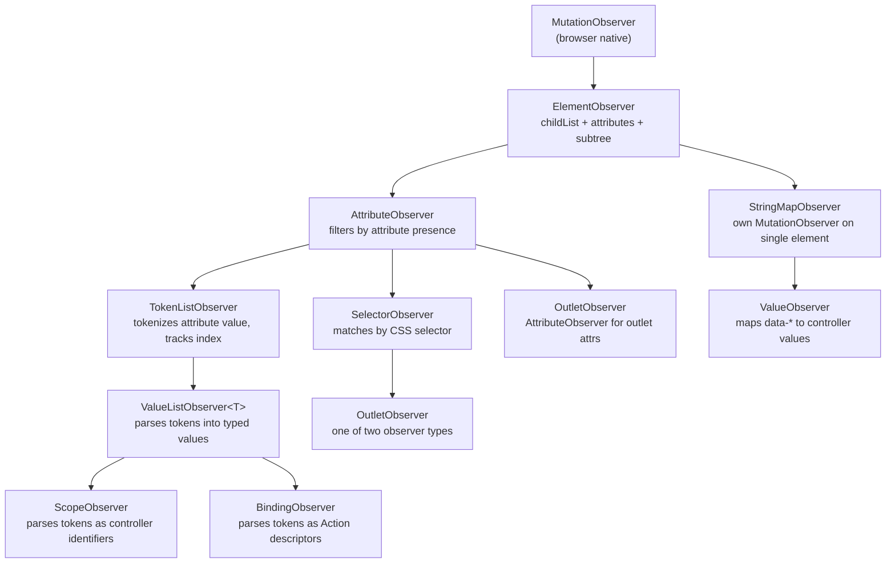
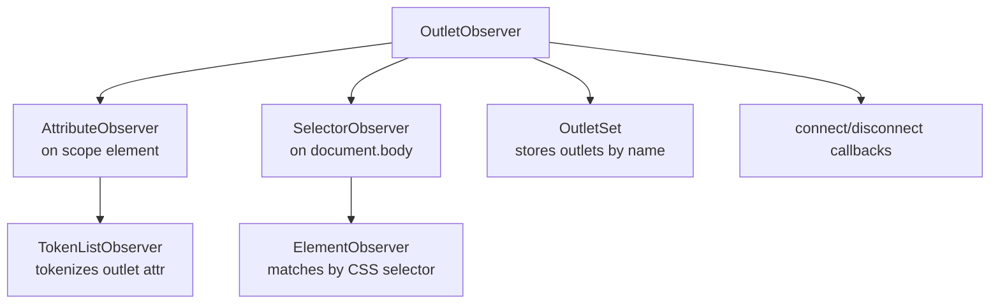
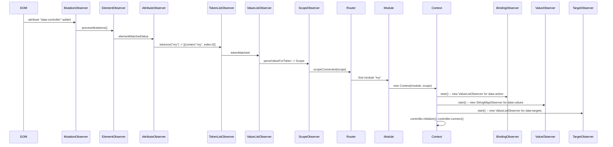

# Stimulus Observers: The MutationObserver Chain Hierarchy

Stimulus detects DOM changes using a chain of observers that wrap the browser native `MutationObserver` API. The hierarchy is a chain of composition, not inheritance: each higher-level observer wraps the one below it and implements its delegate interface. The chain starts with `MutationObserver` at the bottom and ends with `BindingObserver` at the top, parsing raw DOM mutations into controller method invocations.

Source: `src/mutation-observers/` and `src/core/` in [hotwired/stimulus](https://github.com/hotwired/stimulus) v3.2.2.

## The Observer Chain Architecture



Every observer follows the same `start()` / `stop()` / `pause(callback)` pattern. The `pause(callback)` method is critical: it disconnects the `MutationObserver`, runs the callback (which may trigger DOM mutations), then reconnects. This prevents observer callbacks from recursively triggering themselves.

## ElementObserver: The Foundation

All Stimulus observers build on `ElementObserver`, which wraps a single `MutationObserver`.

Source: `src/mutation-observers/element_observer.ts`

```typescript
// src/mutation-observers/element_observer.ts
export class ElementObserver {
  element: Element
  started: boolean
  private delegate: ElementObserverDelegate
  private elements: Set<Element>
  private mutationObserver: MutationObserver

  constructor(element: Element, delegate: ElementObserverDelegate) {
    this.element = element
    this.delegate = delegate
    this.elements = new Set()
    this.mutationObserver = new MutationObserver((mutations) => this.processMutations(mutations))
  }

  start(): void {
    if (this.started) return
    this.started = true
    this.mutationObserver.observe(this.element, {
      attributes: true,
      childList: true,
      subtree: true
    })
    this.refresh()
  }

  pause(callback: () => void): void {
    if (this.started) {
      this.mutationObserver.disconnect()
      callback()
      this.mutationObserver.observe(this.element, {
        attributes: true,
        childList: true,
        subtree: true
      })
    } else {
      callback()
    }
  }

  stop(): void {
    if (this.started) {
      this.mutationObserver.disconnect()
      this.started = false
    }
  }

  refresh(): void {
    // Re-scan the DOM tree, diff against tracked elements, call delegate methods
  }

  private processMutations(mutations: MutationRecord[]): void {
    // Handle added/removed nodes and attribute changes
  }
}
```

Aha: The `pause(callback)` method is the key to avoiding infinite loops. When `targetConnected` adds a CSS class to an element, that class addition triggers a `MutationObserver` notification. Without `pause`, the observer would process this notification, potentially calling `targetConnected` again, creating an infinite loop. The `pause` method breaks this cycle by temporarily suspending observation during DOM mutations that the observer itself triggers.

The observer configures `MutationObserver` with `{ attributes: true, childList: true, subtree: true }`. This means it receives notifications for:
- Any attribute change on any descendant element
- Any child element added or removed from any descendant
- Changes anywhere in the subtree, not just on the root element

## AttributeObserver: Filtering by Attribute Presence

`AttributeObserver` wraps `ElementObserver` and filters mutations to only elements that have a specific attribute.

Source: `src/mutation-observers/attribute_observer.ts`

```typescript
// src/mutation-observers/attribute_observer.ts
export class AttributeObserver implements ElementObserverDelegate {
  attributeName: string
  private delegate: AttributeObserverDelegate
  private elementObserver: ElementObserver

  constructor(element: Element, attributeName: string, delegate: AttributeObserverDelegate) {
    this.attributeName = attributeName
    this.delegate = delegate
    this.elementObserver = new ElementObserver(element, this)
  }

  get selector(): string { return `[${this.attributeName}]` }

  matchElement(element: Element): boolean {
    return element.hasAttribute(this.attributeName)
  }

  matchElementsInTree(tree: Element): Element[] {
    return Array.from(tree.querySelectorAll(this.selector))
  }
}
```

The `AttributeObserver` implements `ElementObserverDelegate`, providing `matchElement()` and `matchElementsInTree()` to filter mutations. Only elements with the specified attribute trigger delegate callbacks.

## TokenListObserver: Tokenizing Space-Separated Attributes

`AttributeObserver` filters by presence. `TokenListObserver` goes further: it tokenizes the attribute value and tracks each token's index within the value. This is how `data-controller="modal dropdown"` produces two separate controller scopes from one attribute.

Source: `src/mutation-observers/token_list_observer.ts`

```typescript
// src/mutation-observers/token_list_observer.ts
interface Token {
  element: Element
  attributeName: string
  index: number
  content: string
}

export class TokenListObserver implements AttributeObserverDelegate {
  private attributeObserver: AttributeObserver
  private delegate: TokenListObserverDelegate
  private tokensByElement: Multimap<Element, Token>

  constructor(element: Element, attributeName: string, delegate: TokenListObserverDelegate) {
    this.attributeObserver = new AttributeObserver(element, attributeName, this)
    this.delegate = delegate
    this.tokensByElement = new Multimap()
  }

  // When an element gains the attribute or the value changes,
  // tokenize the value and call delegate.tokenMatched() for each token.
}
```

The `Token` interface captures four pieces of information:
1. **element** -- which DOM element
2. **attributeName** -- which attribute
3. **index** -- the token position (0, 1, 2...) within the space-separated value
4. **content** -- the token string itself

The index is critical. It ensures that bindings are dispatched in the correct order. If two controllers handle the same event, the one with the lower token index fires first.

## ValueListObserver: Parsing Tokens into Typed Values

`ValueListObserver` wraps `TokenListObserver` and parses each token into a typed value using a delegate-provided parser. If the parser returns an error, the error is tracked but does not stop processing of other tokens.

Source: `src/mutation-observers/value_list_observer.ts`

```typescript
// src/mutation-observers/value_list_observer.ts
interface ParseResult<T> {
  value?: T
  error?: Error
}

export class ValueListObserver<T> implements TokenListObserverDelegate {
  private tokenListObserver: TokenListObserver
  private delegate: ValueListObserverDelegate<T>
  private parseResultsByToken: WeakMap<Token, ParseResult<T>>
  private valuesByTokenByElement: WeakMap<Element, Map<Token, T>>

  constructor(element: Element, attributeName: string, delegate: ValueListObserverDelegate<T>) {
    this.tokenListObserver = new TokenListObserver(element, attributeName, this)
    this.delegate = delegate
    this.parseResultsByToken = new WeakMap()
    this.valuesByTokenByElement = new WeakMap()
  }

  tokenMatched(token: Token): void {
    const result = this.delegate.parseValueForToken(token)
    if (result.value) {
      // Store the parsed value
    }
  }
}
```

Two observers in Stimulus use `ValueListObserver`:
1. **ScopeObserver** parses tokens as controller identifiers (strings)
2. **BindingObserver** parses tokens as `Action` descriptors

## ScopeObserver: Detecting Controller Identifiers

`ScopeObserver` is the observer that kicks off the entire Stimulus lifecycle. It watches the `data-controller` attribute and creates `Scope` objects for each controller identifier.

Source: `src/core/scope_observer.ts`

```typescript
// src/core/scope_observer.ts
export class ScopeObserver implements ValueListObserverDelegate<Scope> {
  element: Element
  schema: Schema
  private delegate: ScopeObserverDelegate
  private valueListObserver: ValueListObserver<Scope>
  private scopesByIdentifierByElement: WeakMap<Element, Map<string, Scope>>
  private scopeReferenceCounts: WeakMap<Scope, number>  // ref-count for connect/disconnect

  constructor(element: Element, schema: Schema, delegate: ScopeObserverDelegate) {
    this.element = element
    this.schema = schema
    this.delegate = delegate
    this.valueListObserver = new ValueListObserver(this, element, schema.controllerAttribute, this)
    this.scopesByIdentifierByElement = new WeakMap()
    this.scopeReferenceCounts = new WeakMap()
    this.valueListObserver.start()
  }

  parseValueForToken(token: Token): Scope | undefined {
    // Creates a Scope for this element + identifier
  }

  elementMatchedValue(element: Element, value: Scope): void {
    // Increments reference count. Connects when count goes 0 -> 1.
    const refs = this.scopeReferenceCounts.get(value) || 0
    this.scopeReferenceCounts.set(value, refs + 1)
    if (refs == 0) {
      this.delegate.scopeConnected(value)
    }
  }

  elementUnmatchedValue(element: Element, value: Scope): void {
    // Decrements reference count. Disconnects when count goes 1 -> 0.
    const refs = this.scopeReferenceCounts.get(value) || 0
    this.scopeReferenceCounts.set(value, refs - 1)
    if (refs == 1) {
      this.delegate.scopeDisconnected(value)
    }
  }
}
```

Aha: The reference counting in `ScopeObserver` is the clever mechanism that handles nested controllers with the same identifier. If a parent element has `data-controller="my"` and a child element also has `data-controller="my"`, the parent scope is created first (ref count = 1), then the child scope is created (ref count = 1 for a different `Scope` object). Each scope is independent. The reference count handles the case where a single element has multiple controller identifiers in its `data-controller` attribute: `data-controller="alpha beta"`. If `alpha` is removed but `beta` remains, the element is not fully disconnected from Stimulus.

## StringMapObserver: Watching Value Attributes on a Single Element

Unlike the `ElementObserver` chain (which watches subtrees), `StringMapObserver` uses its own `MutationObserver` to watch a single element. It maps attribute names to string keys, tracking which attributes have changed and their current values.

Source: `src/mutation-observers/string_map_observer.ts`

```typescript
// src/mutation-observers/string_map_observer.ts
export class StringMapObserver {
  element: Element
  delegate: StringMapObserverDelegate
  private stringMap: Map<string, string>
  private mutationObserver: MutationObserver

  constructor(element: Element, delegate: StringMapObserverDelegate) {
    this.element = element
    this.delegate = delegate
    this.stringMap = new Map()
    this.mutationObserver = new MutationObserver((mutations) => this.processMutations(mutations))
  }

  start(): void {
    this.mutationObserver.observe(this.element, { attributes: true })
    this.refresh()
  }

  private processMutations(mutations: MutationRecord[]): void {
    for (const mutation of mutations) {
      const oldValue = this.stringMap.get(mutation.attributeName) || null
      const newValue = this.element.getAttribute(mutation.attributeName)
      if (oldValue !== newValue) {
        this.stringMap.set(mutation.attributeName, newValue)
        if (oldValue !== null) {
          this.delegate.stringMapKeyChanged(mutation.attributeName, newValue)
        } else if (newValue !== null) {
          this.delegate.stringMapKeyAdded(mutation.attributeName, newValue)
        }
      }
    }
  }
}
```

The `StringMapObserver` only watches `{ attributes: true }` (no `childList` or `subtree`). This is efficient because it only receives notifications for attribute changes on the single observed element.

## ValueObserver: Mapping Data Attributes to Controller Properties

`ValueObserver` wraps `StringMapObserver` and maps `data-${identifier}-*` attributes to controller value properties. When a value attribute changes, it calls `${name}Changed(newValue, oldValue)` on the controller.

Source: `src/core/value_observer.ts`

```typescript
// src/core/value_observer.ts
export class ValueObserver implements StringMapObserverDelegate {
  readonly context: Context
  readonly receiver: any  // the controller instance
  private stringMapObserver: StringMapObserver
  private valueDescriptorMap: object

  constructor(context: Context, receiver: any) {
    this.context = context
    this.receiver = receiver
    this.stringMapObserver = new StringMapObserver(context.element, this)
    this.valueDescriptorMap = receiver.valueDescriptorMap
  }

  start(): void { this.stringMapObserver.start() }
  stop(): void { this.stringMapObserver.stop() }

  stringMapKeyAdded(key: string, value: string): void {
    const descriptor = this.valueDescriptorMap[key]
    if (descriptor) {
      const name = descriptor.name
      if (this.receiver[`${name}Changed`]) {
        this.receiver[`${name}Changed`](undefined, descriptor.reader(value))
      }
    }
  }

  stringMapKeyChanged(key: string, value: string | null): void {
    const descriptor = this.valueDescriptorMap[key]
    if (descriptor) {
      const name = descriptor.name
      if (this.receiver[`${name}Changed`]) {
        this.receiver[`${name}Changed`](
          value ? descriptor.reader(value) : undefined,
          this.receiver[name]
        )
      }
    }
  }
}
```

The `valueDescriptorMap` is generated by the `ValuePropertiesBlessing` during the blessing phase. It maps attribute names to `ValueDescriptor` objects that know how to read and write typed values. See [Stimulus Blessing](03-stimulus-blessing.md) for details.

## SelectorObserver: Matching Elements by CSS Selector

`SelectorObserver` wraps `ElementObserver` and matches elements using a CSS selector. When an element starts or stops matching the selector, it calls the delegate.

Source: `src/mutation-observers/selector_observer.ts`

```typescript
// src/mutation-observers/selector_observer.ts
export class SelectorObserver implements ElementObserverDelegate {
  private elementObserver: ElementObserver
  private delegate: SelectorObserverDelegate
  private matchesByElement: Multimap<string, Element>
  private details: object
  _selector: string | null  // mutable, triggers refresh on set

  constructor(element: Element, selector: string, delegate: SelectorObserverDelegate, details: object) {
    this.elementObserver = new ElementObserver(element, this)
    this.delegate = delegate
    this.matchesByElement = new Multimap()
    this.details = details || {}
    this._selector = selector
  }

  matchElement(element: Element): boolean {
    return element.matches(this.selector)
  }

  matchElementsInTree(tree: Element): Element[] {
    return Array.from(tree.querySelectorAll(this.selector))
  }
}
```

The `OutletObserver` uses `SelectorObserver` to watch the document body for outlet elements that match a dynamically generated selector.

## TargetObserver and OutletObserver: Higher-Level Observers

`TargetObserver` wraps `ValueListObserver` (which wraps `TokenListObserver` -> `AttributeObserver` -> `ElementObserver`) to watch `data-${identifier}-target` attributes on the scope element and its descendants.

Source: `src/core/target_observer.ts`

```typescript
// src/core/target_observer.ts
export class TargetObserver implements TokenListObserverDelegate {
  readonly context: Context
  readonly delegate: TargetObserverDelegate
  readonly targetsByName: Multimap<string, Element>
  private tokenListObserver?: TokenListObserver

  constructor(context: Context, delegate: TargetObserverDelegate) {
    this.context = context
    this.delegate = delegate
    this.targetsByName = new Multimap()
  }

  connectTarget(element: Element, name: string): void {
    // Pauses observer during callback to avoid recursive trigger
    const observer = this.tokenListObserver
    if (observer) {
      observer.elementObserver.pause(() => {
        this.delegate.targetConnected(element, name)
      })
    }
  }

  disconnectTarget(element: Element, name: string): void {
    const observer = this.tokenListObserver
    if (observer) {
      observer.elementObserver.pause(() => {
        this.delegate.targetDisconnected(element, name)
      })
    }
  }
}
```

The `pause()` call during `connectTarget` and `disconnectTarget` is the recursive trigger prevention mechanism. When the user's `targetConnected` callback modifies the DOM (e.g., adds a CSS class), the `pause` ensures that modification does not trigger another `MutationObserver` notification.

`OutletObserver` is more complex. It uses two observer types simultaneously:
1. **AttributeObserver** watches outlet attributes on the scope element itself
2. **SelectorObserver** watches the document body for outlet elements matching the selector



## BindingObserver: Parsing Actions into Bindings

`BindingObserver` is at the top of the observer chain. It wraps `ValueListObserver<Action>` and parses `data-action` attribute tokens into `Action` objects, then creates `Binding` objects that register with the `Dispatcher`.

Source: `src/core/binding_observer.ts`

```typescript
// src/core/binding_observer.ts
export class BindingObserver implements ValueListObserverDelegate<Action> {
  readonly context: Context
  private delegate: BindingObserverDelegate  // the Dispatcher
  private valueListObserver?: ValueListObserver<Action>
  private bindingsByAction: Map<Action, Binding>

  constructor(context: Context, delegate: BindingObserverDelegate) {
    this.context = context
    this.delegate = delegate
    this.valueListObserver = new ValueListObserver(this, context.element, context.schema.actionAttribute, this)
    this.bindingsByAction = new Map()
  }

  get actionAttribute(): string { return this.context.schema.actionAttribute }

  parseValueForToken(token: Token): Action | undefined {
    const action = Action.forToken(token, this.context.schema)
    if (action.identifier == this.context.identifier) {
      return action  // only parse actions for this controller
    }
    return undefined
  }

  elementMatchedValue(element: Element, action: Action): void {
    const binding = new Binding(this.context, action)
    this.bindingsByAction.set(action, binding)
    this.delegate.bindingConnected(binding)
  }
}
```

The key filter `if (action.identifier == this.context.identifier)` ensures that a `data-action="click->modal#open"` on a `dropdown` controller element does not create a binding for the `dropdown` controller. The action only binds to the controller whose identifier matches.

## The Complete Observer Hierarchy in Practice

When `data-controller="my"` appears on an element, here is the full observer chain activation:



## Pause Mechanism Deep Dive

The `pause(callback)` mechanism appears at multiple levels:

| Level | Class | Used When |
|-------|-------|-----------|
| ElementObserver | `ElementObserver.pause()` | Any callback that modifies the DOM |
| TargetObserver | `elementObserver.pause()` | `connectTarget` and `disconnectTarget` |
| BindingObserver | (inherited) | Not directly used |
| OutletObserver | (inherited) | `connectOutlet` and `disconnectOutlet` |

When a user writes:

```javascript
// my_controller.js
static targets = ["item"]
targetConnected(element) {
  element.classList.add("active")  // triggers MutationObserver
}
```

Without `pause()`, the `classList.add("active")` would trigger the `MutationObserver`, which would re-evaluate all tokens, which would call `targetConnected` again for the same element, creating an infinite loop. The `pause()` mechanism prevents this by suspending the observer during the callback.

Aha: The `pause` mechanism is not a general-purpose lock. It is scoped to the specific `ElementObserver` that wraps the `MutationObserver`. This means pausing one observer does not pause others. The `TargetObserver` pauses its `ElementObserver` during target connection callbacks, but the `BindingObserver`'s `ElementObserver` continues running. This allows actions to fire while target connections are being processed.

## Next

The blessing system that generates typed accessors from static declarations is covered in [Stimulus Blessing](03-stimulus-blessing.md). For the complete picture of how the `Application`, `Module`, `Scope`, and `Context` classes coordinate with these observers, see [Stimulus Core](01-stimulus-core.md).
