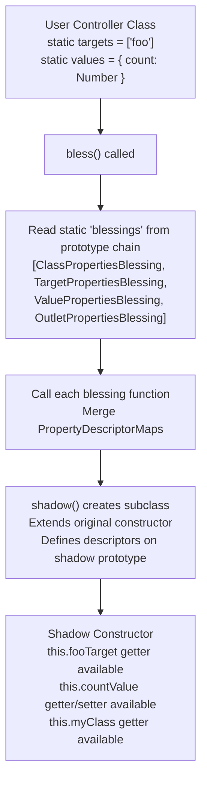

# Stimulus Blessing: Runtime Shadow Constructors and Typed Accessors

The blessing system is how Stimulus generates typed accessor properties (`this.fooTarget`, `this.barValue`, `this.bazClass`) at runtime without requiring manual property definitions. When you declare `static targets = ["foo"]` or `static values = { count: Number }`, the blessing system creates a shadow subclass at class registration time that injects the appropriate getters and setters into the prototype. This eliminates boilerplate while maintaining full TypeScript type safety.

Source: `src/core/blessing.ts`, `src/core/definition.ts`, and `src/core/*_properties.ts` in [hotwired/stimulus](https://github.com/hotwired/stimulus) v3.2.2.

## The Blessing Pipeline



## The Bless Function

The `bless()` function reads all static `blessings` from the constructor's prototype chain, calls each one, merges the resulting `PropertyDescriptorMap` objects, and creates a shadow class.

Source: `src/core/blessing.ts`

```typescript
// src/core/blessing.ts:7
export function bless<T>(constructor: Blessable<T>): Constructor<T> {
  // 1. Read all blessings from the prototype chain
  const blessings = readInheritableStaticArrayValues(constructor, "blessings")

  // 2. Call each blessing, merge PropertyDescriptorMaps
  const propertyDescriptorMap: PropertyDescriptorMap = {}
  for (const blessingFunction of blessings) {
    const descriptors = blessingFunction(constructor)
    Object.assign(propertyDescriptorMap, descriptors)
  }

  // 3. Create shadow class with the merged descriptors
  return shadow(constructor, propertyDescriptorMap)
}
```

The default `blessings` array on the base `Controller` class is:

Source: `src/core/controller.ts:3`

```typescript
// src/core/controller.ts:3
export class Controller<Element = HTMLElement> {
  static blessings = [
    ClassPropertiesBlessing,
    TargetPropertiesBlessing,
    ValuePropertiesBlessing,
    OutletPropertiesBlessing
  ]
  static targets: string[] = []
  static outlets: string[] = []
  static values: ValueDefinitionMap = {}
  static shouldLoad = true
  // ...
}
```

Each blessing function takes the constructor and returns a `PropertyDescriptorMap`. The `Object.assign` call merges them. If two blessings define the same property key, the later one wins (which means `OutletPropertiesBlessing` can override `TargetPropertiesBlessing` if there is a naming conflict).

## The Shadow Function

The `shadow()` function creates a subclass that defines the blessed properties on its prototype.

Source: `src/core/blessing.ts`

```typescript
// src/core/blessing.ts:10
export function bless<T>(constructor: Blessable<T>): Constructor<T> {
  return shadow(constructor, getBlessedProperties(constructor))
}

function shadow<T>(constructor: Constructor<T>, properties: PropertyDescriptorMap) {
  const shadowConstructor = extend(constructor)
  const shadowProperties = getShadowProperties(constructor.prototype, properties)
  Object.defineProperties(shadowConstructor.prototype, shadowProperties)
  return shadowConstructor
}

function getBlessedProperties<T>(constructor: Constructor<T>) {
  const blessings = readInheritableStaticArrayValues(constructor, "blessings") as Blessing<T>[]
  return blessings.reduce((blessedProperties, blessing) => {
    const properties = blessing(constructor)
    for (const key in properties) {
      const descriptor = blessedProperties[key] || ({} as PropertyDescriptor)
      blessedProperties[key] = Object.assign(descriptor, properties[key])
    }
    return blessedProperties
  }, {} as PropertyDescriptorMap)
}

function getShadowProperties(prototype: any, properties: PropertyDescriptorMap) {
  return getOwnKeys(properties).reduce((shadowProperties, key) => {
    const descriptor = getShadowedDescriptor(prototype, properties, key)
    if (descriptor) {
      Object.assign(shadowProperties, { [key]: descriptor })
    }
    return shadowProperties
  }, {} as PropertyDescriptorMap)
}
```

The actual implementation uses three helper functions: `getBlessedProperties()` (collects and merges all blessing descriptors using `Object.assign`), `getShadowProperties()` (filters through `getShadowedDescriptor` to handle user overrides), and `getOwnKeys()` (includes both `getOwnPropertyNames` and `getOwnPropertySymbols`). The old docs showed a simpler direct loop, but the actual code uses `reduce` for all three operations.

Aha: The `getShadowedDescriptor` function is the key to allowing subclass overrides. If the user's class already defines a getter or setter for a key that a blessing would generate, `getShadowedDescriptor` merges the existing getter/setter with the blessed descriptor. This means a user can override `this.fooTarget` with their own getter, and the blessing does not overwrite it. If the user defines a plain value property (not an accessor), the blessing skips shadowing entirely for that key.

## The Extend Function

The `extend()` function creates a subclass using the best available mechanism. It uses an IIFE that tests Reflect.construct once at load time and caches the result.

Source: `src/core/blessing.ts`

```typescript
// src/core/blessing.ts:64
const extend = (() => {
  function extendWithReflect<T extends Constructor<any>>(constructor: T): T {
    function extended() {
      return Reflect.construct(constructor, arguments, new.target)
    }

    extended.prototype = Object.create(constructor.prototype, {
      constructor: { value: extended },
    })

    Reflect.setPrototypeOf(extended, constructor)
    return extended as any
  }

  function testReflectExtension() {
    const a = function (this: any) { this.a.call(this) } as any
    const b = extendWithReflect(a)
    b.prototype.a = function () {}
    return new b()
  }

  try {
    testReflectExtension()
    return extendWithReflect
  } catch (error: any) {
    return <T extends Constructor<any>>(constructor: T) => class extended extends constructor {}
  }
})()
```

The IIFE attempts `Reflect.construct` once and caches whichever path succeeds. This avoids repeated `supportsReflectConstruct()` checks at runtime. The fallback `class extends` path works in environments without `Reflect.construct`.

## TargetPropertiesBlessing: this.fooTarget and this.fooTargets

The `TargetPropertiesBlessing` generates accessors for each declared target name.

Source: `src/core/target_properties.ts`

```typescript
// src/core/target_properties.ts
export function TargetPropertiesBlessing(constructor: Constructor<Controller>): PropertyDescriptorMap {
  const targets = readInheritableStaticArrayValues(constructor, "targets")
  const properties: PropertyDescriptorMap = {}

  for (const name of targets) {
    properties[`${name}Target`] = {
      get(this: Controller) {
        const target = this.targets.find(name)
        if (target) {
          return target
        } else {
          throw new Error(`Missing target element "${name}" for "${this.identifier}" controller`)
        }
      }
    }
    properties[`${name}Targets`] = {
      get(this: Controller): Element[] {
        return this.targets.findAll(name)
      }
    }
    properties[`has${capitalize(name)}Target`] = {
      get(this: Controller): boolean {
        return this.targets.has(name)
      }
    }
  }
  return properties
}
```

For each target name `foo`, three properties are generated:
- `fooTarget` -- returns the first matching element (throws via `Guide` if missing)
- `fooTargets` -- returns all matching elements
- `hasFooTarget` -- returns true if at least one matching element exists

The `TargetSet.find()` method is what powers `fooTarget`:

Source: `src/core/target_set.ts`

```typescript
// src/core/target_set.ts
export class TargetSet {
  find(...targetNames: string[]): Element | undefined {
    for (const name of targetNames) {
      const element = this.findElement(name)
      if (element) return element
    }
    this.guide.warn(this.element, `target:${targetNames[0]}`, "missing target")
    return undefined
  }

  private findElement(targetName: string): Element | undefined {
    const selector = this.selectorForTargetName(targetName)
    return this.element.querySelector(selector)
  }
}
```

## ValuePropertiesBlessing: this.countValue and this.countValueChanged

The `ValuePropertiesBlessing` generates accessors for each declared value with type coercion.

Source: `src/core/value_properties.ts`

```typescript
// src/core/value_properties.ts
export function ValuePropertiesBlessing(constructor: Constructor<Controller>): PropertyDescriptorMap {
  const valueDefinitionPairs = readInheritableStaticObjectPairs(constructor, "values")
  const propertyDescriptorMap: PropertyDescriptorMap = {}

  // valueDescriptorMap: used by ValueObserver to detect changes
  propertyDescriptorMap["valueDescriptorMap"] = {
    get(this: Controller): ValueDescriptorMap {
      const map = {}
      for (const [name, definition] of valueDefinitionPairs) {
        const descriptor = new ValueDescriptor(name, definition)
        map[descriptor.getAttributeName(this.identifier)] = descriptor
      }
      return map
    }
  }

  for (const [name, definition] of valueDefinitionPairs) {
    const descriptor = new ValueDescriptor(name, definition)
    const { attributeName } = descriptor

    // Getter: reads data attribute, coerces type
    propertyDescriptorMap[name] = {
      get(this: Controller) {
        const value = this.data.get(key)
        if (value !== null) {
          return read(value)  // JSON.parse for arrays/objects
        }
        return definition.defaultValue  // typed default
      },

      set(this: Controller, value: T | undefined) {
        if (value === undefined) {
          this.data.delete(key)  // remove attribute when set to undefined
        } else {
          this.data.set(key, write(value))  // JSON.stringify
        }
      }
    }

    // hasXxx getter
    propertyDescriptorMap[`has${capitalize(name)}`] = {
      get(this: Controller): boolean {
        return this.data.has(key) || definition.hasCustomDefaultValue
      }
    }
  }
  return properties
}
```

The `ValueDescriptor` is a type alias for a plain object (not a class) with fields `type`, `key`, `name`, `defaultValue`, `hasCustomDefaultValue`, `reader`, and `writer`. It handles type coercion for five built-in types:

Source: `src/core/value_properties.ts`

```typescript
// Default values by type -- uses getters to return fresh instances
const defaultValuesByType = {
  get array() { return [] },
  boolean: false,
  number: 0,
  get object() { return {} },
  string: "",
}

// readers: array uses JSON.parse, boolean checks "0"/"false", number strips underscores
// writers: array/object use JSON.stringify, others use string interpolation
```

Aha: When a value is set to `undefined`, the attribute is removed from the DOM. This is an intentional cleanup mechanism. If `countValue` is `0` (the default) and you set `this.countValue = undefined`, the `data-my-count` attribute is removed. Note: setting to the default value itself (e.g., `0`) does NOT remove the attribute -- only `undefined` does. The getters on `defaultValuesByType` ensure each access to `array` or `object` returns a fresh instance, preventing shared mutable defaults.

## Value Type Coercion Table

| Declaration | Type | Default | Reader | Writer |
|------------|------|---------|--------|--------|
| `count: Number` | number | `0` | `Number("3")` = `3` | `"3"` |
| `active: Boolean` | boolean | `false` | `"true"` = `true`, `""` = `true` | `"true"`/`"false"` |
| `label: String` | string | `""` | direct | direct |
| `tags: Array` | array | `[]` | `JSON.parse` | `JSON.stringify` |
| `config: Object` | object | `{}` | `JSON.parse` | `JSON.stringify` |

Boolean coercion has a special case: an empty attribute value (`data-my-active=""`) is `true`. This allows boolean presence/absence semantics: the attribute is either present (true) or absent (false/default).

## ClassPropertiesBlessing: this.fooClass and this.fooClasses

The `ClassPropertiesBlessing` generates accessors for CSS class names.

Source: `src/core/class_properties.ts`

```typescript
// src/core/class_properties.ts
export function ClassPropertiesBlessing(constructor: Constructor<Controller>): PropertyDescriptorMap {
  const classes = readInheritableStaticObjectPairs(constructor, "classes")
  const properties: PropertyDescriptorMap = {}

  for (const [name] of classes) {
    properties[`${name}Class`] = {
      get(this: Controller): string {
        return this.classes.get(name)  // throws Guide warning if missing
      }
    }
    properties[`${name}Classes`] = {
      get(this: Controller): string[] {
        return this.classes.getAll(name)
      }
    }
    properties[`has${capitalize(name)}Class`] = {
      get(this: Controller): boolean {
        return this.classes.has(name)
      }
    }
  }
  return properties
}
```

Each class name is read from a `data-${identifier}-foo-class` attribute. For example, `data-my-loading-class="is-spinning"` maps to `this.loadingClass` returning `"is-spinning"`.

## OutletPropertiesBlessing: this.barOutlet and this.barOutlets

The `OutletPropertiesBlessing` generates accessors for outlet controllers and elements. The actual source also generates `${camelizedName}OutletElements` (returns `Element[]`).

Source: `src/core/outlet_properties.ts`

```typescript
// src/core/outlet_properties.ts
export function OutletPropertiesBlessing(constructor: Constructor<Controller>): PropertyDescriptorMap {
  const outlets = readInheritableStaticArrayValues(constructor, "outlets")
  return outlets.reduce((properties: any, outletDefinition: any) => {
    return Object.assign(properties, propertiesForOutletDefinition(outletDefinition))
  }, {} as PropertyDescriptorMap)
}

function propertiesForOutletDefinition(name: string) {
  const camelizedName = namespaceCamelize(name)

  return {
    [`${camelizedName}Outlet`]: {
      get(this: Controller) {
        const outletElement = this.outlets.find(name)
        const selector = this.outlets.getSelectorForOutletName(name)
        if (outletElement) {
          const outletController = getControllerAndEnsureConnectedScope(this, outletElement, name)
          if (outletController) return outletController
          throw new Error(`Missing outlet controller "${name}"`)
        }
        throw new Error(`Missing outlet element "${name}"`)
      },
    },
    [`${camelizedName}Outlets`]: {
      get(this: Controller) { ... }  // returns Controller[] (with warnings for missing controllers)
    },
    [`${camelizedName}OutletElement`]: {
      get(this: Controller) { ... }  // returns Element | undefined
    },
    [`${camelizedName}OutletElements`]: {
      get(this: Controller) { return this.outlets.findAll(name) }  // returns Element[]
    },
    [`has${capitalize(camelizedName)}Outlet`]: {
      get(this: Controller) { return this.outlets.has(name) },
    },
  }
}
```

For each outlet name, FIVE properties are generated (not four as in targets/values):
- `sidebarOutlet` -> returns the Controller instance (throws if element or controller missing)
- `sidebarOutlets` -> returns Controller[] (warns for missing controllers, filters them out)
- `sidebarOutletElement` -> returns Element (throws if missing)
- `sidebarOutletElements` -> returns Element[]
- `hasSidebarOutlet` -> boolean

Aha: The `${name}Outlet` getter does NOT just return `this.outlets.find()` -- it first gets the element, then calls `getControllerAndEnsureConnectedScope()` which looks up the controller by identifier, and if not found, calls `router.proposeToConnectScopeForElementAndIdentifier()` to dynamically propose a connection. This ensures the outlet controller is instantiated and connected before being returned.

Aha: The `OutletSet.find()` method does not just return the element -- it returns the controller instance for that element. This is because outlets are designed for inter-controller communication. When you access `this.sidebarOutlet`, you get the `SidebarController` instance, not just the DOM element. If the outlet controller is not yet connected, the `OutletObserver` dynamically proposes a scope connection for the outlet element, ensuring the controller is instantiated and connected before returning.

## blessDefinition: Wiring It Together

The `blessDefinition()` function calls `bless()` on the controller constructor when a definition is loaded.

Source: `src/core/definition.ts`

```typescript
// src/core/definition.ts
export function blessDefinition(definition: Definition): Definition {
  return {
    identifier: definition.identifier,
    controllerConstructor: bless(definition.controllerConstructor)
  }
}
```

This is called in the `Module` constructor:

```typescript
// src/core/module.ts:10
constructor(application: Application, definition: Definition) {
  this.application = application
  this.definition = blessDefinition(definition)
}
```

The blessing happens exactly once per registration. The shadow constructor's `blessings` array is set to `[constructor]` (the original, not the default four), preventing re-blessing if the same controller is registered again.

## Shadow Descriptor Merging

The `getShadowedDescriptor()` function handles the case where a user subclass overrides a blessed property.

Source: `src/core/blessing.ts`

```typescript
// src/core/blessing.ts:43
function getShadowedDescriptor(prototype: any, properties: PropertyDescriptorMap, key: string | symbol) {
  const shadowingDescriptor = Object.getOwnPropertyDescriptor(prototype, key)
  const shadowedByValue = shadowingDescriptor && "value" in shadowingDescriptor
  if (!shadowedByValue) {
    const descriptor = Object.getOwnPropertyDescriptor(properties, key)!.value
    if (shadowingDescriptor) {
      descriptor.get = shadowingDescriptor.get || descriptor.get
      descriptor.set = shadowingDescriptor.set || descriptor.set
    }
    return descriptor
  }
  // If the prototype has a value property (not accessor), skip shadowing
}
```

This means:
1. If the user defines an accessor (getter/setter), the blessed descriptor's get/set are merged with the user's
2. If the user defines a plain value property (`shadowedByValue` is true), the blessing is skipped entirely (returns `undefined`)
3. If the user defines nothing, the full blessed descriptor is used

## Example: Complete Controller with All Blessings

```javascript
// controllers/my_controller.js
import { Controller } from "@hotwired/stimulus"

export default class extends Controller {
  static targets = ["item", "loader"]
  static values = { count: Number, active: Boolean, tags: Array }
  static classes = ["highlight", "loading"]
  static outlets = ["sidebar"]

  // After blessing, these are available:
  // this.itemTarget        -> Element (first item)
  // this.itemTargets       -> Element[] (all items)
  // this.hasItemTarget     -> boolean
  // this.countValue        -> number (read/write with coercion)
  // this.activeValue       -> boolean (read/write with coercion)
  // this.tagsValue         -> array (JSON parse/stringify)
  // this.highlightClass    -> string
  // this.highlightClasses  -> string[]
  // this.sidebarOutlet     -> SidebarController instance
  // this.sidebarOutlets    -> Controller[]
  // this.valueDescriptorMap -> { "data-my-count": ValueDescriptor, ... }

  connect() {
    console.log(this.countValue)        // reads data-my-count attribute
    this.countValue = 5                  // writes data-my-count="5"
    this.itemTarget.classList.add(this.highlightClass)
    this.sidebarOutlet.refresh()         // calls method on outlet controller
  }
}
```

## Next

The observer chain that triggers the blessing-generated callbacks is covered in [Stimulus Observers](02-stimulus-observers.md). For the overall architecture of `Application`, `Module`, `Scope`, and `Context`, see [Stimulus Core](01-stimulus-core.md).
