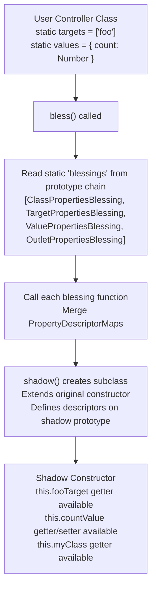

# Stimulus Blessing: Runtime Shadow Constructors and Typed Accessors

The blessing system is how Stimulus generates typed accessor properties (`this.fooTarget`, `this.barValue`, `this.bazClass`) at runtime without requiring manual property definitions. When you declare `static targets = ["foo"]` or `static values = { count: Number }`, the blessing system creates a shadow subclass at class registration time that injects the appropriate getters and setters into the prototype. This eliminates boilerplate while maintaining full TypeScript type safety.

Source: `src/core/blessing.ts`, `src/core/definition.ts`, and `src/core/*_properties.ts` in [hotwired/stimulus](https://github.com/hotwired/stimulus) v3.2.2.

## The Blessing Pipeline



## The Bless Function

The `bless()` function reads all static `blessings` from the constructor's prototype chain, calls each one, merges the resulting `PropertyDescriptorMap` objects, and creates a shadow class.

Source: `src/core/blessing.ts`

```typescript
// src/core/blessing.ts:7
export function bless<T>(constructor: Blessable<T>): Constructor<T> {
  // 1. Read all blessings from the prototype chain
  const blessings = readInheritableStaticArrayValues(constructor, "blessings")

  // 2. Call each blessing, merge PropertyDescriptorMaps
  const propertyDescriptorMap: PropertyDescriptorMap = {}
  for (const blessingFunction of blessings) {
    const descriptors = blessingFunction(constructor)
    Object.assign(propertyDescriptorMap, descriptors)
  }

  // 3. Create shadow class with the merged descriptors
  return shadow(constructor, propertyDescriptorMap)
}
```

The default `blessings` array on the base `Controller` class is:

Source: `src/core/controller.ts:3`

```typescript
// src/core/controller.ts:3
export class Controller<Element = HTMLElement> {
  static blessings = [
    ClassPropertiesBlessing,
    TargetPropertiesBlessing,
    ValuePropertiesBlessing,
    OutletPropertiesBlassing
  ]
  static targets: string[] = []
  static outlets: string[] = []
  static values: ValueDefinitionMap = {}
  static shouldLoad = true
  // ...
}
```

Each blessing function takes the constructor and returns a `PropertyDescriptorMap`. The `Object.assign` call merges them. If two blessings define the same property key, the later one wins (which means `OutletPropertiesBlessing` can override `TargetPropertiesBlessing` if there is a naming conflict).

## The Shadow Function

The `shadow()` function creates a subclass that defines the blessed properties on its prototype.

Source: `src/core/blessing.ts`

```typescript
// src/core/blessing.ts:20
export function shadow<T>(constructor: Constructor<T>, properties: PropertyDescriptorMap): Constructor<T> {
  const shadowConstructor = extend(constructor)
  shadowConstructor.blessings = [constructor]  // prevent re-blessing
  const shadowPrototype = shadowConstructor.prototype as any

  for (const [key, descriptor] of Object.entries(properties)) {
    const existing = getShadowedDescriptor(shadowPrototype, properties, key)
    if (existing) {
      Object.defineProperty(shadowPrototype, key, existing)
    }
  }
  return shadowConstructor as any
}
```

Aha: The `getShadowedDescriptor` function is the key to allowing subclass overrides. If the user's class already defines a getter or setter for a key that a blessing would generate, `getShadowedDescriptor` merges the existing getter/setter with the blessed descriptor. This means a user can override `this.fooTarget` with their own getter, and the blessing does not overwrite it. If the user defines a plain value property (not an accessor), the blessing skips shadowing entirely for that key.

## The Extend Function

The `extend()` function creates a subclass using the best available mechanism.

Source: `src/core/blessing.ts`

```typescript
// src/core/blessing.ts:35
export function extend<T>(constructor: Constructor<T>): Constructor<T> {
  if (supportsReflectConstruct()) {
    // Use Reflect.construct for proper ES6 subclassing
    return class extends constructor {
      constructor(...args: any[]) {
        super(...args)
        Reflect.construct(constructor, args, new.target)
      }
    }
  } else {
    // Fallback: class extends
    return class extends constructor {}
  }
}
```

The `Reflect.construct` path ensures that `new.target` is preserved, which is important for ES6 class semantics. The fallback `class extends` path works in environments without `Reflect.construct`.

## TargetPropertiesBlessing: this.fooTarget and this.fooTargets

The `TargetPropertiesBlessing` generates accessors for each declared target name.

Source: `src/core/target_properties.ts`

```typescript
// src/core/target_properties.ts
export function TargetPropertiesBlessing(constructor: Constructor<Controller>): PropertyDescriptorMap {
  const targets = readInheritableStaticArrayValues(constructor, "targets")
  const properties: PropertyDescriptorMap = {}

  for (const name of targets) {
    properties[`${name}Target`] = {
      get(this: Controller): Element | undefined {
        return this.targets.find(name)  // throws Guide warning if not found
      }
    }
    properties[`${name}Targets`] = {
      get(this: Controller): Element[] {
        return this.targets.findAll(name)
      }
    }
    properties[`has${capitalize(name)}Target`] = {
      get(this: Controller): boolean {
        return this.targets.has(name)
      }
    }
  }
  return properties
}
```

For each target name `foo`, three properties are generated:
- `fooTarget` -- returns the first matching element (throws via `Guide` if missing)
- `fooTargets` -- returns all matching elements
- `hasFooTarget` -- returns true if at least one matching element exists

The `TargetSet.find()` method is what powers `fooTarget`:

Source: `src/core/target_set.ts`

```typescript
// src/core/target_set.ts
export class TargetSet {
  find(...targetNames: string[]): Element | undefined {
    for (const name of targetNames) {
      const element = this.findElement(name)
      if (element) return element
    }
    this.guide.warn(this.element, `target:${targetNames[0]}`, "missing target")
    return undefined
  }

  private findElement(targetName: string): Element | undefined {
    const selector = this.selectorForTargetName(targetName)
    return this.element.querySelector(selector)
  }
}
```

## ValuePropertiesBlessing: this.countValue and this.countValueChanged

The `ValuePropertiesBlessing` generates accessors for each declared value with type coercion.

Source: `src/core/value_properties.ts`

```typescript
// src/core/value_properties.ts
export function ValuePropertiesBlessing(constructor: Constructor<Controller>): PropertyDescriptorMap {
  const valueDefinitionPairs = readInheritableStaticObjectPairs(constructor, "values")
  const propertyDescriptorMap: PropertyDescriptorMap = {}

  // valueDescriptorMap: used by ValueObserver to detect changes
  propertyDescriptorMap["valueDescriptorMap"] = {
    get(this: Controller): ValueDescriptorMap {
      const map = {}
      for (const [name, definition] of valueDefinitionPairs) {
        const descriptor = new ValueDescriptor(name, definition)
        map[descriptor.getAttributeName(this.identifier)] = descriptor
      }
      return map
    }
  }

  for (const [name, definition] of valueDefinitionPairs) {
    const descriptor = new ValueDescriptor(name, definition)
    const { attributeName } = descriptor

    // Getter: reads data attribute, coerces type
    propertyDescriptorMap[name] = {
      get(this: Controller): TypedValue {
        const key = this.data.get(attributeName)
        if (key !== null) {
          return descriptor.reader(key)  // JSON.parse for arrays/objects
        }
        return descriptor.defaultValue  // typed default
      },
      set(this: Controller, value: TypedValue) {
        if (value === descriptor.defaultValue) {
          this.data.delete(attributeName)  // remove attribute when set to default
        } else {
          this.data.set(attributeName, descriptor.writer(value))  // JSON.stringify
        }
      }
    }

    // hasXxx getter
    propertyDescriptorMap[`has${capitalize(name)}`] = {
      get(this: Controller): boolean {
        return this.data.has(attributeName) || this.hasCustomDefaultValue(name)
      }
    }
  }
  return properties
}
```

The `ValueDescriptor` class handles type coercion for five built-in types:

Source: `src/core/value_properties.ts`

```typescript
// Default values by type
const defaultValuesByType = {
  array: [] as any[],
  boolean: false,
  number: 0,
  object: {} as any,
  string: ""
}

// ValueDescriptor.reader() for arrays and objects uses JSON.parse
// ValueDescriptor.writer() for arrays and objects uses JSON.stringify
// Scalars (boolean, number, string) use direct coercion
```

Aha: When a value is set to its default value, the attribute is removed from the DOM. This is an intentional cleanup mechanism. If `countValue` defaults to `0` and you set `this.countValue = 0`, the `data-my-count` attribute is removed from the element. This keeps the DOM clean and makes it obvious which values differ from defaults.

## Value Type Coercion Table

| Declaration | Type | Default | Reader | Writer |
|------------|------|---------|--------|--------|
| `count: Number` | number | `0` | `Number("3")` = `3` | `"3"` |
| `active: Boolean` | boolean | `false` | `"true"` = `true`, `""` = `true` | `"true"`/`"false"` |
| `label: String` | string | `""` | direct | direct |
| `tags: Array` | array | `[]` | `JSON.parse` | `JSON.stringify` |
| `config: Object` | object | `{}` | `JSON.parse` | `JSON.stringify` |

Boolean coercion has a special case: an empty attribute value (`data-my-active=""`) is `true`. This allows boolean presence/absence semantics: the attribute is either present (true) or absent (false/default).

## ClassPropertiesBlessing: this.fooClass and this.fooClasses

The `ClassPropertiesBlessing` generates accessors for CSS class names.

Source: `src/core/class_properties.ts`

```typescript
// src/core/class_properties.ts
export function ClassPropertiesBlessing(constructor: Constructor<Controller>): PropertyDescriptorMap {
  const classes = readInheritableStaticObjectPairs(constructor, "classes")
  const properties: PropertyDescriptorMap = {}

  for (const [name] of classes) {
    properties[`${name}Class`] = {
      get(this: Controller): string {
        return this.classes.get(name)  // throws Guide warning if missing
      }
    }
    properties[`${name}Classes`] = {
      get(this: Controller): string[] {
        return this.classes.getAll(name)
      }
    }
    properties[`has${capitalize(name)}Class`] = {
      get(this: Controller): boolean {
        return this.classes.has(name)
      }
    }
  }
  return properties
}
```

Each class name is read from a `data-${identifier}-foo-class` attribute. For example, `data-my-loading-class="is-spinning"` maps to `this.loadingClass` returning `"is-spinning"`.

## OutletPropertiesBlessing: this.barOutlet and this.barOutlets

The `OutletPropertiesBlessing` generates accessors for outlet controllers and elements.

Source: `src/core/outlet_properties.ts`

```typescript
// src/core/outlet_properties.ts
export function OutletPropertiesBlessing(constructor: Constructor<Controller>): PropertyDescriptorMap {
  const outlets = readInheritableStaticArrayValues(constructor, "outlets")
  const properties: PropertyDescriptorMap = {}

  for (const outletName of outlets) {
    const camelizedName = camelize(outletName)

    properties[`${camelizedName}Outlet`] = {
      get(this: Controller): Controller | undefined {
        return this.outlets.find(outletName)  // returns outlet controller instance
      }
    }
    properties[`${camelizedName}Outlets`] = {
      get(this: Controller): Controller[] {
        return this.outlets.findAll(outletName)
      }
    }
    properties[`${camelizedName}OutletElement`] = {
      get(this: Controller): Element | undefined {
        return this.outlets.find(outletName)?.element
      }
    }
    properties[`has${capitalize(camelizedName)}Outlet`] = {
      get(this: Controller): boolean {
        return this.outlets.has(outletName)
      }
    }
  }
  return properties
}
```

Aha: The `OutletSet.find()` method does not just return the element -- it returns the controller instance for that element. This is because outlets are designed for inter-controller communication. When you access `this.sidebarOutlet`, you get the `SidebarController` instance, not just the DOM element. If the outlet controller is not yet connected, the `OutletObserver` dynamically proposes a scope connection for the outlet element, ensuring the controller is instantiated and connected before returning.

## blessDefinition: Wiring It Together

The `blessDefinition()` function calls `bless()` on the controller constructor when a definition is loaded.

Source: `src/core/definition.ts`

```typescript
// src/core/definition.ts
export function blessDefinition(definition: Definition): Definition {
  return {
    identifier: definition.identifier,
    controllerConstructor: bless(definition.controllerConstructor)
  }
}
```

This is called in the `Module` constructor:

```typescript
// src/core/module.ts:10
constructor(application: Application, definition: Definition) {
  this.application = application
  this.definition = blessDefinition(definition)
}
```

The blessing happens exactly once per registration. The shadow constructor's `blessings` array is set to `[constructor]` (the original, not the default four), preventing re-blessing if the same controller is registered again.

## Shadow Descriptor Merging

The `getShadowedDescriptor()` function handles the case where a user subclass overrides a blessed property.

Source: `src/core/blessing.ts`

```typescript
// src/core/blessing.ts:47
function getShadowedDescriptor(prototype: any, properties: PropertyDescriptorMap, key: string): PropertyDescriptor | null {
  const existingDescriptor = Object.getOwnPropertyDescriptor(prototype, key)
  if (existingDescriptor) {
    // User already defined a getter/setter -- merge with blessed descriptor
    const blessedDescriptor = properties[key]
    if (existingDescriptor.get || existingDescriptor.set) {
      // Both are accessors -- merge them
      return {
        get: function() {
          return blessedDescriptor.get ? blessedDescriptor.get.call(this) : existingDescriptor.get!.call(this)
        },
        set: function(value: any) {
          existingDescriptor.set ? existingDescriptor.set.call(this, value) : blessedDescriptor.set?.call(this, value)
        }
      }
    }
    // User defined a plain value -- skip shadowing
    return null
  }
  return properties[key]
}
```

This means:
1. If the user defines a getter/setter, both the user code and the blessed code run
2. If the user defines a plain value property, the blessing is skipped entirely
3. If the user defines nothing, the full blessed descriptor is used

## Example: Complete Controller with All Blessings

```javascript
// controllers/my_controller.js
import { Controller } from "@hotwired/stimulus"

export default class extends Controller {
  static targets = ["item", "loader"]
  static values = { count: Number, active: Boolean, tags: Array }
  static classes = ["highlight", "loading"]
  static outlets = ["sidebar"]

  // After blessing, these are available:
  // this.itemTarget        -> Element (first item)
  // this.itemTargets       -> Element[] (all items)
  // this.hasItemTarget     -> boolean
  // this.countValue        -> number (read/write with coercion)
  // this.activeValue       -> boolean (read/write with coercion)
  // this.tagsValue         -> array (JSON parse/stringify)
  // this.highlightClass    -> string
  // this.highlightClasses  -> string[]
  // this.sidebarOutlet     -> SidebarController instance
  // this.sidebarOutlets    -> Controller[]
  // this.valueDescriptorMap -> { "data-my-count": ValueDescriptor, ... }

  connect() {
    console.log(this.countValue)        // reads data-my-count attribute
    this.countValue = 5                  // writes data-my-count="5"
    this.itemTarget.classList.add(this.highlightClass)
    this.sidebarOutlet.refresh()         // calls method on outlet controller
  }
}
```

## Next

The observer chain that triggers the blessing-generated callbacks is covered in [Stimulus Observers](02-stimulus-observers.md). For the overall architecture of `Application`, `Module`, `Scope`, and `Context`, see [Stimulus Core](01-stimulus-core.md).
