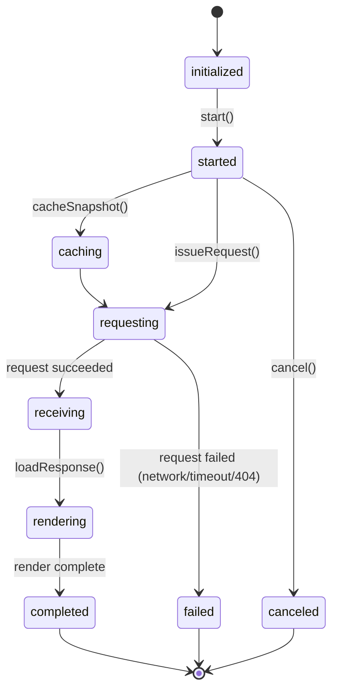
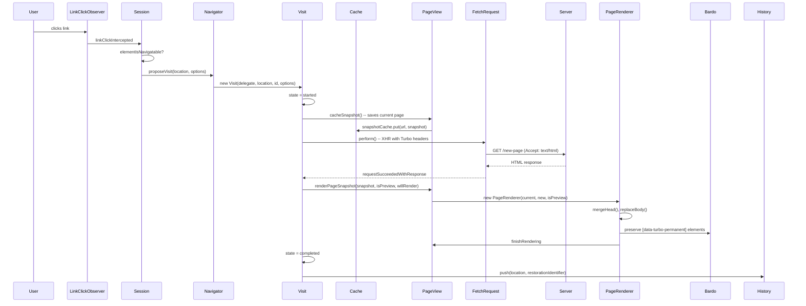

# Turbo Drive: SPA Navigation, Snapshot Cache, and Visit Lifecycle

Turbo Drive intercepts link clicks and form submissions, fetches responses via XHR, caches the current page snapshot, and replaces the body. This gives SPA-like navigation (no full page reload, instant back navigation) without a client-side router or JavaScript framework. The entire system is coordinated by the `Session` class, which owns the `Navigator`, `History`, `PageView`, `BrowserAdapter`, and ten observer instances.

Source: `src/core/` and `src/core/drive/` in [hotwired/turbo](https://github.com/hotwired/turbo) v8.0.13.

## Session: The Central Coordinator

The `Session` class is the hub. It creates and manages every subsystem, serves as the delegate for all of them, and dispatches all application-level events.

Source: `src/core/session.js`

```javascript
// src/core/session.js
class Session {
  navigator = new Navigator(this)
  history = new History(this)
  view = new PageView(this, document.documentElement)
  adapter = new BrowserAdapter(this)
  pageObserver = new PageObserver(this)
  cacheObserver = new CacheObserver(this)
  linkPrefetchObserver = new LinkPrefetchObserver(this)
  linkClickObserver = new LinkClickObserver(this)
  formSubmitObserver = new FormSubmitObserver(this)
  scrollObserver = new ScrollObserver(this)
  streamObserver = new StreamObserver(this)
  formLinkClickObserver = new FormLinkClickObserver(this)
  frameRedirector = new FrameRedirector(this, document.documentElement)
  streamMessageRenderer = new StreamMessageRenderer(this)
  cache = new Cache(this)
  enabled = true
  started = false
  #pageRefreshDebouncePeriod = 150

  constructor(recentRequests)
  start() / stop() / disable()
  registerAdapter(adapter)
  visit(location, options = {})
  refresh(url, requestId)
  connectStreamSource(source) / disconnectStreamSource(source)
  renderStreamMessage(message)
  clearCache()
  // Properties: progressBarDelay, drive, formMode, location, restorationIdentifier
}
```

The `start()` method activates everything:

Source: `src/core/session.js:21`

```javascript
// src/core/session.js:52
start() {
  if (!this.started) {
    this.pageObserver.start()
    this.cacheObserver.start()
    this.linkPrefetchObserver.start()
    this.formLinkClickObserver.start()
    this.linkClickObserver.start()
    this.formSubmitObserver.start()
    this.scrollObserver.start()
    this.streamObserver.start()
    this.frameRedirector.start()
    this.history.start()
    this.preloader.start()
    this.started = true
    this.enabled = true
  }
}
```

Aha: The `Session` does not just delegate -- it is the delegate for 10+ subsystems simultaneously. The `LinkPrefetchObserver`, `LinkClickObserver`, `FormSubmitObserver`, `ScrollObserver`, `StreamObserver`, `History`, `PageView`, `BrowserAdapter`, and `Preloader` all call back to `Session` methods. This centralized delegation pattern means the Session has a complete view of every navigation event, prefetch, scroll position, and form submission on the page. No subsystem communicates directly with another. All communication flows through the Session.

## Visit Lifecycle

A `Visit` represents one navigation action. It goes through five states: `initialized` -> `started` -> `completed` (or `failed`/`canceled`).

Source: `src/core/drive/visit.js`

```javascript
// src/core/drive/visit.js
const VisitState = { initialized, started, canceled, failed, completed }
const SystemStatusCode = { networkFailure: 0, timeoutFailure: -1, contentTypeMismatch: -2 }
const Direction = { advance: "forward", restore: "back", replace: "none" }
const TimingMetric = { visitStart, requestStart, requestEnd, visitEnd }

const defaultOptions = {
  action: "advance",
  historyChanged: false,
  visitCachedSnapshot: () => {},
  willRender: true,
  updateHistory: true,
  shouldCacheSnapshot: true,
  acceptsStreamResponse: false
}

class Visit {
  identifier = uuid()
  timingMetrics = {}
  followedRedirect = false
  historyChanged = false
  scrolled = false
  shouldCacheSnapshot = true
  acceptsStreamResponse = false
  snapshotCached = false
  state = VisitState.initialized
  viewTransitioner = new ViewTransitioner()

  constructor(delegate, location, restorationIdentifier, options = {})
  start() / cancel() / complete() / fail()
  changeHistory()
  issueRequest() / simulateRequest() / startRequest() / recordResponse() / finishRequest()
  loadResponse() / getCachedSnapshot() / getPreloadedSnapshot() / hasCachedSnapshot() / loadCachedSnapshot()
  followRedirect() / goToSamePageAnchor()
  performScroll() / scrollToRestoredPosition() / scrollToAnchor()
  recordTimingMetric(metric) / getTimingMetrics()
  shouldIssueRequest() / cacheSnapshot() / render(callback) / renderPageSnapshot() / cancelRender()
}
```

The visit lifecycle follows this flow:



## Visit Flow: Click to Rendered Page



## SnapshotCache: LRU Page Cache

The `SnapshotCache` is an LRU cache with a default size of 10. It stores `PageSnapshot` objects keyed by URL location.

Source: `src/core/drive/snapshot_cache.js`

```javascript
// src/core/drive/snapshot_cache.js
class SnapshotCache {
  keys = []
  snapshots = {}

  constructor(size = 10) { this.size = size }

  has(location) { return location in this.snapshots }

  get(location) {
    if (this.has(location)) {
      // Move to front (most recently used)
      const index = this.keys.indexOf(location)
      this.keys.splice(index, 1)
      this.keys.unshift(location)
      return this.snapshots[location]
    }
  }

  put(location, snapshot) {
    if (!this.has(location)) {
      this.trim()  // evict oldest if at capacity
      this.keys.unshift(location)
    }
    this.snapshots[location] = snapshot
  }

  clear() {
    this.keys = []
    this.snapshots = {}
  }

  trim() {
    const excess = this.keys.length - this.size
    for (let i = 0; i < excess; i++) {
      const oldest = this.keys.pop()
      delete this.snapshots[oldest]
    }
  }
}
```

Aha: The cache uses parallel data structures: a `keys` array for ordering and a `snapshots` object for O(1) lookup. On each `get()`, the accessed key is moved to the front of the `keys` array (most-recently-used position). On each `put()`, if the cache is full, `trim()` evicts the oldest keys (end of array). This is the classic LRU cache pattern implemented with minimal overhead. The cache stores the full `PageSnapshot` (the parsed DOM tree), so restoring from cache is instant -- no network request needed.

## PageView: The DOM Renderer

`PageView` extends the base `View` class and adds snapshot caching, preview rendering, and scroll position management.

Source: `src/core/drive/page_view.js`

```javascript
// src/core/drive/page_view.js
class PageView extends View {
  snapshotCache = new SnapshotCache(10)
  lastRenderedLocation = new URL(location.href)
  forceReloaded = false

  shouldTransitionTo(newSnapshot) {
    // Checks <meta name="view-transition"> on both snapshots
    // and prefers-reduced-motion media query
  }

  renderPageSnapshot(snapshot, isPreview, willRender, visit) {
    const renderer = new PageRenderer(this.snapshot, snapshot, isPreview, willRender)
    return this.render(renderer)
  }

  isPageRefresh(visit) {
    // Checks if the visit URL matches the current location
  }

  shouldPreserveScrollPosition(visit) {
    // Checks turbo-refresh meta for scroll preservation
  }

  async cacheSnapshot(snapshot) {
    if (snapshot.isCacheable) {
      this.snapshotCache.put(location, snapshot)
    }
  }
}
```

## PageRenderer: Head Merge and Body Replace

The `PageRenderer` handles the complex task of replacing the page body while preserving the head element's scripts, stylesheets, and metadata.

Source: `src/core/drive/page_renderer.js`

```javascript
// src/core/drive/page_renderer.js
class PageRenderer extends Renderer {
  async prepareToRender() {
    this.setLanguage()
    await this.mergeHead()  // diff head elements, add/remove scripts and styles
  }

  async render() {
    if (this.shouldRender) {
      await this.replaceBody()
    }
  }

  finishRendering() {
    if (!this.isPreview) {
      this.focusFirstAutofocusableElement()
    }
  }

  async mergeHead() {
    this.copyNewHeadStylesheetElements()
    this.copyNewHeadScriptElements()
    this.removeUnusedDynamicStylesheetElements()
  }

  async replaceBody() {
    this.activateNewBody()
    await this.assignNewBody()
    this.activateNewBodyScriptElements()
  }
}
```

The head merge process is critical. When navigating from page A to page B, the head elements may differ. The `PageRenderer` calculates which `<script>` and `<link rel="stylesheet">` elements are in the new head but not in the old head, and adds them. It also removes dynamic stylesheet elements that are no longer needed.

## History: PushState and Restoration

The `History` class wraps `history.pushState()` and `history.replaceState()`, tracking restoration identifiers for back/forward navigation.

Source: `src/core/drive/history.js`

```javascript
// src/core/drive/history.js
class History {
  location
  restorationIdentifier = uuid()
  restorationData = {}
  started = false
  pageLoaded = false
  currentIndex = 0

  push(location, restorationIdentifier) {
    this.update("push", location, restorationIdentifier)
  }

  replace(location, restorationIdentifier) {
    this.update("replace", location, restorationIdentifier)
  }

  getRestorationDataForIdentifier(id) {
    return this.restorationData[id] || {}
  }

  onPopState(event) {
    // Fires turbo:before-restore event
    // Calls delegate.proposeVisit with restore action
  }

  assumeControlOfScrollRestoration() {
    history.scrollRestoration = "manual"
  }
}
```

The `restorationIdentifier` is a UUID stored with each history entry. When the user navigates back, the `onPopState` handler uses the restoration identifier to look up the cached snapshot and render it without a network request.

## ProgressBar: The Tricking Progress Bar

The `ProgressBar` appears after a configurable delay (default 500ms) and uses a trickling algorithm to simulate progress.

Source: `src/core/drive/progress_bar.js`

```javascript
// src/core/drive/progress_bar.js
class ProgressBar {
  static animationDuration = 300  // ms
  hiding = false
  value = 0
  visible = false

  show() {
    this.visible = true
    this.hiding = false
    this.startTrickling()
  }

  hide() {
    this.hiding = true
    this.setValue(1)
    this.stopTrickling()
  }

  startTrickling() {
    this.trickleInterval = setInterval(() => {
      this.value += Math.random() / 100
      if (this.value > 1) this.value = 1
      this.refresh()
    }, ProgressBar.animationDuration)
  }

  refresh() {
    this.element.style.width = `${10 + this.value * 90}%`
  }
}
```

Aha: The progress bar never reaches 100% during trickling. It increments by `Math.random() / 100` every 300ms, which means it asymptotically approaches but never reaches the maximum. This creates a realistic "something is happening" feel without promising a specific completion time. When the response arrives, `setValue(1)` jumps to 100%, and the bar slides off screen.

## FormSubmission: Handling Form Posts

`FormSubmission` handles form submissions with the same visit lifecycle as link navigation.

Source: `src/core/drive/form_submission.js`

```javascript
// src/core/drive/form_submission.js
const FormSubmissionState = { initialized, requesting, waiting, receiving, stopping, stopped }

class FormSubmission {
  state = FormSubmissionState.initialized
  static confirmMethod(message) { return Promise.resolve(confirm(message)) }

  constructor(delegate, formElement, submitter, mustRedirect = false)

  async start() {
    // 1. Check data-turbo-confirm
    // 2. Read CSRF token, add X-CSRF-Token header
    // 3. Call fetchRequest.perform()
  }

  // FetchRequest delegate methods:
  //   prepareRequest -- adds CSRF token, checks for stream response
  //   requestStarted -- dispatches turbo:submit-start
  //   requestSucceededWithResponse -- processes response
  //   requestFailedWithResponse -- handles error status codes
  //   requestFinished -- dispatches turbo:submit-end
}
```

## Config: Drive and Forms

Turbo has two main configuration objects that control behavior.

Source: `src/core/config/drive.js`

```javascript
// src/core/config/drive.js
export const drive = {
  enabled: true,
  progressBarDelay: 500,
  unvisitableExtensions: new Set([
    ".7z", ".aac", ".apk", ".avi", ".bmp", ".bz2", ".css", ".csv", ".deb", ".dmg",
    ".doc", ".docx", ".exe", ".gif", ".gz", ".heic", ".heif", ".ico", ".iso",
    ".jpeg", ".jpg", ".js", ".json", ".m4a", ".mkv", ".mov", ".mp3", ".mp4",
    ".mpeg", ".mpg", ".msi", ".ogg", ".ogv", ".pdf", ".pkg", ".png", ".ppt",
    ".pptx", ".rar", ".rtf", ".svg", ".tar", ".tif", ".tiff", ".txt", ".wav",
    ".webm", ".webp", ".wma", ".wmv", ".xls", ".xlsx", ".xml", ".zip"
  ])
}
```

The `unvisitableExtensions` set prevents Turbo from intercepting links to binary files. These 54 extensions are always handled as full page navigations rather than XHR fetches. Note: `drive` is a plain object, NOT wrapped in `Config` like `forms` is.

Source: `src/core/config/forms.js`

```javascript
// src/core/config/forms.js
class Config {
  #submitter = null
  constructor(config) { Object.assign(this, config) }
  get submitter() { return this.#submitter }
  set submitter(value) { this.#submitter = submitter[value] || value }
}

export const forms = new Config({
  mode: "on",          // "on" | "off" | "optin"
  submitter: "disabled" // or "aria-disabled" or custom object
})
```

The `mode` setting controls form submission behavior:
- `"on"` -- all forms with `method="post"` (or other non-GET methods) go through Turbo
- `"off"` -- no forms go through Turbo
- `"optin"` -- only forms with `data-turbo="true"` go through Turbo

The `submitter` setting is transformed by the `Config` class into an object with `beforeSubmit` and `afterSubmit` callbacks. `"disabled"` sets `submitter.disabled = true/false`, while `"aria-disabled"` sets the `aria-disabled` attribute.

## Bardo: Permanent Element Preservation

The `Bardo` class preserves elements across renders using a placeholder pattern. Elements with `data-turbo-permanent` are kept in the DOM and moved into the new page.

Source: `src/core/bardo.js`

```javascript
// src/core/bardo.js
class Bardo {
  static async preservingPermanentElements(delegate, permanentElementMap, callback) {
    const bardo = new Bardo(delegate, permanentElementMap)
    bardo.enter()
    await callback()
    bardo.leave()
  }

  enter() {
    for (const element of this.permanentElements) {
      this.replaceNewPermanentElementWithPlaceholder(element)
    }
  }

  leave() {
    for (const element of this.permanentElements) {
      this.replaceCurrentPermanentElementWithClone(element)
      this.replacePlaceholderWithPermanentElement(element)
    }
  }
}
```

During `enter()`, permanent elements in the new page are replaced with `<meta name="turbo-permanent-placeholder" id="...">` markers. During `leave()`, the current permanent elements are cloned and swapped back into the new page. This preserves video players, maps, and other stateful elements across navigation.

## MorphingPageRenderer: Idiomorph Integration

Turbo v8 supports morphing as an alternative to full body replacement.

Source: `src/core/drive/morphing_page_renderer.js`

```javascript
// src/core/drive/morphing_page_renderer.js
class MorphingPageRenderer extends PageRenderer {
  static renderElement(currentElement, newElement) {
    morphElements(currentElement, newElement)  // uses Idiomorph library
    dispatch("turbo:morph", { currentElement, newElement })
  }

  get renderMethod() { return "morph" }
  get shouldAutofocus() { return false }  // morphing preserves focus

  async preservingPermanentElements(callback) {
    callback()  // no-op: morphing handles permanent elements natively
  }
}
```

Morphing is enabled when the page has `<meta name="turbo-refresh-method" content="morph">`. Instead of replacing the body, Turbo uses the Idiomorph library to morph the current DOM tree to match the new one. This preserves focus, selection, and element state that would be lost with full replacement.

## PrefetchCache: Hover-Based Preloading

`LinkPrefetchObserver` watches for mouse hover on links and preloads the page.

Source: `src/core/drive/prefetch_cache.js`

```javascript
// src/core/drive/prefetch_cache.js
const cacheTtl = 10 * 1000  // 10 seconds
const prefetchDelay = 100   // 100ms

class PrefetchCache {
  get(url) / set(url, request, ttl) / clear()
}
```

When the user hovers over a link for 100ms, Turbo issues a GET request with `X-Sec-Purpose: prefetch` header. If the user clicks the link within 10 seconds, the cached response is used instantly. If the mouse leaves before 100ms, the request is cancelled.

## Key Constants Summary

| Constant | Value | Source |
|----------|-------|--------|
| `SnapshotCache` default size | `10` | `snapshot_cache.js` |
| `ProgressBar.animationDuration` | `300ms` | `progress_bar.js` |
| `ProgressBar` default delay | `500ms` | `config/drive.js` |
| `PrefetchCache` TTL | `10000ms` | `prefetch_cache.js` |
| `Prefetch delay` | `100ms` | `prefetch_cache.js` |
| `Page refresh debounce` | `150ms` | `session.js:259` |
| `LimitedSet` max size | `20` (recent requests) | `limited_set.js` |
| `Drive enabled` | `true` | `config/drive.js` |
| `Forms mode` | `"on"` | `config/forms.js` |
| `Unvisitable extensions` | 54 extensions | `config/drive.js` |
| `Visit action default` | `"advance"` | `visit.js` |

## Next

Turbo Frames and Streams enable partial-page updates that do not require full page navigation. See [Turbo Frames & Streams](05-turbo-frames-streams.md) for details. For the overall Hotwire ecosystem context, see [Overview](00-overview.md).
