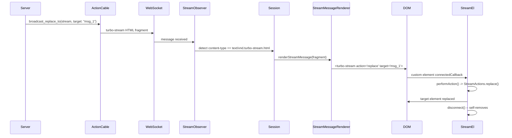

# Turbo Frames & Streams: Partial-Page Updates and WebSocket-Driven Live DOM

Turbo Frames divide the page into independently loadable sections. Clicking a link inside a frame only updates that frame's content. Turbo Streams broadcast HTML fragments over WebSockets and apply them to the DOM using seven built-in actions (append, prepend, replace, update, remove, before, after). Together, they enable partial-page updates without full page navigation or client-side JavaScript frameworks.

Source: `src/core/frames/`, `src/core/streams/`, `src/elements/`, and `src/observers/` in [hotwired/turbo](https://github.com/hotwired/turbo) v8.0.13.

## Turbo Frame: Independent Sections

The `<turbo-frame>` custom element wraps a portion of the page. When a link or form inside the frame is activated, only the frame's content is replaced. The rest of the page remains unchanged.

Source: `src/elements/frame_element.js`

```javascript
// src/elements/frame_element.js
const FrameLoadingStyle = { eager: "eager", lazy: "lazy" }

class FrameElement extends HTMLElement {
  static delegateConstructor = undefined
  static observedAttributes = ["disabled", "loading", "src"]
  loaded = Promise.resolve()

  constructor() {
    super()
    this.delegate = new FrameElement.delegateConstructor(this)
  }

  connectedCallback() {
    if (this.loadingStyle == FrameLoadingStyle.lazy) {
      this.appearanceObserver = new AppearanceObserver(this, this)
      this.appearanceObserver.start()
    }
    this.delegate.connect()
  }

  disconnectedCallback() {
    this.delegate.disconnect()
  }

  attributeChangedCallback(name) {
    if (name == "disabled") this.delegate.disabledChanged()
    if (name == "loading") this.delegate.loadingStyleChanged()
    if (name == "src") this.delegate.sourceURLChanged()
  }

  reload() { this.delegate.sourceURLReloaded() }

  // Properties:
  // src, refresh, loading, disabled, autoscroll, complete, isActive, isPreview
}

customElements.define("turbo-frame", FrameElement)
FrameElement.delegateConstructor = FrameController
```

The `FrameElement` delegates all behavior to `FrameController`. The `static observedAttributes` array ensures that `attributeChangedCallback` fires for `disabled`, `loading`, and `src` changes.

Aha: The `delegateConstructor` pattern is clever. The custom element class does not know which controller class will handle it. Instead, `FrameElement.delegateConstructor = FrameController` is set before `customElements.define()` is called. This decouples the element definition from the controller implementation and allows the same element to be reconfigured if needed.

## FrameController: The Frame Logic Engine

The `FrameController` manages frame loading, navigation, and form submission.

Source: `src/core/frames/frame_controller.js`

```javascript
// src/core/frames/frame_controller.js
class FrameController {
  fetchResponseLoaded = (_fetchResponse) => Promise.resolve()
  action = null

  constructor(element) {
    this.element = element
    this.view = new FrameView(this, this.element)
    this.appearanceObserver = new AppearanceObserver(this, this.element)
    this.formLinkClickObserver = new FormLinkClickObserver(this, this.element)
    this.linkInterceptor = new LinkInterceptor(this, this.element)
    this.formSubmitObserver = new FormSubmitObserver(this, this.element)
    this.restorationIdentifier = uuid()
  }

  connect() {
    this.linkInterceptor.start()
    this.formSubmitObserver.start()
    this.formLinkClickObserver.start()
    if (this.element.hasAttribute("loading")) {
      this.loadingStyleChanged()
    }
    if (this.sourceURL) {
      this.#loadSourceURL()
    }
  }

  disconnect() {
    this.linkInterceptor.stop()
    this.formSubmitObserver.stop()
    this.formLinkClickObserver.stop()
  }

  // FetchRequest delegate -- prepares request with Turbo-Frame header
  prepareRequest(request) {
    request.headers["Turbo-Frame"] = this.element.id
  }

  // View delegate -- dispatches turbo:before-frame-render
  allowsImmediateRender(snapshot, options) {
    const event = dispatch("turbo:before-frame-render", { cancelable: true, detail: { ... } })
    return !event.defaultPrevented
  }

  async #loadSourceURL() {
    const response = await fetch(this.sourceURL, {
      headers: { "Turbo-Frame": this.element.id }
    })
    const html = await response.text()
    this.#loadFrameResponse(html)
  }

  async #handleFrameMissingFromResponse(fetchResponse) {
    // If response doesn't contain matching <turbo-frame id="...">,
    // try to find it in nested frames (recurse attribute)
    const frame = await this.extractForeignFrameElement(fetchResponse.responseHTML)
    if (frame) {
      this.#loadFrameResponse(frame.innerHTML)
    }
  }

  async extractForeignFrameElement(container) {
    // Supports recurse="frame_id" attribute to find frames within frames
    const id = this.element.getAttribute("recurse")
    if (id) {
      return container.querySelector(`turbo-frame[id="${id}"]`)
    }
  }
}
```

The `Turbo-Frame` header in every request tells the server which frame is being requested. The server can respond with just the frame content (when `turbo_frame_request?` is true in Rails) instead of the full page. This is the key to efficient partial updates.

## Frame Loading Styles

Frames support two loading styles:

| Style | Behavior |
|-------|----------|
| `eager` (default) | Loads immediately when the element connects to the DOM |
| `lazy` | Defers loading until the frame enters the viewport (via `AppearanceObserver`) |

Lazy frames use an `IntersectionObserver` to detect when they become visible. This is useful for below-the-fold content that should not be loaded until the user scrolls to it.

```html
<turbo-frame id="comments" src="/comments" loading="lazy">
  Loading comments...
</turbo-frame>
```

## LinkInterceptor: Click Routing Within Frames

The `LinkInterceptor` intercepts clicks on links within the frame and routes them through the frame controller instead of Turbo Drive.

Source: `src/core/frames/link_interceptor.js`

```javascript
// src/core/frames/link_interceptor.js
class LinkInterceptor {
  constructor(delegate, element) {
    this.delegate = delegate
    this.element = element
  }

  start() {
    this.element.addEventListener("click", this.clickBubbled)
    document.addEventListener("turbo:click", this.linkClicked)
    document.addEventListener("turbo:before-visit", this.willVisit)
  }

  stop() {
    this.element.removeEventListener("click", this.clickBubbled)
    document.removeEventListener("turbo:click", this.linkClicked)
    document.removeEventListener("turbo:before-visit", this.willVisit)
  }

  clickEventIsSignificant(event) {
    // Returns false if the click is inside a turbo-frame with a different id
    // (the frame should handle it, not Turbo Drive)
    return !(event.target?.closest("turbo-frame")?.id != this.element.id)
  }
}
```

## Stream Element: The Custom Element

`<turbo-stream>` is a custom element that applies DOM operations when connected.

Source: `src/elements/stream_element.js`

```javascript
// src/elements/stream_element.js
class StreamElement extends HTMLElement {
  static async renderElement(newElement) {
    await newElement.performAction()
  }

  async connectedCallback() {
    await this.render()
    this.disconnect()  // self-removes after action
  }

  async render() {
    // Fires turbo:before-stream-render event
    // Allows custom render() override via event.detail.render
    const event = new CustomEvent("turbo:before-stream-render", {
      cancelable: true,
      bubbles: true,
      detail: { newStream: this, render: StreamElement.renderElement }
    })
    this.dispatchEvent(event)
    await event.detail.render(this)
  }

  disconnect() {
    if (this.parentElement) this.parentElement.removeChild(this)
  }

  get performAction() {
    if (this.action) {
      const actionFunction = StreamActions[this.action]
      if (actionFunction) return actionFunction
      this.#raise("unknown action")
    }
    this.#raise("action attribute is missing")
  }

  get targetElements() {
    if (this.target) {
      return this.targetElementsById
    } else if (this.targets) {
      return this.targetElementsByQuery
    } else {
      this.#raise("target or targets attribute is missing")
    }
  }

  get action() { return this.getAttribute("action") }
  get target() { return this.getAttribute("target") }
  get targets() { return this.getAttribute("targets") }
  get requestId() { return this.getAttribute("request-id") }
}

customElements.define("turbo-stream", StreamElement)
```

Aha: The `turbo:before-stream-render` event allows third-party code to completely override how a stream action is applied. The `detail.render` function defaults to `StreamElement.renderElement`, which calls `this.performAction()`. By overriding `detail.render`, you can apply morphing, animation, or any custom DOM operation instead of the default direct DOM manipulation.

## StreamActions: Seven Built-In Operations

Source: `src/core/streams/stream_actions.js`

```javascript
// src/core/streams/stream_actions.js
export const StreamActions = {
  after() {
    this.targetElements.forEach((e) => e.parentElement?.insertBefore(this.templateContent, e.nextSibling))
  },

  append() {
    this.removeDuplicateTargetChildren()
    this.targetElements.forEach((e) => e.append(this.templateContent))
  },

  before() {
    this.targetElements.forEach((e) => e.parentElement?.insertBefore(this.templateContent, e))
  },

  prepend() {
    this.removeDuplicateTargetChildren()
    this.targetElements.forEach((e) => e.prepend(this.templateContent))
  },

  remove() {
    this.targetElements.forEach((e) => e.remove())
  },

  replace() {
    const method = this.getAttribute("method")
    this.targetElements.forEach((targetElement) => {
      if (method === "morph") {
        morphElements(targetElement, this.templateContent)
      } else {
        targetElement.replaceWith(this.templateContent)
      }
    })
  },

  update() {
    const method = this.getAttribute("method")
    this.targetElements.forEach((targetElement) => {
      if (method === "morph") {
        morphChildren(targetElement, this.templateContent)
      } else {
        targetElement.innerHTML = ""
        targetElement.append(this.templateContent)
      }
    })
  },

  refresh() {
    // Calls session.refresh(baseURI, requestId) -- debounced page refresh
    session.refresh(this.baseURI, this.requestId)
  }
}
```

The `method="morph"` attribute on replace and update actions switches from direct DOM replacement to Idiomorph-based morphing. This preserves focus, selection, and element state.

## Stream Action Comparison

| Action | DOM Operation | Duplicates Removed | Morph Support |
|--------|--------------|-------------------|---------------|
| `append` | `target.append(content)` | Yes (by ID) | No |
| `prepend` | `target.prepend(content)` | Yes (by ID) | No |
| `update` | `target.innerHTML = content` | No | Yes |
| `replace` | `target.replaceWith(content)` | No | Yes |
| `remove` | `target.remove()` | N/A | No |
| `before` | `parent.insertBefore(content, target)` | No | No |
| `after` | `parent.insertBefore(content, target.nextSibling)` | No | No |
| `refresh` | `session.refresh(url)` | N/A | N/A |

## StreamMessage: WebSocket Content Detection

`StreamObserver` watches for responses with `text/vnd.turbo-stream.html` content type and converts them into stream messages.

Source: `src/core/streams/stream_message.js`

```javascript
// src/core/streams/stream_message.js
class StreamMessage {
  static contentType = "text/vnd.turbo-stream.html"

  static wrap(message) {
    if (typeof message == "string") {
      return new StreamMessage(createDocumentFragment(message))
    }
    return message
  }

  constructor(html) {
    this.contentType = StreamMessage.contentType
    this.fragment = createDocumentFragment(html)
  }
}
```

Source: `src/observers/stream_observer.js`

```javascript
// src/observers/stream_observer.js
// Listens for turbo:before-fetch-response event
// Checks response content-type header
// If text/vnd.turbo-stream.html, renders via StreamMessageRenderer
```

The `StreamMessageRenderer` wraps the `Bardo` system to preserve permanent elements while applying stream actions.

Source: `src/core/streams/stream_message_renderer.js`

```javascript
// src/core/streams/stream_message_renderer.js
class StreamMessageRenderer {
  render({ fragment }) {
    Bardo.preservingPermanentElements(this, getPermanentElementMap(), () => {
      document.documentElement.appendChild(fragment)
    })
  }
}
```

## Stream Source Element: WebSocket and SSE

The `<turbo-stream-source>` custom element connects to a WebSocket or Server-Sent Events source and feeds incoming messages into Turbo's stream system.

Source: `src/elements/stream_source_element.js`

```javascript
// src/elements/stream_source_element.js
class StreamSourceElement extends HTMLElement {
  streamSource = null

  connectedCallback() {
    if (this.src.startsWith("ws://") || this.src.startsWith("wss://")) {
      this.streamSource = new WebSocket(this.src)
    } else {
      this.streamSource = new EventSource(this.src)
    }
    // Connects to session via session.connectStreamSource(this.streamSource)
  }

  disconnectedCallback() {
    this.streamSource.close()
    session.disconnectStreamSource(this.streamSource)
  }

  get src() { return this.getAttribute("src") }
}

customElements.define("turbo-stream-source", StreamSourceElement)
```

Aha: The protocol detection is automatic. If the `src` attribute starts with `ws://` or `wss://`, a WebSocket is created. Otherwise, an `EventSource` (SSE) is used. This means the same `<turbo-stream-source>` element works with both transport protocols without any configuration.

## Morphing System: Idiomorph Integration

Turbo v8 integrates the Idiomorph library for DOM morphing. This is used in two places:

1. **MorphingPageRenderer** -- when the page has `<meta name="turbo-refresh-method" content="morph">`
2. **replace/update stream actions** -- when the `<turbo-stream>` has `method="morph"`

Source: `src/core/morphing.js`

```javascript
// src/core/morphing.js
function morphElements(currentElement, newElement, { callbacks, ...options }) {
  // Uses Idiomorph library
  idiomorph.morph(currentElement, newElement, {
    callbacks: new DefaultIdiomorphCallbacks(callbacks)
  })
}

function shouldRefreshFrameWithMorphing(currentFrame, newFrame) {
  return (
    currentFrame instanceof FrameElement &&
    currentFrame.shouldReloadWithMorph &&
    currentFrame.id == newFrame.id &&
    currentFrame.src == newFrame.src &&
    !isInPermanentElement(currentFrame)
  )
}

class DefaultIdiomorphCallbacks {
  beforeNodeAdded(node) {
    dispatch("turbo:before-morph-element", { cancelable: true, target: node })
  }
  beforeNodeMorphed(oldNode, newNode) {
    dispatch("turbo:before-morph-element", { cancelable: true, target: oldNode })
  }
  beforeAttributeUpdated(attributeName, node, mutationType) {
    dispatch("turbo:before-morph-attribute", { cancelable: true, detail: { attributeName, node, mutationType } })
  }
  afterNodeMorphed(node) {
    dispatch("turbo:morph-element", { target: node })
  }
}
```

The morphing callbacks dispatch events that allow user code to cancel or modify morph operations on specific elements.

## Frame Redirector: Top-Level Frame Routing

When a `<turbo-frame>` is at the top level (directly in `<body>`), the `FrameRedirector` intercepts all link clicks and form submissions within the frame and routes them through the frame controller.

Source: `src/core/frames/frame_redirector.js`

```javascript
// src/core/frames/frame_redirector.js
class FrameRedirector {
  constructor(session, element) {
    this.session = session
    this.element = element
    this.linkInterceptor = new LinkInterceptor(this, element)
    this.formSubmitObserver = new FormSubmitObserver(this, element)
  }

  start() {
    this.linkInterceptor.start()
    this.formSubmitObserver.start()
  }

  stop() {
    this.linkInterceptor.stop()
    this.formSubmitObserver.stop()
  }
}
```

## Custom Elements Registration

All three Turbo custom elements are registered in `src/elements/index.js`:

Source: `src/elements/index.js`

```javascript
// src/elements/index.js
FrameElement.delegateConstructor = FrameController

if (customElements.get("turbo-frame") == undefined) {
  customElements.define("turbo-frame", FrameElement)
}
if (customElements.get("turbo-stream") == undefined) {
  customElements.define("turbo-stream", StreamElement)
}
if (customElements.get("turbo-stream-source") == undefined) {
  customElements.define("turbo-stream-source", StreamSourceElement)
}
```

The `customElements.get()` check prevents double-registration when Turbo is loaded multiple times (e.g., via both ESM and script tag).

## Stream Event Lifecycle



## Recent Request Tracking

Every fetch request gets a `X-Turbo-Request-Id` header (UUID). The last 20 IDs are tracked in a `LimitedSet`.

Source: `src/core/drive/limited_set.js`

```javascript
// src/core/drive/limited_set.js
class LimitedSet extends Set {
  constructor(maxSize = 20) {
    super()
    this.maxSize = maxSize
  }
  add(value) {
    if (this.size >= this.maxSize) {
      const oldest = this.values().next().value
      this.delete(oldest)
    }
    super.add(value)
  }
}
```

The `refresh` stream action checks this set to avoid refreshing after its own request. This prevents infinite refresh loops when a stream action triggers a page refresh that triggers another stream action.

## Next

The native SDKs embed these web components inside native apps. See [Native iOS](06-native-ios.md) and [Native Android](07-native-android.md) for how native navigation integrates with Turbo. For the bridge protocol that connects web controllers to native components, see [Bridge Protocol](08-bridge-protocol.md).
