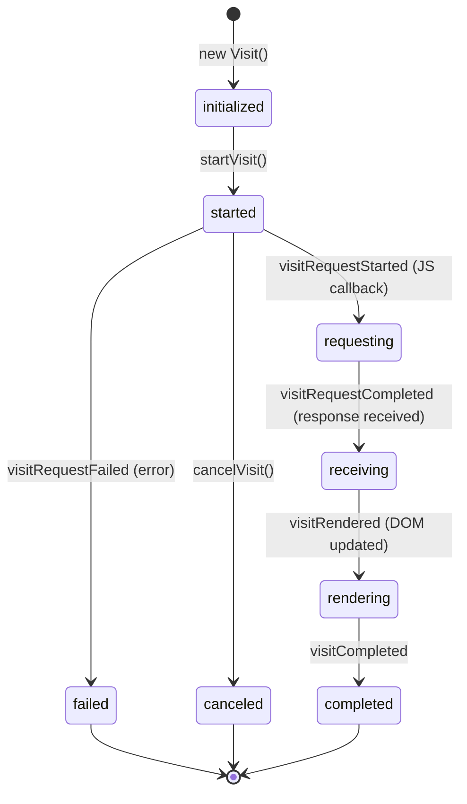
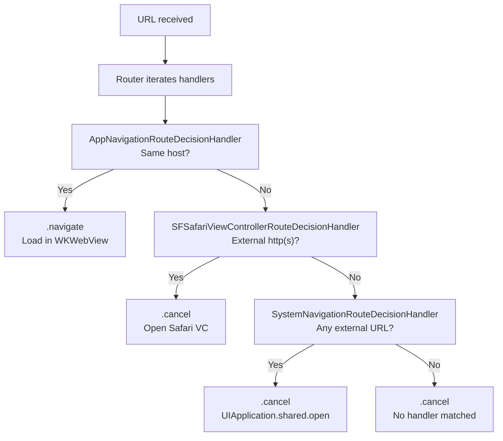

# Native iOS: Session, Navigator, and Visitable System

The hotwire-native-ios SDK wraps `WKWebView` with native navigation stacks, enabling a hybrid app where the server renders HTML and native Swift controls the navigation, appearance, and platform features. The architecture consists of three core concepts: `Session` (one web view per session), `Navigator` (routing and navigation stack management), and `Visitable` (protocol that view controllers implement to own a web view). A bidirectional `Bridge` enables communication between web content and native components.

Source: `Source/` in [hotwired/hotwire-native-ios](https://github.com/hotwired/hotwire-native-ios). Swift, iOS 14+.

## Session: One Web View Per Session

Each `Session` manages a single `WKWebView` instance. The session handles visits (both cold boot and JavaScript-driven), manages activation/deactivation of visitables, and dispatches lifecycle events to its delegate.

Source: `Source/Turbo/Session/Session.swift`

```swift
// Source/Turbo/Session/Session.swift
public class Session: NSObject {
    weak var delegate: SessionDelegate?
    let webView: WKWebView
    var pathConfiguration: PathConfiguration?
    var currentVisit: Visit?
    var topmostVisit: Visit?
    var previousVisit: Visit?
    var activatedVisitable: Visitable?
    var activeVisitable: Visitable?

    // Visit creation -- cold boot for first visit, JS-driven for subsequent
    func visit(_ visitable: Visitable, action: VisitAction)
    func visit(_ visitable: Visitable, options: VisitOptions?, reload: Bool)

    // Lifecycle management
    func reload()
    func clearSnapshotCache()
    func markSnapshotCacheAsStale()
    func activateVisitable(_ visitable: Visitable)
    func deactivateVisitable(_ visitable: Visitable, showScreenshot: Bool = true)
}
```

Aha: The Session uses a single `WKWebView` shared across all view controllers. When a view controller becomes active, the web view is attached to its `VisitableView`. When it becomes inactive, the web view is detached (but not destroyed). This means the web view's JavaScript state, DOM tree, and cookie store persist across all navigation. Only the visual attachment point changes. This is fundamentally different from creating a new web view per screen.

## Visitable: The Protocol for Web-View-Backed Controllers

`Visitable` is the protocol that any view controller must implement to participate in the Hotwire navigation system.

Source: `Source/Visitable/Visitable.swift`

```swift
// Source/Visitable/Visitable.swift
protocol VisitableDelegate: AnyObject {
    func visitableViewWillAppear(_ visitable: Visitable)
    func visitableViewDidAppear(_ visitable: Visitable)
    func visitableViewWillDisappear(_ visitable: Visitable)
    func visitableViewDidDisappear(_ visitable: Visitable)
    func visitableWillReload()
    func visitableDidRefresh()
}

protocol Visitable: AnyObject {
    var visitableViewController: UIViewController { get }
    var visitableDelegate: VisitableDelegate? { get set }
    var visitableView: VisitableView { get }
    var initialVisitableURL: URL { get }
    var currentVisitableURL: URL { get }
    func visitableDidRender()
    func showVisitableActivityIndicator()
    func hideVisitableActivityIndicator()
    func visitableDidActivateWebView(_ webView: WKWebView)
    func visitableWillDeactivateWebView()
    func visitableDidDeactivateWebView()
}
```

The `VisitableViewController` is the concrete implementation:

Source: `Source/Visitable/VisitableViewController.swift`

```swift
// Source/Visitable/VisitableViewController.swift
open class VisitableViewController: UIViewController, Visitable {
    let initialVisitableURL: URL
    var currentVisitableURL: URL  // resolved from webView.url or initial
    var appearReason: AppearReason       // .pushedOntoNavigationStack, .revealedByPop, .tabSelected, .revealedByModalDismiss
    var disappearReason: DisappearReason // .coveredByPush, .poppedFromNavigationStack, .tabDeselected, .coveredByModal
    lazy var visitableView: VisitableView { VisitableView() }
}
```

The `appearReason` and `disappearReason` enums track why a view controller appeared or disappeared. This is critical for detecting iOS native swipe gestures.

Aha: The `VisitableViewController` tracks appear/disappear reasons to detect native back-swipe gestures. When `disappearReason == .poppedFromNavigationStack` and the user swipes back, the `Session` knows to trigger a `.restore` visit (using the cached snapshot) instead of an `.advance` visit (fetching from the server). This is how the native SDK provides instant back navigation that matches Turbo's browser behavior.

## VisitableView: The Container View

`VisitableView` is the UIView that holds the web view and manages the progress indicator, refresh control, and screenshot cache.

Source: `Source/Visitable/VisitableView.swift`

```swift
// Source/Visitable/VisitableView.swift
open class VisitableView: UIView {
    var webView: WKWebView?
    var allowsPullToRefresh: Bool = true
    lazy var refreshControl: UIRefreshControl
    lazy var activityIndicatorView: UIActivityIndicatorView

    // Screenshot management
    var screenshotView: UIView?
    func updateScreenshot() -> UIImage?
    func showScreenshot()
    func hideScreenshot()
    func clearScreenshot()

    // WebView attachment
    func activateWebView(_ webView: WKWebView, forVisitable: Visitable)
    func deactivateWebView()
}
```

The web view attachment process adds the web view as a subview and sets its frame to fill the container. Detachment removes it. The screenshot is captured using `drawHierarchy(in:afterScreenUpdates:)` before detachment, so the user sees the previous page content during the transition animation.

## Visit System: Cold Boot and JavaScript Visits

The iOS SDK has two visit types, mirroring Turbo's browser behavior.

Source: `Source/Turbo/Visit/Visit.swift`

```swift
// Source/Turbo/Visit/Visit.swift
enum VisitState { case initialized, started, canceled, failed, completed }

class Visit: NSObject {  // abstract base
    weak var delegate: VisitDelegate?
    let visitable: Visitable
    let location: URL
    let options: VisitOptions
    let bridge: WebViewBridge
    var restorationIdentifier: String?
    var hasCachedSnapshot: Bool
    var isPageRefresh: Bool
    private(set) var state: VisitState

    func start() / cancel() / complete() / fail(with:) / cacheSnapshot()
    // Template methods: startVisit() / cancelVisit() / completeVisit() / failVisit()
}

protocol VisitDelegate: AnyObject {
    func visitDidStart(_ visit: Visit)
    func visitWillStart(_ visit: Visit)
    func visitDidComplete(_ visit: Visit)
    func visitDidFail(_ visit: Visit, error: Error)
    func visitDidCancel(_ visit: Visit)
    func visitWillLoadResponse(_ visit: Visit)
    func visitWillRender(_ visit: Visit)
    func visitDidRender(_ visit: Visit)
    func visitDidCacheSnapshot(_ visit: Visit)
    func visitableDidActivateWebView(_ visit: Visit)
    func visitableDidDeactivateWebView(_ visit: Visit)
    func visitableProposedVisit(_ visit: Visit)
}
```

Source: `Source/Turbo/Visit/ColdBootVisit.swift`

```swift
// Source/Turbo/Visit/ColdBootVisit.swift
final class ColdBootVisit: Visit {
    private(set) var navigation: WKNavigation?

    override func startVisit() {
        // Uses WKNavigationDelegate directly
        navigation = webView.load(URLRequest(url: location))
    }
}
```

Source: `Source/Turbo/Visit/JavaScriptVisit.swift`

```swift
// Source/Turbo/Visit/JavaScriptVisit.swift
final class JavaScriptVisit: Visit {
    var identifier: String  // UUID

    override func startVisit() {
        // Calls Turbo JS: visitLocation(location, options, restorationIdentifier)
        bridge.visitLocation(location, options: options, restorationIdentifier: restorationIdentifier)
    }
}
```



## Navigator: The Routing Orchestrator

The `Navigator` is the top-level routing entity. It owns two sessions (main + modal), manages two navigation stacks (main + modal), and routes URLs through a decision handler chain.

Source: `Source/Turbo/Navigator/Navigator.swift`

```swift
// Source/Turbo/Navigator/Navigator.swift
public class Navigator {
    weak var delegate: NavigatorDelegate?
    var rootViewController: UINavigationController
    var modalRootViewController: UINavigationController
    var activeNavigationController: UINavigationController { get }
    var activeWebView: WKWebView { get }
    private(set) var session: Session       // main session
    private(set) var modalSession: Session  // modal session

    func start()  // routes to configuration.startLocation
    func route(_ url: URL, options: VisitOptions?, parameters: [String: Any]?)
    func route(_ proposal: VisitProposal)
    func pop(animated: Bool)
    func clearAll(animated: Bool)
    func reload()
}

extension Navigator {
    struct Configuration {
        let name: String
        let startLocation: URL
    }
}
```

The Navigator owns two `Session` instances: one for main content and one for modal content. Each session has its own `WKWebView`. This allows modal views to have independent web state from the main content.

## Route Decision Handler Chain

When the Navigator receives a URL, it routes through a chain of `RouteDecisionHandler` instances. The first matching handler wins.

Source: `Source/Turbo/Navigator/Routing/RouteDecisionHandler.swift`

```swift
// Source/Turbo/Navigator/Routing/RouteDecisionHandler.swift
protocol RouteDecisionHandler {
    var name: String { get }
    func matches(location: URL, configuration: Navigator.Configuration) -> Bool
    func handle(location: URL, options: VisitOptions?, parameters: [String: Any]?,
                navigator: Navigator, configuration: Navigator.Configuration) -> Router.Decision
}

enum Router.Decision { case navigate, case cancel }
```

Built-in handlers:

| Handler | Matches | Action |
|---------|---------|--------|
| `AppNavigationRouteDecisionHandler` | Same host as configuration | `.navigate` (load in web view) |
| `SFSafariViewControllerRouteDecisionHandler` | External `http(s)` URL | `.cancel`, open `SFSafariViewController` |
| `SystemNavigationRouteDecisionHandler` | Any external URL | `.cancel`, open via `UIApplication.shared.open` |



## Navigation Hierarchy Controller

The `NavigationHierarchyController` translates visit proposals into UIKit navigation operations.

Source: `Source/Turbo/Navigator/NavigationHierarchyController.swift`

```swift
// Source/Turbo/Navigator/NavigationHierarchyController.swift
class NavigationHierarchyController {
    let navigationController: UINavigationController
    let modalNavigationController: UINavigationController
    enum NavigationStackType { case main, case modal }

    func route(controller: UIViewController, proposal: VisitProposal) {
        switch proposal.presentation {
        case .default:
            navigationController.pushViewController(controller, animated: proposal.animated)
        case .pop:
            navigationController.popViewController(animated: proposal.animated)
        case .replace:
            replaceLastViewController(with: controller)
        case .refresh:
            refreshLastViewController()
        case .clearAll:
            navigationController.popToRootViewController(animated: proposal.animated)
        case .replaceRoot:
            replaceRootViewController(with: controller)
        case .none:
            break  // no navigation
        }
    }
}
```

The presentation style is determined by the path configuration properties for the URL. See [Bridge Protocol](08-bridge-protocol.md) for the path configuration system.

## WebViewBridge: Turbo JS Injection

The `WebViewBridge` injects Turbo JavaScript into the web view and handles script message callbacks.

Source: `Source/WebView/WebViewBridge.swift`

```swift
// Source/WebView/WebViewBridge.swift
protocol WebViewDelegate: AnyObject {
    func webView(_ webView: WebViewBridge, didProposeVisit proposal: VisitProposal)
    func webView(_ webView: WebViewBridge, didProposeVisitToCrossOriginRedirect location: URL)
    func webView(_ webView: WebViewBridge, didFailRequestForVisitable visitable: Visitable, error: Error)
    func webViewDidLoadPage(_ webView: WebViewBridge)
    // ...
}

final class WebViewBridge {
    let webView: WKWebView
    weak var delegate: WebViewDelegate?
    weak var pageLoadDelegate: WebViewPageLoadDelegate?
    weak var visitDelegate: WebViewVisitDelegate?

    func visitLocation(_ location: URL, options: VisitOptions?, restorationIdentifier: String?)
    func clearSnapshotCache()
    func cacheSnapshot()
    func cancelVisit(withIdentifier identifier: String)
}
```

The bridge injects `turbo.js` as a `WKUserScript` at document start. Script messages from the web page are received via `WKScriptMessageHandler` and dispatched to the appropriate delegate.

## Script Message Types

The `ScriptMessage` enum lists all message types the web page can send to native.

Source: `Source/WebView/ScriptMessage.swift`

```swift
// Source/WebView/ScriptMessage.swift
struct ScriptMessage {
    let name: Name
    let data: [String: Any]

    enum Name: String {
        case pageLoaded
        case pageLoadFailed
        case visitProposed
        case visitStarted
        case visitRequestStarted
        case visitRequestCompleted
        case visitRequestFailed
        case visitRequestFinished
        case visitRendered
        case visitCompleted
        case formSubmissionStarted
        case formSubmissionFinished
        case pageInvalidated
        case errorRaised
        case log
        case visitProposalScrollingToAnchor
        case visitProposalRefreshingPage
    }
}
```

## VisitOptions and VisitProposal

Source: `Source/Turbo/Visit/VisitOptions.swift`

```swift
// Source/Turbo/Visit/VisitOptions.swift
struct VisitOptions: Codable {
    let action: VisitAction        // .advance, .replace, .restore
    let response: VisitResponse?   // response from previous visit (for error handling)
}

enum VisitAction: String, Codable {
    case advance
    case replace
    case restore
}

struct VisitResponse: Codable {
    let statusCode: Int
    let redirected: Bool
    var responseHTML: String?
    var isSuccessful: Bool { return statusCode >= 200 && statusCode < 300 }
}
```

Source: `Source/Turbo/Visit/VisitProposal.swift`

```swift
// Source/Turbo/Visit/VisitProposal.swift
struct VisitProposal {
    let url: URL
    let options: VisitOptions
    let properties: PathProperties     // from path configuration
    let parameters: [String: Any]?     // custom parameters

    // Extension properties (derived from PathProperties):
    var context: Navigation.Context             // .default or .modal
    var presentation: Navigation.Presentation   // .default, .push, .pop, .replace, etc.
    var modalStyle: Navigation.ModalStyle       // .medium, .large, .full, .pageSheet, .formSheet
    var pullToRefreshEnabled: Bool              // default: true
    var modalDismissGestureEnabled: Bool        // default: true
    var viewController: String                  // "web" -> VisitableViewController
    var animated: Bool                          // default: true
    var historicalLocation: Bool                // default: false
    var queryStringPresentation: Navigation.QueryStringPresentation
}
```

## Navigation Enums

Source: `Source/Turbo/Navigator/Helpers/Navigation.swift`

```swift
// Source/Turbo/Navigator/Helpers/Navigation.swift
enum Navigation {
    enum Context: String { case `default`, case modal }
    enum Presentation: String {
        case `default`, pop, replace, refresh, clearAll, replaceRoot, none
    }
    enum ModalStyle: String { case medium, large, full, pageSheet, formSheet }
    enum QueryStringPresentation: String { case `default`, replace }
}
```

## iOS-Specific Platform Features

| Feature | Implementation |
|---------|---------------|
| iOS 14+ minimum | Package.swift `platforms: [.iOS(.v14)]` |
| iOS 18+ `UITab` API | Conditional compilation in `HotwireTabBarController` |
| iOS 17.4+ SF Symbols | `widget.small` symbol used conditionally |
| iOS 16.4+ Web Inspector | `webView.isInspectable = true` in debug builds |
| UIKit-centric | All VCs are UIKit-based |
| SwiftUI | Only for error view (`UIHostingController`) |
| macCatalyst | Pull-to-refresh excluded via `#if !targetEnvironment(macCatalyst)` |
| Scene-based | Uses `UIWindowSceneDelegate` for scene lifecycle |

## HotwireConfig

The global configuration object controls SDK-wide settings.

Source: `Source/HotwireConfig.swift`

```swift
// Source/HotwireConfig.swift
public final class HotwireConfig {
    public var applicationUserAgentPrefix: String?
    public var makeWebView: (WKWebViewConfiguration) -> WKWebView
    public var makeCustomErrorView: () -> AnyView
    public var jsonEncoder: JSONEncoder
    public var jsonDecoder: JSONDecoder
    public var pathConfiguration: PathConfiguration
    public var router: Router
    public var webViewPolicyManager: WebViewPolicyManager
    public var defaultNavigationController: () -> UINavigationController
    public var backButtonDisplayMode: UINavigationItem.BackButtonDisplayMode
    public var showDoneButtonOnModals: Bool
    public var animateReplaceActions: Bool
    var debugLoggingEnabled: Bool
    var userAgent: String
}
```

## WebView Policy Chain

The `WebViewPolicyManager` intercepts `WKNavigationDelegate` decisions to prevent direct web navigation that should go through the native Navigator.

Source: `Source/Turbo/Navigator/WebViewPolicy/WebViewPolicyManager.swift`

```swift
// Source/Turbo/Navigator/WebViewPolicy/WebViewPolicyManager.swift
protocol WebViewPolicyDecisionHandler {
    var name: String { get }
    func matches(navigationAction: WKNavigationAction, configuration: Navigator.Configuration) -> Bool
    func handle(navigationAction: WKNavigationAction, navigator: Navigator, configuration: Navigator.Configuration) -> Decision
}

enum Decision { case cancel, case allow }
```

Built-in policy handlers:

| Handler | Matches | Decision |
|---------|---------|----------|
| `LinkActivatedWebViewPolicyDecisionHandler` | `linkActivated` in main frame | `.cancel` |
| `NewWindowWebViewPolicyDecisionHandler` | Requests new window | `.cancel` + route |
| `ExternalNavigationWebViewPolicyDecisionHandler` | External URL | `.cancel` + route |
| `ReloadWebViewPolicyDecisionHandler` | Page reload | `.cancel` + reload |

## Hotwire Entry Point

Source: `Source/Hotwire.swift`

```swift
// Source/Hotwire.swift
public enum Hotwire {
    static var bridgeComponentTypes: [BridgeComponent.Type]
    static var config: HotwireConfig

    static func registerBridgeComponents(_ componentTypes: [BridgeComponent.Type])
    static func registerRouteDecisionHandlers(_ handlers: [RouteDecisionHandler])
    static func registerWebViewPolicyDecisionHandlers(_ handlers: [WebViewPolicyDecisionHandler])
    static func loadPathConfiguration(from sources: [PathConfiguration.Source])
}
```

## Next

The Android SDK follows a similar architecture but uses Kotlin, fragments, and a shared WebView model. See [Native Android](07-native-android.md) for details. The bridge protocol that both SDKs share is covered in [Bridge Protocol](08-bridge-protocol.md).
