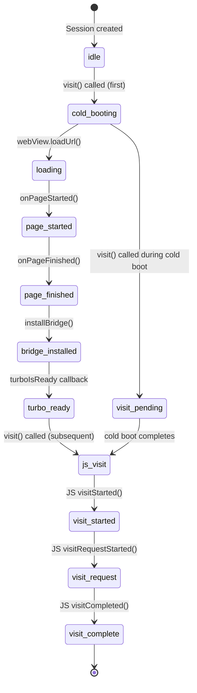

# Native Android: Session, Navigator, and Fragment-Based Navigation

The hotwire-native-android SDK uses a shared `WebView` across fragments, managed by a `Session` and orchestrated by a `Navigator` built on Android Jetpack Navigation. Unlike iOS (which creates a new session per navigation stack), Android shares one WebView instance across all destinations within a `NavigatorHost`. The navigation system uses fragments (`HotwireFragment`, `HotwireWebFragment`) and path configuration JSON to control presentation style.

Source: `core/` and `navigation-fragments/` in [hotwired/hotwire-native-android](https://github.com/hotwired/hotwire-native-android). Kotlin, min SDK 28, JVM target 17.

## Project Structure

The project is a multi-module Gradle build:

| Module | Namespace | Artifact |
|--------|-----------|----------|
| `core` | `dev.hotwire.core` | `dev.hotwire:core` |
| `navigation-fragments` | `dev.hotwire.navigation` | `dev.hotwire:navigation-fragments` |
| `demo` | (demo app) | - |

Build configuration:

Source: `build.gradle.kts`

```kotlin
// build.gradle.kts (root)
plugins {
    id("com.android.application") version "8.13.2"
    id("org.jetbrains.kotlin.android") version "2.3.0"
    id("org.jetbrains.kotlin.plugin.serialization") version "2.3.0"
}

// core/build.gradle.kts
android {
    compileSdk = 35
    minSdk = 28
    kotlinOptions { jvmTarget = "17" }
}
dependencies {
    implementation("com.squareup.okhttp3:okhttp:4.12.0")
    implementation("org.jetbrains.kotlinx:kotlinx-serialization-json:1.8.1")
    implementation("org.jetbrains.kotlinx:kotlinx-coroutines:1.10.1")
    implementation("com.google.code.gson:gson:2.12.1")
    implementation("androidx.webkit:webkit:1.13.0")
    implementation("com.google.android.material:material:1.12.0")
}
```

## Session: Shared WebView Manager

The `Session` class manages a single `HotwireWebView` instance shared across all destinations in a `NavigatorHost`.

Source: `core/src/main/kotlin/dev/hotwire/core/turbo/session/Session.kt`

```kotlin
// core/.../session/Session.kt
class Session(
    val sessionName: String,
    private val activity: AppCompatActivity,
    val webView: HotwireWebView
) {
    // Cold boot tracking
    private var isColdBooting = false
    private var visitPending = false
    private var isReady = false
    var coldBootVisitIdentifier = ""

    // Visit management
    fun visit(visit: Visit) {
        if (isColdBooting) {
            visitPending = true
            return
        }
        if (isReady) {
            visitLocation(visit)  // JS-driven visit
        } else {
            visitLocationAsColdBoot(visit)  // full page load
        }
    }

    fun reset() {
        restorationIdentifiers.clear()
        isReady = false
        isColdBooting = false
    }

    // WebView callback handling
    fun onPageStarted() { /* set isColdBooting */ }
    fun onPageFinished() { /* install bridge, mark ready */ }
    fun visitStarted(visitIdentifier, restorationIdentifier) { /* */ }
    fun visitRequestCompleted(visitIdentifier) { /* */ }
    fun visitRequestFailed(visitIdentifier) { /* */ }
    fun visitRendered(visitIdentifier) { /* */ }
    fun visitCompleted(visitIdentifier) { /* */ }
}
```

Aha: Android shares a single `WebView` across all fragments. The `HotwireView` container attaches and detaches the WebView during fragment transitions. This is different from iOS, where each `Session` has its own `WKWebView`. The Android approach means JavaScript state, cookies, and localStorage are truly shared across all screens. The trade-off is that modal sessions need separate handling (the SDK creates a second Session for modal contexts).

## Cold Boot vs JavaScript Visit Flow



## HotwireWebView: Custom WebView

Source: `core/src/main/kotlin/dev/hotwire/core/turbo/webview/HotwireWebView.kt`

```kotlin
// core/.../webview/HotwireWebView.kt
@SuppressLint("SetJavaScriptEnabled")
open class HotwireWebView @JvmOverloads constructor(
    context: Context,
    attrs: AttributeSet? = null
) : WebView(context, attrs) {
    init {
        settings.javaScriptEnabled = true
        settings.domStorageEnabled = true
        // ... additional settings
    }

    // JavaScript interface for native <-> web communication
    @JavascriptInterface
    fun visitCompleted(visitIdentifier: String) { /* */ }
}
```

The WebView enables JavaScript, DOM storage, and adds a JavaScript interface named "TurboSession" that the injected bridge uses to call native methods.

## HotwireWebFragment: The Base Fragment

Source: `navigation-fragments/src/main/java/dev/hotwire/navigation/fragments/HotwireWebFragment.kt`

```kotlin
// navigation-fragments/.../HotwireWebFragment.kt
open class HotwireWebFragment : HotwireFragment(), HotwireWebFragmentCallback {
    internal var delegate = HotwireWebFragmentDelegate(...)

    override fun onCreateView(inflater: LayoutInflater, container: ViewGroup?, savedInstanceState: Bundle?): View {
        return HotwireView(requireContext())
    }

    override fun onViewCreated(view: View, savedInstanceState: Bundle?) {
        delegate.onViewCreated()
    }

    override fun onResume() {
        super.onResume()
        delegate.onResume()
    }
}

interface HotwireWebFragmentCallback {
    val hotwireView: HotwireView?
    fun createErrorView(error: VisitError): View
    fun createProgressView(): View
    fun createWebChromeClient(session: Session): WebChromeClient
}
```

The `HotwireWebFragmentDelegate` handles the visit lifecycle:

Source: `navigation-fragments/src/main/java/dev/hotwire/navigation/fragments/HotwireWebFragmentDelegate.kt`

```kotlin
// navigation-fragments/.../HotwireWebFragmentDelegate.kt
internal class HotwireWebFragmentDelegate(
    private val delegate: HotwireDestination,
    private val session: Session,
    private val viewModel: HotwireFragmentViewModel
) : SessionCallback, VisitDestination {

    fun onViewCreated() {
        // Attaches WebView to HotwireView container
        val visit = Visit(
            location = delegate.location,
            destinationIdentifier = /* */,
            restoreWithCachedSnapshot = true,
            reload = false,
            callback = this,
            options = VisitOptions(action = VisitAction.ADVANCE)
        )
        session.visit(visit)
    }

    // SessionCallback implementations
    override fun onPageStarted() { /* show progress */ }
    override fun onPageFinished(location: String) { /* hide progress */ }
    override fun onReceivedError(error: VisitError) { /* show error view */ }
}
```

## HotwireView: The Container

`HotwireView` is a custom `FrameLayout` that manages the WebView attachment, progress indicator, screenshot cache, and error view.

Source: `navigation-fragments/src/main/java/dev/hotwire/navigation/views/HotwireView.kt`

```kotlin
// navigation-fragments/.../views/HotwireView.kt
class HotwireView : FrameLayout {
    fun attachWebView(onAttached: (Boolean) -> Unit) {
        // Adds the shared WebView as a child, sets LayoutParams to match parent
    }

    fun detachWebView(onDetached: () -> Unit) {
        // Removes WebView from this container
    }

    fun webViewIsAttached(): Boolean
    fun addProgressView()
    fun removeProgressView()
    fun addScreenshot()
    fun removeScreenshot()
    fun addErrorView(error: View)
    fun removeErrorView()
    fun currentOrientation(): Int
}
```

## HotwireViewScreenshotHolder: Screenshot Caching

Before detaching the WebView, a screenshot is captured for smooth transitions.

Source: `navigation-fragments/src/main/java/dev/hotwire/navigation/util/HotwireViewScreenshotHolder.kt`

```kotlin
// navigation-fragments/.../util/HotwireViewScreenshotHolder.kt
internal class HotwireViewScreenshotHolder {
    var currentlyZoomed = false
    fun reset()
    fun showScreenshotIfAvailable()

    suspend fun captureScreenshot(view: View): Bitmap? {
        // Uses PixelCopy.request() for hardware-accelerated capture
        // Checks memory availability (>20% remaining) before capturing
    }
}
```

The screenshot capture checks that the device has more than 20% of memory available before attempting. This prevents OOM errors on low-memory devices.

## Navigator: Jetpack Navigation Integration

The `Navigator` is built on Android Jetpack Navigation (`NavController`, `NavHostFragment`). It manages the navigation graph, determines presentation style from path configuration, and creates Sessions.

Source: `navigation-fragments/src/main/java/dev/hotwire/navigation/navigator/Navigator.kt`

```kotlin
// navigation-fragments/.../navigator/Navigator.kt
class Navigator(
    val host: NavigatorHost,
    val configuration: NavigatorConfiguration,
    val activity: HotwireActivity
) {
    val session: Session  // created via createNewSession() with custom WebView

    fun route(location: String, options: VisitOptions? = null,
              bundle: Bundle? = null, extras: NavigatorExtras? = null) {
        val rule = NavigatorRule(location, options, bundle, pathConfiguration, this)
        when (rule.navigationMode) {
            IN_CONTEXT -> navigateInContext(rule)
            TO_MODAL -> navigateToModal(rule)
            DISMISS_MODAL -> dismissModal(rule)
            REFRESH -> refresh()
            NONE -> {}
        }
    }

    fun pop() {
        if (currentDialogDestination != null) {
            currentDialogDestination?.closeDialog()
        } else {
            host.navController.popBackStack()
        }
    }

    fun clearAll() {
        host.navController.popBackStack(host.navController.graph.startDestinationId, false)
    }
}

data class NavigatorConfiguration(
    val name: String,
    val startLocation: String,
    @IdRes val navigatorHostId: Int
)
```

## NavigatorRule: Path-Based Navigation Decisions

The `NavigatorRule` evaluates path configuration properties to determine navigation behavior.

Source: `navigation-fragments/src/main/java/dev/hotwire/navigation/navigator/NavigatorRule.kt`

```kotlin
// navigation-fragments/.../navigator/NavigatorRule.kt
internal class NavigatorRule(
    location: String,
    visitOptions: VisitOptions?,
    bundle: Bundle?,
    pathConfiguration: PathConfiguration,
    navigator: Navigator
) {
    val currentContext = /* current destination's context */
    val newContext = pathConfiguration.properties(location).context
    val newPresentation = calculatePresentation()
    val newNavigationMode = calculateNavigationMode()
    val newModalResult = calculateModalResult()

    private fun calculatePresentation(): Presentation {
        return when {
            isSameDestination() -> REPLACE
            isPreviousDestination() -> POP
            else -> PUSH
        }
    }

    private fun calculateNavigationMode(): NavigatorMode {
        return when {
            newContext == MODAL && currentContext != MODAL -> TO_MODAL
            newContext != MODAL && currentContext == MODAL -> DISMISS_MODAL
            newPresentation == REFRESH -> REFRESH
            else -> IN_CONTEXT
        }
    }
}
```

## NavigatorMode and Presentation

Source: `core/src/main/kotlin/dev/hotwire/core/turbo/nav/Presentation.kt`

```kotlin
// core/.../nav/Presentation.kt
enum class Presentation {
    DEFAULT, PUSH, POP, REPLACE, CLEAR_ALL, REPLACE_ROOT, REFRESH, NONE
}

enum class PresentationContext { DEFAULT, MODAL }
enum class QueryStringPresentation { DEFAULT, REPLACE }
```

Source: `navigation-fragments/src/main/java/dev/hotwire/navigation/navigator/NavigatorMode.kt`

```kotlin
// navigation-fragments/.../navigator/NavigatorMode.kt
internal enum class NavigatorMode {
    IN_CONTEXT, TO_MODAL, DISMISS_MODAL, REFRESH, NONE
}
```

## Route Decision Handlers

Android uses the same route decision handler pattern as iOS.

Source: `navigation-fragments/src/main/java/dev/hotwire/navigation/routing/Router.kt`

```kotlin
// navigation-fragments/.../routing/Router.kt
class Router(private val decisionHandlers: List<RouteDecisionHandler>) {
    interface RouteDecisionHandler {
        val name: String
        fun matches(location: String, configuration: List<NavigatorConfiguration>): Boolean
        fun handle(location: String, navigator: Navigator, configuration: List<NavigatorConfiguration>): Decision
    }

    enum class Decision { NAVIGATE, CANCEL }

    fun getDecision(location: String): Decision {
        for (handler in decisionHandlers) {
            if (handler.matches(location, config)) {
                return handler.handle(location, navigator, config)
            }
        }
        return Decision.NAVIGATE  // default: navigate
    }
}
```

Built-in handlers:

| Handler | Matches | Decision |
|---------|---------|----------|
| `AppNavigationRouteDecisionHandler` | Same host | `NAVIGATE` |
| `BrowserTabRouteDecisionHandler` | External http(s) | `CANCEL` + open Custom Tab |
| `SystemNavigationRouteDecisionHandler` | Non-http external | `CANCEL` + startActivity |

## HotwireActivity: The Activity Base

Source: `navigation-fragments/src/main/java/dev/hotwire/navigation/activities/HotwireActivity.kt`

```kotlin
// navigation-fragments/.../activities/HotwireActivity.kt
abstract class HotwireActivity : AppCompatActivity() {
    lateinit var delegate: HotwireActivityDelegate

    abstract fun navigatorConfigurations(): List<NavigatorConfiguration>

    open fun onNavigatorReady(navigatorConfiguration: NavigatorConfiguration, navigator: Navigator) {}

    override fun onCreate(savedInstanceState: Bundle?) {
        super.onCreate(savedInstanceState)
        delegate = HotwireActivityDelegate(this)
    }
}
```

## HotwireActivityDelegate: Activity Lifecycle

```kotlin
// navigation-fragments/.../activities/HotwireActivityDelegate.kt
class HotwireActivityDelegate(val activity: HotwireActivity) {
    // Manages Navigator creation and registration
    // Creates Sessions with custom WebView per NavigatorConfiguration
}
```

## Fragment Types

| Fragment | Purpose |
|----------|---------|
| `HotwireFragment` | Base fragment implementing `HotwireDestination` |
| `HotwireBottomSheetFragment` | Bottom sheet dialog fragment |
| `HotwireWebFragment` | Web-backed fragment with WebView |
| `HotwireWebBottomSheetFragment` | Web-backed bottom sheet |

Source: `navigation-fragments/src/main/java/dev/hotwire/navigation/fragments/HotwireFragment.kt`

```kotlin
// navigation-fragments/.../HotwireFragment.kt
abstract class HotwireFragment : Fragment(), HotwireDestination {
    override val navigator: Navigator by lazy { /* find Navigator from Activity */ }
    override val location: String by lazy { /* from arguments */ }
    override val fragment: Fragment get() = this

    override fun toolbarForNavigation(): Toolbar? = null
    override fun shouldObserveTitleChanges(): Boolean = true
}
```

## HotwireDestination: The Destination Interface

Source: `navigation-fragments/src/main/java/dev/hotwire/navigation/destinations/HotwireDestination.kt`

```kotlin
// navigation-fragments/.../destinations/HotwireDestination.kt
interface HotwireDestination : BridgeDestination {
    val navigator: Navigator
    val fragment: Fragment
    val location: String
    val pathProperties: PathConfigurationProperties
    val fragmentViewModel: HotwireFragmentViewModel
    val isActive: Boolean
    val isModal: Boolean

    fun delegate(): HotwireWebFragmentDelegate?
    fun toolbarForNavigation(): Toolbar?
    fun shouldObserveTitleChanges(): Boolean
    fun onBeforeNavigation()
    fun refresh()
    fun customNavigatorForNavigation(): Navigator?
    fun customRouteDecision(): Router.Decision?
    fun customNavigationOptions(): NavigatorOptions?
    fun activityResultLauncher(): ActivityResultLauncher<Intent>?
    fun activityPermissionResultLauncher(): ActivityResultLauncher<String>?
}
```

## Path Configuration on Android

The Android path configuration system mirrors the iOS system.

Source: `core/src/main/kotlin/dev/hotwire/core/turbo/config/PathConfiguration.kt`

```kotlin
// core/.../config/PathConfiguration.kt
class PathConfiguration {
    data class Location(val assetFilePath: String?, val remoteFileUrl: String?)
    data class LoaderOptions(val httpHeaders: Map<String, String>)

    fun load(context: Context, location: Location, options: LoaderOptions) {
        // 1. Load bundled asset configuration immediately
        // 2. Download remote configuration asynchronously
        // 3. Cache remote config in SharedPreferences
    }

    fun properties(path: String): PathConfigurationProperties {
        // Iterates all rules, merges matching properties
    }
}
```

Loading flow:

Source: `core/.../config/PathConfigurationLoader.kt`

```kotlin
// core/.../config/PathConfigurationLoader.kt
internal class PathConfigurationLoader(val context: Context) : CoroutineScope {
    fun load(options: LoaderOptions, then: (PathConfigurationDecoder) -> Unit) {
        // 1. Load from asset file (immediate)
        val assetConfig = loadFromAsset(options.assetFilePath)
        then(assetConfig)

        // 2. Download from remote (async)
        val remoteConfig = repository.download(options.remoteFileUrl, options.httpHeaders)
        cacheInSharedPreferences(remoteConfig)
        then(remoteConfig)
    }
}
```

## File Chooser Integration

Android handles `<input type="file">` through the WebView's WebChromeClient.

Source: `core/src/main/kotlin/dev/hotwire/core/files/delegates/FileChooserDelegate.kt`

```kotlin
// core/.../files/delegates/FileChooserDelegate.kt
class FileChooserDelegate(val session: Session) : CoroutineScope {
    fun launchFileChooser() {
        // Opens chooser with camera and file browsing options
        // Files copied to app-private directory via HotwireFileProvider (FileProvider)
    }
}
```

The `HotwireFileProvider` is a `FileProvider` subclass that serves files from the app's private cache directory. The `UriHelper` class includes path traversal vulnerability protection in `writeFileTo()`.

## WebView Version Checking

Source: `core/src/main/kotlin/dev/hotwire/core/turbo/webview/WebViewVersionCompatibility.kt`

```kotlin
// core/.../webview/WebViewVersionCompatibility.kt
class WebViewVersionCompatibility {
    companion object {
        fun isOutdated(webViewInfo: WebViewInfo): Boolean {
            // Checks for Chromium 120+ (required for Rails 8)
            return webViewInfo.majorVersion < 120
        }

        fun displayUpdateDialogIfOutdated(context: Context, webViewInfo: WebViewInfo) {
            // Prompts user to update WebView via Play Store
        }
    }
}
```

## Bottom Tab Navigation

Android supports bottom tab navigation with independent navigation stacks per tab.

Source: `navigation-fragments/src/main/java/dev/hotwire/navigation/tabs/HotwireBottomNavigationController.kt`

```kotlin
// navigation-fragments/.../tabs/HotwireBottomNavigationController.kt
class HotwireBottomNavigationController(
    val activity: HotwireActivity,
    val view: BottomNavigationView,
    val tabConfigurations: List<HotwireBottomTab>
) : NavController.OnDestinationChangedListener {

    val currentTab: HotwireBottomTab
    var tabs: List<HotwireBottomTab>

    fun load()  // creates NavigatorHost per tab
    fun selectTab(tab: HotwireBottomTab)
    fun route(location: String)

    override fun onDestinationChanged(controller: NavController, destination: NavDestination, arguments: Bundle?) {
        // Hides bottom nav during modal contexts
    }
}
```

Each tab has its own `NavigatorHost` with an independent navigation stack. The bottom navigation bar hides during modal contexts and when the keyboard is visible.

## Day/Night Theming

Source: `core/src/main/kotlin/dev/hotwire/core/turbo/webview/HotwireWebView.kt`

```kotlin
// Uses WebViewCompat.FORCE_DARK and FORCE_DARK_STRATEGY for Android < 13
// On Android 13+, uses the system's automatic dark mode
```

## Pull-to-Refresh

Source: `navigation-fragments/src/main/java/dev/hotwire/navigation/views/HotwireSwipeRefreshLayout.kt`

```kotlin
// navigation-fragments/.../views/HotwireSwipeRefreshLayout.kt
class HotwireSwipeRefreshLayout : SwipeRefreshLayout {
    override fun canChildScrollUp(): Boolean {
        // Disabled when WebView is zoomed
        return webViewIsZoomed() || super.canChildScrollUp()
    }
}
```

Pull-to-refresh is enabled/disabled per path via the `pull_to_refresh_enabled` property from path configuration.

## Key Constants Summary

| Constant | Value | Source |
|----------|-------|--------|
| Min SDK | 28 (Android 9) | `core/build.gradle.kts` |
| Compile SDK | 35 | `core/build.gradle.kts` |
| JVM Target | 17 | `core/build.gradle.kts` |
| OkHttp | 4.12.0 | `core/build.gradle.kts` |
| kotlinx-serialization-json | 1.8.1 | `core/build.gradle.kts` |
| kotlinx-coroutines | 1.10.1 | `core/build.gradle.kts` |
| Navigation Fragment KTX | 2.8.9 | `navigation-fragments/build.gradle.kts` |
| WebView Chrome 120+ | Required for Rails 8 | `WebViewVersionCompatibility` |
| Screenshot memory threshold | 20% remaining | `HotwireViewScreenshotHolder` |

## Next

The bridge protocol that enables web-to-native communication is covered in [Bridge Protocol](08-bridge-protocol.md). The iOS SDK follows similar patterns with different platform APIs -- see [Native iOS](06-native-ios.md) for comparison.
