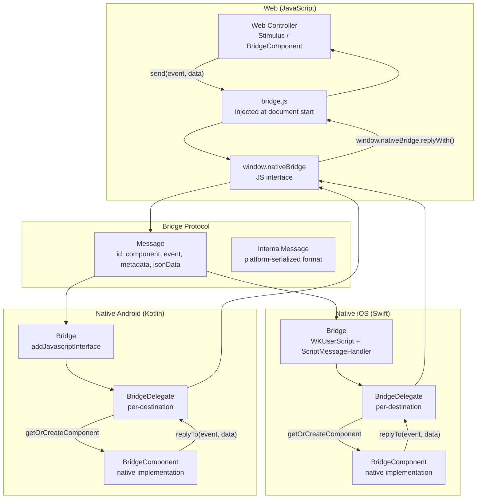
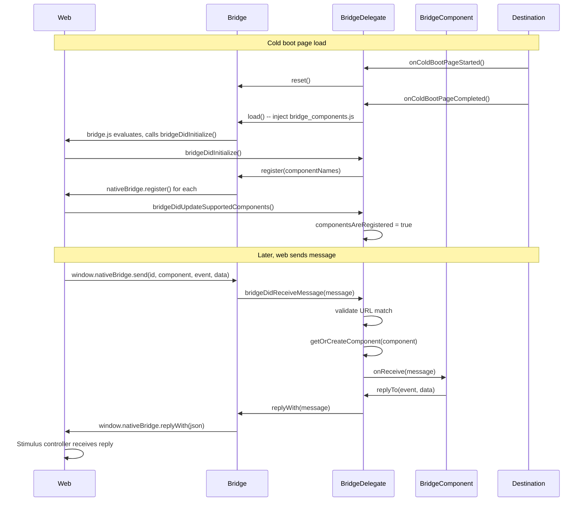

# Bridge Protocol: Bidirectional Web-Native Communication

The Hotwire Bridge protocol enables web content (JavaScript running in the embedded web view) to send messages to native components, and native components to reply with data or actions. Both iOS (Swift) and Android (Kotlin) share the same message format and lifecycle, allowing web controllers to communicate with platform-specific implementations using identical JavaScript. The bridge injects a JavaScript interface into the web view, registers native component names, and routes messages between web and native.

Source: `Source/Bridge/` in [hotwire-native-ios](https://github.com/hotwired/hotwire-native-ios) and `core/.../bridge/` in [hotwire-native-android](https://github.com/hotwired/hotwire-native-android).

## Architecture Overview



## Message Format

The `Message` struct is the same concept on both platforms.

Source: iOS `Source/Bridge/Message.swift` and Android `core/.../bridge/Message.kt`

```swift
// iOS: Source/Bridge/Message.swift
public struct Message: Equatable {
    let id: String               // UUID
    let component: String        // component name (e.g., "alert", "haptic")
    let event: String            // event name (e.g., "show", "vibrate")
    let metadata: Metadata?      // contains url
    let jsonData: String         // JSON payload (lazy decoding)

    func replacing(event: String?, jsonData: String?) -> Message
    func replacing<T: Encodable>(event: String?, data: T) -> Message
    func data<T: Decodable>() -> T?  // decode jsonData to typed value
}

public struct Metadata {
    let url: String  // current page URL for context
}
```

```kotlin
// Android: core/.../bridge/Message.kt
@Serializable
data class Message(
    val id: String,
    val component: String,
    val event: String,
    val metadata: Metadata?,
    val jsonData: String
) {
    fun replacing(event: String?, jsonData: String?): Message
    fun <T> data(jsonConverter: BridgeComponentJsonConverter): T?
}

@Serializable
data class Metadata(val url: String)
```

The `jsonData` field is a string, not a parsed object. This enables lazy decoding: the component only decodes the JSON when it actually needs the data. This is important for performance when messages are queued and may be discarded before processing.

## iOS Bridge Implementation

### Bridge: WKUserScript Injection

Source: `Source/Bridge/Bridge.swift`

```swift
// Source/Bridge/Bridge.swift
public final class Bridge: Bridgable {
    weak var delegate: BridgeDelegate?
    weak var webView: WKWebView?

    static func initialize(_ webView: WKWebView) {
        // Injects bridge.js as WKUserScript at document start
        let userScript = WKUserScript(
            source: bridgeJS,
            injectionTime: .atDocumentStart,
            forMainFrameOnly: false
        )
        webView.configuration.userContentController.addUserScript(userScript)
        webView.configuration.userContentController.add(
            ScriptMessageHandler(),
            name: "bridge"
        )
    }

    static func getBridgeFor(_ webView: WKWebView) -> Bridge? {
        // Returns registered bridge instance from static registry
    }

    func register(component: String) async throws {
        // Sends component name to web: window.nativeBridge.register(component)
    }

    func register(components: [String]) async throws {
        // Sends all component names at once
    }

    func unregister(component: String) async throws {
        // Tells web to unregister component
    }

    func reply(with message: Message) async throws {
        // Calls window.nativeBridge.replyWith(messageJSON)
        let js = JavaScript.replyWith(message)
        try await webView?.evaluateJavaScript(js)
    }
}
```

The bridge uses a static registry keyed by `WKWebView` instances:

```swift
// Static registry: webView -> Bridge instance
private static var registry = NSMapTable<WKWebView, Bridge>(
    keyOptions: .weakMemory,
    valueOptions: .strongMemory
)
```

### ScriptMessageHandler: Receiving Web Messages

Source: `Source/ScriptMessageHandler.swift`

```swift
// Source/ScriptMessageHandler.swift
class ScriptMessageHandler: NSObject, WKScriptMessageHandler {
    func userContentController(_ controller: WKUserContentController,
                               didReceive message: WKScriptMessage) {
        // Parses message body
        // Routes to BridgeDelegate.bridgeDidReceiveMessage()
    }
}
```

### BridgeDelegate: Per-Destination Mediator

Source: `Source/Bridge/BridgeDelegate.swift`

```swift
// Source/Bridge/BridgeDelegate.swift
public final class BridgeDelegate: BridgingDelegate {
    let location: String
    weak var destination: BridgeDestination?
    var webView: WKWebView?

    func webViewDidBecomeActive(_ webView: WKWebView) {
        self.webView = webView
        // Validates message URL matches destination location
    }

    func webViewDidBecomeDeactivated() {
        self.webView = nil
        // Stops component lifecycle events
    }

    func bridgeDidInitialize() {
        // Called when bridge.js signals ready
        // Registers component names with the bridge
    }

    func bridgeDidReceiveMessage(_ message: Message) -> Bool {
        // Validates message URL matches current destination
        // Gets or creates the component
        // Calls component.onReceive(message:)
        // Returns false if URL mismatch (redirect in progress)
    }

    func component<C: BridgeComponent>() -> C? {
        // Returns component by type
    }
}
```

Aha: The BridgeDelegate validates that the message URL matches the current destination location. This handles the redirect case: if the web view navigates from `/page-a` to `/page-b` while a message is in flight, the message for `/page-a` should be discarded because the destination has changed. The delegate checks `message.metadata.url == destination.location` and returns `false` if they differ.

### BridgeComponent: Native Implementation Base

Source: `Source/Bridge/BridgeComponent.swift`

```swift
// Source/Bridge/BridgeComponent.swift
@MainActor open class BridgeComponent {
    open class var name: String { fatalError("must override") }
    weak var delegate: BridgingDelegate?

    open func onReceive(message: Message) {
        fatalError("must override")
    }

    open func onViewDidLoad() {}
    open func onViewWillAppear() {}
    open func onViewDidAppear() {}
    open func onViewWillDisappear() {}
    open func onViewDidDisappear() {}

    func reply(with message: Message) async throws -> Bool
    func reply(to event: String) async throws -> Bool
    func reply<T: Encodable>(to event: String, with data: T) async throws -> Bool
    func receivedMessage(for event: String) -> Message?
}
```

Each native component subclass overrides `onReceive(message:)` to handle web-sent events and uses `reply(to:with:)` to send data back to the web.

## Android Bridge Implementation

### Bridge: JavaScript Interface

Source: `core/src/main/kotlin/dev/hotwire/core/bridge/Bridge.kt`

```kotlin
// core/.../bridge/Bridge.kt
class Bridge internal constructor(private val webView: WebView) {
    companion object {
        fun initialize(webView: WebView): Bridge {
            val bridge = Bridge(webView)
            webView.addJavascriptInterface(bridge, "BridgeComponentsNative")
            bridge.load(webView.context)
            return bridge
        }
    }

    @JavascriptInterface
    fun send(id: String, component: String, event: String, metadata: String?, jsonData: String) {
        // Called from web: window.BridgeComponentsNative.send(...)
        // Parses InternalMessage, routes to delegate
        val message = InternalMessage(id, component, event, metadata, jsonData).toMessage()
        delegate?.bridgeDidReceiveMessage(message)
    }

    @JavascriptInterface
    fun replyWith(jsonMessage: String) {
        // Called from web: window.BridgeComponentsNative.replyWith(...)
    }

    fun register(component: String) {
        // Evaluates JavaScript: window.nativeBridge.register(component)
        webView.evaluateJavascript("window.nativeBridge.register('$component')", null)
    }

    fun register(components: List<String>) {
        // Evaluates JavaScript with all component names
    }

    fun replyWith(message: Message) {
        // Evaluates JavaScript: window.nativeBridge.replyWith(messageJSON)
    }
}
```

### BridgeComponent on Android

Source: `core/src/main/kotlin/dev/hotwire/core/bridge/BridgeComponent.kt`

```kotlin
// core/.../bridge/BridgeComponent.kt
abstract class BridgeComponent<in D : BridgeDestination>(
    val name: String,
    private val delegate: BridgeDelegate<D>
) {
    abstract fun onReceive(message: Message)

    fun onStart() {}
    fun onStop() {}

    fun replyTo(event: String) {
        delegate.replyWith(Message(id = UUID.randomUUID().toString(), ...))
    }

    fun replyTo(event: String, jsonData: String) {
        delegate.replyWith(Message(id = UUID.randomUUID().toString(), ...))
    }

    fun <T> replyTo(event: String, data: T, converter: BridgeComponentJsonConverter) {
        val json = converter.toJson(data)
        replyTo(event, json)
    }
}

abstract class BridgeComponentFactory<D : BridgeDestination, out C : BridgeComponent<D>>(
    val name: String,
    val creator: (D, BridgeDelegate<D>) -> C
)
```

The factory pattern allows lazy component creation. Components are only instantiated when a message for their name arrives.

### BridgeDelegate on Android

Source: `core/src/main/kotlin/dev/hotwire/core/bridge/BridgeDelegate.kt`

```kotlin
// core/.../bridge/BridgeDelegate.kt
class BridgeDelegate<D : BridgeDestination>(
    val location: String,
    val destination: D,
    componentFactories: List<BridgeComponentFactory<D, out BridgeComponent<D>>>
) : DefaultLifecycleObserver {
    private var componentsByName = mutableMapOf<String, BridgeComponent<D>>()

    fun onColdBootPageStarted() {
        bridge.reset()
    }

    fun onColdBootPageCompleted() {
        bridge.load()  // injects bridge_components.js
    }

    fun onStart() {
        // Forwards to active components
        getActiveComponentNames().forEach { componentsByName[it]?.onStart() }
    }

    fun onStop() {
        getActiveComponentNames().forEach { componentsByName[it]?.onStop() }
    }

    fun bridgeDidReceiveMessage(message: Message): Boolean {
        // Validates URL match
        // Gets or creates component via factory
        // Calls component.onReceive(message)
        val component = getOrCreateComponent(message.component)
        component.onReceive(message)
        return true
    }
}
```

## Bridge Lifecycle: Cold Boot Sequence



## Component Lifecycle

Components receive lifecycle events from the destination:

| Event | iOS | Android | Triggered When |
|-------|-----|---------|---------------|
| ViewDidLoad | `onViewDidLoad()` | N/A | View controller/fragment created |
| ViewWillAppear | `onViewWillAppear()` | N/A | View about to appear |
| ViewDidAppear | `onViewDidAppear()` | `onStart()` | View visible |
| ViewWillDisappear | `onViewWillDisappear()` | `onStop()` | View about to hide |
| ViewDidDisappear | `onViewDidDisappear()` | `onStop()` | View hidden |
| Message | `onReceive(message)` | `onReceive(message)` | Web sends message |

## Message Flow in Both Directions

### Web to Native

```javascript
// Web controller sends message
window.nativeBridge.send(id, "alert", "show", JSON.stringify(metadata), JSON.stringify({
  title: "Confirm",
  description: "Are you sure?",
  confirm: "Yes",
  dismiss: "No"
}))
```

The native bridge receives this, creates or retrieves the `AlertComponent`, and calls `onReceive(message)`. The component shows a native alert dialog.

### Native to Web

```swift
// iOS native component replies
func onReceive(message: Message) {
    if message.event == "show" {
        let alert = UIAlertController(...)
        alert.addAction(UIAlertAction(title: "Confirm") { _ in
            try? self.reply(to: "confirmed", with: ["action": "confirm"])
        })
        present(alert, animated: true)
    }
}
```

The `reply(to:with:)` method sends a message back to the web. The Stimulus controller receives it via a custom event.

## JSON Converter Pattern

Android uses a pluggable JSON converter system.

Source: `core/src/main/kotlin/dev/hotwire/core/bridge/BridgeComponentJsonConverter.kt`

```kotlin
// core/.../bridge/BridgeComponentJsonConverter.kt
abstract class BridgeComponentJsonConverter {
    abstract fun <T> toObject(json: String, type: Class<T>): T
    abstract fun <T> toJson(value: T): String
}

class KotlinXJsonConverter(val json: Json = Json { ignoreUnknownKeys = true }) : BridgeComponentJsonConverter() {
    override fun <T> toObject(jsonData: String, type: Class<T>): T {
        return json.decodeFromString(type.serializer(), jsonData)
    }
    override fun <T> toJson(value: T): String {
        return json.encodeToString(value)
    }
}
```

iOS uses `JSONEncoder` and `JSONDecoder` from Foundation, configured on `HotwireConfig`.

## BridgeDestination Protocol

Both platforms define a `BridgeDestination` protocol/interface that the owning destination implements.

Source: iOS `Source/Bridge/BridgeDelegate.swift`

```swift
// iOS
public protocol BridgeDestination: AnyObject {
    func onBridgeComponentInitialized(_ component: BridgeComponent)  // default: empty
}
```

Source: Android `core/.../bridge/BridgeDestination.kt`

```kotlin
// Android
interface BridgeDestination {
    fun bridgeWebViewIsReady(): Boolean
    fun onBridgeComponentInitialized(component: BridgeComponent<*, *>) {}
}
```

## Internal Message Format

The internal message format used for platform serialization:

Source: iOS `Source/Bridge/InternalMessage.swift`

```swift
// Source/Bridge/InternalMessage.swift
struct InternalMessage: Codable {
    let id: String
    let component: String
    let event: String
    let data: InternalMessageData?
}

struct InternalMessageData: Codable {
    let url: String?
    let metadata: [String: String]?
    let jsonData: String?
}
```

Source: Android `core/.../bridge/InternalMessage.kt`

```kotlin
// core/.../bridge/InternalMessage.kt
@Serializable
data class InternalMessage(
    val id: String,
    val component: String,
    val event: String,
    val metadata: String?,  // JSON string
    val jsonData: String
) {
    fun toMessage(): Message {
        return Message(id, component, event, parseMetadata(metadata), jsonData)
    }
}
```

## Next

See [Bridge Components](10-bridge-components.md) for the 16 Stimulus controllers and their native implementations that use this protocol. The Rails integration that enables server-side bridge component rendering is covered in [Rails Integration](09-rails-integration.md).
