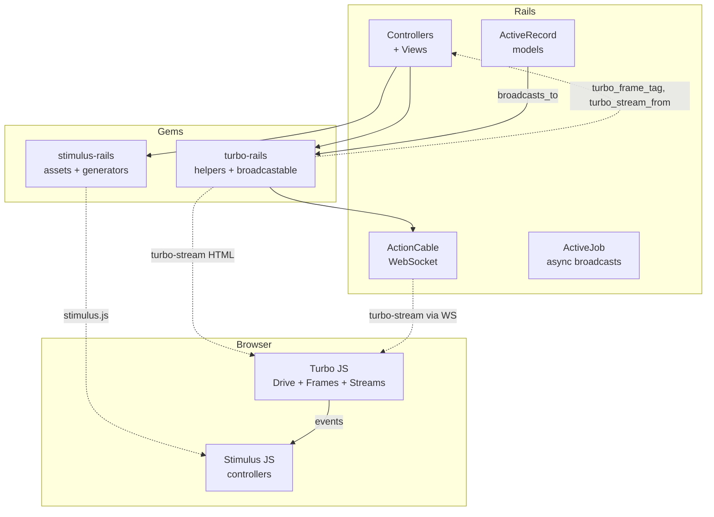

# Rails Integration: stimulus-rails, turbo-rails, and hotwire-rails

Three Ruby gems integrate the Hotwire JavaScript ecosystem into Rails applications. `stimulus-rails` provides asset bundling, manifest generation, and controller generators. `turbo-rails` provides ActionCable integration, form and frame helpers, a broadcastable ActiveRecord concern, and native bridge navigation helpers. `hotwire-rails` is a meta-gem that depends on both. Together, they transform Rails from a traditional request-response framework into a real-time, partial-update-capable application server.

Source: [stimulus-rails](https://github.com/hotwired/stimulus-rails) v1.3.4, [turbo-rails](https://github.com/hotwired/turbo-rails) v2.0.17, [hotwire-rails](https://github.com/hotwired/hotwire-rails) v0.1.3.

## stimulus-rails v1.3.4

The `stimulus-rails` gem bundles Stimulus 3.2.2 as a Rails asset and provides generators and manifest auto-discovery.

Source: `stimulus-rails.gemspec`

```ruby
# stimulus-rails.gemspec
Gem::Specification.new do |s|
  s.name        = "stimulus-rails"
  s.version     = "1.3.4"
  s.authors     = ["Sam Stephenson", "Javan Mahkmali", "David Heinemeier Hansson"]
  s.license     = "MIT"
  s.add_dependency "railties", ">= 6.0.0"
end
```

### Engine and Asset Precompilation

Source: `lib/stimulus/engine.rb`

```ruby
# lib/stimulus/engine.rb
module Stimulus
  class Engine < Rails::Engine
    initializer "stimulus.assets", group: :all do |app|
      app.config.assets.precompile += %w[stimulus.js stimulus.min.js stimulus.min.js.map]
    end
  end
end
```

The gem precompiles three asset files: the full Stimulus bundle, the minified version, and the source map.

### Manifest Auto-Discovery

The Manifest system scans a directory for `*_controller.*` files and generates JavaScript import statements.

Source: `lib/stimulus/manifest.rb`

```ruby
# lib/stimulus/manifest.rb
module Stimulus::Manifest
  def self.generate_from(controllers_path)
    # Scans for *_controller.* files
    # Generates JS import + application.register() statements
  end

  def self.write_index_from(controllers_path)
    index = generate_from(controllers_path)
    # Writes to app/javascript/controllers/index.js
  end

  def self.import_and_register_controller(identifier, path)
    # Generates: import { default as X } from "path"
    #          application.register("identifier", X)
  end

  def self.extract_controllers_from(directory)
    # Finds all files matching *_controller.* pattern
    # Returns array of { identifier, path } pairs
  end
end
```

Aha: The manifest system bridges the Ruby and JavaScript worlds. Rails knows about controller files because they live in `app/javascript/controllers/`. The manifest scanner generates the JavaScript code that registers them with the Stimulus application. This means a developer never writes `application.register("my", MyController)` manually -- the Rails generator and manifest system do it automatically.

### Generator

Source: `lib/generators/stimulus/stimulus_generator.rb`

```ruby
# lib/generators/stimulus/stimulus_generator.rb
class StimulusGenerator < Rails::Generators::NamedBase
  source_root File.expand_path("templates", __dir__)
  argument :actions, type: :array, default: [], banner: "action action"

  def copy_view_files
    template "controller.js.tt", "app/javascript/controllers/#{file_name}_controller.js"
  end

  def controller_name
    "#{file_name.camelize}Controller"
  end

  def stimulus_attribute_value
    actions.map { |a| "#{a}->#{controller_name.underscore}##{a}" }.join(" ")
  end

  def update_manifest_index?
    # Checks if index.js has auto-generation comment
  end
end
```

Usage: `rails generate stimulus modal show hide`

This creates `app/javascript/controllers/modal_controller.js` with `show()` and `hide()` methods, and auto-registers it in the manifest.

### Install Scripts

Three installation paths are supported:

| Path | Script | What it does |
|------|--------|-------------|
| Importmap | `lib/install/stimulus_with_importmap.rb` | Creates controllers dir, copies index + application.js, appends `import "controllers"`, pins in `config/importmap.rb` |
| Node | `lib/install/stimulus_with_node.rb` | Creates controllers dir, runs `yarn add @hotwired/stimulus` |
| Bun | `lib/install/stimulus_with_bun.rb` | Creates controllers dir, runs `bun add @hotwired/stimulus` |

Source: `lib/tasks/stimulus_tasks.rake`

```ruby
# lib/tasks/stimulus_tasks.rake
namespace :stimulus do
  task :install do
    # Auto-detects importmap/bun/node
    case
    when using_bun? then run_stimulus_install_template("stimulus_with_bun.rb")
    when File.exist?("config/importmap.rb") then run_stimulus_install_template("stimulus_with_importmap.rb")
    else run_stimulus_install_template("stimulus_with_node.rb")
    end
  end

  namespace :manifest do
    task :display  # Shows current manifest
    task :update   # Regenerates index.js
  end
end
```

### JavaScript Assets

Source: `app/assets/javascripts/stimulus-loading.js`

```javascript
// app/assets/javascripts/stimulus-loading.js
export function eagerLoadControllersFrom(under, application) {
  // Imports and registers all controllers in directory
}

export function lazyLoadControllersFrom(under, application, element) {
  // Only loads controller when data-controller attribute appears
}

function registerControllerFromPath(identifier, under, application) {
  const path = `${under}/${identifier.replace(/--/g, "/")}_controller`
  import(path).then(module => application.register(identifier, module.default))
}
```

The `eagerLoadControllersFrom` function is the current recommended approach. It scans a directory at build time and registers all controllers. The deprecated `stimulus-autoloader.js` used a `MutationObserver` to load controllers on demand, which was less predictable.

## turbo-rails v2.0.17

The `turbo-rails` gem is the server-side half of Turbo. It provides ActionCable integration, Ruby helpers for generating `<turbo-frame>` and `<turbo-stream>` elements, a broadcastable ActiveRecord concern, and native bridge navigation helpers.

Source: `turbo-rails.gemspec`

```ruby
# turbo-rails.gemspec
Gem::Specification.new do |s|
  s.name        = "turbo-rails"
  s.version     = "2.0.17"
  s.license     = "MIT"
  s.add_dependency "railties", ">= 7.1.0"
  s.add_dependency "actionpack", ">= 7.1.0"
  s.required_ruby_version = ">= 3.1"
end
```

### Engine: The Central Integrator

Source: `lib/turbo/engine.rb`

```ruby
# lib/turbo/engine.rb
module Turbo
  class Engine < Rails::Engine
    # Initializers (run in order):
    initializer "turbo.no_active_job"     # warns if ActiveJob not available
    initializer "turbo.no_action_cable"   # warns if ActionCable not available
    initializer "turbo.assets"            # precompiles turbo.js, turbo.min.js, map
    initializer "turbo.configs"           # sets up Turbo.draw_routes config
    initializer "turbo.helpers"           # mixes helpers into ActionController::Base
    initializer "turbo.request_id_tracking" # around_action for request ID
    initializer "turbo.broadcastable"     # mixes into ActiveRecord
    initializer "turbo.mimetype"          # registers text/vnd.turbo-stream.html
    initializer "turbo.renderer"          # registers TurboStreamRenderer
    initializer "turbo.signed_stream_verifier_key"
    initializer "turbo.test_assertions"   # test helpers
    initializer "turbo.integration_test_request_encoding"
    initializer "turbo.system_test_helper"
  end
end
```

The gem mixes helpers into various Rails classes:

```ruby
# Mixed into ActionController::Base:
include Turbo::Streams::TurboStreamsTagBuilder
include Turbo::Frames::FrameRequest
include Turbo::Native::Navigation

# Mixed into ActiveRecord::Base:
include Turbo::Broadcastable
```

### Routes

Source: `config/routes.rb`

```ruby
# config/routes.rb (guarded by Turbo.draw_routes)
Turbo::Engine.routes.draw do
  get "/recede_historical_location", to: "turbo/native/navigation#recede"
  get "/resume_historical_location", to: "turbo/native/navigation#resume"
  get "/refresh_historical_location", to: "turbo/native/navigation#refresh"
end
```

These three routes support native iOS/Android navigation gestures (back, refresh, stay). They return simple text responses like "Going back..." that the native SDK interprets.

### Turbo Frames Helper

Source: `app/helpers/turbo/frames_helper.rb`

```ruby
# app/helpers/turbo/frames_helper.rb
module Turbo::FramesHelper
  def turbo_frame_tag(*ids, src: nil, target: nil, **attributes)
    # Generates <turbo-frame id="..." src="..." data-turbo-target="...">
    tag.turbo_frame(nil, id: ids.first, src: src, **attributes)
  end
end
```

Usage: `<%= turbo_frame_tag "messages", src: messages_path %>`

This generates: `<turbo-frame id="messages" src="/messages"></turbo-frame>`

### Turbo Streams Tag Builder

Source: `app/models/turbo/streams/tag_builder.rb`

```ruby
# app/models/turbo/streams/tag_builder.rb
class Turbo::Streams::TagBuilder
  def remove(target)              # <turbo-stream action="remove" target="...">
  def remove_all(targets)         # <turbo-stream action="remove" targets="...">
  def replace(target, **attrs)    # <turbo-stream action="replace" target="...">
  def before(target, **attrs)     # <turbo-stream action="before" target="...">
  def after(target, **attrs)      # <turbo-stream action="after" target="...">
  def update(target, **attrs)     # <turbo-stream action="update" target="...">
  def append(target, **attrs)     # <turbo-stream action="append" target="...">
  def prepend(target, **attrs)    # <turbo-stream action="prepend" target="...">
  def refresh(**attrs)            # <turbo-stream action="refresh">
  def action(name, target, **attrs) # generic stream action
  def action_all(name, targets, **attrs)
end
```

Usage in a controller:

```ruby
# app/controllers/messages_controller.rb
def create
  @message = Message.create!(message_params)
  respond_to do |format|
    format.turbo_stream {
      render turbo_stream: turbo_stream.append("messages", @message)
    }
    format.html { redirect_to messages_path }
  end
end
```

### Broadcastable ActiveRecord Concern

Source: `app/models/concerns/turbo/broadcastable.rb`

```ruby
# app/models/concerns/turbo/broadcastable.rb
module Turbo::Broadcastable
  # Class methods:
  def self.included(base)
    base.extend ClassMethods
  end

  module ClassMethods
    def broadcasts_to(stream, renders: false, target: nil, inserts: :append)
      # After commit callback: broadcast the specified action
    end

    def broadcasts(stream, renders: false, target: nil, inserts: :append)
      # Like broadcasts_to but uses model's own stream name
    end

    def broadcasts_refreshes_to(stream)
      # Broadcasts refresh action (debounced page refresh)
    end

    def broadcasts_refreshes
      # broadcasts_refreshes_to with model's own stream name
    end

    def broadcast_target_default(target)
      # Sets default DOM target for this model
    end

    def suppressing_turbo_broadcasts
      # Temporarily disables broadcasts (for bulk operations)
    end

    def suppressed_turbo_broadcasts?
    end
  end

  # Instance methods:
  def broadcast_remove_to(*streamables, target: nil)
  def broadcast_replace_to(*streamables, target: nil, **rendering)
  def broadcast_update_to(*streamables, target: nil, **rendering)
  def broadcast_append_to(*streamables, target: nil, **rendering)
  def broadcast_prepend_to(*streamables, target: nil, **rendering)
  def broadcast_refresh_to(*streamables, request_id: nil)
  def broadcast_action_to(*streamables, action:, target: nil, **rendering)
  def broadcast_render_to(*streamables, **rendering)

  # Async variants (via ActiveJob):
  def broadcast_replace_to_later(*streamables, **rendering)
  def broadcast_append_to_later(*streamables, **rendering)
  # ... etc
end
```

Usage:

```ruby
# app/models/message.rb
class Message < ApplicationRecord
  broadcasts_to ->(message) { "room_#{message.room_id}" }, inserts: :append
end
```

When a Message is created, updated, or destroyed, Turbo automatically broadcasts the corresponding stream action over ActionCable to all subscribers of `room_{room_id}`.

### Action Cable Integration

Source: `app/channels/turbo/streams_channel.rb`

```ruby
# app/channels/turbo/streams_channel.rb
class Turbo::StreamsChannel < ActionCable::Channel::Base
  def subscribed
    # Verifies signed stream name from params
    stream_name = verified_stream_name(params[:signed_stream_name])
    stream_from stream_name if stream_name
  end
end
```

The signed stream name prevents unauthorized clients from subscribing to streams they should not access. The signature uses SHA-256 via `ActiveSupport::MessageVerifier`.

Source: `app/channels/turbo/streams/broadcasts.rb`

```ruby
# app/channels/turbo/streams/broadcasts.rb
module Turbo::Streams::Broadcasts
  def self.broadcast_remove_to(*streamables, target:)
    ActionCable.server.broadcast(stream_name, turbo_stream.remove(target))
  end

  def self.broadcast_replace_to(*streamables, target:, **rendering)
    ActionCable.server.broadcast(stream_name, turbo_stream.replace(target, **rendering))
  end

  def self.broadcast_refresh_to(*streamables, request_id: nil)
    # Uses refresh_debouncer_for to avoid duplicate refreshes
    debouncer.debounce { ActionCable.server.broadcast(stream_name, turbo_stream.refresh) }
  end

  # Async variants:
  def self.broadcast_replace_to_later(...)
    Turbo::Streams::BroadcastJob.perform_later(...)
  end
end
```

### Stream Name Generation

Source: `app/channels/turbo/streams/stream_name.rb`

```ruby
# app/channels/turbo/streams/stream_name.rb
module Turbo::Streams::StreamName
  def self.signed_stream_name(streamables)
    Turbo.signed_stream_verifier.generate(stream_name_from(streamables))
  end

  def self.stream_name_from(streamables)
    # Joins with ":" delimiter
    # Uses to_gid_param for GlobalID objects
    # Uses to_param for other objects
    Array(streamables).map { |s| s.respond_to?(:to_gid_param) ? s.to_gid_param : s.to_param }.join(":")
  end
end
```

Stream names are colon-delimited strings. A `Message` with GlobalID `gid://app/Message/42` becomes `messages:gid://app/Message/42`. Multiple streamables are joined: `["room_1", @message]` becomes `room_1:gid://app/Message/42`.

### Debouncer: Preventing Duplicate Refreshes

Source: `app/models/turbo/debouncer.rb`

```ruby
# app/models/turbo/debouncer.rb
class Turbo::Debouncer
  DEFAULT_DELAY = 0.5  # seconds

  def initialize(delay: DEFAULT_DELAY)
    @delay = delay
  end

  def debounce(&block)
    @pending_block = block
    # Schedules execution after delay
  end

  def wait
    # Executes pending block
  end
end
```

Source: `app/models/turbo/thread_debouncer.rb`

```ruby
# app/models/turbo/thread_debouncer.rb
class Turbo::ThreadDebouncer
  def self.for(key, delay: Turbo::Debouncer::DEFAULT_DELAY)
    # Per-thread factory -- ensures each thread has its own debouncer
    Thread.current[key] ||= new(delay: delay)
  end
end
```

The refresh debouncer prevents duplicate page refreshes when multiple models broadcast refreshes in quick succession. The per-thread factory ensures thread safety.

### Request ID Tracking

Source: `app/controllers/concerns/turbo/request_id_tracking.rb`

```ruby
# app/controllers/concerns/turbo/request_id_tracking.rb
module Turbo::RequestIdTracking
  def self.included(base)
    base.around_action :turbo_tracking_request_id
  end

  def turbo_tracking_request_id(&block)
    Turbo.with_request_id(request.headers["X-Turbo-Request-Id"], &block)
  end
end
```

Source: `lib/turbo-rails.rb`

```ruby
# lib/turbo-rails.rb
module Turbo
  thread_mattr_accessor :current_request_id

  def self.with_request_id(request_id)
    previous = current_request_id
    current_request_id = request_id
    yield
  ensure
    current_request_id = previous
  end

  def self.signed_stream_verifier
    @signed_stream_verifier ||= ActiveSupport::MessageVerifier.new(
      Rails.application.secret_key_base,
      serializer: JSON,
      digest: "SHA256"
    )
  end
end
```

The request ID is tracked per-thread (using `thread_mattr_accessor`) so that the `action=refresh` stream action can check whether the current request caused the refresh, preventing infinite refresh loops.

### Native Navigation Helpers

Source: `app/controllers/turbo/native/navigation.rb`

```ruby
# app/controllers/turbo/native/navigation.rb
module Turbo::Native::Navigation
  def hotwire_native_app?
    request.user_agent.to_s.match?(/Hotwire Native/)
  end
  alias_method :turbo_native_app?, :hotwire_native_app?

  def recede_or_redirect_to(url, **options)
    if hotwire_native_app?
      redirect_to turbo_recede_historical_location_path, **options
    else
      redirect_to url, **options
    end
  end

  def resume_or_redirect_to(url, **options)
    # Similar pattern
  end

  def refresh_or_redirect_to(url, **options)
    # Similar pattern
  end

  # Back variants:
  def recede_or_redirect_back_or_to(url, **options)
  def resume_or_redirect_back_or_to(url, **options)
  def refresh_or_redirect_back_or_to(url, **options)
end
```

Aha: The `hotwire_native_app?` helper checks for "Hotwire Native" in the user agent. This is set by the native SDK's `WKWebView`/`WebView` user agent string. When a request comes from a native app, the `recede_or_redirect_to` helper redirects to the special `/recede_historical_location` route instead of the URL. The native SDK intercepts this route and performs the native back action. This is how the server controls native navigation without any API layer.

### Frame Request Detection

Source: `app/controllers/turbo/frames/frame_request.rb`

```ruby
# app/controllers/turbo/frames/frame_request.rb
module Turbo::Frames::FrameRequest
  def turbo_frame_request?
    request.headers["Turbo-Frame"].present?
  end

  def turbo_frame_request_id
    request.headers["Turbo-Frame"]
  end

  # Layout conditional:
  # "turbo_rails/frame" layout is used for frame requests
  # This layout only renders the frame content, not the full page
end
```

When a frame request is detected (via the `Turbo-Frame` header), the layout is switched to a minimal frame-only layout. The ETag is also scoped to the frame ID so that caching works correctly.

### Drive Helper

Source: `app/helpers/turbo/drive_helper.rb`

```ruby
# app/helpers/turbo/drive_helper.rb
module Turbo::DriveHelper
  def turbo_exempts_page_from_cache
    tag.meta(name: "turbo-cache-control", content: "no-cache")
  end

  def turbo_exempts_page_from_preview
    tag.meta(name: "turbo-cache-control", content: "no-preview")
  end

  def turbo_refreshes_with(method: :morph, scroll: :preserve)
    tag.meta(name: "turbo-refresh-method", content: method.to_s)
    tag.meta(name: "turbo-refresh-scroll", content: scroll.to_s)
  end
end
```

These meta tags control Turbo Drive behavior on the client side.

### Cable Stream Source Element

Source: `app/javascript/turbo/cable_stream_source_element.js`

```javascript
// app/javascript/turbo/cable_stream_source_element.js
class TurboCableStreamSourceElement extends HTMLElement {
  connectedCallback() {
    // Subscribes to ActionCable channel
    this.consumer = getConsumer()
    this.consumer.subscriptions.create({
      channel: "Turbo::StreamsChannel",
      signed_stream_name: this.getAttribute("signed-stream-name")
    }, {
      received: (data) => this.dispatchMessageEvent(data),
      connected: () => this.subscriptionConnected(),
      disconnected: () => this.subscriptionDisconnected()
    })
  }

  disconnectedCallback() {
    // Unsubscribes
  }
}

customElements.define("turbo-cable-stream-source", TurboCableStreamSourceElement)
```

This custom element is generated by the `turbo_stream_from` helper. It connects to ActionCable and feeds incoming stream messages into Turbo's stream system.

Usage in a view:

```erb
<%= turbo_stream_from "room_#{@room.id}" %>
```

Generates: `<turbo-cable-stream-source channel="Turbo::StreamsChannel" signed-stream-name="...">`

### Streams Helper

Source: `app/helpers/turbo/streams_helper.rb`

```ruby
# app/helpers/turbo/streams_helper.rb
module Turbo::StreamsHelper
  def turbo_stream
    Turbo::Streams::TagBuilder.new(view_context: self)
  end

  def turbo_stream_from(*streamables)
    tag.turbo_cable_stream_source(
      channel: "Turbo::StreamsChannel",
      signed_stream_name: Turbo::Streams::StreamName.signed_stream_name(streamables)
    )
  end
end
```

### Test Assertions

Source: `lib/turbo/test_assertions.rb`

```ruby
# lib/turbo/test_assertions.rb
module Turbo::TestAssertions
  def assert_turbo_stream(action:, target: nil, targets: nil, count: 1)
    # Asserts that response contains N turbo-stream elements
  end

  def assert_no_turbo_stream(action:, target: nil, targets: nil)
    # Asserts that response does NOT contain matching turbo-stream
  end
end
```

### Broadcastable Test Helper

Source: `lib/turbo/broadcastable/test_helper.rb`

```ruby
# lib/turbo/broadcastable/test_helper.rb
module Turbo::Broadcastable::TestHelper
  def assert_turbo_stream_broadcasts(stream, count:)
    # Asserts that N broadcasts occurred on a stream
  end

  def assert_no_turbo_stream_broadcasts(stream)
  end

  def capture_turbo_stream_broadcasts(stream)
    # Captures broadcast content for inspection
  end
end
```

## hotwire-rails v0.1.3

The `hotwire-rails` gem is a meta-gem with no code of its own. It depends on both `stimulus-rails` and `turbo-rails` and installs them together.

Source: `hotwire-rails.gemspec`

```ruby
# hotwire-rails.gemspec
Gem::Specification.new do |s|
  s.name        = "hotwire-rails"
  s.version     = "0.1.3"
  s.add_dependency "stimulus-rails"
  s.add_dependency "turbo-rails"
end
```

## Integration Architecture



## Next

The bridge-components project provides 16 Stimulus controllers with native iOS/Android implementations. See [Bridge Components](10-bridge-components.md) for details. For the bridge protocol that powers the web-native communication, see [Bridge Protocol](08-bridge-protocol.md).
