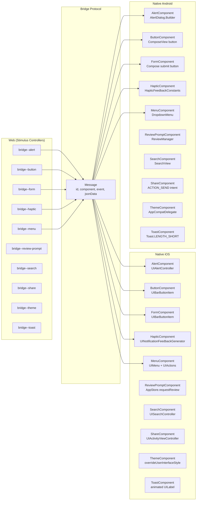

# Bridge Components: 16 Stimulus Controllers with Native iOS/Android Implementations

The bridge-components project (`@joemasilotti/bridge-components` v0.8.3) provides 16 Stimulus controllers that communicate with native iOS and Android components through the Hotwire Bridge protocol. Each controller handles a specific platform feature: alerts, haptics, menus, form toolbar buttons, search, share, theme, toast, and more. The web controllers send messages to native, and the native components reply with data or perform platform actions. Ten of the 16 components have matching iOS and Android implementations.

Source: `web/controllers/`, `ios/components/`, and `android/core/src/main/kotlin/` in bridge-components v0.8.3. Peer dependencies: `@hotwired/stimulus >= 3.2.0`, `@hotwired/hotwire-native-bridge >= 1.2.0`.

## Component Parity Matrix

| Component | Web | iOS | Android | Web Event | Native Events |
|-----------|-----|-----|---------|-----------|--------------|
| Alert | Yes | Yes | Yes | `show` | `.show` |
| Barcode Scanner | Yes | No | No | `scan` | N/A |
| Biometrics Lock | Yes | No | No | `enable`, `disable` | N/A |
| Button | Yes | Yes | Yes | (connect) | `.left`, `.right` |
| Document Scanner | Yes | No | No | `scan` | N/A |
| Form | Yes | Yes | Yes | `submitStart`, `submitEnd` | `.connect`, `.enableSubmit`, `.disableSubmit` |
| Haptic | Yes | Yes | Yes | `vibrate` | `.vibrate` |
| Location | Yes | No | No | `get` | N/A |
| Menu | Yes | Yes | Yes | (connect) | `.connect` |
| Notification Token | Yes | No | No | `get` | N/A |
| Permissions | Yes | No | No | (connect) | N/A |
| Review Prompt | Yes | Yes | Yes | `prompt` | `.prompt` |
| Search | Yes | Yes | Yes | (connect) | `.connect` |
| Share | Yes | Yes | Yes | (connect) | `.connect` |
| Theme | Yes | Yes | Yes | (connect) | (connect) |
| Toast | Yes | Yes | Yes | `show` | `.show` |



## Web Controller Base Class

All 16 controllers extend `BridgeComponent` from `@hotwired/hotwire-native-bridge`.

Source: `web/controllers/bridge_component.js`

```javascript
// web/controllers/bridge_component.js
import { BridgeComponent } from "@hotwired/hotwire-native-bridge"

export class BridgeComponent extends BridgeComponent {
  // Base class provides:
  // - this.send(event, jsonData) -- sends message to native
  // - this.receive(event) -- returns Promise that resolves when native replies
  // - this.identifier -- component identifier
}
```

## Alert Component

Source: `web/controllers/alert_controller.js`

```javascript
// web/controllers/alert_controller.js
import { BridgeComponent } from "@hotwired/hotwire-native-bridge"

export default class extends BridgeComponent {
  static component = "alert"

  show(event) {
    const { title, description, destructive, confirm, dismiss } = event.params
    this.send("show", { title, description, destructive, confirm, dismiss })
    this.receive("confirmed").then(() => {
      event.target.closest("form")?.requestSubmit()
    })
    this.receive("dismissed").then(() => {
      // User tapped dismiss
    })
  }
}
```

The alert controller sends a `show` event with title, description, confirm/dismiss button text, and whether the confirm button should be styled as destructive. It listens for `confirmed` and `dismissed` replies.

Source: `ios/components/AlertComponent.swift`

```swift
// ios/components/AlertComponent.swift
class AlertComponent: BridgeComponent {
    static override var name: String { "alert" }

    override func onReceive(message: Message) {
        switch message.event {
        case "show":
            let data: AlertData = message.data()
            let alert = UIAlertController(title: data.title, message: data.description, preferredStyle: .alert)
            alert.addAction(UIAlertAction(title: data.confirm, style: data.destructive ? .destructive : .default) { _ in
                try? self.reply(to: "confirmed")
            })
            alert.addAction(UIAlertAction(title: data.dismiss, style: .cancel) { _ in
                try? self.reply(to: "dismissed")
            })
            presentingViewController?.present(alert, animated: true)
        default:
            break
        }
    }
}
```

Source: `android/core/src/main/kotlin/com/masilotti/bridgecomponents/AlertComponent.kt`

```kotlin
// android/.../AlertComponent.kt
class AlertComponent(destination: HotwireDestination) : BridgeComponent<HotwireDestination>("alert", destination) {
    override fun onReceive(message: Message) {
        when (message.event) {
            "show" -> {
                val data = message.data<AlertData>()
                AlertDialog.Builder(context)
                    .setTitle(data.title)
                    .setMessage(data.description)
                    .setPositiveButton(data.confirm) { _, _ -> replyTo("confirmed") }
                    .setNegativeButton(data.dismiss) { _, _ -> replyTo("dismissed") }
                    .show()
            }
        }
    }
}
```

## Button Component

Source: `web/controllers/button_controller.js`

```javascript
// web/controllers/button_controller.js
export default class extends BridgeComponent {
  static component = "button"
  static targets = ["button"]

  connect() {
    const { title, icon, destructive, disabled } = this.element.dataset
    this.send("connect", { title, icon, destructive, disabled, side: this.side })
  }

  get side() {
    return this.element.dataset.side || "right"  // "left" or "right"
  }
}
```

The button controller reads button title, icon, and styling from data attributes on the element, then sends a `connect` message to native. Native adds a toolbar button. When the button is tapped, native navigates to the element's href or fires a click event.

Source: `ios/components/ButtonComponent.swift`

```swift
// ios/components/ButtonComponent.swift
class ButtonComponent: BridgeComponent {
    static override var name: String { "button" }

    override func onReceive(message: Message) {
        switch message.event {
        case "left", "right":
            let data: ButtonData = message.data()
            let action = UIAction(title: data.title, image: data.iosImage?.map { UIImage(systemName: $0) }) { [weak self] _ in
                // Triggers click on web element
                try? self?.reply(to: "clicked")
            }
            let item = UIBarButtonItem(title: data.title, image: action.image, target: nil, action: nil)
            item.primaryAction = action
            if data.destructive { item.tintColor = .systemRed }
            navigationItem.setButton(item, on: data.side == "left" ? .left : .right)
        default:
            break
        }
    }
}
```

## Form Component

Source: `web/controllers/form_controller.js`

```javascript
// web/controllers/form_controller.js
export default class extends BridgeComponent {
  static component = "form"

  connect() {
    this.send("connect", { title: this.element.dataset.title || "Submit" })
  }

  submitStart() {
    this.send("disableSubmit")
  }

  submitEnd() {
    this.send("enableSubmit")
  }
}
```

The form controller adds a submit button to the native toolbar when connected. When a form submission starts, the submit button is disabled. When it ends, the button is re-enabled.

Source: `ios/components/FormComponent.swift`

```swift
// ios/components/FormComponent.swift
class FormComponent: BridgeComponent {
    static override var name: String { "form" }

    override func onReceive(message: Message) {
        switch message.event {
        case "connect":
            let data: FormData = message.data()
            navigationItem.rightBarButtonItem = UIBarButtonItem(
                title: data.title,
                style: .done,
                target: self,
                action: #selector(submitTapped)
            )
        case "enableSubmit":
            navigationItem.rightBarButtonItem?.isEnabled = true
        case "disableSubmit":
            navigationItem.rightBarButtonItem?.isEnabled = false
        default:
            break
        }
    }

    @objc private func submitTapped() {
        // Triggers form submission on web
    }
}
```

## Haptic Component

Source: `web/controllers/haptic_controller.js`

```javascript
// web/controllers/haptic_controller.js
export default class extends BridgeComponent {
  static component = "haptic"

  vibrate(event) {
    const { feedback } = event.params  // "success", "warning", "error"
    this.send("vibrate", { feedback })
  }
}
```

The haptic controller sends a feedback type to native. Native triggers the platform haptic feedback.

Source: `ios/components/HapticComponent.swift`

```swift
// ios/components/HapticComponent.swift
class HapticComponent: BridgeComponent {
    static override var name: String { "haptic" }

    override func onReceive(message: Message) {
        switch message.event {
        case "vibrate":
            let data: HapticData = message.data()
            let generator = UINotificationFeedbackGenerator()
            switch data.feedback {
            case "success": generator.notificationChanged(.success)
            case "warning": generator.notificationChanged(.warning)
            case "error":   generator.notificationChanged(.error)
            default: break
            }
        default: break
        }
    }
}
```

Source: `android/.../HapticComponent.kt`

```kotlin
// android/.../HapticComponent.kt
class HapticComponent(destination: HotwireDestination) : BridgeComponent<HotwireDestination>("haptic", destination) {
    override fun onReceive(message: Message) {
        when (message.event) {
            "vibrate" -> {
                val data = message.data<HapticData>()
                val constant = when (data.feedback) {
                    "success" -> HapticFeedbackConstants.CONFIRM
                    "warning" -> HapticFeedbackConstants.REJECT
                    else -> HapticFeedbackConstants.CONFIRM
                }
                view?.performHapticFeedback(constant)
            }
        }
    }
}
```

## Menu Component

Source: `web/controllers/menu_controller.js`

```javascript
// web/controllers/menu_controller.js
export default class extends BridgeComponent {
  static component = "menu"

  connect() {
    const items = Array.from(this.element.querySelectorAll("[data-action]")).map(el => ({
      title: el.textContent,
      iosImage: el.dataset.iosImage,
      androidImage: el.dataset.androidImage,
      action: el.dataset.action
    }))
    this.send("connect", { items })
  }
}
```

The menu controller reads items from the DOM and sends them to native. Native shows them in a platform-specific menu.

Source: `ios/components/MenuComponent.swift`

```swift
// ios/components/MenuComponent.swift
class MenuComponent: BridgeComponent {
    static override var name: String { "menu" }

    override func onReceive(message: Message) {
        switch message.event {
        case "connect":
            let data: MenuData = message.data()
            let actions = data.items.map { item in
                UIAction(title: item.title, image: UIImage(systemName: item.iosImage)) { _ in
                    // Triggers click on matching web element
                }
            }
            navigationItem.rightBarButtonItem = UIBarButtonItem(
                image: UIImage(systemName: "ellipsis.circle"),
                menu: UIMenu(children: actions)
            )
        default: break
        }
    }
}
```

## Search Component

Source: `web/controllers/search_controller.js`

```javascript
// web/controllers/search_controller.js
export default class extends BridgeComponent {
  static component = "search"
  static values = { items: Array }

  connect() {
    const query = this.element.dataset.query || ""
    this.send("connect", { query, items: this.itemsValue })
  }

  itemsValueChanged() {
    this.send("connect", { items: this.itemsValue })
  }
}
```

The search controller sends a list of items and an optional initial query to native. Native shows a search bar in the toolbar with autocomplete.

## Share Component

Source: `web/controllers/share_controller.js`

```javascript
// web/controllers/share_controller.js
export default class extends BridgeComponent {
  static component = "share"

  connect() {
    const url = this.element.dataset.url
    this.send("connect", { url })
  }
}
```

Source: `ios/components/ShareComponent.swift`

```swift
// ios/components/ShareComponent.swift
class ShareComponent: BridgeComponent {
    static override var name: String { "share" }

    override func onReceive(message: Message) {
        switch message.event {
        case "connect":
            let data: ShareData = message.data()
            let vc = UIActivityViewController(activityItems: [URL(string: data.url)!], applicationActivities: nil)
            presentingViewController?.present(vc, animated: true)
        default: break
        }
    }
}
```

## Theme Component

Source: `web/controllers/theme_controller.js`

```javascript
// web/controllers/theme_controller.js
export default class extends BridgeComponent {
  static component = "theme"
  static values = { theme: String }

  connect() {
    this.send("connect", { theme: this.themeValue })
  }

  themeValueChanged() {
    this.send("connect", { theme: this.themeValue })
  }
}
```

Source: `ios/components/ThemeComponent.swift`

```swift
// ios/components/ThemeComponent.swift
class ThemeComponent: BridgeComponent {
    static override var name: String { "theme" }

    override func onReceive(message: Message) {
        let data: ThemeData = message.data()
        let style: UIUserInterfaceStyle = switch data.theme {
            case "dark": .dark
            case "light": .light
            default: .unspecified
        }
        window?.overrideUserInterfaceStyle = style
    }
}
```

Source: `android/.../ThemeComponent.kt`

```kotlin
// android/.../ThemeComponent.kt
class ThemeComponent(destination: HotwireDestination) : BridgeComponent<HotwireDestination>("theme", destination) {
    override fun onReceive(message: Message) {
        val data = message.data<ThemeData>()
        val mode = when (data.theme) {
            "dark" -> AppCompatDelegate.MODE_NIGHT_YES
            "light" -> AppCompatDelegate.MODE_NIGHT_NO
            else -> AppCompatDelegate.MODE_NIGHT_FOLLOW_SYSTEM
        }
        AppCompatDelegate.setDefaultNightMode(mode)
    }
}
```

## Toast Component

Source: `web/controllers/toast_controller.js`

```javascript
// web/controllers/toast_controller.js
export default class extends BridgeComponent {
  static component = "toast"

  show(event) {
    const { message } = event.params
    this.send("show", { message })
  }
}
```

Source: `ios/components/ToastComponent.swift`

```swift
// ios/components/ToastComponent.swift
class ToastComponent: BridgeComponent {
    static override var name: String { "toast" }

    override func onReceive(message: Message) {
        switch message.event {
        case "show":
            let data: ToastData = message.data()
            let label = UILabel()
            label.text = data.message
            label.backgroundColor = UIColor.black.withAlphaComponent(0.8)
            label.textColor = .white
            label.textAlignment = .center
            label.layer.cornerRadius = 8
            label.layer.masksToBounds = true
            // AutoLayout constraints, fade in, then fade out after 2 seconds
        default: break
        }
    }
}
```

## Web-Only Components

Six components have web controllers but no native implementations:

| Component | Purpose |
|-----------|---------|
| Barcode Scanner | `scan` event -- receives barcode data from native (platform-specific integration not provided) |
| Biometrics Lock | `enable`/`disable` events -- controls biometric auth lock |
| Document Scanner | `scan` event -- receives scanned document as base64 blob |
| Location | `get` event -- receives {latitude, longitude} from native |
| Notification Token | `get` event -- receives FCM/APNS token from native |
| Permissions | `connect` event -- queries camera, location, notifications permission status |

These components provide the web-side interface and message format, allowing developers to implement the native side for their specific app needs.

## Stimulus Controller HTML Patterns

Each component uses specific HTML patterns:

```html
<!-- Alert -->
<button data-controller="bridge--alert"
        data-action="click->bridge--alert#show"
        data-bridge--alert-title-param="Confirm"
        data-bridge--alert-description-param="Are you sure?"
        data-bridge--alert-confirm-param="Yes"
        data-bridge--alert-dismiss-param="No">
  Delete Item
</button>

<!-- Haptic -->
<button data-controller="bridge--haptic"
        data-action="click->bridge--haptic#vibrate"
        data-bridge--haptic-feedback-param="success">
  Save
</button>

<!-- Form -->
<form data-controller="bridge--form"
      data-action="turbo:submit-start->bridge--form#submitStart turbo:submit-end->bridge--form#submitEnd"
      data-bridge--form-title-param="Save">
  <!-- form fields -->
</form>

<!-- Theme -->
<div data-controller="bridge--theme" data-bridge--theme-value="dark">
  <!-- dark theme content -->
</div>

<!-- Toast -->
<button data-controller="bridge--toast"
        data-action="click->bridge--toast#show"
        data-bridge--toast-message-param="Saved!">
  Show Toast
</button>

<!-- Search -->
<div data-controller="bridge--search"
     data-bridge--search-query="initial query"
     data-bridge--search-items-value='[{"title":"Item 1"},{"title":"Item 2"}]'>
</div>
```

## Component Registration

Source: iOS and Android configuration

```swift
// iOS registration
Hotwire.registerBridgeComponents([
    AlertComponent.self,
    ButtonComponent.self,
    FormComponent.self,
    HapticComponent.self,
    MenuComponent.self,
    ReviewPromptComponent.self,
    SearchComponent.self,
    ShareComponent.self,
    ThemeComponent.self,
    ToastComponent.self
])
```

```kotlin
// Android registration
Hotwire.registerBridgeComponents(
    AlertComponentFactory(),
    ButtonComponentFactory(),
    FormComponentFactory(),
    HapticComponentFactory(),
    MenuComponentFactory(),
    ReviewPromptComponentFactory(),
    SearchComponentFactory(),
    ShareComponentFactory(),
    ThemeComponentFactory(),
    ToastComponentFactory()
)
```

## Key Design Decisions

Aha: The web controllers do not know or care whether the app is running in a browser, iOS web view, or Android web view. They always send bridge messages. When running in a regular browser without the native bridge, the messages are silently ignored (no error thrown). This means the same HTML works across all three environments. The native components are only activated when the Hotwire Bridge is present. This is the core Hotwire philosophy: HTML works everywhere, and native features are layered on top.

Aha: The bridge-components project uses a naming convention: web controller identifiers are `bridge--{name}` (double dash, following Stimulus namespace convention). Native component names are `{name}Component` (PascalCase, no "bridge" prefix). The bridge protocol matches them by string: web `bridge--alert` sends component name `"alert"`, native `AlertComponent.name` returns `"alert"`. The double dash in the web identifier is stripped to produce the bridge component name.

## Next

For the bridge protocol that powers this communication, see [Bridge Protocol](08-bridge-protocol.md). For the Rails integration that generates turbo-stream and turbo-frame elements, see [Rails Integration](09-rails-integration.md). For cross-cutting patterns across the entire ecosystem, see [Cross-Cutting Concerns](11-cross-cutting.md).
