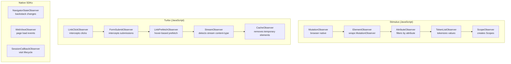
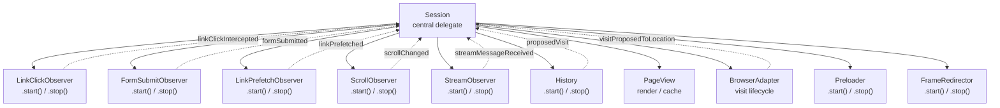
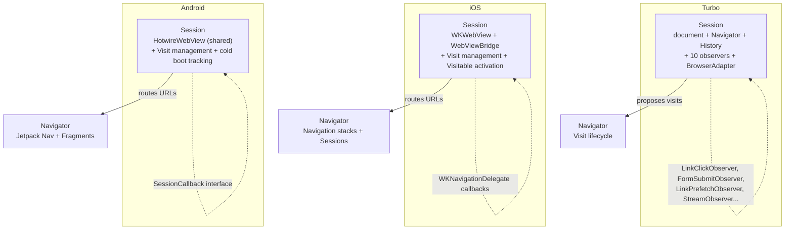
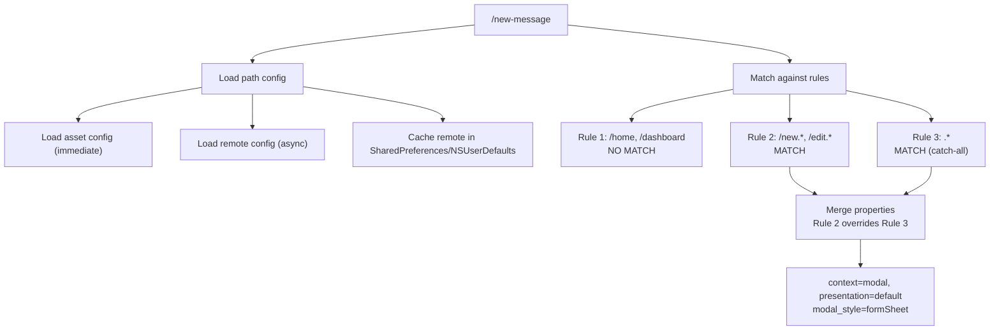

# Cross-Cutting Concerns: Observer Patterns, Delegates, Sessions, and Path Configuration

Several design patterns recur across the entire Hotwire ecosystem. The observer pattern powers DOM detection in Stimulus and native WebView events in Turbo. The delegate pattern coordinates subsystems in both Turbo and the native SDKs. The Session pattern centralizes navigation management in all four layers. Path configuration drives native navigation behavior on both iOS and Android. This document catalogs these cross-cutting patterns and explains how they manifest across the ecosystem.

## The Observer Pattern Everywhere

Hotwire uses observers at every layer to detect changes and respond without polling.



In Stimulus, the `MutationObserver` hierarchy (detailed in [Stimulus Observers](02-stimulus-observers.md)) detects attribute changes and drives controller lifecycle. In Turbo, a flat set of observers (not a hierarchy) each watch for specific DOM events and delegate to the `Session`. In native SDKs, observers wrap platform-specific callbacks (WebKit delegates, Android lifecycle callbacks) and forward to the Session.

### Observer Comparison Across Layers

| Pattern | Stimulus | Turbo | Native iOS | Native Android |
|---------|----------|-------|-----------|---------------|
| Primary observer | `MutationObserver` | DOM event listeners | `WKNavigationDelegate` | Fragment lifecycle |
| Detection target | DOM attributes | Link clicks, form submits | WKWebView navigation | WebView load events |
| Response | Connect/disconnect controllers | Propose visits, cache snapshots | Create Visits, route URLs | Create Visits, attach WebView |
| Pause mechanism | `pause(callback)` | None needed | None needed | None needed |
| Hierarchy | 6-level composition chain | Flat (direct to Session) | Delegate chain | Delegate chain |

## The Delegate Pattern

Delegation is the primary communication mechanism. A coordinator object serves as the delegate for multiple subsystems, receiving callbacks from each and deciding how to respond.

### Turbo Session as Universal Delegate

The Turbo `Session` class is the delegate for 10+ subsystems:

| Subsystem | Delegate Method Called | Session Response |
|-----------|----------------------|------------------|
| `LinkClickObserver` | `linkClickIntercepted(link, event)` | Check `elementIsNavigatable`, propose visit |
| `FormSubmitObserver` | `formSubmitted(form, submitter)` | Check `submissionIsNavigatable`, submit via Turbo |
| `LinkPrefetchObserver` | `linkPrefetched(url, request)` | Cache the request for potential click |
| `ScrollObserver` | `scrollChanged(position)` | Update history restoration data |
| `StreamObserver` | `streamMessageReceived(message)` | Render via `StreamMessageRenderer` |
| `History` | `proposedVisit(location, action)` | Create Visit, start navigation |
| `PageView` | `allowsImmediateRender(snapshot)` | Check if Turbo Drive is enabled |
| `BrowserAdapter` | `visitProposedToLocation(location, options)` | Start visit or full page nav |
| `Preloader` | `shouldPreloadLink(link)` | Check preload eligibility |
| `FrameRedirector` | Various frame routing callbacks | Route to appropriate frame controller |



### Native iOS Delegate Chain

The iOS SDK uses protocols for delegation:

| Protocol | Adopted By | Used By |
|----------|-----------|---------|
| `SessionDelegate` | `Navigator` | `Session` |
| `VisitDelegate` | `Session` | `ColdBootVisit`, `JavaScriptVisit` |
| `NavigatorDelegate` | App code | `Navigator` |
| `WebViewDelegate` | `Session` | `WebViewBridge` |
| `VisitableDelegate` | `Session` | `VisitableViewController` |
| `BridgeDelegate` (protocol) | `VisitableViewController` | `Bridge` |

The chain flows from low-level to high-level: `WebViewBridge` -> `Session` -> `Navigator` -> `NavigatorDelegate` (app code). Each level translates the events into its own domain.

### Native Android Delegate Chain

Android uses interfaces similarly:

| Interface | Implemented By | Used By |
|-----------|---------------|---------|
| `SessionCallback` | `HotwireWebFragmentDelegate` | `Session` |
| `VisitDestination` | `HotwireWebFragmentDelegate` | `Visit` |
| `HotwireDestination` | `HotwireFragment`, `HotwireWebFragment` | `Navigator` |
| `BridgeDestination` | `HotwireDestination` | `BridgeDelegate` |
| `Router.RouteDecisionHandler` | Built-in handlers | `Router` |

## The Session Pattern

Every layer has a Session class that serves as the central coordinator.

### Session Comparison

| Aspect | Turbo (Browser) | Native iOS | Native Android |
|--------|----------------|-----------|---------------|
| Web view | `document.documentElement` | `WKWebView` (per session) | `HotwireWebView` (shared) |
| Visit types | `Visit` (XHR-driven) | `ColdBootVisit`, `JavaScriptVisit` | `Visit` (cold boot vs JS) |
| Cache | `SnapshotCache` (LRU, size 10) | Restoration identifiers (NSMapTable) | Restoration identifiers (HashMap) |
| Navigation | `Navigator` (proposes visits) | `Navigator` (routes + stacks) | `Navigator` (Jetpack Nav) |
| Bridge | N/A | `Bridge` (WKUserScript) | `Bridge` (JS interface) |
| Observers | 10 internal observers | `WKNavigationDelegate` | `SessionCallback` |
| Delegate protocol | `Session.delegate` | `SessionDelegate` | `SessionCallback` |



Aha: The Session pattern is consistent across all layers but adapts to platform constraints. Turbo's Session manages the document and intercepts DOM events. iOS's Session manages a WKWebView and Visitable view controllers. Android's Session manages a shared WebView and fragments. The core responsibilities are identical: manage visits, coordinate with a Navigator, handle bridge communication. The implementation details differ because each platform has different primitives (DOM events vs WKNavigationDelegate vs Android fragments).

## Path Configuration: The Navigation Rule Engine

Both native SDKs use JSON path configuration to control navigation behavior. This is the single most important configuration file in a Hotwire native app.

### JSON Format

```json
{
  "settings": {
    "custom_key": "custom_value"
  },
  "rules": [
    {
      "patterns": ["/home", "/dashboard"],
      "properties": {
        "context": "default",
        "presentation": "default",
        "pull_to_refresh_enabled": true
      }
    },
    {
      "patterns": ["/new.*", "/edit.*"],
      "properties": {
        "context": "modal",
        "presentation": "default",
        "modal_style": "formSheet"
      }
    },
    {
      "patterns": [".*"],
      "properties": {
        "context": "default",
        "presentation": "default"
      }
    }
  ]
}
```

### Rule Matching

Rules are evaluated in order. All matching rules' properties are merged, with later rules overriding earlier ones. The `patterns` array contains regex strings (case-insensitive).



### Property Types

| Property | iOS Type | Android Type | Default | Meaning |
|----------|---------|-------------|---------|---------|
| `context` | `Navigation.Context` | `PresentationContext` | `.default` | Default or modal navigation stack |
| `presentation` | `Navigation.Presentation` | `Presentation` | `.default` | Push, pop, replace, refresh, etc. |
| `modal_style` | `Navigation.ModalStyle` | N/A | `.large` | iOS modal presentation style |
| `pull_to_refresh_enabled` | `Bool` | `Boolean` | `true` | Enable pull-to-refresh |
| `title` | `String` | `String` | Page title | Navigation bar title |
| `uri` | `String` | `String` | None | Deep link URI for nav destination |
| `fallback_uri` | `String` | `String` | None | Fallback if primary not found |
| `animated` | `Bool` | N/A | `true` | Animate navigation transition |
| `historical_location` | `Bool` | N/A | `false` | Track for back navigation |
| `query_string_presentation` | `QueryStringPresentation` | `QueryStringPresentation` | `.default` | How query string changes are presented |

### Loading Sources

Both SDKs support multiple configuration sources:

Source: iOS `Source/Path Configuration/PathConfiguration.swift`

```swift
// iOS
enum PathConfiguration.Source: Equatable {
    case data(Data)       // immediate parse
    case file(URL)        // read from bundle
    case server(URL)      // download + cache to ~/Library/Caches/Turbo/
}

Hotwire.loadPathConfiguration(from: [
    .file(Bundle.main.url(forResource: "path-configuration", withExtension: "json")!),
    .server(URL(string: "https://example.com/path-configuration.json")!)
])
```

Source: Android `core/.../config/PathConfiguration.kt`

```kotlin
// Android
data class Location(val assetFilePath: String?, val remoteFileUrl: String?)

Hotwire.loadPathConfiguration(
    context = this,
    location = PathConfiguration.Location(
        assetFilePath = "json/path-configuration.json",
        remoteFileUrl = "https://example.com/path-configuration.json"
    ),
    options = PathConfiguration.LoaderOptions(httpHeaders = mapOf("Authorization" to "Bearer ..."))
)
```

The typical loading strategy loads a bundled file immediately (for offline-first startup) and then downloads a remote file asynchronously (for server-controlled navigation changes). The remote file is cached for offline use.

## Event Dispatch Pattern

All layers dispatch custom events that user code can listen for.

### Turbo Events

| Event | When Dispatched | Cancelable |
|-------|----------------|------------|
| `turbo:click` | Link clicked before navigation | Yes |
| `turbo:before-visit` | Visit about to start | Yes |
| `turbo:visit` | Visit started | No |
| `turbo:before-cache` | Page about to be cached | No |
| `turbo:before-render` | Page about to be rendered | No |
| `turbo:render` | Page rendered | No |
| `turbo:load` | Visit completed, page loaded | No |
| `turbo:frame-load` | Frame content loaded | No |
| `turbo:frame-render` | Frame rendered | No |
| `turbo:reload` | Page reloading | No |
| `turbo:before-stream-render` | Stream action about to apply | Yes |
| `turbo:before-frame-render` | Frame about to render | Yes |
| `turbo:before-morph-element` | Element about to be morphed | Yes |
| `turbo:morph-element` | Element morphed | No |
| `turbo:before-morph-attribute` | Attribute about to be morphed | Yes |

### Stimulus Events

Stimulus controllers dispatch events via `this.dispatch()`:

```javascript
this.dispatch("loaded", { detail: { data: result } })
// Dispatches: "my:loaded" on the element (prefixed by controller identifier)
```

### Native Events

The native SDKs use delegate methods rather than events:

```swift
// iOS
func session(_ session: Session, didProposeVisit proposal: VisitProposal)
func session(_ session: Session, didFailRequestForVisitable visitable: Visitable, error: Error)
```

```kotlin
// Android
override fun onPageStarted()
override fun onPageFinished(location: String)
override fun onReceivedError(error: VisitError)
```

## Naming Conventions

| Layer | Controllers | Components | Files |
|-------|------------|------------|-------|
| Stimulus | `my_controller.js` | `MyController` class | `*_controller.ts` |
| Turbo | N/A | `<turbo-frame>` element | `*_element.js` |
| Native iOS | N/A | `AlertComponent` | `*Component.swift` |
| Native Android | N/A | `AlertComponent` | `*Component.kt` |
| Bridge Components | `bridge--alert_controller.js` | `alert` (bridge name) | `*_controller.js` |
| Rails | N/A | `Turbo::Streams::TagBuilder` | `*_helper.rb` |

The Stimulus namespace convention uses double dashes: `bridge--alert` maps to the file `bridge/alert_controller.js`. The bridge component name is the part after the double dash: `alert`.

## Error Handling

Each layer has its own error types:

### Turbo Errors

```javascript
// src/core/errors.js
class TurboFrameMissingError extends Error {}

// HTTP status codes in visit.js:
const SystemStatusCode = {
  networkFailure: 0,
  timeoutFailure: -1,
  contentTypeMismatch: -2
}
```

### Native iOS Errors

```swift
// Source/TurboError.swift
enum TurboError: LocalizedError {
    case networkFailure
    case timeoutFailure
    case contentTypeMismatch
    case pageLoadFailure
    case http(statusCode: Int)
}

// core/.../errors/ (Android equivalent)
sealed interface VisitError
sealed interface HttpError : VisitError  // ClientError, ServerError
sealed interface LoadError : VisitError  // NotPresent, NotReady
sealed interface WebError : VisitError   // Unknown, HostLookup, etc.
sealed interface WebSslError : VisitError // NotYetValid, Expired, etc.
```

## Key Constants Across the Ecosystem

| Constant | Value | Used In |
|----------|-------|---------|
| SnapshotCache size | 10 | Turbo |
| ProgressBar animation | 300ms | Turbo |
| ProgressBar delay | 500ms | Turbo |
| Prefetch TTL | 10s | Turbo |
| Prefetch delay | 100ms | Turbo |
| Page refresh debounce | 150ms | Turbo |
| Recent requests max | 20 | Turbo |
| Default value types | array, boolean, number, object, string | Stimulus |
| Unvisitable extensions | 56 extensions | Turbo |
| Android min SDK | 28 | hotwire-native-android |
| iOS min version | 14 | hotwire-native-ios |
| WebView Chromium min | 120 | hotwire-native-android |
| Bridge component peer deps | Stimulus >= 3.2, bridge >= 1.2 | bridge-components |
| Rails min version | 6.0 (stimulus), 7.1 (turbo) | stimulus-rails, turbo-rails |

## Next

This document ties together patterns from all layers. For specific deep dives, see [Stimulus Core](01-stimulus-core.md), [Turbo Drive](04-turbo-drive.md), [Native iOS](06-native-ios.md), [Native Android](07-native-android.md), and [Bridge Protocol](08-bridge-protocol.md).
