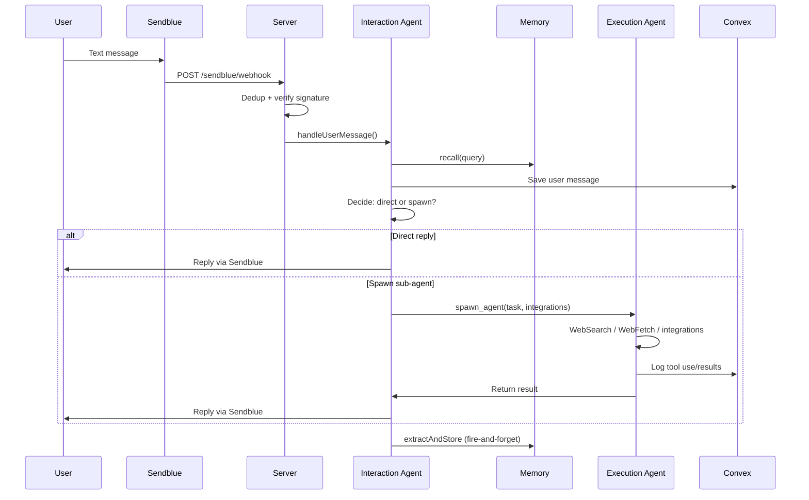

# Boop: Overview

Boop is an iMessage-based personal agent you text like a friend. Behind the casual interface sits a carefully designed distributed system: a dispatcher that decides what to do, sub-agents that do the work, a tiered memory system that remembers across conversations, and an integrations layer that connects to 1000+ services.

## What It Is

A single-process Express server that receives iMessage texts via Sendblue webhooks, runs them through an LLM-powered dispatcher (the "interaction agent"), and optionally spawns focused sub-agents ("execution agents") to perform real work — web research, email, calendar queries, Slack messages, GitHub operations, and more.

**Source:** `server/index.ts:35` — main entry point
**Version:** 0.2.0, TypeScript, MIT license
**Runtime:** Node.js 20+, Express 5, Convex for persistence

## The Core Insight: Dispatcher / Executor Split

**Aha:** The interaction agent is a *dispatcher*, not a doer. It has no web access, no file system, no API tools — only memory, spawn, automation, and draft tools. This keeps it cheap, fast, and deterministic. Most casual turns (chit-chat, simple questions) never spawn a sub-agent. Real work gets a focused execution agent with only the integrations it needs.

```mermaid
flowchart TD
    A[iMessage] -->|webhook| B[Sendblue]
    B -->|POST /sendblue/webhook| C[Interaction Agent\n(dispatcher)]
    C -->|chit-chat| D[Direct reply]
    C -->|real work| E[spawn_agent]
    E -->|task + integrations| F[Execution Agent]
    F -->|WebSearch, WebFetch| G[External tools]
    F -->|Composio MCP| H[Integrations]
    F -->|result| C
    C -->|reply| B
    B -->|Sendblue API| A
    C -->|background| I[Memory extraction]
    C -->|daily| J[Consolidation]
    K[Automations] -->|every 30s tick| E
```

## Architecture at a Glance

```
┌─────────────┐    webhook     ┌─────────────────────┐
│   iMessage  │ ─────────────► │ Sendblue → /webhook │
└─────────────┘                └──────────┬──────────┘
                                          │
                                          ▼
                          ┌────────────────────────────┐
                          │    Interaction agent       │
                          │    (dispatcher only)       │
                          │  • recall / write_memory   │
                          │  • spawn_agent(...)        │
                          └────────┬────────┬──────────┘
                                   │        │
                   ┌───────────────┘        └──────────────┐
                   ▼                                       ▼
           ┌───────────────┐                      ┌──────────────┐
           │   Memory      │                      │  Execution   │
           │ (Convex)      │                      │  agent(s)    │
           │ + cleaning    │                      │  + integrations│
           └───────────────┘                      └──────────────┘
                              │
                              ▼
                       ┌────────────┐         ┌────────────────┐
                       │  Convex    │◄───────►│  Debug UI      │
                       │  (truth)   │         │  (read-only)   │
                       └────────────┘         └────────────────┘
```

**Source:** `README.md:319` (upstream), `ARCHITECTURE.md:1`

## Four Moving Parts

1. **Interaction Agent** (`server/interaction-agent.ts`) — The front door. Decides, doesn't do. Reads user message + recent history, chooses: answer directly or spawn a sub-agent.

2. **Execution Agent** (`server/execution-agent.ts`) — Spawned per task. Gets only the integrations named in the spawn call. Returns a concise answer.

3. **Memory** (`server/memory/`) — Three tiers (short/long/permanent), seven segments (identity/correction/relationship/preference/project/knowledge/context), post-turn extraction, adaptive decay, daily cleaning.

4. **Integrations** (`server/composio.ts`) — Composio handles 1000+ toolkits with hosted OAuth. Each spawn scopes the toolkit to just what's needed.

Plus background loops: **Automations** (30s poll), **Heartbeat** (60s stale-agent sweep), **Consolidation** (24h adversarial pipeline), **Image cleanup**.

## Dual Runtime Support

Boop runs on **two LLM runtimes** — you choose during setup:

| Runtime | SDK | Default Model | Billing |
|---------|-----|---------------|---------|
| Claude | `@anthropic-ai/claude-agent-sdk` | `claude-sonnet-4-6` | API (real cost) |
| Codex | `codex app-server` via stdio | `gpt-5.5` | Subscription (estimated cost) |

**Source:** `server/runtimes/index.ts:6` — `runAgentRuntime` dispatcher
**Source:** `server/runtime-config.ts:27-32` — `RuntimeConfig` interface

The same agent code runs on both through a runtime abstraction layer (`server/runtimes/`). The dispatcher (`interaction-agent.ts`) and worker (`execution-agent.ts`) are runtime-agnostic — they call `runAgentRuntime(config, request)` and get back `{ text, usage }`.

## Key Design Decisions

### Memory Lives Next to Execution, Not in the Model

Claude has no memory across turns. Boop re-hydrates the relevant slice every turn via `recall()`. Writing is explicit (`write_memory`) or inferred (`extract.ts`). Nothing is implicit.

**Aha:** `recall()` is **mandatory** before any claim about the user — the system prompt enforces this as a hard rule. Saying "I don't have a phone number for Alex" without calling `recall()` first is a critical failure, because that fact might be in memory.

### Integrations Via Composio, Not Hand-Rolled

Every third-party service connects through Composio's proxy. Boop never sees an access token. Each sub-agent gets only the toolkits the dispatcher named — tens of tools per spawn, not thousands.

### Convex for Reactive State

The debug dashboard reads Convex in real-time — no polling needed. Messages, agents, memory, automations, drafts, usage — all live in Convex tables with typed queries.

## Project Layout

```
boop-agent/
├── server/                          # Express server + agents
│   ├── index.ts                     # Entry: routes, WS, loop starts
│   ├── interaction-agent.ts         # Dispatcher
│   ├── execution-agent.ts           # Sub-agent runner
│   ├── sendblue.ts                  # iMessage webhook + reply
│   ├── runtimes/                    # Claude + Codex adapters
│   │   ├── index.ts                 # runAgentRuntime dispatcher
│   │   ├── claude.ts                # Claude Agent SDK adapter
│   │   ├── codex-app-server.ts      # Codex app-server stdio adapter
│   │   └── types.ts                 # Shared runtime contracts
│   ├── memory/                      # Tiered memory system
│   │   ├── tools.ts                 # recall / write_memory MCP
│   │   ├── extract.ts               # Post-turn fact extraction
│   │   ├── clean.ts                 # Decay + archive + prune loop
│   │   └── types.ts                 # MemoryRecord, SegmentDefaults
│   ├── integrations/                # Integration registry
│   │   ├── registry.ts              # loadIntegrations, buildMcpServers
│   │   ├── composio-loader.ts       # Register Composio toolkits
│   │   ├── browser-loader.ts        # Register optional local browser
│   │   └── apple-loader.ts          # Register optional Apple data
│   ├── composio.ts                  # Composio SDK wrapper
│   ├── composio-routes.ts           # /composio/* HTTP routes
│   ├── consolidations.ts            # Adversarial memory pipeline
│   ├── automations.ts               # Cron poll + execution
│   ├── heartbeat.ts                 # Stale-agent sweep
│   ├── runtime-config.ts            # Model/runtime/feature settings
│   ├── usage.ts                     # Cost aggregation
│   ├── embeddings.ts                # Voyage/OpenAI/local BGE vectors
│   └── browser/                     # Optional Patchright Chrome
│       ├── launcher.ts              # Chrome launch/status
│       └── tools.ts                 # Browser MCP tools
├── convex/                          # Real-time database
│   ├── schema.ts                    # 14 tables
│   └── *.ts                         # Queries + mutations
├── debug/                           # React + Vite dashboard
├── scripts/                         # Setup, dev orchestrator
└── package.json                     # Dependencies, scripts
```

**Source:** Full file listing from `find` command on source directory

## What You Get

- **iMessage in/out** via Sendblue — typing indicators, webhook dedup, signed requests
- **Dispatcher + workers** — lean interaction agent spawns focused sub-agents
- **Pure dispatcher** — no web access, no files, no APIs for the dispatcher; sub-agents get `WebSearch`/`WebFetch`/integrations
- **Tiered memory** — short/long/permanent with post-turn extraction, decay, and cleaning
- **Vector search** — Voyage/OpenAI embeddings with local BGE-large fallback
- **Memory consolidation** — daily 3-phase adversarial pipeline (proposer → adversary → judge)
- **Automations** — schedule recurring work from text ("every morning at 8 summarize my calendar")
- **Draft-and-send** — external actions stage first, commit only on user confirm
- **Composio integrations** — 1000+ toolkits, hosted OAuth, multi-account support
- **Optional local browser** — Patchright-backed Chrome for login-required services
- **Optional Apple data** — Mac-only, read-only iMessage/Notes/Reminders connectors
- **Debug dashboard** — React + Vite with agents, automations, memory graph, events, connections
- **Dual runtime** — Claude or Codex, switch at runtime via iMessage

## Quick Data Flow

Following a text from iMessage to reply:



**Source:** Traced from `server/sendblue.ts:283` → `server/interaction-agent.ts:319` → `server/execution-agent.ts:125`

## Next

Continue to [Architecture](01-architecture.md) for the full dependency graph, layer diagram, and module communication patterns.
