# Boop: Architecture

Boop is a small distributed system disguised as a single-server app. Four moving parts, each doing one job, communicating through Convex for state and Express/WS for real-time events.

**Source:** `server/index.ts` — entry point
**Source:** `ARCHITECTURE.md` — upstream architecture doc

## Layer Diagram

```
┌────────────────────────────────────────────────────────────────┐
│                        EXPRESS + WS SERVER                      │
│                                                                 │
│   POST /sendblue/webhook   ──────►  Interaction Agent           │
│   POST /chat                        (dispatcher, streams)       │
│   WS /ws                                  │                     │
│                                           │ spawn_agent         │
│                                           ▼                     │
│                                    Execution Agent(s)           │
│                                    (one per task)               │
│                                           │                     │
│                                           ▼                     │
│                                    Integrations (MCP/tools)     │
└────────────────────────────────────────────────────────────────┘
                              │
                              ▼
                       ┌────────────┐         ┌────────────────┐
                       │  Convex    │◄───────►│  Debug UI      │
                       │  (truth)   │         │  (read-only)   │
                       └────────────┘         └────────────────┘
```

**Source:** `server/index.ts:35-226` — main() function

## Module Dependency Graph

```mermaid
flowchart TD
    subgraph Entry
        IDX[server/index.ts]
    end

    subgraph "Core Agents"
        IA[interaction-agent.ts]
        EA[execution-agent.ts]
    end

    subgraph "I/O Layer"
        SB[sendblue.ts]
        SB_AUTH[sendblue-webhook-auth.ts]
        BC[broadcast.ts]
        CVX[convex-client.ts]
    end

    subgraph "Runtimes"
        RT[runtimes/index.ts]
        RT_CLAUDE[runtimes/claude.ts]
        RT_CODEX[runtimes/codex-app-server.ts]
        RT_TYPES[runtimes/types.ts]
        RT_TOOL[runtimes/tool.ts]
    end

    subgraph "Memory"
        MEM_TOOLS[memory/tools.ts]
        MEM_EXTRACT[memory/extract.ts]
        MEM_CLEAN[memory/clean.ts]
        MEM_TYPES[memory/types.ts]
    end

    subgraph "Integrations"
        REG[integrations/registry.ts]
        COMP[composio.ts]
        COMP_ROUTES[composio-routes.ts]
        BROWSER_L[browser-loader.ts]
        APPLE_L[apple-loader.ts]
    end

    subgraph "Background Loops"
        AUTO[automations.ts]
        AUTO_TOOLS[automation-tools.ts]
        HB[heartbeat.ts]
        CONS[consolidation.ts]
        IMG_CLEAN[images/clean.ts]
    end

    subgraph "Configuration"
        RTC[runtime-config.ts]
        TZ[timezone-config.ts]
        PRIVACY[privacy.ts]
    end

    subgraph "Optional Features"
        BROWSER[browser/launcher.ts]
        BROWSER_TOOLS[browser/tools.ts]
        BROWSER_ROUTES[browser-routes.ts]
        APPLE[apple/tools.ts]
        APPLE_ROUTES[apple-routes.ts]
    end

    subgraph "Utilities"
        USAGE[usage.ts]
        EMBED[embeddings.ts]
        DRAFT[draft-tools.ts]
        SELF[self-tools.ts]
        IMG[images/content-blocks.ts]
        IMG_MIME[images/mime.ts]
    end

    subgraph "Debug UI"
        DEBUG[debug/]
    end

    subgraph "Convex"
        SCHEMA[convex/schema.ts]
        CVX_FNS[convex/*.ts]
    end

    IDX --> IA
    IDX --> SB
    IDX --> REG
    IDX --> MEM_CLEAN
    IDX --> AUTO
    IDX --> HB
    IDX --> CONS
    IDX --> RT
    IDX --> RTC
    IDX --> EMBED
    IDX --> MEM_ROUTES[memory-routes.ts]
    IDX --> BROWSER_ROUTES
    IDX --> APPLE_ROUTES
    IDX --> COMP_ROUTES
    IDX --> IMG_CLEAN
    IDX --> CHG[changelog.ts]
    IDX --> LA[local-access.ts]

    IA --> MEM_TOOLS
    IA --> AUTO_TOOLS
    IA --> DRAFT
    IA --> SELF
    IA --> EA
    IA --> RT
    IA --> RTC
    IA --> BC
    IA --> SB
    IA --> USAGE
    IA --> IMG
    IA --> PRIVACY

    EA --> REG
    EA --> DRAFT
    EA --> RT
    EA --> RTC
    EA --> BC
    EA --> CVX
    EA --> USAGE
    EA --> IMG

    SB --> IA
    SB --> BC
    SB --> CVX
    SB --> SB_AUTH
    SB --> IMG
    SB --> IMG_MIME
    SB --> PRIVACY
    SB --> SDR[scripted-demo-replies.ts]

    REG --> COMP
    REG --> BROWSER_L
    REG --> APPLE_L
    REG --> RT_TYPES

    COMP --> RT_CLAUDE
    COMP --> RT_TYPES

    RT --> RT_CLAUDE
    RT --> RT_CODEX
    RT_CLAUDE --> RT_TYPES
    RT_CLAUDE --> USAGE
    RT_CODEX --> RT_TYPES
    RT_CODEX --> USAGE

    MEM_TOOLS --> MEM_TYPES
    MEM_TOOLS --> EMBED
    MEM_TOOLS --> RT_CLAUDE
    MEM_TOOLS --> RT_TOOL

    MEM_EXTRACT --> EMBED
    MEM_EXTRACT --> RT
    MEM_EXTRACT --> RTC
    MEM_EXTRACT --> USAGE
    MEM_EXTRACT --> MEM_TYPES
    MEM_EXTRACT --> IMG

    MEM_CLEAN --> CVX
    MEM_CLEAN --> MEM_TYPES

    CONS --> RT
    CONS --> RTC
    CONS --> USAGE
    CONS --> CVX
    CONS --> BC

    AUTO --> CVX
    AUTO --> EA
    AUTO --> SB
    AUTO --> BC
    AUTO --> TZ

    HB --> CVX
    HB --> EA
    HB --> BC

    BROWSER_ROUTES --> BROWSER
    BROWSER_ROUTES --> RTC
    BROWSER_ROUTES --> LA

    APPLE_ROUTES --> APPLE
    APPLE_ROUTES --> RTC
    APPLE_ROUTES --> LA

    DEBUG --> CVX_FNS
    DEBUG --> SCHEMA
```



**Source:** Complete file import analysis across all `server/**/*.ts` files

## Communication Patterns

### HTTP Routes (Express)

| Route | Module | Purpose |
|-------|--------|---------|
| `GET /health` | `index.ts:74` | Health check |
| `POST /chat` | `index.ts:171` | Local test / dashboard chat |
| `POST /sendblue/webhook` | `sendblue.ts:226` | Inbound iMessage webhook |
| `/composio/*` | `composio-routes.ts` | Toolkit catalog, OAuth, refresh |
| `/memory/*` | `memory-routes.ts` | Memory query routes for dashboard |
| `/browser/*` | `browser-routes.ts` | Local-only browser control |
| `/apple/*` | `apple-routes.ts` | Local-only Apple data control |
| `/changelog/*` | `changelog.ts` | Upstream changelog routes |
| `POST /agents/:id/cancel` | `index.ts:143` | Abort a running agent |
| `POST /agents/:id/retry` | `index.ts:161` | Re-spawn a failed agent |
| `POST /consolidate` | `index.ts:148` | Trigger manual consolidation |
| `GET/POST /runtime-config` | `index.ts:78-134` | Runtime/model settings |
| `WS /ws` | `index.ts:191` | WebSocket for real-time events |

**Source:** `server/index.ts:74-199`

### WebSocket Events (Broadcast)

The server fans out events to all connected WS clients via `broadcast.ts`:

| Event | Trigger | Payload |
|-------|---------|---------|
| `hello` | WS connect | `{ ok: true }` |
| `user_message` | Inbound text | `{ conversationId, content }` |
| `proactive_notice` | Proactive email notice | `{ conversationId, content }` |
| `assistant_ack` | Dispatcher ack before spawn | `{ conversationId, content }` |
| `assistant_message` | Final reply | `{ conversationId, content }` |
| `thinking` | Dispatcher streaming | `{ conversationId, t }` |
| `message_in` | Sendblue webhook received | `{ conversationId, from_number }` |
| `agent_spawned` | New execution agent | `{ agentId, name, task }` |
| `agent_tool` | Agent tool use | `{ agentId, toolName, accounts }` |
| `agent_done` | Agent finished | `{ agentId, status, result }` |
| `agent_stale` | Heartbeat marked failed | `{ agentId }` |
| `automation_started` | Automation fired | `{ automationId, runId, name }` |
| `automation_completed` | Automation finished | `{ automationId, runId }` |
| `automation_failed` | Automation failed | `{ automationId, runId, error }` |
| `consolidation_started` | Consolidation run | `{ runId, trigger }` |
| `consolidation_phase` | Phase transition | `{ runId, phase, ... }` |
| `consolidation_completed` | Consolidation done | `{ runId, merged, pruned }` |
| `consolidation_failed` | Consolidation error | `{ runId, error }` |
| `memory.written` | New memory stored | `{ conversationId, memoryId }` |
| `memory.recalled` | Memory recalled | `{ conversationId, query, hits, mode }` |
| `memory.extracted` | Post-turn extraction | `{ conversationId, turnId, count }` |
| `memory.cleaned` | Cleaning sweep | `{ scanned, archived, pruned }` |
| `memory.consolidated` | Consolidation done | `{ runId, proposals, merged, pruned }` |

**Source:** `server/broadcast.ts:1-30` (WS fanout), calls across all modules

## Body Parser Ordering

**Aha:** The Composio webhook receiver must read raw bytes for HMAC verification, so its body parser is mounted **before** the global `express.json()`. Without this ordering, the JSON parser consumes the stream first and the raw buffer arrives empty.

```ts
// server/index.ts:71
app.use("/composio/webhook", express.raw({ type: "application/json", limit: "2mb" }));
app.use(express.json({ limit: "2mb" }));
```

**Source:** `server/index.ts:67-72`

## Access Control: Public Tunnel vs Local

**Aha:** Only health checks and provider webhook routes are exposed through the public tunnel. Dashboard, browser-control, and local configuration routes remain local to the Mac.

```ts
// server/index.ts:59
app.use((req, res, next) => {
  if (isPublicServerRequest(req) || isTrustedLocalRequest(req)) {
    next();
    return;
  }
  res.status(404).json({ error: "not found" });
});
```

**Source:** `server/index.ts:59-65`, `server/local-access.ts`

## Signal Handling

Clean shutdown closes the local browser before exiting:

```ts
// server/index.ts:210
const signalExitCodes = { SIGTERM: 143, SIGINT: 130, SIGHUP: 129 } as const;
for (const sig of ["SIGTERM", "SIGINT", "SIGHUP"] as const) {
  process.on(sig, () => {
    if (shuttingDown) return;
    shuttingDown = true;
    closeLocalBrowser().finally(() => process.exit(signalExitCodes[sig]));
  });
}
```

**Source:** `server/index.ts:210-220`

## Server Boot Sequence

```mermaid
flowchart TD
    A[main()] --> B[loadIntegrations]
    B --> C[startCleanupLoop - 6h]
    C --> D[startAutomationLoop - 30s]
    D --> E[startHeartbeatLoop - 60s]
    E --> F[startConsolidationLoop - 24h]
    F --> G[startImageCleanup]
    G --> H[preloadLocalModel]
    H --> I{PUBLIC_URL set?}
    I -->|yes| J[ensureProactiveWatcher]
    I -->|no| K[skip proactive]
    J --> L[Create Express app]
    K --> L
    L --> M[Mount routes]
    M --> N[Create HTTP server]
    N --> O[Create WS server on /ws]
    O --> P[server.listen PORT]
    P --> Q[Signal handlers]
```

**Source:** `server/index.ts:35-226`

## Next

Continue to [Interaction Agent](02-interaction-agent.md) for the dispatcher deep dive — system prompt, tools, spawn logic, and acknowledgment flow.
