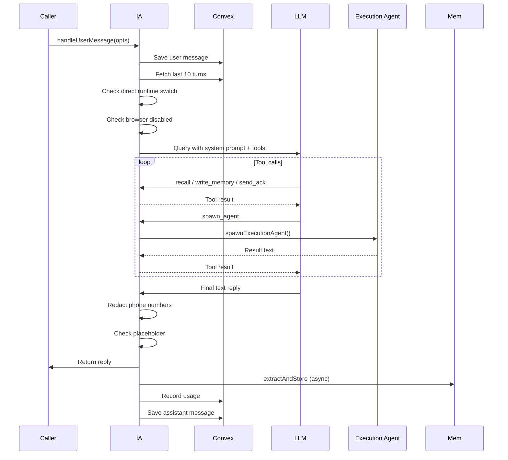

# Boop: Interaction Agent (Dispatcher)

The interaction agent is Boop's front door. One instance per user turn. Its job is to **decide**, not to do.

**Source:** `server/interaction-agent.ts:28-654`
**Version:** Part of boop-agent 0.2.0

## Role and Responsibilities

The interaction agent receives the user's message plus the last 10 turns from Convex, then chooses: answer directly (chit-chat, simple questions) or spawn a sub-agent for real work. It has exactly five tool categories:

1. **Memory** — `recall()`, `write_memory()`
2. **Spawn** — `spawn_agent(task, integrations[], name?)`
3. **Automations** — `create/list/toggle/delete_automation`
4. **Drafts** — `list_drafts`, `send_draft`, `reject_draft`
5. **Self-inspection** — `get_config`, `set_runtime`, `set_model`, `set_timezone`, etc.

```mermaid
flowchart TD
    A[User message + last 10 turns] --> B{Direct runtime switch?}
    B -->|"use claude/codex"| C[Switch runtime, reply instantly]
    B -->|no| D{Browser requested but disabled?}
    D -->|yes| E[Reply: turn it on in Settings]
    D -->|no| F[Build prompt with history + images]
    F --> G[Query LLM with INTERACTION_SYSTEM]
    G --> H{Model tool calls}
    H -->|recall| I[Search memory, return results]
    H -->|write_memory| J[Persist fact to Convex]
    H -->|send_ack| K[Send "On it..." to user]
    H -->|spawn_agent| L[Create execution agent]
    H -->|automation tools| M[Create/list/toggle/delete]
    H -->|draft tools| N[List/send/reject drafts]
    H -->|self tools| O[Config/model/runtime changes]
    H -->|text reply| P[Final answer]
    I --> G
    J --> G
    K --> G
    L --> G
    M --> G
    N --> G
    O --> G
    P --> Q[Redact phone numbers]
    Q --> R[Validate not placeholder]
    R --> S[Broadcast + persist reply]
    S --> T[Fire-and-forget extractAndStore]
    T --> U[Return reply]
```

**Source:** `server/interaction-agent.ts:319-654` — `handleUserMessage()` function

## System Prompt Architecture

The `INTERACTION_SYSTEM` prompt (~230 lines) is the most carefully engineered piece in Boop. It enforces behavioral rules that are hard to implement in code:

```ts
// server/interaction-agent.ts:28
const INTERACTION_SYSTEM = `You are Boop, a personal agent the user texts from iMessage.

You are a DISPATCHER, not a doer. Your job:
1. Understand what the user wants.
2. Decide: answer directly (quick facts, chit-chat) OR spawn_agent (real work).
3. When you spawn, give the agent a crisp, specific task.
4. When the agent returns, relay the result in YOUR voice.
...`;
```

**Key enforced rules:**
- **No world knowledge from training data** — "You cannot answer factual questions from your own knowledge. Not allowed."
- **Mandatory recall** — "BEFORE making ANY statement about the user — you MUST call recall() first."
- **Ack before spawn** — "BEFORE every spawn_agent call, you MUST call send_ack first with a short 1-sentence message."
- **Draft-before-send** — external actions go through `save_draft` → `send_draft` flow
- **Phone number privacy** — never include phone numbers in replies
- **Verbatim source relay** — pass through the Sources section from sub-agents verbatim

**Source:** `server/interaction-agent.ts:28-236`

## Tool Surface

The interaction agent has a carefully restricted tool whitelist:

```ts
// server/interaction-agent.ts:531-554
allowedTools: [
  "mcp__boop-memory__write_memory",
  "mcp__boop-memory__recall",
  "mcp__boop-spawn__spawn_agent",
  "mcp__boop-automations__create_automation",
  "mcp__boop-automations__list_automations",
  "mcp__boop-automations__toggle_automation",
  "mcp__boop-automations__delete_automation",
  "mcp__boop-draft-decisions__list_drafts",
  "mcp__boop-draft-decisions__send_draft",
  "mcp__boop-draft-decisions__reject_draft",
  "mcp__boop-ack__send_ack",
  "mcp__boop-self__get_config",
  "mcp__boop-self__set_runtime",
  "mcp__boop-self__set_model",
  "mcp__boop-self__set_codex_reasoning_effort",
  "mcp__boop-self__set_timezone",
  "mcp__boop-self__list_integrations",
  "mcp__boop-self__search_composio_catalog",
  "mcp__boop-self__inspect_toolkit",
],
disallowedTools: [
  "WebSearch", "WebFetch", "Bash", "Read", "Write", "Edit", "Glob", "Grep", "Agent", "Skill",
],
```

**Aha:** The disallowed tools list is a belt-and-suspenders measure. Even with `bypassPermissions`, the SDK can leak its built-ins if you only whitelist. Explicitly blocking them forces the dispatcher to **must** spawn a sub-agent for external work.

**Source:** `server/interaction-agent.ts:531-569`

## Spawn Agent Tool

The `spawn_agent` tool is the bridge to execution agents:

```ts
// server/interaction-agent.ts:470-521
defineRuntimeTool(
  "boop-spawn",
  "spawn_agent",
  "Spawn a focused sub-agent to do real work using external tools...",
  {
    task: z.string().describe("Crisp task description — not the raw user message."),
    integrations: z.array(z.string()).describe("Which integrations to give the agent."),
    name: z.string().optional().describe("Short label for the agent."),
    imageRefs: z.array(z.string()).optional().describe("Convex storage IDs from current turn."),
  },
  async (args) => {
    const imageStorageIds = resolveSpawnImageRefs(args.imageRefs, spawnableImageStorageIds);
    const selectedIntegrations = resolveSpawnIntegrations(
      args.integrations, integrations, opts.content,
    ).filter((name) => integrations.includes(name));
    const res = await spawnExecutionAgent({
      task: args.task,
      integrations: selectedIntegrations,
      conversationId: opts.conversationId,
      name: args.name,
      runtimeConfig,
      imageStorageIds,
    });
    return runtimeText(`[agent ${res.agentId} ${res.status}]\n\n${redactPhoneNumbers(res.result)}`);
  },
)
```

**Source:** `server/interaction-agent.ts:470-521`

### Integration Resolution

The `resolveSpawnIntegrations` function handles the browser integration override:

```ts
// server/interaction-agent.ts:308
export function resolveSpawnIntegrations(
  requested: string[],
  available: string[],
  content: string,
): string[] {
  if (available.includes("browser") && explicitlyRequestsBrowser(content)) {
    return ["browser"];
  }
  return requested;
}
```

**Source:** `server/interaction-agent.ts:308-317`

### Browser Detection

The `explicitlyRequestsBrowser` function uses regex patterns to detect browser intent:

```ts
// server/interaction-agent.ts:287
function explicitlyRequestsBrowser(content: string): boolean {
  const normalized = content.toLowerCase().replace(/\s+/g, " ");
  const directBrowserIntent =
    /\blocal browser\b/.test(normalized) ||
    /\blocal chrome\b/.test(normalized) ||
    /\bpatchright\b/.test(normalized) ||
    // ... more patterns
  return directBrowserIntent || (antiNative && browserMention);
}
```

**Source:** `server/interaction-agent.ts:287-306`

## Acknowledgment Flow

**Aha:** The acknowledgment rule is a UX design encoded in the system prompt. Without it, the user sees nothing for 10-30 seconds while the sub-agent works. The `send_ack` tool sends a short message like "On it — one sec 🔍" **before** spawning.

```ts
// server/interaction-agent.ts:418
const sendAck = async (message: string): Promise<void> => {
  const text = redactPhoneNumbers(message.trim());
  if (!text) return;
  if (opts.conversationId.startsWith("sms:") && opts.kind !== "proactive") {
    const number = opts.conversationId.slice(4);
    await sendImessage(number, text);
  }
  await convex.mutation(api.messages.send, {
    conversationId: opts.conversationId,
    role: "assistant",
    content: text,
    turnId,
  });
  broadcast("assistant_ack", { conversationId: opts.conversationId, content: text });
};
```

**Source:** `server/interaction-agent.ts:418-436`

## Runtime Switch Handling

Direct runtime switches ("use claude", "switch to codex") are handled at the top of `handleUserMessage` before the LLM is even queried:

```ts
// server/interaction-agent.ts:375
const directRuntimeSwitch =
  opts.kind === "proactive" ? null : resolveDirectRuntimeSwitch(opts.content);
if (directRuntimeSwitch) {
  await setRuntimeProvider(directRuntimeSwitch);
  const reply = runtimeConfig.runtime === directRuntimeSwitch
    ? `Already on ${label}. Next turn will use ${nextConfig.model}.`
    : `Switched to ${label}. Next turn will use ${nextConfig.model}.`;
  return reply;
}
```

The `resolveDirectRuntimeSwitch` function uses a regex to match natural language requests:

```ts
// server/interaction-agent.ts:263
export function resolveDirectRuntimeSwitch(content: string): "claude" | "codex" | null {
  const match = normalized.match(
    /^(?:please |pls |can you )?(?:switch|change|set|use|move|flip)...(?<runtime>claude|codex)...$/,
  );
  // Returns "claude" or "codex" based on matched group
}
```

**Source:** `server/interaction-agent.ts:263-274`, `server/interaction-agent.ts:375-396`

## Image Handling

When the user sends a photo or screenshot:

1. Images are downloaded via `ingestSendblueImage` and stored in Convex storage
2. The prompt is built with `buildPromptWithImagesOrTextFallback` — base64-encoded image blocks or text fallback
3. The interaction agent sees images directly as input
4. If the task requires external work, the agent passes image storage IDs to the sub-agent via `imageRefs`

```ts
// server/interaction-agent.ts:276
export function resolveSpawnImageRefs(
  requestedRefs: string[] | undefined,
  inboundImageStorageIds: string[],
): string[] | undefined {
  if (inboundImageStorageIds.length === 0) return undefined;
  const selected = requestedRefs?.filter((id) => inboundImageStorageIds.includes(id));
  return selected && selected.length > 0 ? selected : inboundImageStorageIds;
}
```

**Source:** `server/interaction-agent.ts:276-285`, `server/images/content-blocks.ts`

## Placeholder Reply Detection

Sometimes the model produces placeholder text like "(no output)" instead of a real reply. Boop detects and replaces these:

```ts
// server/interaction-agent.ts:594
const placeholder = /^(?:\(\s*no (?:output|reply|response|content)\s*\)|no (?:output|reply|response|content))\.?$/i;
if (!reply || placeholder.test(reply)) {
  reply = "Hmm — got tangled up there. Want to try that again?";
}
```

**Source:** `server/interaction-agent.ts:586-602`

## Memory Extraction (Fire-and-Forget)

After the reply is sent, Boop extracts durable facts in the background:

```ts
// server/interaction-agent.ts:642
if (opts.kind !== "proactive") {
  extractAndStore({
    conversationId: opts.conversationId,
    userMessage: opts.content,
    assistantReply: reply,
    turnId,
    runtimeConfig,
    imageStorageIds: inboundImageStorageIds,
  }).catch((err) => console.error("[interaction] extraction error", err));
}
```

This is fire-and-forget — the user never waits on extraction. Skipped on proactive turns to avoid creating feedback loops.

**Source:** `server/interaction-agent.ts:636-651`

## Turn Lifecycle



**Source:** Traced from `server/interaction-agent.ts:319-654`

## Next

Continue to [Execution Agent](03-execution-agent.md) for the sub-agent deep dive — per-task execution, integration loading, tool logging, and abort handling.
