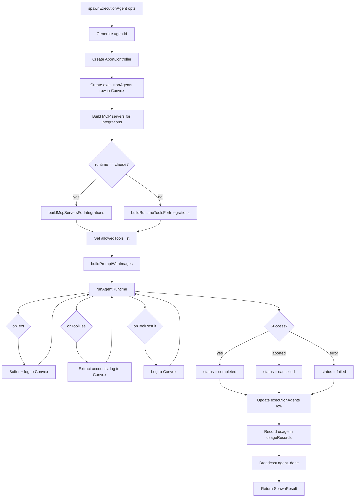

# Boop: Execution Agent

The execution agent is Boop's worker. Spawned per task. Ephemeral. One instance, one job, one result.

**Source:** `server/execution-agent.ts:1-318`
**Version:** Part of boop-agent 0.2.0

## Role and Responsibilities

While the interaction agent **decides**, the execution agent **does**. It:

1. Receives a crisp task description (not the raw user message)
2. Loads only the integrations named in the spawn call
3. Uses WebSearch, WebFetch, and integration tools to investigate and act
4. Returns a concise answer with source URLs



**Source:** `server/execution-agent.ts:125-277` — `spawnExecutionAgent()`

## System Prompt

The execution agent's prompt enforces research discipline, draft-before-send, and iMessage-friendly formatting:

```ts
// server/execution-agent.ts:64
const EXECUTION_SYSTEM = `You are a focused background worker for the user.

Your job:
1. Perform the task you were given, end to end.
2. Use your tools — WebSearch, WebFetch, and any integrations loaded.
3. Return a concise, well-structured answer.

Research discipline:
- Prefer WebSearch for fresh/factual questions.
- Cross-check when it matters.
- Cite real URLs only — NEVER invent sources.

Safety:
- Anything that sends a message or creates an event: call save_draft.
- Only the interaction agent's send_draft tool commits. You never commit.`;
```

**Key enforced rules:**
- **Mandatory Sources section** — any WebSearch/WebFetch usage must end with `Sources:` listing actual URLs
- **Draft-before-send** — external actions go through `save_draft`, not direct send
- **iMessage format** — short sentences, bullets, under 500 words
- **Never fabricate URLs**

**Source:** `server/execution-agent.ts:64-106`

## Spawn Lifecycle

```ts
// server/execution-agent.ts:125
export async function spawnExecutionAgent(opts: SpawnOptions): Promise<SpawnResult> {
  const agentId = randomId("agent");
  const abort = new AbortController();
  running.set(agentId, abort);  // Track for heartbeat

  // Create DB row
  await convex.mutation(api.agents.create, { agentId, ... });
  await convex.mutation(api.agents.update, { agentId, status: "running" });

  // Build integration servers
  const mcpServers = runtimeConfig.runtime === "claude"
    ? await buildMcpServersForIntegrations(opts.integrations, opts.conversationId)
    : {};
  const runtimeTools = runtimeConfig.runtime === "codex"
    ? await buildRuntimeToolsForIntegrations(opts.integrations, opts.conversationId)
    : [];

  // Run the agent
  const result = await runAgentRuntime(runtimeConfig, { ... });

  // Update status, tokens, cost
  await convex.mutation(api.agents.update, { agentId, status, result, ... });
  await convex.mutation(api.usageRecords.record, { ... });
  broadcast("agent_done", { agentId, status, result: buffer.slice(0, 200) });

  return { agentId, result: buffer || errorMsg || "(no output)", status };
}
```

**Source:** `server/execution-agent.ts:125-277`

## Integration Loading

**Aha:** Each sub-agent gets only the integrations named in the spawn call. This is how Boop keeps context tight — tens of tools per spawn, not thousands.

```ts
// server/execution-agent.ts:156
const integrationServers =
  runtimeConfig.runtime === "claude"
    ? await buildMcpServersForIntegrations(opts.integrations, opts.conversationId)
    : {};
const integrationTools =
  runtimeConfig.runtime === "codex"
    ? await buildRuntimeToolsForIntegrations(opts.integrations, opts.conversationId)
    : [];
```

The allowed tools list is built from the MCP server namespaces:

```ts
// server/execution-agent.ts:168
const allowedTools = [
  "WebSearch",
  "WebFetch",
  "Skill",
  ...Object.keys(mcpServers).flatMap((n) => [`mcp__${n}__*`]),
  ...(draftTools.length ? ["mcp__boop-drafts__*"] : []),
  ...runtimeToolNamespaces.flatMap((n) => [`mcp__${n}__*`]),
];
```

**Source:** `server/execution-agent.ts:156-175`

## Tool Logging

Every tool use and result is logged to Convex so the debug dashboard can replay the agent's full execution:

```ts
// server/execution-agent.ts:204
onToolUse: async (toolName, input) => {
  const toolShort = toolName.replace(/^mcp__[a-z-]+__/, "");
  const accounts = extractAccounts(input);
  await convex.mutation(api.agents.addLog, {
    agentId,
    logType: "tool_use",
    toolName,
    ...(accounts.length ? { accounts } : {}),
    content: JSON.stringify(logInput).slice(0, 2000),
  });
  broadcast("agent_tool", { agentId, toolName, accounts });
},
```

**Source:** `server/execution-agent.ts:204-218`

## Multi-Account Identity Extraction

**Aha:** When 2+ Gmail accounts are connected, Composio needs to know which one to use per tool call. Boop extracts the account from the tool input and logs it for visibility:

```ts
// server/execution-agent.ts:24
function extractAccounts(input: unknown): string[] {
  if (!input || typeof input !== "object") return [];
  const accounts = new Set<string>();
  const obj = input as Record<string, unknown>;
  collect(obj.account);
  collect(obj.connectedAccountId);
  collect(obj.connected_account_id);
  if (Array.isArray(obj.accounts)) obj.accounts.forEach(collect);
  // COMPOSIO_MULTI_EXECUTE_TOOL fans out: { tools: [{ account, ... }] }
  if (Array.isArray(obj.tools)) { ... }
  return [...accounts];
}
```

**Source:** `server/execution-agent.ts:24-48`

## Browser Fill Redaction

**Aha:** The `browser_fill` tool redacts typed values before agent tool-use logs are stored. Boop never stores third-party passwords in Convex:

```ts
// server/execution-agent.ts:55
export function redactToolInputForLog(toolName: string, input: unknown): unknown {
  if (!isBrowserFillTool(toolName)) return input;
  if (!input || typeof input !== "object" || Array.isArray(input)) return input;
  return { ...(input as Record<string, unknown>), text: "[redacted]" };
}
```

**Source:** `server/execution-agent.ts:50-62`

## Abort and Retry

The heartbeat loop (`server/heartbeat.ts`) aborts agents that have been running too long:

```ts
// server/execution-agent.ts:279
export function cancelAgent(agentId: string): boolean {
  const abort = running.get(agentId);
  if (!abort) return false;
  abort.abort();
  return true;
}

export async function retryAgent(agentId: string): Promise<SpawnResult | null> {
  const existing = await convex.query(api.agents.get, { agentId });
  if (!existing) return null;
  return await spawnExecutionAgent({
    task: existing.task,
    integrations: existing.mcpServers,
    conversationId: existing.conversationId,
    name: existing.name,
    runtimeConfig,
  });
}
```

**V1 limitation:** Image refs are not persisted to `executionAgents` and therefore are not replayed on retry. See the TODO comment at `server/execution-agent.ts:304`.

**Source:** `server/execution-agent.ts:279-313`

## Running Agent State

```ts
// server/execution-agent.ts:15
const running = new Map<string, AbortController>();
```

This in-memory map tracks all live agents. The heartbeat sweep (`server/heartbeat.ts:15`) compares DB "running" agents against this map to detect orphans (server restarted while agent was running).

**Source:** `server/execution-agent.ts:15`

## Next

Continue to [Memory System](04-memory-system.md) for the tiered memory system, extraction, decay, and cleaning.
