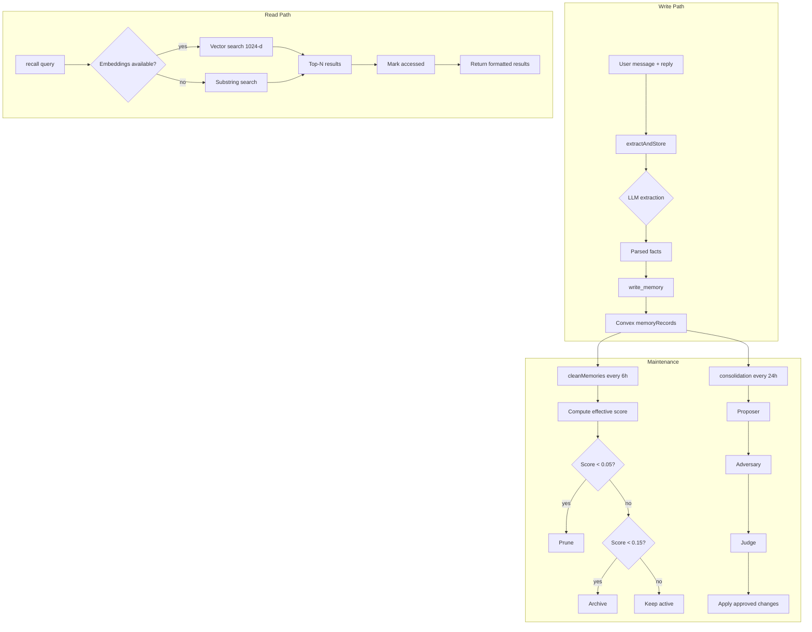

# Boop: Memory System

Boop's memory is a tiered, decaying, self-cleaning store. It survives across conversations, adapts to access patterns, and consolidates itself daily through an adversarial pipeline.

**Source:** `server/memory/` — tools.ts, extract.ts, clean.ts, types.ts
**Source:** `server/consolidation.ts` — adversarial consolidation

## Architecture



**Source:** `server/memory/tools.ts`, `server/memory/extract.ts`, `server/memory/clean.ts`, `server/consolidation.ts`

## Tiers and Segments

Boop has three tiers and seven segments:

| Tier | Purpose | Default Decay Rate |
|------|---------|-------------------|
| `short` | Current situation, transient context | 0.05 (5%/day linear baseline) |
| `long` | Durable facts, preferences, relationships | 0.02 (2%/day linear baseline) |
| `permanent` | Core identity, never decays | 0 |

| Segment | Description | Preferred Tier | Default Importance |
|---------|-------------|---------------|-------------------|
| `identity` | Name, role, location, core traits | `permanent` | 0.85 |
| `correction` | User explicitly corrected something | `long` | 0.80 |
| `relationship` | People they know + how | `long` | 0.75 |
| `preference` | How they like things done | `long` | 0.70 |
| `project` | Ongoing work or goals | `long` | 0.65 |
| `knowledge` | Facts about their world | `long` | 0.60 |
| `context` | Current ongoing situation | `short` | 0.40 |

**Aha:** The `correction` segment is unique — it's the user **fixing** something. When a correction contradicts an older fact, the consolidation pipeline treats it as authoritative. The `corrects` metadata field stores what was wrong, so the LLM sees the full context.

**Source:** `server/memory/types.ts:1-66`

```ts
// server/memory/types.ts:37
export const SEGMENT_DEFAULTS: Record<MemorySegment, SegmentDefault> = {
  identity:    { tier: "permanent", importance: 0.85, decayRate: 0.01 },
  correction:  { tier: "long",      importance: 0.80, decayRate: 0.015 },
  relationship:{ tier: "long",      importance: 0.75, decayRate: 0.02 },
  preference:  { tier: "long",      importance: 0.70, decayRate: 0.02 },
  project:     { tier: "long",      importance: 0.65, decayRate: 0.025 },
  knowledge:   { tier: "long",      importance: 0.60, decayRate: 0.03 },
  context:     { tier: "short",     importance: 0.40, decayRate: 0.08 },
};
```

**Source:** `server/memory/types.ts:37-45`

## Write Memory

The `write_memory` tool persists a fact with segment-aware tiering:

```ts
// server/memory/tools.ts:24
defineRuntimeTool(NAMESPACE, "write_memory", "Persist a fact about the user...", {
  content: z.string(),
  segment: z.enum(["identity", "preference", "relationship", "project", "knowledge", "context"]),
  importance: z.number().min(0).max(1),
  tier: z.enum(["short", "long", "permanent"]).optional(),
  supersedes: z.array(z.string()).optional(),
}, async (args) => {
  const tier = args.tier ?? SEGMENT_PREFERRED_TIER[args.segment];
  const memoryId = makeMemoryId();
  const embedding = (await embed(args.content)) ?? undefined;
  await convex.mutation(api.memoryRecords.upsert, {
    memoryId, content: args.content, tier, segment: args.segment,
    importance: args.importance, decayRate: DEFAULT_DECAY[tier],
    supersedes: args.supersedes, embedding,
  });
  return runtimeText(`Stored ${memoryId} (tier=${tier}, segment=${args.segment}).`);
})
```

**Source:** `server/memory/tools.ts:24-61`

## Recall: Vector + Substring Fallback

```ts
// server/memory/tools.ts:64
defineRuntimeTool(NAMESPACE, "recall", "Search your memories for anything relevant...", {
  query: z.string(),
  limit: z.number().optional().default(10),
}, async (args) => {
  let results: any[] = [];
  let mode: "vector" | "substring" = "substring";

  if (embeddingsAvailable()) {
    const queryVec = await embed(args.query);
    if (queryVec) {
      const hits = await convex.action(api.memoryRecords.vectorSearch, {
        embedding: queryVec,
        limit: args.limit,
      });
      results = hits.map((h) => h.record);
      mode = "vector";
    }
  }
  if (results.length === 0) {
    // Fallback to substring search
    results = await convex.query(api.memoryRecords.search, {
      query: args.query,
      limit: args.limit,
    });
  }

  for (const r of results) {
    await convex.mutation(api.memoryRecords.markAccessed, { memoryId: r.memoryId });
  }
  // Return formatted results...
})
```

**Aha:** The vector index is 1024-dimensional with filter fields on `lifecycle`. If embeddings aren't available (no Voyage/OpenAI API key and no local model), it falls back to substring search — which still works perfectly, just without semantic similarity.

**Source:** `server/memory/tools.ts:64-113`, `convex/schema.ts:60-64`

## Post-Turn Extraction

After every turn, Boop extracts durable facts in the background:

```ts
// server/memory/extract.ts:10
const EXTRACTION_PROMPT = `You are a memory-extraction subagent.

Given a user message + assistant reply, extract any DURABLE facts worth remembering.
Return STRICT JSON:
{"facts":[
  {"content":"...","segment":"identity|preference|correction|...",
   "importance":0.0-1.0,"corrects":"...","describesImage":true|false}
]}

Rules:
- Prefer fewer, higher-quality facts over many trivial ones.
- Skip anything transient.
- If the user sent an image and it depicts something durable, produce a SINGLE descriptive fact.
```

**Source:** `server/memory/extract.ts:10-38`

The extraction flow:

```ts
// server/memory/extract.ts:48
export async function extractAndStore(opts: {...}): Promise<void> {
  const result = await runAgentRuntime(runtimeConfig, {
    prompt: payload,
    systemPrompt: EXTRACTION_PROMPT,
    tools: [],
    mode: "background",
  });
  const parsed = JSON.parse(match[0]) as { facts?: ExtractedFact[] };
  const facts = parsed.facts ?? [];

  for (const f of facts) {
    const defaults = SEGMENT_DEFAULTS[f.segment];
    const rawImportance = Math.max(0, Math.min(1, f.importance ?? defaults.importance));
    await convex.mutation(api.memoryRecords.upsert, {
      memoryId: makeMemoryId(),
      content: f.content,
      tier: defaults.tier,
      segment: f.segment,
      importance: rawImportance,
      decayRate: defaults.decayRate,
      sourceTurn: opts.turnId,
      embedding: await embed(f.content),
      metadata: f.segment === "correction" && f.corrects
        ? JSON.stringify({ corrects: f.corrects })
        : undefined,
    });
  }
}
```

**Source:** `server/memory/extract.ts:48-144`

## Adaptive Decay and Cleaning

**Aha:** The cleaning loop uses an **adaptive exponential decay** model ported from Ping's `applyMemoryDecay`. The half-life scales with importance so identity memories persist much longer than context:

```ts
// server/memory/clean.ts:28
function effectiveScore(mem): number {
  const daysSinceAccess = Math.max(0, (Date.now() - mem.lastAccessedAt) / DAY_MS);
  const adaptiveHalfLife = BASE_HALF_LIFE_DAYS * (1 + mem.importance);
  // identity (0.85): half-life ≈ 11.25 × 1.85 ≈ 20.8 days
  // context  (0.40): half-life ≈ 11.25 × 1.40 ≈ 15.8 days
  const lambda = (LN2 / Math.max(adaptiveHalfLife, 0.001)) * DECAY_BETA;
  const effectiveLambda = lambda * (1 + mem.decayRate);
  const decayed = mem.importance * Math.exp(-effectiveLambda * daysSinceAccess);
  const reinforcement = 1 + Math.log1p(mem.accessCount) * 0.1;
  return clamp(decayed * reinforcement, 0, 1);
}
```

**Constants:**
- `DECAY_BETA = 0.8`
- `BASE_HALF_LIFE_DAYS = 11.25`
- `PRUNE_THRESHOLD = 0.05`
- `ARCHIVE_THRESHOLD = 0.15`

With `beta=0.8` and `half_life=11.25`:
- importance=0.5 → ~21 days half-life
- importance=0.9 → ~27 days half-life

**Source:** `server/memory/clean.ts:4-47`

The cleaning loop runs every 6 hours:

```ts
// server/memory/clean.ts:84
export function startCleanupLoop(intervalMs = 6 * 60 * 60 * 1000): () => void {
  const timer = setInterval(() => {
    cleanMemories().catch((err) => console.error("[memory.clean] loop error", err));
  }, intervalMs);
  return () => clearInterval(timer);
}
```

The clean logic:

```ts
// server/memory/clean.ts:49
export async function cleanMemories(): Promise<{ scanned, archived, pruned }> {
  const active = await convex.query(api.memoryRecords.list, { lifecycle: "active", limit: 500 });
  for (const mem of active) {
    if (mem.tier === "permanent") continue;
    const score = effectiveScore(mem);
    if (score < PRUNE_THRESHOLD) {
      await convex.mutation(api.memoryRecords.setLifecycle, { memoryId: mem.memoryId, lifecycle: "pruned" });
      pruned++;
    } else if (score < ARCHIVE_THRESHOLD && mem.tier !== "long") {
      await convex.mutation(api.memoryRecords.setLifecycle, { memoryId: mem.memoryId, lifecycle: "archived" });
      archived++;
    }
  }
}
```

**Source:** `server/memory/clean.ts:49-89`

## Memory Events

Every memory operation emits an event to the `memoryEvents` table for the debug UI:

| Event | When |
|-------|------|
| `memory.written` | `write_memory()` called |
| `memory.recalled` | `recall()` returns results |
| `memory.extracted` | Post-turn extraction completes |
| `memory.cleaned` | Cleaning sweep finishes |
| `memory.consolidated` | Consolidation run completes |

**Source:** `server/memory/tools.ts:54,97`, `server/memory/extract.ts:136`, `server/memory/clean.ts:76`

## Next

Continue to [Runtimes](05-runtimes.md) for the Claude and Codex runtime adapter deep dive.
