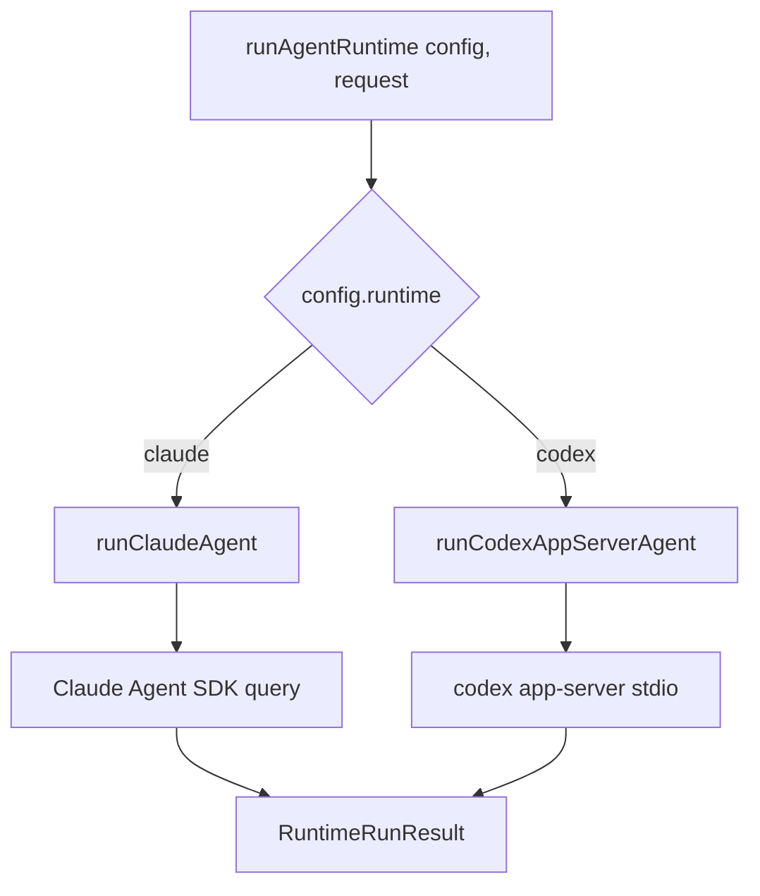
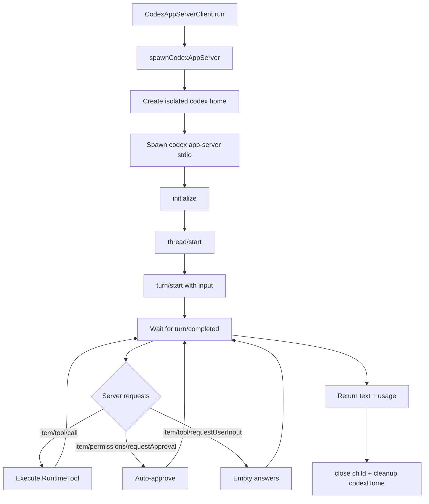

# Boop: Runtimes

Boop runs on two LLM runtimes — Claude Agent SDK and OpenAI Codex — through a single abstraction layer. The same agent code works on both.

**Source:** `server/runtimes/` — index.ts, types.ts, claude.ts, codex-app-server.ts, tool.ts

## Runtime Abstraction



**Source:** `server/runtimes/index.ts:6-21`

The `RuntimeRunRequest` interface is the shared contract:

```ts
// server/runtimes/types.ts:29
export interface RuntimeRunRequest {
  prompt: RuntimePrompt;           // string or image+text blocks
  systemPrompt: string;
  model: string;
  reasoningEffort?: RuntimeReasoningEffort;
  tools: RuntimeTool[];
  claudeMcpServers?: Record<string, unknown>;
  allowedTools?: string[];
  disallowedTools?: string[];
  cwd?: string;
  abortController?: AbortController;
  mode: RuntimeMode;               // "dispatcher" | "execution" | "background"
  onText?: (text: string) => void;
  onToolUse?: (toolName: string, input: unknown) => void;
  onToolResult?: (toolName: string, text: string) => void;
  onUsage?: (usage: UsageTotals) => void;
}
```

**Source:** `server/runtimes/types.ts:29-45`

## RuntimeTool Contract

The `RuntimeTool` interface lets both runtimes expose the same tool surface:

```ts
// server/runtimes/types.ts:15
export interface RuntimeTool {
  namespace: string;               // e.g. "boop-memory", "gmail", "browser"
  name: string;                    // e.g. "recall", "write_memory"
  description: string;
  inputSchema: z.ZodRawShape;      // Zod schema for input validation
  jsonSchema: Record<string, unknown>;  // JSON Schema for the LLM
  handle: (args: Record<string, unknown>) => Promise<RuntimeToolResult>;
}
```

**Source:** `server/runtimes/types.ts:15-22`

## Claude Runtime Adapter

The Claude adapter uses the `@anthropic-ai/claude-agent-sdk`:

```ts
// server/runtimes/claude.ts:55
export async function runClaudeAgent(request: RuntimeRunRequest): Promise<RuntimeRunResult> {
  // Group runtime tools by namespace into MCP servers
  const runtimeServers = new Map<string, RuntimeTool[]>();
  for (const runtimeTool of request.tools) {
    const list = runtimeServers.get(runtimeTool.namespace) ?? [];
    list.push(runtimeTool);
    runtimeServers.set(runtimeTool.namespace, list);
  }

  // Build MCP server configs
  const mcpServers = {
    ...(request.claudeMcpServers ?? {}),
    ...Object.fromEntries(
      [...runtimeServers.entries()].map(([name, tools]) => [
        name, createClaudeMcpServer(name, tools),
      ]),
    ),
  };

  // Stream through the SDK's query() API
  for await (const msg of query({
    prompt: toClaudePrompt(request.prompt),
    options: {
      systemPrompt: request.systemPrompt,
      model: request.model,
      mcpServers,
      allowedTools: request.allowedTools,
      disallowedTools: request.disallowedTools,
      ...(request.mode === "execution" ? { settingSources: ["project"] } : {}),
      permissionMode: "bypassPermissions",
      abortController: request.abortController,
    },
  })) {
    if (msg.type === "assistant") {
      // Handle text blocks and tool_use blocks
    } else if (msg.type === "user") {
      // Handle tool_result blocks
    } else if (msg.type === "result") {
      usage = aggregateUsageFromResult(msg, request.model);
    }
  }
  return { text: lastAssistantText || text, usage };
}
```

**Aha:** The `settingSources: ["project"]` is only set for execution agents. This lets execution agents load project-level skills (`.claude/skills/`), while the dispatcher runs without them — keeping the dispatcher's context tight.

**Source:** `server/runtimes/claude.ts:55-122`

### MCP Server Creation

```ts
// server/runtimes/claude.ts:32
export function createClaudeMcpServer(
  name: string,
  tools: RuntimeTool[],
): McpSdkServerConfigWithInstance {
  return createSdkMcpServer({
    name,
    version: "0.1.0",
    tools: tools.map((runtimeTool) =>
      tool(
        runtimeTool.name,
        runtimeTool.description,
        runtimeTool.inputSchema,
        async (args) => {
          const result = await runtimeTool.handle(args as Record<string, unknown>);
          return { content: [{ type: "text", text: result.text }] };
        },
      ),
    ),
  });
}
```

**Source:** `server/runtimes/claude.ts:32-53`

## Codex Runtime Adapter

The Codex adapter spawns `codex app-server` as a child process and communicates via stdio JSON-RPC:

```ts
// server/runtimes/codex-app-server.ts:519
export async function runCodexAppServerAgent(request: RuntimeRunRequest): Promise<RuntimeRunResult> {
  return new CodexAppServerClient().run(request);
}
```

### Isolated Codex Home

**Aha:** Each Codex agent gets its own isolated home directory with a symlinked (or copied) auth.json. This prevents credential leakage between agents:

```ts
// server/runtimes/codex-app-server.ts:61
function createIsolatedCodexHome(): string {
  const sourceHome = process.env.BOOP_CODEX_AUTH_HOME ?? join(homedir(), ".codex");
  const sourceAuth = join(sourceHome, "auth.json");
  const codexHome = mkdtempSync(join(tmpdir(), "boop-codex-home."));
  mkdirSync(join(codexHome, "workspace"));
  const targetAuth = join(codexHome, "auth.json");
  try {
    symlinkSync(sourceAuth, targetAuth);
  } catch {
    copyFileSync(sourceAuth, targetAuth);
  }
  writeFileSync(join(codexHome, "config.toml"), [
    'model = "gpt-5.5"',
    'approval_policy = "never"',
    'sandbox_mode = "read-only"',
    'web_search = "disabled"',
  ].join("\n"));
  return codexHome;
}
```

**Source:** `server/runtimes/codex-app-server.ts:61-88`

### Codex App Server Lifecycle

The adapter manages the full lifecycle:



**Source:** `server/runtimes/codex-app-server.ts:247-345`

### Disabled Features

**Aha:** The Codex adapter disables many built-in features that Boop provides itself:

```ts
// server/runtimes/codex-app-server.ts:96
const args = [
  "app-server", "--listen", "stdio://",
  "--disable", "plugins",
  "--disable", "apps",
  "--disable", "computer_use",
  "--disable", "browser_use",
  "--disable", "in_app_browser",
  "--disable", "image_generation",
  "--disable", "multi_agent",
  "--disable", "shell_tool",
  "--disable", "unified_exec",
];
```

Boop provides its own tools for all of these — browser (Patchright), integrations (Composio), multi-agent (spawn), shell (not exposed to agents).

**Source:** `server/runtimes/codex-app-server.ts:90-135`

### Voice Override for Codex

**Aha:** Codex agents are told to sound like Boop, not Codex:

```ts
// server/runtimes/codex-app-server.ts:161
const CODEX_USER_FACING_VOICE_OVERLAY = `Codex runtime voice override:
- You are powering Boop, the user's personal iMessage agent. You are not speaking as Codex.
- Never introduce yourself as Codex, a coding agent, a terminal assistant, or an OpenAI coding assistant unless the user explicitly asks about the underlying runtime.
- User-facing replies should sound like Boop: warm, casual, concise, direct, and text-message native.
- Do not narrate implementation mechanics. Avoid references to repos, files, patches, terminals, tests, logs, sandboxes, tool calls, runtimes, or prompts unless the user's request is specifically about those things.
- When work was completed by tools or sub-agents, summarize the useful result in Boop's voice. Do not hand off a Codex-style engineering status report.
- If the user asks what you are, say you are Boop. If asked what provider is running you, you may say this turn is using Codex.`;
```

**Source:** `server/runtimes/codex-app-server.ts:161-167`

### Dynamic Tool Registration

Codex's `thread/start` supports dynamic tools:

```ts
// server/runtimes/codex-app-server.ts:305
const threadResponse = await this.call("thread/start", {
  model: request.model,
  dynamicTools: availableTools.map((runtimeTool) => ({
    namespace: runtimeTool.namespace,
    name: runtimeTool.name,
    description: runtimeTool.description,
    inputSchema: asJsonValue(runtimeTool.jsonSchema),
  })),
  // ...
});
```

When Codex calls a tool, the adapter routes it to the right `RuntimeTool`:

```ts
// server/runtimes/codex-app-server.ts:438
case "item/tool/call": {
  const runtimeTool = this.tools.get(`${namespace}:${toolName}`);
  if (!runtimeTool) { /* error response */ }
  const result = await runtimeTool.handle(args);
  this.respond(message.id, {
    success: result.success ?? true,
    contentItems: [{ type: "inputText", text: result.text }],
  });
}
```

**Source:** `server/runtimes/codex-app-server.ts:305-332`, `server/runtimes/codex-app-server.ts:438-467`

### Sandbox Policies

Different modes get different sandbox policies:

```ts
// server/runtimes/codex-app-server.ts:144
function codexSandboxForMode(mode: RuntimeRunRequest["mode"]): SandboxPolicy {
  if (mode === "dispatcher" || mode === "background") {
    return { type: "readOnly", networkAccess: false };
  }
  return { type: "readOnly", networkAccess: true };
}
```

Execution agents need network access for WebSearch/WebFetch. Dispatchers and background agents don't.

**Source:** `server/runtimes/codex-app-server.ts:144-149`

### Codex Usage Estimation

**Aha:** Codex subscription doesn't expose real billing, so Boop estimates cost from OpenAI's published token prices:

```ts
// server/runtimes/codex-app-server.ts:418-431
} else if (message.method === "thread/tokenUsage/updated") {
  const usage = message.params.tokenUsage.total;
  if (usage) {
    const nextUsage: UsageTotals = {
      model: this.request?.model ?? this.usage.model,
      inputTokens: usage.inputTokens,
      outputTokens: usage.outputTokens,
      cacheReadTokens: usage.cachedInputTokens,
      cacheCreationTokens: 0,
      costUsd: 0,
    };
    nextUsage.costUsd = estimateOpenAiCostUsd(nextUsage);
    this.usage = nextUsage;
  }
}
```

**Source:** `server/runtimes/codex-app-server.ts:418-431`

## Runtime Config

The `RuntimeConfig` interface ties both runtimes together:

```ts
// server/runtime-config.ts:27
export interface RuntimeConfig {
  runtime: RuntimeName;          // "claude" | "codex"
  model: string;
  reasoningEffort?: RuntimeReasoningEffort;
  billingMode: "api" | "codex-subscription";
}
```

Settings are stored in Convex `settings` table with 30s cache TTL:

| Setting Key | Values |
|-------------|--------|
| `runtime` | `claude`, `codex` |
| `model` | `claude-sonnet-4-6`, `claude-opus-4-7`, `claude-haiku-4-5-20251001` |
| `codex_model` | `gpt-5.5`, `gpt-5.4`, `gpt-5.4-mini`, `gpt-5.3-codex`, `gpt-5.2` |
| `codex_reasoning_effort` | `minimal`, `low`, `medium`, `high`, `xhigh` |

**Source:** `server/runtime-config.ts:27-32`, `server/runtime-config.ts:69-124`

### Model Aliases

Users can say "use opus" or "switch to 5.5" and it resolves:

```ts
// server/runtime-config.ts:80
export const MODEL_ALIASES: Record<string, string> = {
  opus: "claude-opus-4-7",
  "opus 4.7": "claude-opus-4-7",
  sonnet: "claude-sonnet-4-6",
  "sonnet 4.6": "claude-sonnet-4-6",
  haiku: "claude-haiku-4-5-20251001",
  "haiku 4.5": "claude-haiku-4-5-20251001",
};

export const CODEX_MODEL_ALIASES: Record<string, string> = {
  "5.5": "gpt-5.5",
  "gpt 5.5": "gpt-5.5",
  "gpt-5.5": "gpt-5.5",
  "5.4": "gpt-5.4",
  "gpt 5.4": "gpt-5.4",
  "gpt-5.4": "gpt-5.4",
  mini: "gpt-5.4-mini",
  "5.4 mini": "gpt-5.4-mini",
  "gpt-5.4-mini": "gpt-5.4-mini",
  codex: "gpt-5.3-codex",
  "5.3 codex": "gpt-5.3-codex",
  "gpt-5.3-codex": "gpt-5.3-codex",
};
```

**Source:** `server/runtime-config.ts:80-108`

## Next

Continue to [Integrations & Composio](06-integrations-composio.md) for the Composio integration system.
