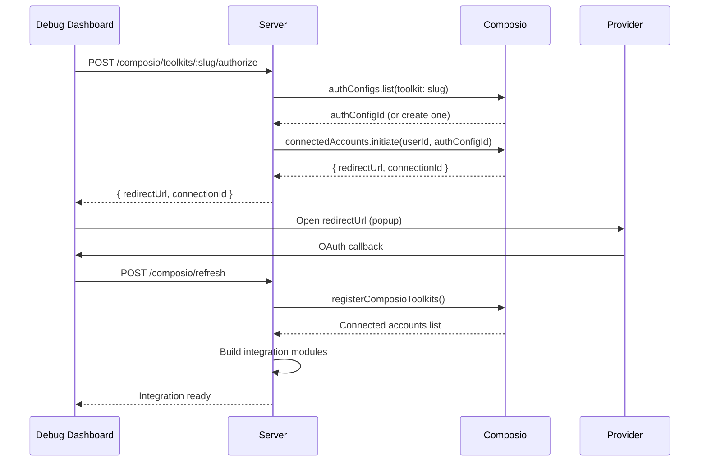

# Boop: Integrations & Composio

Boop delegates all third-party integrations to Composio. One SDK, 1000+ toolkits, hosted OAuth. Boop never sees an access token.

**Source:** `server/composio.ts`, `server/composio-routes.ts`, `server/integrations/`

## Architecture

```mermaid
flowchart TD
    A[User: check my Gmail] --> B[Interaction Agent]
    B -->|spawn_agent integrations:["gmail"]| C[Execution Agent]
    C --> D[buildMcpServersForIntegrations]
    D --> E[composio.create userId, toolkits:["gmail"]]
    E --> F[Composio opens toolkit-scoped session]
    F --> G[session.tools returns Gmail tools only]
    G --> H[createSdkMcpServer name:"gmail", tools]
    H --> I[Gmail MCP server exposed to agent]
    I --> J[Agent calls mcp__gmail__GMAIL_LIST_MESSAGES]
    J --> K[Composio proxy executes with real OAuth token]
    K --> L[Result back to agent]
```

**Source:** `server/composio.ts:558-593` — `buildComposioIntegrationModule`

## Toolkit Registry

The curated toolkit list is hand-picked in `server/composio.ts`:

```ts
// server/composio.ts:25
export const CURATED_TOOLKITS: CuratedToolkit[] = [
  { slug: "gmail", displayName: "Gmail", authMode: "managed" },
  { slug: "googlecalendar", displayName: "Google Calendar", authMode: "managed" },
  { slug: "googledrive", displayName: "Google Drive", authMode: "managed" },
  { slug: "slack", displayName: "Slack", authMode: "managed" },
  { slug: "github", displayName: "GitHub", authMode: "managed" },
  { slug: "linear", displayName: "Linear", authMode: "managed" },
  { slug: "notion", displayName: "Notion", authMode: "managed" },
  { slug: "hubspot", displayName: "HubSpot", authMode: "managed" },
  { slug: "discord", displayName: "Discord", authMode: "managed" },
  { slug: "stripe", displayName: "Stripe", authMode: "managed" },
  { slug: "supabase", displayName: "Supabase", authMode: "managed" },
  { slug: "twitter", displayName: "Twitter / X", authMode: "byo" },
  // ... 25 total curated toolkits
];
```

Each toolkit has an `authMode`:
- **`managed`** — Composio hosts a shared OAuth app, click Connect, it works
- **`byo`** — User must register their own OAuth app at the toolkit's dev portal and add it via Composio Dashboard

**Source:** `server/composio.ts:25-51`

## Integration Registry

Integrations are registered at boot via the registry:

```ts
// server/integrations/registry.ts:43
export async function loadIntegrations(): Promise<void> {
  const { registerComposioToolkits } = await import("./composio-loader.js");
  await registerComposioToolkits();
  const { registerBrowserIntegration } = await import("./browser-loader.js");
  registerBrowserIntegration();
  const { registerAppleIntegration } = await import("./apple-loader.js");
  registerAppleIntegration();
}
```

The registry provides a uniform `IntegrationModule` interface:

```ts
// server/integrations/registry.ts:4
export interface IntegrationModule {
  name: string;
  description: string;
  requiredEnv?: string[];
  isEnabled?: () => Promise<boolean>;
  createServer: (ctx: IntegrationContext) => Promise<McpSdkServerConfigWithInstance>;
  createTools?: (ctx: IntegrationContext) => Promise<RuntimeTool[]>;
}
```

**Source:** `server/integrations/registry.ts:4-11`

## Build MCP Servers

When spawning an execution agent, Boop builds MCP servers for the requested integrations:

```ts
// server/integrations/registry.ts:66
export async function buildMcpServersForIntegrations(
  names: string[],
  conversationId?: string,
): Promise<Record<string, McpSdkServerConfigWithInstance>> {
  const ctx = makeContext(conversationId);
  const out: Record<string, McpSdkServerConfigWithInstance> = {};
  for (const name of names) {
    const mod = registry.get(name);
    if (!mod) { console.warn(`unknown integration: ${name}`); continue; }
    if (mod.isEnabled && !(await mod.isEnabled())) { continue; }
    out[name] = await mod.createServer(ctx);
  }
  return out;
}
```

**Source:** `server/integrations/registry.ts:66-89`

## Composio Integration Module

The core integration module builder:

```ts
// server/composio.ts:558
export function buildComposioIntegrationModule(slug: string): IntegrationModule {
  return {
    name: slug,
    description: `${displayNameFor(slug)} (via Composio)`,
    requiredEnv: ["COMPOSIO_API_KEY"],
    createServer: async (): Promise<McpSdkServerConfigWithInstance> => {
      const session = await composio.create(boopUserId(), {
        toolkits: [slug],
        manageConnections: false,
        ...(authConfig ? { authConfigs: { [slug]: authConfig.id } } : {}),
        ...(activeCount >= 2
          ? { multiAccount: { enable: true, requireExplicitSelection: true } }
          : {}),
      });
      const tools = await session.tools();
      return createSdkMcpServer({ name: slug, version: "0.1.0", tools });
    },
    createTools: async (): Promise<RuntimeTool[]> => {
      // For Codex runtime: convert raw Composio tools to RuntimeTool[]
    },
  };
}
```

**Aha:** When 2+ accounts are connected for the same toolkit, Boop forces explicit account selection per tool call. Without this, Composio silently picks the default account, and every Gmail row in the UI ends up labeled with the same (newest) email.

**Source:** `server/composio.ts:558-682`

## Account Identity Resolution

**Aha:** Composio redacts access tokens in API responses, so Boop can't call the provider's userinfo endpoint directly. Instead, it executes the toolkit's own "who am I" tool through Composio, which injects real credentials:

```ts
// server/composio.ts:297
const WHOAMI_BY_TOOLKIT: Record<string, WhoAmITool> = {
  gmail: { tool: "GMAIL_GET_PROFILE", arguments: { user_id: "me" }, parse: ... },
  github: { tool: "GITHUB_GET_THE_AUTHENTICATED_USER", arguments: {}, parse: genericProfileParse },
  linear: { tool: "LINEAR_GET_CURRENT_USER", arguments: {}, parse: genericProfileParse },
  notion: { tool: "NOTION_GET_ABOUT_ME", arguments: {}, parse: genericProfileParse },
  hubspot: { tool: "HUBSPOT_GET_ACCOUNT_INFO", arguments: {}, parse: genericProfileParse },
  stripe: { tool: "STRIPE_GET_ACCOUNT", arguments: {}, parse: genericProfileParse },
  slack: { tool: "SLACK_FETCH_TEAM_INFO", arguments: {}, parse: genericProfileParse },
};
```

**Source:** `server/composio.ts:297-316`

## OAuth Authorization Flow



**Source:** `server/composio.ts:504-550` — `authorizeToolkit`

## Multi-Account Support

**Aha:** When the user connects a second Gmail (work + personal), each gets its own connection row. The `connectedAccountId` field is injected into the tool schema when 2+ accounts are active:

```ts
// server/composio.ts:684
function withConnectedAccountSchema(schema: unknown, activeCount: number): Record<string, unknown> {
  if (activeCount >= 2) {
    properties.connectedAccountId = {
      type: "string",
      description: "Composio connected account id to use for this call.",
    };
    required.push("connectedAccountId");
  }
  return { type: "object", ...base, properties, required };
}
```

**Source:** `server/composio.ts:684-709`

## Toolkit Catalog

Boop caches the full Composio toolkit catalog (1000+ toolkits) for the lifetime of the process:

```ts
// server/composio.ts:196
export async function listToolkitMeta(): Promise<Map<string, ToolkitMeta>> {
  if (!toolkitMetaCache) {
    toolkitMetaCache = fetchAllToolkitMeta().catch((err) => {
      toolkitMetaCache = null;
      return new Map<string, ToolkitMeta>();
    });
  }
  return toolkitMetaCache;
}
```

The catalog fetcher handles pagination with cursor deduplication to prevent infinite loops:

```ts
// server/composio.ts:123
export async function collectToolkitCatalog(
  fetchPage: (cursor?: string) => Promise<ToolkitCatalogPage>,
): Promise<Map<string, ToolkitMeta>> {
  const seenCursors = new Set<string>();
  while (true) {
    const page = await fetchPage(cursor);
    // ... process items
    if (seenCursors.has(nextCursor)) {
      throw new Error("Composio toolkit catalog returned a repeated cursor");
    }
    seenCursors.add(nextCursor);
  }
}
```

**Source:** `server/composio.ts:123-152`

## HTTP Routes

| Route | Method | Purpose |
|-------|--------|---------|
| `/composio/status` | GET | `{ enabled }` |
| `/composio/toolkits` | GET | Curated list + connection state |
| `/composio/toolkits/:slug/authorize` | POST | Start OAuth flow |
| `/composio/toolkits/:slug/disconnect` | POST | Revoke connection |
| `/composio/refresh` | POST | Re-run registry loader |
| `/composio/webhook` | POST | Raw bytes (HMAC verification) |

**Source:** `server/composio-routes.ts`

## ComposioNeedsAuthConfigError

For BYO (bring-your-own) toolkits like Twitter/X that don't have managed OAuth:

```ts
// server/composio.ts:490
export class ComposioNeedsAuthConfigError extends Error {
  constructor(slug: string, underlying: string) {
    super(`Toolkit "${slug}" needs an auth config — Composio doesn't host a managed OAuth app for it.`);
  }
}
```

**Source:** `server/composio.ts:490-502`

## Next

Continue to [Automations](07-automations.md) for the cron scheduling system.
