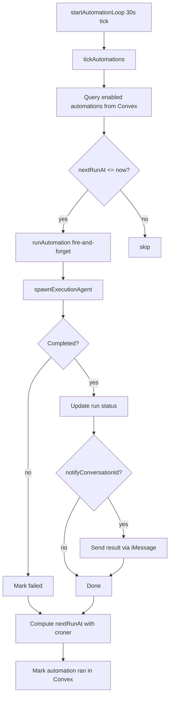

# Boop: Automations

Boop can schedule recurring work from any conversation. When the user says "every morning at 8 summarize my calendar", the interaction agent creates an automation that fires on a cron schedule.

**Source:** `server/automations.ts`, `server/automation-tools.ts`

## Architecture



**Source:** `server/automations.ts:104-128`

## Automation Creation

The four MCP tools exposed to the interaction agent:

| Tool | Purpose |
|------|---------|
| `create_automation(name, schedule, task, integrations, notify?)` | Create a new scheduled automation |
| `list_automations(enabledOnly?)` | List all or enabled-only automations |
| `toggle_automation(id, enabled)` | Enable/disable an automation |
| `delete_automation(id)` | Delete an automation |

**Source:** `server/automation-tools.ts`

## Cron Scheduling

Boop uses the `croner` library for cron parsing, with timezone support:

```ts
// server/automations.ts:17
export function nextRunFor(schedule: string, timezone?: string): number | null {
  try {
    const c = new Cron(schedule, { paused: true, ...(timezone ? { timezone } : {}) });
    const next = c.nextRun();
    return next ? next.getTime() : null;
  } catch {
    return null;
  }
}
```

**Aha:** Both `nextRunFor` and `validateSchedule` accept an optional IANA timezone. Without it, croner falls back to the server's local zone, which is almost always wrong for users in a different timezone than the host machine.

**Source:** `server/automations.ts:17-37`

## Automation Execution

```ts
// server/automations.ts:39
async function runAutomation(a: {...}): Promise<void> {
  const runId = randomId("run");
  await convex.mutation(api.automations.createRun, { runId, automationId: a.automationId });

  const res = await spawnExecutionAgent({
    task: `AUTOMATION "${a.name}": ${a.task}`,
    integrations: a.integrations,
    conversationId: a.conversationId,
    name: `auto:${a.name}`,
  });

  // Push result back to iMessage if configured
  if (a.notifyConversationId && res.result) {
    if (a.notifyConversationId.startsWith("sms:")) {
      const number = a.notifyConversationId.slice(4);
      await sendImessage(number, `[${a.name}]\n\n${res.result}`);
    }
  }

  // Compute next run time
  const tz = a.timezone ?? (await getUserTimezone());
  const next = nextRunFor(a.schedule, tz);
  await convex.mutation(api.automations.markRan, {
    automationId: a.automationId,
    lastRunAt: Date.now(),
    nextRunAt: next ?? undefined,
  });
}
```

**Source:** `server/automations.ts:39-102`

## Automation Tick Loop

```ts
// server/automations.ts:123
export function startAutomationLoop(intervalMs = 30_000): () => void {
  const timer = setInterval(() => {
    tickAutomations().catch((err) => console.error("[automations] tick error", err));
  }, intervalMs);
  return () => clearInterval(timer);
}

export async function tickAutomations(): Promise<void> {
  const all = await convex.query(api.automations.list, { enabledOnly: true });
  const now = Date.now();
  const due = all.filter((a) => a.nextRunAt !== undefined && a.nextRunAt <= now);
  for (const a of due) {
    // fire-and-forget so one slow automation doesn't block others
    runAutomation({...}).catch((err) => console.error("[automations] run error", err));
  }
}
```

Each due automation runs in parallel (fire-and-forget) so one slow automation doesn't block others.

**Source:** `server/automations.ts:104-128`

## Timezone Support

**Aha:** The timezone is stored at automation creation time so changing the user's global timezone later doesn't shift existing automations. Pre-TZ automations fall back to the user's current setting at runtime.

```ts
// server/automations.ts:95
const tz = a.timezone ?? (await getUserTimezone());
const next = nextRunFor(a.schedule, tz);
```

**Source:** `server/automations.ts:95`, `server/automations.ts:169` (Convex schema timezone field)

## Convex Schema

```ts
// convex/schema.ts:159
automations: defineTable({
  automationId: v.string(),
  name: v.string(),
  task: v.string(),
  integrations: v.array(v.string()),
  schedule: v.string(),              // 5-field cron expression
  timezone: v.optional(v.string()),  // IANA timezone
  enabled: v.boolean(),
  conversationId: v.optional(v.string()),
  notifyConversationId: v.optional(v.string()),
  lastRunAt: v.optional(v.number()),
  nextRunAt: v.optional(v.number()),
  createdAt: v.number(),
}).index("by_automation_id", ["automationId"])
  .index("by_enabled", ["enabled"]),
```

**Source:** `convex/schema.ts:159-178`

## Next

Continue to [Consolidation](08-consolidation.md) for the adversarial memory consolidation pipeline.
