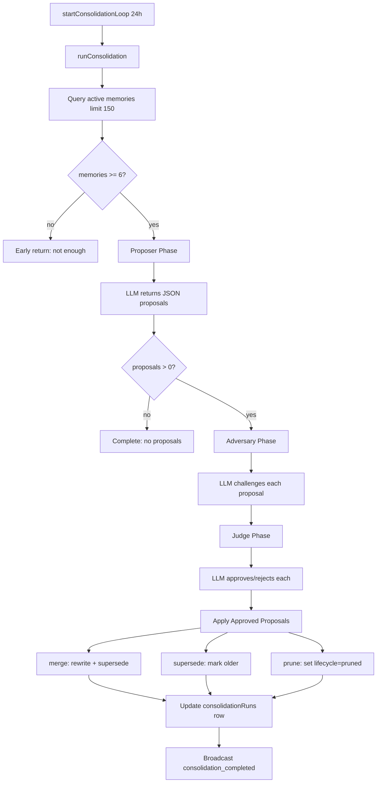

# Boop: Consolidation

Boop runs a daily adversarial memory consolidation pipeline. Three LLM agents — proposer, adversary, judge — work together to merge duplicates, resolve contradictions, and prune noise.

**Source:** `server/consolidation.ts:1-489`

## Pipeline Architecture



**Source:** `server/consolidation.ts:168-479`

## Three-Agent Pipeline

### Phase 1: Proposer

The proposer receives all active memories and finds merge/supersede/prune opportunities:

```ts
// server/consolidation.ts:12
const PROPOSER_PROMPT = `You are a memory-consolidation proposer.

Find cases where memories should be:
- merged: multiple entries say the same durable fact in different words
- superseded: a newer memory replaces an older one with a conflicting value
- pruned: an entry is redundant given stronger ones, or obviously wrong

Segment-aware rules:
- A memory tagged "correction" is the user FIXING something. Propose "supersede" with the correction as "newer".
- Identity memories are high-priority. Only supersede with another identity or correction.
- Context memories are low-priority — prefer prune over merge for context clutter.`;
```

Proposal types:

```ts
interface Proposal {
  type: "merge" | "supersede" | "prune";
  keep?: string;           // memoryId to keep
  absorb?: string[];       // memoryIds to merge into keep
  rewriteContent?: string; // new content for merge
  newer?: string;          // memoryId that supersedes
  older?: string[];        // memoryIds being superseded
  memoryId?: string;       // memoryId to prune
  reason?: string;         // reason for prune
}
```

**Source:** `server/consolidation.ts:12-39`, `server/consolidation.ts:84-93`

### Phase 2: Adversary

**Aha:** The adversary is a skeptical agent that tries to find reasons each proposal could be wrong. This prevents the system from accidentally merging distinct facts or pruning rare-but-valuable memories.

```ts
// server/consolidation.ts:41
const ADVERSARY_PROMPT = `You are a memory-consolidation adversary.

Look for:
- merges that would blur genuinely distinct facts
- supersedes where the "newer" doesn't cover everything the "older" said
- prunes that would remove a fact that's rare or harder to rediscover

Segment-aware skepticism:
- If a correction is being superseded by a non-correction, flag it — that's almost always wrong.
- If an identity memory is being merged or pruned, verify it's clearly redundant.`;
```

The adversary model defaults to Haiku for the Claude runtime (cheap, fast):

```ts
// server/consolidation.ts:101
const ADVERSARY_MODEL = process.env.BOOP_ADVERSARY_MODEL ?? "claude-haiku-4-5";
```

**Source:** `server/consolidation.ts:41-67`, `server/consolidation.ts:101-102`

### Phase 3: Judge

The judge weighs both sides and rules:

```ts
// server/consolidation.ts:69
const JUDGE_PROMPT = `You are a memory-consolidation judge.

Rules:
- A "high" severity adversary objection should usually result in rejection.
- "medium" objections: weigh case-by-case.
- "low" objections and clean proposals: approve.`;
```

**Source:** `server/consolidation.ts:69-82`

## Application of Approved Changes

```ts
// server/consolidation.ts:393
for (let i = 0; i < proposals.length; i++) {
  if (!approved.has(i)) continue;
  const p = proposals[i];
  if (p.type === "merge" && p.keep && p.absorb?.length && p.rewriteContent) {
    const keep = memories.find((m) => m.memoryId === p.keep);
    await convex.mutation(api.memoryRecords.upsert, {
      memoryId: keep.memoryId,
      content: p.rewriteContent,
      tier: keep.tier,
      segment: keep.segment,
      importance: keep.importance,
      decayRate: keep.decayRate,
      supersedes: p.absorb,  // Mark absorbed memories as superseded
    });
    merged++;
  } else if (p.type === "supersede" && p.newer && p.older?.length) {
    const newer = memories.find((m) => m.memoryId === p.newer);
    await convex.mutation(api.memoryRecords.upsert, {
      memoryId: newer.memoryId,
      content: newer.content,
      supersedes: p.older,
    });
    merged++;
  } else if (p.type === "prune" && p.memoryId) {
    await convex.mutation(api.memoryRecords.setLifecycle, {
      memoryId: p.memoryId,
      lifecycle: "pruned",
    });
    pruned++;
  }
}
```

**Source:** `server/consolidation.ts:391-448`

## Progressive Detail Persistence

**Aha:** Details are persisted progressively during the run so navigating into a running consolidation in the debug UI shows partial reasoning — proposals now, challenges/decisions/applied as those phases finish. Without this, the UI shows nothing until the very end.

```ts
// server/consolidation.ts:265
const referencedIds = new Set<string>();
for (const p of proposals) {
  if (p.keep) referencedIds.add(p.keep);
  for (const id of p.absorb ?? []) referencedIds.add(id);
  // ... collect all referenced IDs
}
const memorySnapshots = {};
for (const m of memories) {
  if (referencedIds.has(m.memoryId)) {
    memorySnapshots[m.memoryId] = { content: m.content, segment: m.segment, tier: m.tier };
  }
}
```

**Source:** `server/consolidation.ts:265-292`

## LLM Invocation

Each phase calls the LLM through the shared runtime:

```ts
// server/consolidation.ts:116
async function runLlm(systemPrompt, userPrompt, runtimeConfig, modelOverride?): Promise<{
  buffer: string; usage: UsageTotals; durationMs: number;
}> {
  const callConfig = modelOverride ? { ...runtimeConfig, model: modelOverride } : runtimeConfig;
  const result = await runAgentRuntime(callConfig, {
    prompt: userPrompt,
    systemPrompt,
    tools: [],
    mode: "background",
  });
  return { buffer: result.text, usage: result.usage, durationMs: Date.now() - started };
}
```

**Source:** `server/consolidation.ts:116-133`

## Consolidation Runs Table

Every run creates a `consolidationRuns` row with full details:

```ts
// convex/schema.ts:203
consolidationRuns: defineTable({
  runId: v.string(),
  trigger: v.string(),                   // "scheduled" | "manual"
  status: v.union(v.literal("running"), v.literal("completed"), v.literal("failed")),
  proposalsCount: v.number(),
  mergedCount: v.number(),
  prunedCount: v.number(),
  details: v.optional(v.string()),       // JSON: { proposals, challenges, decisions, applied }
  startedAt: v.number(),
  completedAt: v.optional(v.number()),
})
```

**Source:** `convex/schema.ts:203-222`

## Broadcast Events

| Event | When |
|-------|------|
| `consolidation_started` | Run starts |
| `consolidation_phase` | Each phase transition (loaded → proposing → proposed → challenging → challenged → judging → judged → applying) |
| `consolidation_completed` | All phases done |
| `consolidation_failed` | Error during run |

**Source:** `server/consolidation.ts` — `broadcast()` calls throughout

## Manual Trigger

Users can trigger consolidation via `POST /consolidate`:

```ts
// server/index.ts:148
app.post("/consolidate", async (_req, res) => {
  const { runConsolidation } = await import("./consolidation.js");
  runConsolidation("manual").catch((err) =>
    console.error("[consolidation] manual run failed", err),
  );
  res.json({ ok: true, triggered: "manual" });
});
```

**Source:** `server/index.ts:148-159`

## Next

Continue to [Sendblue & iMessage](09-sendblue-imessage.md) for the iMessage bridge.
