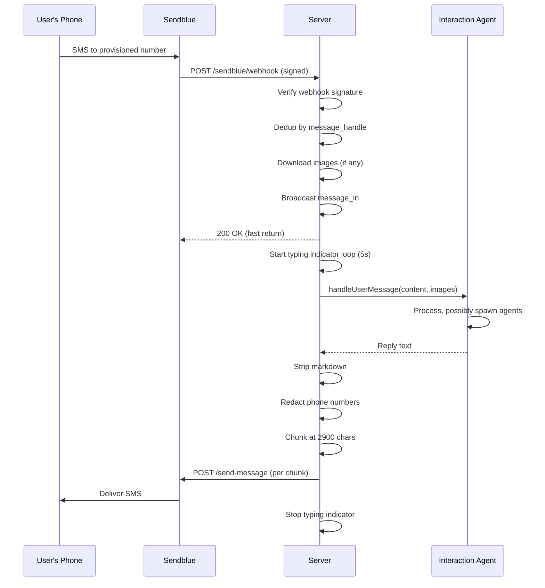

# Boop: Sendblue & iMessage

Sendblue is Boop's iMessage bridge. It receives webhooks from Sendblue when someone texts the provisioned number, and sends replies back via the Sendblue API.

**Source:** `server/sendblue.ts`, `server/sendblue-webhook-auth.ts`

## Architecture



**Source:** `server/sendblue.ts:223-317` — `createSendblueRouter()`

## Webhook Verification

**Aha:** Inbound webhooks are signed by Sendblue. Boop verifies the `sb-signing-secret` header before processing:

```ts
// server/sendblue.ts:226
router.post("/webhook", async (req, res) => {
  if (!verifySendblueWebhookSecret(req.get("sb-signing-secret"))) {
    res.status(401).json({ error: "invalid webhook signature" });
    return;
  }
  // ...
});
```

**Source:** `server/sendblue-webhook-auth.ts`, `server/sendblue.ts:226-230`

## Webhook Dedup

Sendblue sometimes sends duplicate webhooks. Boop deduplicates by `message_handle`:

```ts
// server/sendblue.ts:240
if (message_handle) {
  const { claimed } = await convex.mutation(api.sendblueDedup.claim, {
    handle: message_handle,
  });
  if (!claimed) {
    res.json({ ok: true, deduped: true });
    return;
  }
}
```

The `sendblueDedup` table uses a unique index on `handle` — the first claim wins, subsequent claims return `claimed: false`.

**Source:** `server/sendblue.ts:240-248`, `convex/schema.ts:180-183`

## Image Ingestion

When the user sends a photo, Boop downloads and stores it in Convex:

```ts
// server/sendblue.ts:146
export async function ingestSendblueImage(url: string): Promise<
  { ok: true; image: IngestedImage } | { ok: false; reason: string }
> {
  // Download with 10s timeout
  // Validate content-type and size (MAX_IMAGE_BYTES cap)
  // Stream body to enforce size cap (content-length may be absent)
  // Upload to Convex storage
  // Return { storageId, mediaType }
}
```

**Aha:** The download streams the body so it can abort early when the running total exceeds `MAX_IMAGE_BYTES` — `content-length` is often absent on CDN/redirect responses, and `await res.arrayBuffer()` would buffer the entire payload before any cap check fires.

**Source:** `server/sendblue.ts:146-221`

## Sending Messages

```ts
// server/sendblue.ts:77
export async function sendImessage(toNumber: string, text: string): Promise<void> {
  const plain = redactPhoneNumbers(stripMarkdown(text));
  for (const part of chunk(plain)) {
    const res = await fetch(`${API_BASE}/send-message`, {
      method: "POST",
      headers: h,
      body: JSON.stringify({ number: toNumber, content: part, from_number: from }),
    });
    // Handle errors: from_number mismatch, self-send, unrecognized number
  }
}
```

Messages are chunked to 2900 characters (Sendblue's limit):

```ts
// server/sendblue.ts:39
function chunk(text: string, size = 2900): string[] {
  if (text.length <= size) return [text];
  // Split by lines, keeping line boundaries at chunk edges
}
```

**Source:** `server/sendblue.ts:77-121`, `server/sendblue.ts:39-53`

## E.164 Normalization

Phone numbers are normalized to E.164 format:

```ts
// server/sendblue.ts:66
function normalizeE164(n: string | undefined): string | undefined {
  if (/^\d{10}$/.test(trimmed)) return `+1${trimmed}`;  // US numbers
  if (/^\d{11,15}$/.test(trimmed)) return `+${trimmed}`;
  if (trimmed.startsWith("+")) return trimmed;
  return trimmed;
}
```

**Source:** `server/sendblue.ts:66-75`

## Typing Indicator

While the agent is processing, Boop sends typing indicators every 5 seconds:

```ts
// server/sendblue.ts:138
export function startTypingLoop(toNumber: string): () => void {
  sendTypingIndicator(toNumber);
  const timer = setInterval(() => sendTypingIndicator(toNumber), 5000);
  return () => clearInterval(timer);
}
```

The typing indicator starts before `handleUserMessage` and stops in the `finally` block.

**Source:** `server/sendblue.ts:283,311`

## Auto Webhook Registration

**Aha:** Boop automatically registers the Sendblue webhook on every boot via `npm run dev`. This means even when ngrok's free plan rotates the URL, the new URL is registered without manual dashboard paste.

The `scripts/dev.mjs` orchestrator calls `npm run sendblue:webhook -- <url>` after the ngrok tunnel is live.

**Source:** `scripts/dev.mjs` — webhook registration step

## Markdown Stripping

iMessage doesn't support markdown. Boop strips it before sending:

```ts
// server/sendblue.ts:28
function stripMarkdown(text: string): string {
  return text
    .replace(/```[\s\S]*?```/g, (m) => m.replace(/```\w*\n?|```/g, ""))
    .replace(/\*\*(.+?)\*\*/g, "$1")
    .replace(/\*(.+?)\*/g, "$1")
    .replace(/`([^`]+)`/g, "$1")
    .replace(/^#+\s+/gm, "")
    .replace(/\[(.+?)\]\((.+?)\)/g, "$1 ($2)")
    .trim();
}
```

**Source:** `server/sendblue.ts:28-37`

## Local Chat Endpoint

For testing without Sendblue, Boop exposes `POST /chat`:

```ts
// server/index.ts:171
app.post("/chat", async (req, res) => {
  const { conversationId, content } = req.body ?? {};
  const reply = await handleUserMessage({
    conversationId, content,
    persistAssistantReply: true,
  });
  res.json({ reply });
});
```

**Source:** `server/index.ts:171-188`

## Next

Continue to [Convex Data Model](10-convex-data-model.md) for the full schema reference.
