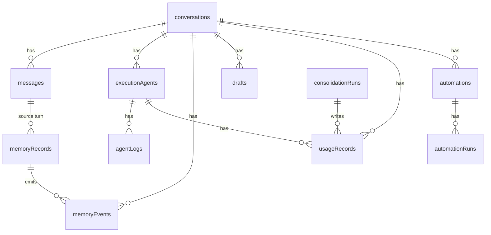

# Boop: Convex Data Model

Boop uses Convex for all persistent state. **13 tables**, typed queries, real-time subscriptions for the debug dashboard.

**Source:** `convex/schema.ts`
**Source:** `convex/*.ts` — query and mutation functions

## Schema Overview

Boop has **13 tables** in the Convex schema (the `_storage` table is built-in and not defined in schema.ts).



**Source:** `convex/schema.ts:1-249`

## Tables

### messages

The iMessage + chat transcript.

```ts
// convex/schema.ts:5
messages: defineTable({
  conversationId: v.string(),
  role: v.union(v.literal("user"), v.literal("assistant"), v.literal("system")),
  content: v.string(),
  agentId: v.optional(v.string()),
  turnId: v.optional(v.string()),
  createdAt: v.number(),
  imageStorageIds: v.optional(v.array(v.id("_storage"))),
  mediaError: v.optional(v.string()),
})
  .index("by_conversation", ["conversationId"])
  .index("by_conversation_turn", ["conversationId", "turnId"])
  .index("by_createdAt", ["createdAt"]),
```

| Field | Type | Purpose |
|-------|------|---------|
| `conversationId` | string | `sms:+1234567890` for iMessage, custom ID for dashboard chat |
| `role` | enum | `user`, `assistant`, `system` (proactive notices) |
| `content` | string | Message text |
| `agentId` | string (optional) | Associated execution agent |
| `turnId` | string (optional) | Groups all messages in one user turn |
| `createdAt` | number | Timestamp |
| `imageStorageIds` | array | Convex storage IDs for attached images |
| `mediaError` | string | Download error message for failed images |
| `mediaError` | string | Download error message for failed images |

**Source:** `convex/schema.ts:5-17`

### conversations

Per-thread metadata.

```ts
// convex/schema.ts:19
conversations: defineTable({
  conversationId: v.string(),
  title: v.optional(v.string()),
  summary: v.optional(v.string()),
  messageCount: v.number(),
  lastActivityAt: v.number(),
}).index("by_conversation", ["conversationId"]),
```

**Source:** `convex/schema.ts:19-25`

### memoryRecords

The memory store — tiered, segment-tagged, with vector embeddings.

```ts
// convex/schema.ts:27
memoryRecords: defineTable({
  memoryId: v.string(),
  content: v.string(),
  tier: v.union(v.literal("short"), v.literal("long"), v.literal("permanent")),
  segment: v.union(v.literal("identity"), v.literal("preference"), v.literal("correction"),
    v.literal("relationship"), v.literal("project"), v.literal("knowledge"), v.literal("context")),
  importance: v.number(),
  decayRate: v.number(),
  accessCount: v.number(),
  lastAccessedAt: v.number(),
  sourceTurn: v.optional(v.string()),
  lifecycle: v.union(v.literal("active"), v.literal("archived"), v.literal("pruned")),
  supersedes: v.optional(v.array(v.string())),
  embedding: v.optional(v.array(v.float64())),
  metadata: v.optional(v.string()),
  createdAt: v.number(),
  imageStorageIds: v.optional(v.array(v.id("_storage"))),
})
  .index("by_memory_id", ["memoryId"])
  .index("by_tier", ["tier"])
  .index("by_segment", ["segment"])
  .index("by_lifecycle", ["lifecycle"])
  .vectorIndex("by_embedding", {
    vectorField: "embedding",
    dimensions: 1024,
    filterFields: ["lifecycle"],
  }),
```

**Aha:** The vector index is 1024-dimensional with `filterFields: ["lifecycle"]`. This means vector searches can filter to only `active` memories, excluding archived and pruned ones — no post-processing needed.

**Source:** `convex/schema.ts:27-64`

### executionAgents

One row per spawned agent.

```ts
// convex/schema.ts:66
executionAgents: defineTable({
  agentId: v.string(),
  conversationId: v.optional(v.string()),
  name: v.string(),
  task: v.string(),
  runtime: v.optional(v.union(v.literal("claude"), v.literal("codex"))),
  model: v.optional(v.string()),
  reasoningEffort: v.optional(v.string()),
  billingMode: v.optional(v.union(v.literal("api"), v.literal("codex-subscription"))),
  status: v.union(v.literal("spawned"), v.literal("running"), v.literal("completed"),
    v.literal("failed"), v.literal("cancelled"), v.literal("paused")),
  result: v.optional(v.string()),
  error: v.optional(v.string()),
  mcpServers: v.array(v.string()),
  inputTokens: v.number(),
  outputTokens: v.number(),
  cacheReadTokens: v.optional(v.number()),
  cacheCreationTokens: v.optional(v.number()),
  costUsd: v.number(),
  startedAt: v.number(),
  completedAt: v.optional(v.number()),
})
  .index("by_agent_id", ["agentId"])
  .index("by_status", ["status"])
  .index("by_conversation", ["conversationId"]),
```

**Source:** `convex/schema.ts:66-96`

### agentLogs

Per-agent audit trail for the debug dashboard replay.

```ts
// convex/schema.ts:130
agentLogs: defineTable({
  agentId: v.string(),
  logType: v.union(v.literal("thinking"), v.literal("tool_use"), v.literal("tool_result"),
    v.literal("text"), v.literal("error")),
  toolName: v.optional(v.string()),
  accounts: v.optional(v.array(v.string())),
  content: v.string(),
  createdAt: v.number(),
}).index("by_agent", ["agentId"]),
```

**Source:** `convex/schema.ts:130-146`

### usageRecords

Append-only per-call cost log. Every LLM call writes a row.

```ts
// convex/schema.ts:101
usageRecords: defineTable({
  source: v.union(v.literal("dispatcher"), v.literal("execution"), v.literal("extract"),
    v.literal("consolidation-proposer"), v.literal("consolidation-adversary"),
    v.literal("consolidation-judge"), v.literal("proactive")),
  conversationId: v.optional(v.string()),
  turnId: v.optional(v.string()),
  agentId: v.optional(v.string()),
  runId: v.optional(v.string()),
  runtime: v.optional(v.union(v.literal("claude"), v.literal("codex"))),
  billingMode: v.optional(v.union(v.literal("api"), v.literal("codex-subscription"))),
  model: v.string(),
  inputTokens: v.number(),
  outputTokens: v.number(),
  cacheReadTokens: v.number(),
  cacheCreationTokens: v.number(),
  costUsd: v.number(),
  durationMs: v.number(),
  createdAt: v.number(),
})
  .index("by_conversation", ["conversationId"])
  .index("by_agent", ["agentId"])
  .index("by_source", ["source"]),
```

**Source:** `convex/schema.ts:101-128`

### automations

Scheduled recurring tasks.

```ts
// convex/schema.ts:159
automations: defineTable({
  automationId: v.string(),
  name: v.string(),
  task: v.string(),
  integrations: v.array(v.string()),
  schedule: v.string(),              // 5-field cron expression
  timezone: v.optional(v.string()),  // IANA timezone
  enabled: v.boolean(),
  conversationId: v.optional(v.string()),
  notifyConversationId: v.optional(v.string()),
  lastRunAt: v.optional(v.number()),
  nextRunAt: v.optional(v.number()),
  createdAt: v.number(),
})
  .index("by_automation_id", ["automationId"])
  .index("by_enabled", ["enabled"]),
```

**Source:** `convex/schema.ts:159-178`

### automationRuns

One row per automation execution.

```ts
// convex/schema.ts:233
automationRuns: defineTable({
  runId: v.string(),
  automationId: v.string(),
  status: v.union(v.literal("running"), v.literal("completed"), v.literal("failed")),
  result: v.optional(v.string()),
  error: v.optional(v.string()),
  agentId: v.optional(v.string()),
  startedAt: v.number(),
  completedAt: v.optional(v.number()),
})
  .index("by_automation", ["automationId"])
  .index("by_run_id", ["runId"]),
```

**Source:** `convex/schema.ts:233-248`

### drafts

Staged external actions.

```ts
// convex/schema.ts:185
drafts: defineTable({
  draftId: v.string(),
  conversationId: v.string(),
  kind: v.string(),
  summary: v.string(),
  payload: v.string(),
  status: v.union(v.literal("pending"), v.literal("sent"), v.literal("rejected"), v.literal("expired")),
  createdAt: v.number(),
  decidedAt: v.optional(v.number()),
})
  .index("by_draft_id", ["draftId"])
  .index("by_conversation_status", ["conversationId", "status"]),
```

**Source:** `convex/schema.ts:185-201`

### consolidationRuns

History of consolidation passes.

```ts
// convex/schema.ts:203
consolidationRuns: defineTable({
  runId: v.string(),
  trigger: v.string(),
  status: v.union(v.literal("running"), v.literal("completed"), v.literal("failed")),
  proposalsCount: v.number(),
  mergedCount: v.number(),
  prunedCount: v.number(),
  notes: v.optional(v.string()),
  details: v.optional(v.string()),
  startedAt: v.number(),
  completedAt: v.optional(v.number()),
})
  .index("by_run_id", ["runId"])
  .index("by_status", ["status"]),
```

**Source:** `convex/schema.ts:203-222`

### memoryEvents

Append-only event log for the debug UI.

```ts
// convex/schema.ts:148
memoryEvents: defineTable({
  eventType: v.string(),
  conversationId: v.optional(v.string()),
  memoryId: v.optional(v.string()),
  agentId: v.optional(v.string()),
  data: v.string(),
  createdAt: v.number(),
})
  .index("by_conversation", ["conversationId"])
  .index("by_type", ["eventType"]),
```

**Source:** `convex/schema.ts:148-157`

### sendblueDedup

Webhook dedup by `message_handle`.

```ts
// convex/schema.ts:180
sendblueDedup: defineTable({
  handle: v.string(),
  claimedAt: v.number(),
}).index("by_handle", ["handle"]),
```

**Source:** `convex/schema.ts:180-183`

### settings

Runtime overrides for things normally pinned by env vars.

```ts
// convex/schema.ts:227
settings: defineTable({
  key: v.string(),
  value: v.string(),
  updatedAt: v.number(),
}).index("by_key", ["key"]),
```

**Source:** `convex/schema.ts:227-231`

## Index Summary

| Table | Indexes |
|-------|---------|
| messages | `by_conversation`, `by_conversation_turn`, `by_createdAt` |
| conversations | `by_conversation` |
| memoryRecords | `by_memory_id`, `by_tier`, `by_segment`, `by_lifecycle`, `by_embedding` (vector) |
| executionAgents | `by_agent_id`, `by_status`, `by_conversation` |
| usageRecords | `by_conversation`, `by_agent`, `by_source` |
| agentLogs | `by_agent` |
| memoryEvents | `by_conversation`, `by_type` |
| automations | `by_automation_id`, `by_enabled` |
| automationRuns | `by_automation`, `by_run_id` |
| drafts | `by_draft_id`, `by_conversation_status` |
| consolidationRuns | `by_run_id`, `by_status` |
| sendblueDedup | `by_handle` |
| settings | `by_key` |

**Source:** `convex/schema.ts:1-249` — all `.index()` and `.vectorIndex()` calls

## Next

Continue to [Optional Features](11-optional-features.md) for local browser and Apple data.
