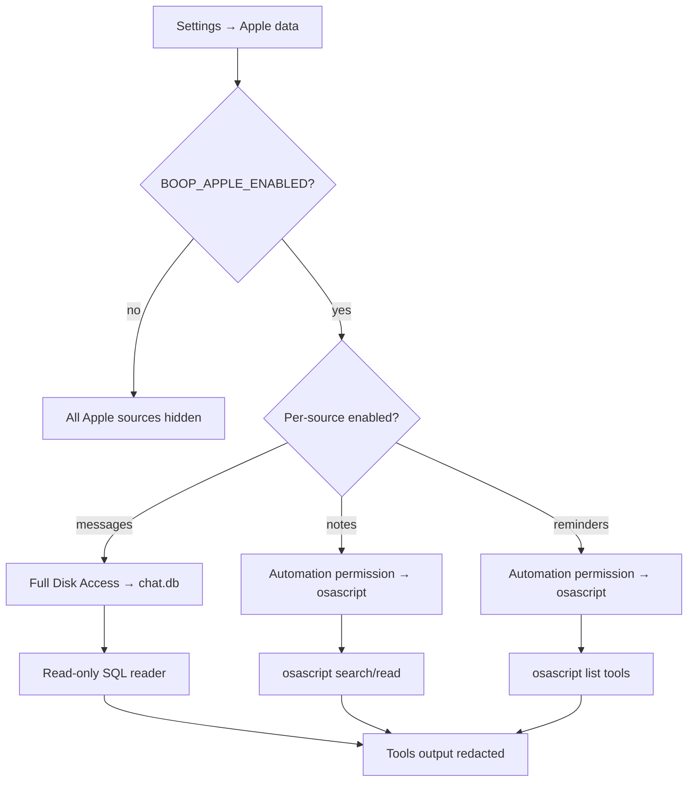

# Boop: Optional Features

Boop has two major optional feature sets: local browser use (Patchright Chrome) and local Apple data (iMessage/Notes/Reminders from the Mac). Both are off by default and require explicit opt-in.

**Source:** `server/runtime-config.ts`, `server/browser/`, `server/apple/`, `server/browser-routes.ts`, `server/apple-routes.ts`

## Local Browser Use

### Architecture

The local browser feature uses Patchright (a Playwright fork) to control a persistent Chrome/Chromium profile on the user's machine.

```mermaid
flowchart TD
    A[Settings → Local browser use] --> B[Convex settings table]
    B --> C[getBrowserSettings 5s cache]
    C --> D{enabled?}
    D -->|yes| E[browser-loader registers integration]
    D -->|no| F[integration hidden from dispatcher]
    E --> G[spawn_agent integrations:["browser"]]
    G --> H[launcher.ts: Patchright launch]
    H --> I{showUi?}
    I -->|yes| J[Visible Chrome window]
    I -->|no| K[Headless]
    J --> L[browser_fill, browser_click, etc.]
    K --> L
    L --> M{Login needed?}
    M -->|yes| N[browser_request_login → handoff]
    M -->|no| O[Continue automation]
```

**Source:** `server/browser/launcher.ts`, `server/browser/tools.ts`

### Settings Hierarchy

Browser settings follow a clear precedence: Convex runtime overrides > `.env.local` > defaults.

```ts
// server/runtime-config.ts:38
export interface BrowserSettings {
  enabled: boolean;
  profileDir: string;                  // Default: ~/.boop/browser-profile
  showUi: boolean;                     // Default: true
  loginHandoffEnabled: boolean;        // Default: false
  startUrl: string;
  channel: string;                     // Default: "chrome"
  executablePath: string;
  extraArgs: string[];
}
```

**Source:** `server/runtime-config.ts:38-47`

### Security: Blocked Flags

**Aha:** Boop blocks dangerous Chrome flags from being passed via settings:

```ts
// server/runtime-config.ts:58
const BLOCKED_BROWSER_EXTRA_ARGS = new Set([
  "--allow-running-insecure-content",
  "--disable-extensions-except",
  "--disable-web-security",
  "--load-extension",
  "--remote-allow-origins",
  "--remote-debugging-address",
  "--remote-debugging-port",
  "--unsafely-treat-insecure-origin-as-secure",
  "--user-data-dir",
]);
```

**Source:** `server/runtime-config.ts:58-68`

### Privacy: Browser Fill Redaction

```ts
// server/execution-agent.ts:55
export function redactToolInputForLog(toolName: string, input: unknown): unknown {
  if (!isBrowserFillTool(toolName)) return input;
  return { ...(input as Record<string, unknown>), text: "[redacted]" };
}
```

Typed values in `browser_fill` are redacted before being logged to Convex. Boop never stores third-party passwords.

**Source:** `server/execution-agent.ts:50-62`

### Local-Only Routes

**Aha:** Browser control HTTP routes are local-only. Requests with public `Host`, `X-Forwarded-Host`, or non-local `X-Forwarded-For` headers are rejected:

```ts
// server/browser-routes.ts
// GET  /browser/status    — settings, version, Chrome path, state
// POST /browser/launch    — launch/reuse local browser
// POST /browser/login     — force visible browser + handoff message
// POST /browser/close     — close browser context
// POST /browser/install   — npx -y patchright install chrome
```

**Source:** `server/browser-routes.ts`

### Codex Namespace

For Codex runtime, local browser tools are exposed under `local_browser` namespace to avoid Codex's reserved browser namespace. The user-facing integration name remains `browser`.

**Source:** `README.md:462` (upstream)

## Local Apple Data

### Architecture

Apple data is optional, Mac-only, and read-only. It has a two-layer disable:

1. Master switch (`apple_enabled`) must be on
2. Each source must be connected separately



**Source:** `server/apple/` — tools.ts, messages-local.ts, notes-local.ts, reminders-local.ts

### Privacy: Phone Number Redaction

All Apple outputs are redacted before reaching the agent/user:

```ts
// server/privacy.ts
// Phone numbers and contact handles are hidden in Apple outputs,
// replies, and outgoing iMessage/log paths.
```

**Source:** `server/privacy.ts`

### Local-Only Routes

Apple control routes are also localhost-only:

```ts
// server/apple-routes.ts
// Local Mac connection cards report unavailable on non-macOS machines.
// Composio integrations and the rest of Boop continue to work normally.
```

**Source:** `server/apple-routes.ts`

### Apple Settings

```ts
// server/runtime-config.ts:49
export interface AppleSettings {
  enabled: boolean;
  messagesEnabled: boolean;
  notesEnabled: boolean;
  remindersEnabled: boolean;
}
```

Apple settings are cached for 5 seconds and fall back to `.env.local` values when no Convex override exists.

**Source:** `server/runtime-config.ts:49-54`, `server/runtime-config.ts:325-364`

### macOS Permissions Required

| Source | Permission | Notes |
|--------|-----------|-------|
| iMessage | Full Disk Access for the app/process | Reads `~/Library/Messages/chat.db` via `/usr/bin/sqlite3` |
| Apple Notes | macOS Automation permission for Notes | Uses `/usr/bin/osascript`, exposes search/read tools only |
| Apple Reminders | macOS Automation permission for Reminders | Uses `/usr/bin/osascript`, exposes list tools only |
| Apple Calendar | Optional Apple bridge | Events are not read by the local server path |

**Source:** `README.md:485-490` (upstream)

## Next

Continue to [Cost Tracking](12-cost-tracking.md) for usage logging and cost estimation.
