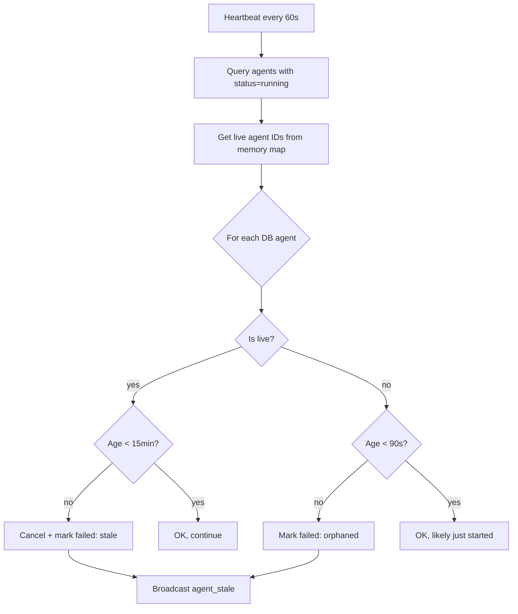

# Boop: Cross-Cutting Concerns

Privacy, security, heartbeat monitoring, WebSocket broadcast, and local access control cut across all of Boop's modules.

## Privacy

### Phone Number Redaction

All user-facing outputs and logs are scrubbed of phone numbers:

```ts
// server/privacy.ts
export function redactPhoneNumbers(text: string): string {
  // Replaces phone numbers with [phone redacted]
  // Handles international formats, E.164, and common separators
}

export function redactContactHandle(handle: string): string {
  // Redacts contact handles in logs and UI
}
```

**Used everywhere:**
- `sendblue.ts:92` — before sending iMessage
- `interaction-agent.ts:419,590,519` — ack messages, final reply, spawn results
- `execution-agent.ts:55` — browser_fill tool input
- `sendblue.ts:261,263` — webhook log preview

**Source:** `server/privacy.ts`

### Browser Fill Redaction

Typed values in `browser_fill` are redacted before being stored in Convex agent logs:

```ts
// server/execution-agent.ts:55
export function redactToolInputForLog(toolName: string, input: unknown): unknown {
  if (!isBrowserFillTool(toolName)) return input;
  return { ...(input as Record<string, unknown>), text: "[redacted]" };
}
```

Boop does not store third-party passwords or OAuth tokens for local browser use.

**Source:** `server/execution-agent.ts:50-62`

### Apple Data Privacy

Phone numbers and contact handles are hidden in all Apple outputs. The Apple data sources are read-only and never modify anything.

**Source:** `server/apple/tools.ts`, `server/privacy.ts`

## Heartbeat Monitoring

The heartbeat loop sweeps for stale and orphaned agents every 60 seconds:



**Thresholds:**
- **Stale:** Live in-process agents marked `failed` after **15 minutes** (`STALE_MS = 15 * 60 * 1000`)
- **Orphaned:** Rows with no live controller marked `failed` after **90 seconds** (`ORPHANED_MS = 90 * 1000`) — covers server restarts

**Source:** `server/heartbeat.ts:1-42`

```ts
// server/heartbeat.ts:6-7
const STALE_MS = 15 * 60 * 1000;
const ORPHANED_MS = 90 * 1000;

export async function sweepStaleAgents(): Promise<void> {
  const runningInDb = await convex.query(api.agents.list, { status: "running", limit: 100 });
  const live = new Set(runningAgentIds());
  const now = Date.now();

  for (const a of runningInDb) {
    const age = now - a.startedAt;
    const isLive = live.has(a.agentId);
    if (isLive && age < STALE_MS) continue;
    if (!isLive && age < ORPHANED_MS) continue;

    if (isLive) {
      cancelAgent(a.agentId);  // Abort the AbortController
    }
    await convex.mutation(api.agents.update, {
      agentId: a.agentId,
      status: "failed",
      error: isLive
        ? `Marked failed after ${Math.round(age / 1000)}s (stale heartbeat).`
        : `Marked failed after ${Math.round(age / 1000)}s (orphaned after backend restart).`,
    });
  }
}
```

**Source:** `server/heartbeat.ts:9-35`

## WebSocket Broadcast

Boop fans out events to all connected WebSocket clients via a simple pub/sub:

```ts
// server/broadcast.ts
const clients = new Set<WebSocket>();

export function addClient(ws: WebSocket): void {
  clients.add(ws);
  ws.on("close", () => clients.delete(ws));
}

export function broadcast(event: string, data: unknown): void {
  const msg = JSON.stringify({ event, data, at: Date.now() });
  for (const client of clients) {
    if (client.readyState === WebSocket.OPEN) {
      client.send(msg);
    }
  }
}
```

The debug dashboard connects to `/ws` and listens for events to update its UI in real-time.

**Source:** `server/broadcast.ts`

### WS Connection Security

WebSocket connections are restricted to local requests:

```ts
// server/index.ts:192
wss.on("connection", (ws, request) => {
  if (!isTrustedLocalRequest(request)) {
    ws.close(1008, "local connections only");
    return;
  }
  addClient(ws);
  ws.send(JSON.stringify({ event: "hello", data: { ok: true }, at: Date.now() }));
});
```

**Source:** `server/index.ts:191-199`

## Local Access Control

Boop distinguishes between public tunnel requests (ngrok) and local requests:

```ts
// server/index.ts:59
app.use((req, res, next) => {
  if (isPublicServerRequest(req) || isTrustedLocalRequest(req)) {
    next();
    return;
  }
  res.status(404).json({ error: "not found" });
});
```

| Route Type | Public Tunnel | Local |
|------------|--------------|-------|
| `/health` | ✓ | ✓ |
| `/sendblue/webhook` | ✓ | ✓ |
| `/composio/webhook` | ✓ | ✓ |
| `/chat` | ✗ | ✓ |
| `/browser/*` | ✗ | ✓ |
| `/apple/*` | ✗ | ✓ |
| `/memory/*` | ✗ | ✓ |
| `/composio/*` (non-webhook) | ✗ | ✓ |
| `/runtime-config` | ✗ | ✓ |
| `/ws` | ✗ | ✓ |

**Source:** `server/index.ts:59-65`, `server/local-access.ts`

## Scripted Demo Replies

Boop has a scripted demo reply system that intercepts certain messages during development:

```ts
// server/sendblue.ts:269
if (await maybeHandleScriptedDemoReply(
  { conversationId, content: textForLog, fromNumber: from_number, turnTag },
  { sendImessage, sendTypingIndicator },
)) {
  return;  // Skip normal processing for demo messages
}
```

**Source:** `server/sendblue.ts:269-281`, `server/scripted-demo-replies.ts`

## Proactive Email Watcher

Boop can watch a Gmail inbox for proactive notices:

```ts
// server/index.ts:51
const stableUrl = process.env.PUBLIC_URL;
if (stableUrl && !stableUrl.includes("localhost")) {
  ensureProactiveWatcher(stableUrl).catch((err) =>
    console.error("[proactive] startup failed", err),
  );
}
```

This is only enabled when a stable public URL is configured. For ngrok-based dev, scripts/dev.mjs drives the same function once the ngrok URL is known.

**Source:** `server/index.ts:51-56`, `server/proactive-email.ts`

## Upstream Version Check

Every `npm run dev` triggers a background check for new upstream commits:

```ts
// scripts/dev.mjs — spawns check-upstream.mjs
// scripts/check-upstream.mjs
// Asks the `upstream` remote if there are new commits.
// If there are, shows a banner with the count and a reminder to run /upgrade-boop.
```

| Condition | Behavior |
|-----------|----------|
| `upstream` set, new commits | Banner with count |
| `upstream` set, up to date | Silent |
| No `upstream` remote, forked | One-line hint about adding it |
| No `upstream` remote, canonical | Silent (you *are* upstream) |

Disable with `BOOP_UPSTREAM_CHECK=false` in `.env.local`.

**Source:** `scripts/check-upstream.mjs`, `README.md:679-691` (upstream)

## Next

Continue to [Setup & Deploy](14-setup-deploy.md) for the interactive setup, dev, desktop app, and production deployment.
