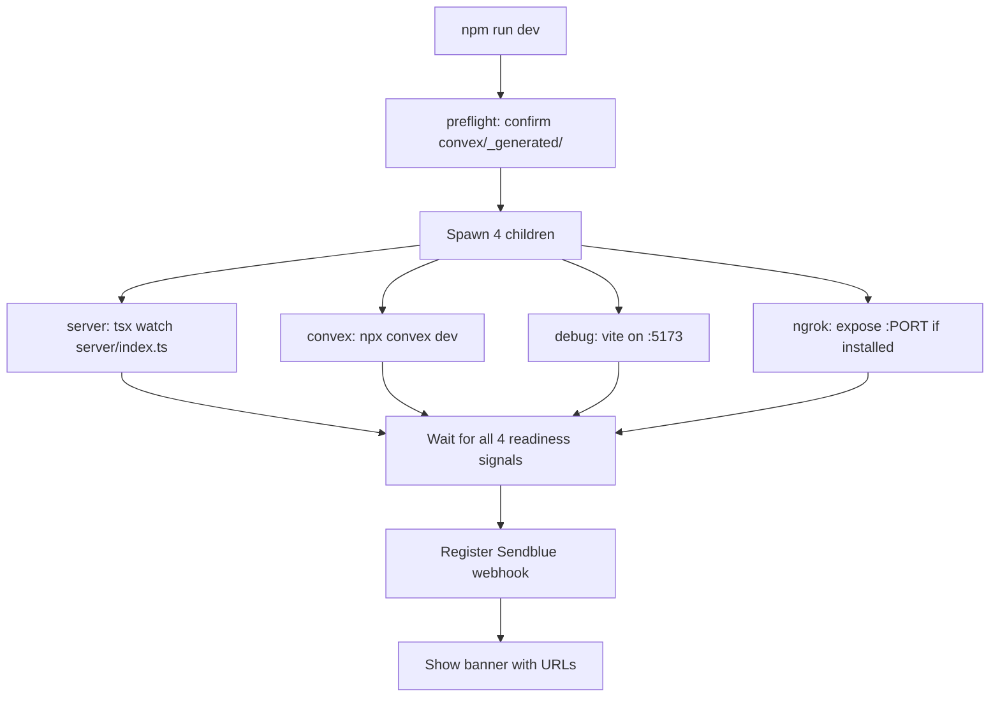

# Boop: Setup & Deploy

Boop has an interactive setup, a one-command dev runner, an experimental desktop app, and production deployment guidance.

**Source:** `scripts/setup.ts`, `scripts/dev.mjs`, `scripts/desktop-setup.mjs`, `scripts/preflight.mjs`

## Prerequisites

| Service | Why | Free? |
|---------|-----|-------|
| [Claude Code](https://claude.com/code) or Codex/ChatGPT | Powers the agent | Subscription required |
| [Sendblue](https://sendblue.com) | iMessage bridge | Free on agent plan |
| [Convex](https://convex.dev) | Database + realtime | Free tier |
| [Composio](https://composio.dev) | Integrations (optional) | Free tier |
| [ngrok](https://ngrok.com) | Expose local port | Free tier |

**Source:** `README.md:120-130` (upstream)

## Interactive Setup

```bash
npm run setup
```

The setup script (`scripts/setup.ts`) is interactive:

1. Writes `.env.local`
2. Walks through runtime choice (Claude vs Codex)
3. Configures Sendblue (API keys, phone number)
4. Creates or reuses a Convex deployment
5. Generates Convex files
6. Offers optional local browser support (Patchright install)

**Source:** `scripts/setup.ts`

## Environment Variables

Everything lives in `.env.local` (auto-created by `npm run setup`):

| Var | Required | Notes |
|-----|----------|-------|
| `VITE_CONVEX_URL` | yes | Convex deployment URL for Vite debug UI |
| `CONVEX_URL` | optional | Server-only Convex URL override |
| `SENDBLUE_API_KEY` / `SENDBLUE_API_SECRET` | yes | From Sendblue dashboard |
| `SENDBLUE_FROM_NUMBER` | yes | Sendblue-provisioned number |
| `BOOP_RUNTIME` | no | `claude` (default) or `codex` |
| `BOOP_MODEL` | no | Default `claude-sonnet-4-6` |
| `BOOP_CODEX_MODEL` | no | Default `gpt-5.5` |
| `BOOP_CODEX_REASONING_EFFORT` | no | Default `medium` |
| `BOOP_BROWSER_ENABLED` | no | Default `false` |
| `BOOP_APPLE_ENABLED` | no | Default `false` |
| `VOYAGE_API_KEY` or `OPENAI_API_KEY` | optional | Vector search (falls back to substring) |
| `COMPOSIO_API_KEY` | optional | Integrations (chat + memory + automations still work without it) |
| `PORT` | no | Default `3456` |
| `PUBLIC_URL` | no | Base URL for Sendblue webhook |
| `ANTHROPIC_API_KEY` | optional | Bypass subscription for Claude runtime |

**Source:** `.env.example`, `README.md:413-443` (upstream)

## Dev Runner

```bash
npm run dev
```

The dev orchestrator (`scripts/dev.mjs`) spawns four children in parallel:



Readiness signals:
- `server` → "listening on :PORT"
- `convex` → "Convex functions ready"
- `debug` → "Local: http://localhost:5173/"
- `ngrok` → tunnel URL visible at http://127.0.0.1:4040

**Source:** `scripts/dev.mjs`, `scripts/preflight.mjs`

### Banner Output

```
════════════════════════════════════════════════════════════════════
  Boop is ready — ngrok tunnel is live.

  🐶 Debug dashboard (click me):   http://localhost:5173
  🌐 Public URL:                   https://abc123.ngrok-free.app
  📮 Sendblue webhook (inbound):   https://abc123.ngrok-free.app/sendblue/webhook
  📱 Text this Sendblue number:    +1234567890  (from a DIFFERENT phone)
════════════════════════════════════════════════════════════════════
```

**Source:** `scripts/dev.mjs` — banner display

### Webhook Auto-Registration

On every boot, Boop registers the Sendblue webhook:

```bash
# scripts/dev.mjs calls:
npm run sendblue:webhook -- <public-url>/sendblue/webhook
```

This removes stale tunnel hooks, registers the new URL as a `type=receive` inbound webhook, and synchronizes the signing secret.

| Setup | Auto-register fires? |
|-------|---------------------|
| Free ngrok (default) | **Yes**, every boot |
| Reserved `NGROK_DOMAIN` | **Yes**, every boot |
| Static `PUBLIC_URL` (Cloudflare etc.) | **Yes**, every boot |
| `SENDBLUE_AUTO_WEBHOOK=false` | No (manual opt-out) |

**Source:** `README.md:264-270` (upstream)

## Sendblue Scripts

| Command | What it does |
|---------|-------------|
| `npm run setup` | Interactive: Sendblue + Convex together |
| `npm run sendblue:sync` | Pulls phone number from `sendblue lines`, writes to `.env.local` |
| `npm run sendblue:webhook -- <url>` | Registers webhook via Sendblue CLI |
| `npm run sendblue:webhook:check` | Read-only: compares active tunnel with Sendblue registration |

**Source:** `README.md:220-228` (upstream)

## Desktop App

Boop has an experimental dedicated macOS desktop app:

```bash
npm run desktop:setup   # Setup app runtime, build, optionally copy to /Applications
npm run desktop:dev     # Developer mode from this checkout
npm run desktop:pack    # Build unsigned app bundle in dist/mac-arm64
npm run desktop:dist    # Build unsigned distributables
```

| Command | What happens | Installs app? |
|---------|-------------|---------------|
| `npm run setup` | Configures checkout for terminal use | No |
| `npm run desktop:setup` | Prepares app runtime, builds, offers /Applications copy | Yes, if accepted |
| `npm run desktop:dev` | Opens desktop app from checkout | No |
| `npm run desktop:pack` | Creates unsigned bundle under `dist/` | No |
| `npm run desktop:dist` | Creates unsigned distributables | No |

**Source:** `README.md:186-199` (upstream)

### Desktop App Runtime Location

For an installed macOS app, `.env.local`, `.convex`, generated Convex files, and local data live under:

```
~/Library/Application Support/Boop/runtime
```

The app bundle contains the runnable project and Boop app icon; the runtime folder contains machine-specific setup.

**Source:** `README.md:201` (upstream)

## Production Deployment

### Static URL

For production, use a stable URL instead of ngrok:

- **ngrok paid plan** — reserved domain
- **Cloudflare Tunnel** — free, stable subdomain
- **Tailscale Funnel** — or any tunnel with static URL

Point it at `localhost:3456`. Set `PUBLIC_URL` in `.env.local`.

### Multiple Instances

**Aha:** The automation loop runs in-process. If you deploy multiple instances, automations will double-fire. Add a lock in Convex or run a dedicated scheduler pod.

**Source:** `README.md:258` (upstream)

### Security Considerations

- Boop has no user auth — it's a single-user tool. Add Clerk or similar for multi-tenant.
- No `maxTurns` or `maxBudgetUsd` set on SDK calls. Add these for higher-throughput deployments.
- Browser control and Apple routes are local-only. Only health checks and provider webhooks are exposed through the public tunnel.

## Typecheck and Test

```bash
npm run typecheck    # tsc --noEmit
npm run test         # vitest run --passWithNoTests
```

**Source:** `package.json:32-34`

## Next

This completes the Boop documentation. Return to the [Overview](00-overview.md) for the full index.
