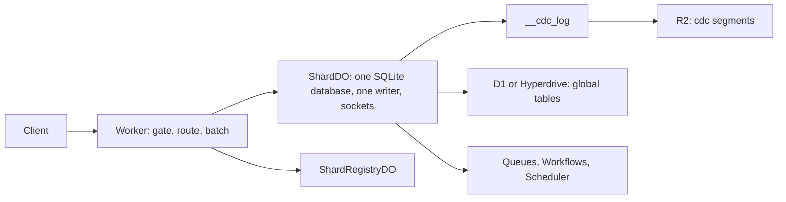
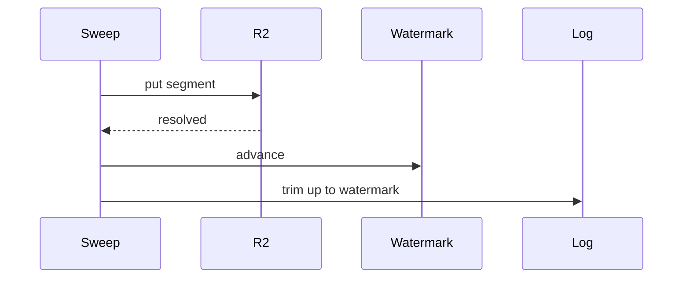

# Project Exploration: Lunora, a Cloudflare backend where the Durable Object is the database

## Overview

Lunora is a type-safe, real-time backend for your own Cloudflare account. A Durable Object (a single-threaded Cloudflare object with its own SQLite storage) is the database. The same object holds the WebSocket connections of the clients that read the data. So the writer is also the broadcaster.

Lunora is alpha software. Its license is FSL-1.1-Apache-2.0. The central class `ShardDO` has 18,454 lines. See [Overview](markdown/00-overview.md).

## Cloudflare services used

Durable Objects (with SQLite and WebSocket hibernation), Workers, D1, Hyperdrive, R2, Workers KV (a key-value store), Queues, Workflows, Cron Triggers, Analytics Engine, Pipelines with R2 SQL (Structured Query Language), Vectorize, Workers AI (artificial intelligence) with AI Gateway, and service bindings. The page [Cloudflare services](markdown/02-cloudflare-services.md) has one section for each.

## Sharding in one minute

The shard is a Durable Object chosen by name. A table marked `.shardBy(field)` lives in the object named by that field value. Other tables live in the root shard `__root__`. A single `ShardRegistryDO` lists the shards for fan-out. The caller supplies the shard key, and I found no server check that it matches the row. There is no resharding, only a manual export and import. See [Sharding design](markdown/04-sharding-design.md).

## Change log and archive

Every shard keeps `__cdc_log` with a sequence number (`_commitSeq`) and an epoch. A sweep copies old rows into R2 as `cdc/{shard}/{epoch}/{16-digit last seq}.json`, advances a watermark, and only then deletes. A restore is detected as a timeline fork. See [Change log](markdown/06-change-log-cdc.md) and [Storage tiers](markdown/08-storage-tiers-and-archive.md).

## Document map

| Topic | Document |
|-------|----------|
| Overview | [00](markdown/00-overview.md) |
| Architecture | [01](markdown/01-architecture.md) |
| Cloudflare services | [02](markdown/02-cloudflare-services.md) |
| Worker runtime | [03](markdown/03-worker-runtime.md) |
| Sharding | [04](markdown/04-sharding-design.md) |
| ShardDO | [05](markdown/05-shard-durable-object.md) |
| Change log | [06](markdown/06-change-log-cdc.md) |
| Replication and read scaling | [07](markdown/07-replication-and-read-scaling.md) |
| Storage tiers and archive | [08](markdown/08-storage-tiers-and-archive.md) |
| D1 and Hyperdrive | [09](markdown/09-d1-global-and-hyperdrive.md) |
| Realtime | [10](markdown/10-realtime-engine.md) |
| Alarms, queues, workflows | [11](markdown/11-alarms-queues-workflows.md) |
| 56 tricks | [12](markdown/12-optimizations-and-tricks.md) |
| Migrations | [13](markdown/13-migrations-and-schema.md) |
| Testing and deployment | [14](markdown/14-testing-observability-deployment.md) |
| Critical assessment | [15](markdown/15-critical-assessment.md) |
| Glossary | [16](markdown/16-glossary.md) |

## The five most important tricks

1. Archive first, destroy second, with a watermark in SQLite and the epoch in the R2 prefix.
2. A gate wrapper that never rejects, because a rejection from `blockConcurrencyWhile` resets the object.
3. A schedule outbox written inside the transaction, so a crash cannot lose a deferred job.
4. Fork detection with outside witnesses (consumer, replica, archive), because SQLite cannot report a restore.
5. Range-gated invalidation with a per-flush diff cache for realtime fan-out.

## Verdict

Strong core idea, careful handling of Cloudflare edge cases. The weak points sit outside one object: caller-chosen shard keys, no resharding, single registry and scheduler objects, a log archive ceiling of about 166 changes per second per shard, and write amplification from the default request log. **Aha: the best parts (gate, outbox, archive) all come from treating the platform's failure modes as first-class.** See [Critical assessment](markdown/15-critical-assessment.md).

## Differences between code and docs

- The code has 59 packages. `AGENTS.md` says 58.
- The docs say routing is by schema. In the code the client passes `shardKey`.
- The docs say actions run in the Worker. In the code they run on the shard.
- Analytics Engine blob size is 5,120 bytes in the code. A doc says 16 kilobytes (KB).

## Grandfather review

Done on 2026-10-27. Every `file:line` citation in chapters 00 to 15 was printed by a script and read against the claim. Several wrong line numbers and facts were fixed (for example 34 workerd tests, not 37; `platform-node` uses `better-sqlite3`). Numbers were cross-checked with grep. Mermaid count is at least 2 in every chapter. Abbreviations are spelled out.

Not verified:

- Nothing was run. The clone was treated as untrusted, so all claims come from reading code.
- Row-write amplification per request (chapter 12, entry 56) is an inference, not a measurement.
- Cloudflare platform limits quoted from the repository comments were not checked against current Cloudflare documentation.
- The Node and `celld` host rows of the capability matrix were counted from the matrix, not tested.
- Chapter 16 (glossary) citations were checked less closely than chapters 00 to 15.
