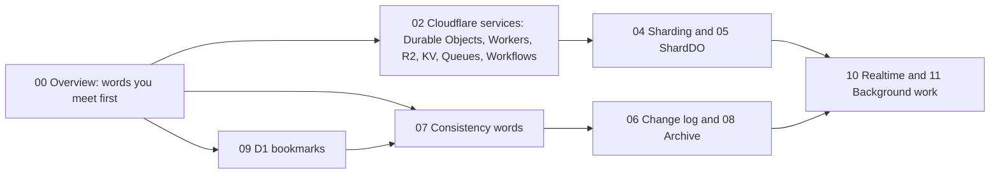
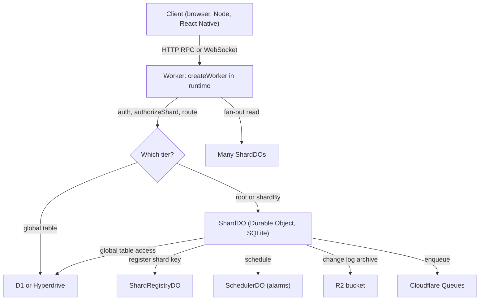
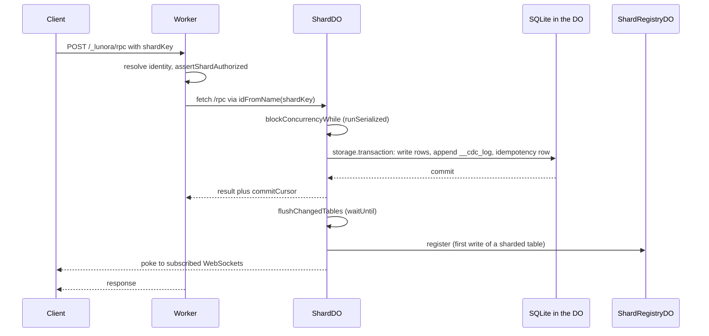

# Lunora Overview: a database that is also a Durable Object

Lunora is a backend framework for Cloudflare. A Durable Object (a single-threaded Cloudflare object with its own storage) is the database. The same Durable Object also holds the WebSocket connections of the clients that read that data.

## How to read these docs

You do not need to know Cloudflare internals. Every Cloudflare idea has one page that explains it from the beginning. Other pages only point to that page. Use this table to find it.

| If you need to understand | Read |
|---------------------------|------|
| What a Durable Object is. The section covers the actor model and one instance per name. It covers input and output gates, `blockConcurrencyWhile`, SQLite storage and transactions, alarms, WebSocket hibernation, point-in-time recovery, location hints, jurisdictions, and why an object is a natural shard | [Cloudflare services](02-cloudflare-services.md), section "Durable Objects from first principles" |
| What a D1 bookmark is, how read replicas use it, and how Lunora gets read-your-writes | [D1 and global tables](09-d1-global-and-hyperdrive.md), section "D1 read replication, sessions and bookmarks" |
| Words such as read-your-writes, monotonic reads, eventual consistency, replication lag, watermark, epoch, commit sequence, idempotency, outbox and fork after restore | [Replication and read scaling](07-replication-and-read-scaling.md), section "Consistency words used in these docs" |
| Workers (isolates and limits), R2, Workers KV, Queues, Workflows, Cron Triggers, Analytics Engine, service bindings, Vectorize, Workers AI, Pipelines | [Cloudflare services](02-cloudflare-services.md), one section for each |
| Hyperdrive and its connection pool | [Cloudflare services](02-cloudflare-services.md) and [D1 and global tables](09-d1-global-and-hyperdrive.md) |
| Shard key, root shard, fan-out, the registry | [Sharding design](04-sharding-design.md) |
| The change data capture (CDC) log, the epoch, cursors and floors | [Change log](06-change-log-cdc.md) |
| Archive segments and sweeps | [Storage tiers and archive](08-storage-tiers-and-archive.md) |
| The gate wrapper and the host contracts | [Architecture](01-architecture.md) |
| Subscriptions, shapes and pokes | [Realtime engine](10-realtime-engine.md) |
| Alarms, the scheduler, queues and workflows in Lunora | [Alarms, queues, workflows](11-alarms-queues-workflows.md) |
| Any single term, in alphabetical order | [Glossary](16-glossary.md) |

Each page that depends on a Cloudflare feature names the Cloudflare documentation file that supports the claim. Those paths are relative to `src/content/docs` in the `cloudflare/cloudflare-docs` repository. Each Lunora claim names a source file and a line.

### Words you meet first

These words appear on this page before their own page explains them. Each has a short meaning here.

| Word | Meaning | Where it is explained |
|------|---------|-----------------------|
| Worker | The Cloudflare program that receives every request. It keeps no data | [Cloudflare services](02-cloudflare-services.md) |
| Shard | One Durable Object that owns one slice of the data. Its name is the shard key | [Sharding design](04-sharding-design.md) |
| Shard key | The string name of a shard. The caller chooses it, for example a channel identifier | [Sharding design](04-sharding-design.md) |
| Root shard | The default shard, named `__root__` (`packages/do/src/shard-do.ts:1598`). Tables with no modifier live here | [Sharding design](04-sharding-design.md) |
| Global table | A table marked `.global()`. It lives in D1 or in Postgres or MySQL, so every shard can read it | [D1 and global tables](09-d1-global-and-hyperdrive.md) |
| Fan-out | One read that the Worker sends to every shard of a table. The Worker merges the answers | [Sharding design](04-sharding-design.md) |
| Change data capture (CDC) log | `__cdc_log`, an append-only table in each shard. It records every write | [Change log](06-change-log-cdc.md) |
| Archive segment | One R2 object that holds a batch of old change log rows | [Storage tiers and archive](08-storage-tiers-and-archive.md) |
| Sweep | One cleanup pass over the change log. It copies old rows to R2 first and deletes them after | [Storage tiers and archive](08-storage-tiers-and-archive.md) |
| Gate wrapper | The adapter code around `blockConcurrencyWhile`. It turns errors into values so that the platform never resets the object | [Architecture](01-architecture.md) |
| Bookmark | A string that names one point in the history of a D1 database. The client sends it back to read its own writes | [D1 and global tables](09-d1-global-and-hyperdrive.md) |
| Poke | A small message from a shard to a client. It lists the rows that entered or left a subscribed set | [Realtime engine](10-realtime-engine.md) |

## About this page

This page explains what Lunora is, which packages it has, and how one request moves through the system. Later pages go deep on each Cloudflare service, the sharding design, and the change log.

Source: `README.md:37`, `AGENTS.md:9`, `architecture.mdx` (in `apps/docs/src/content/docs/architecture.mdx`).

## What Lunora is

Lunora gives a developer type-safe `query`, `mutation` and `action` functions. Codegen (a build step that writes TypeScript) turns the schema and the functions into a Cloudflare Worker. The Worker routes each call to a Durable Object. That Durable Object runs the function against its own SQLite database.

The project says it targets "Convex-style developer experience on your own Cloudflare account" (`README.md:37`). The code is licensed under the Functional Source License identifier FSL-1.1-Apache-2.0 (`package.json`, field `license`). The packages are in alpha. The root `package.json` has version `0.0.0`.

The repository is a pnpm monorepo. The clone has 59 directories under `packages/` and 59 `package.json` files there. The file `AGENTS.md` says "58 packages", so that number is one behind the code. The clone has 6,226 files with a `.ts` or `.tsx` extension.

## The three data tiers

The schema picks where a table lives. Each tier uses a different Cloudflare service.

| Tier | Schema modifier | Cloudflare service | Consistency |
|------|-----------------|--------------------|-------------|
| Root shard | none | one Durable Object named `__root__` | strong, one writer |
| Sharded | `.shardBy("field")` | one Durable Object per field value | strong inside one shard |
| Global | `.global()` | D1 (Cloudflare Structured Query Language (SQL) database) or Postgres/MySQL through Hyperdrive | D1: read-your-writes with a bookmark. Hyperdrive: no bookmark |
| Blob | `.storage()` and the `ctx.storage` facade | R2 (object storage) | per object |

Source: `apps/docs/src/content/docs/concepts/sharding.mdx`, `packages/do/src/shard-do.ts:1598` (`ROOT_SHARD_NAME = "__root__"`).

## Package map

The packages fall into groups. Only the first three groups matter for sharding and storage.

| Group | Packages | Job |
|-------|----------|-----|
| Contracts | `platform`, `platform-cloudflare` | Host-neutral interfaces and the Cloudflare adapter |
| Engine | `shard-engine`, `sql-store`, `d1`, `hyperdrive` | Structured Query Language (SQL), change log, replicas, relays, global tables |
| Runtime | `do`, `runtime`, `server`, `values`, `wire`, `errors` | Durable Object class, Worker, builders, validators |
| Async | `scheduler`, `queue`, `workflow`, `dispatch` | Alarms, Queues, Workflows, at-least-once dispatch |
| Storage and bindings | `storage`, `bindings`, `ai`, `container`, `browser` | R2, Workers KV (a key-value store), Analytics Engine, Vectorize, artificial intelligence (AI), Containers |
| Tooling | `codegen`, `cli`, `vite`, `config`, `advisor`, `studio`, `testing` | Build, deploy, lint, local admin, tests |
| Clients | `client`, `react`, `vue`, `solid`, `svelte`, `angular`, `react-native` | Browser and mobile software development kits (SDKs) |
| Add-ons | `auth`, `mail`, `payment`, `notify`, `ratelimit`, `flags`, `privacy` and more | Optional features |

Lines of TypeScript, without test files, for the packages that matter most: `do` 24,249; `shard-engine` 36,967; `runtime` 22,385; `sql-store` 10,082; `replica` 5,428; `scheduler` 4,272; `queue` 1,764; `d1` 2,649; `hyperdrive` 1,559; `platform-cloudflare` 992 (counted with `wc -l` on the `.ts` files under each package `src` folder, without the files that end in `.test.ts`).

The file `packages/do/src/shard-do.ts` alone has 18,454 lines. It holds the `ShardDO` class. Most behaviour in this document lives in that class or in the helpers it calls.

## Request flow at a glance

Source: `README.md:150`, `packages/runtime/src/create-worker.ts:2970` (`forwardToShard`).

## One mutation, end to end

Source: `packages/do/src/shard-do.ts:8525` (`handleFetchCloudflare`), `shard-do.ts:4288` (`runInTransaction`), `shard-do.ts:13193` (`registerWrittenShard`), `shard-do.ts:5811` (`mutationCommitCursor`).

### Reading the diagram in plain words

1. The client sends the call. The call carries a shard key, which is the name of the Durable Object that must handle it.
2. The Worker finds out who the caller is. It checks that the caller may use that shard.
3. The Worker asks Cloudflare for the Durable Object with that name (`idFromName`) and forwards the call. Cloudflare runs at most one object for each name.
4. The shard enters its gate (`blockConcurrencyWhile`). While it holds the gate, no other event runs in this object.
5. The shard opens one storage transaction. It writes the rows, appends one row to the change log `__cdc_log`, and saves an idempotency row. The idempotency row lets a retry of the same call return the saved result.
6. The transaction commits. Either all of the writes happen or none.
7. After the response, the shard refreshes its subscriptions. It sends a poke to each subscribed WebSocket. The Worker does not wait for this.
8. On the first write to a sharded table, the shard tells the registry its name. The registry is the list that a later fan-out uses.

## Aha moments

**Aha: the writer is also the broadcaster.** One Durable Object runs one event at a time. The commit order of its writes is the consistency order. The same object holds the WebSocket connections. So a change never crosses a process boundary to reach a subscriber.

**Aha: sharding is an address, not a database feature.** There is no hash ring and no rebalancer. A shard is a Durable Object name. The caller chooses the name. Cloudflare turns the name into an object with `idFromName`. See [Sharding design](04-sharding-design.md).

**Aha: Lunora records its own known limits.** The code uses a comment tag, `ponytail:`, for a limit the authors accept and have not fixed. The clone has 46 such comments in `packages/*/src`. They are a useful list of known weak points.

## Where the code and the documentation disagree

| Topic | Documentation says | Code shows |
|-------|--------------------|------------|
| Package count | 58 (`AGENTS.md`) | 59 directories in `packages/` |
| Shard routing | "codegen re-addresses `ctx.db.messages.*`" (`concepts/sharding.mdx`) | The client sends `shardKey` in the remote procedure call (RPC) envelope. The Durable Object does not check that a row field equals its own name. See [Sharding design](04-sharding-design.md) |
| Analytics blob size | "5120 bytes" in the sink comment (`packages/runtime/src/observability-sinks.ts:430`) | 16 kilobytes (KB) in `bindings/src/analytics/create-analytics.ts:19`. The Cloudflare limit is 16 KB (`analytics/analytics-engine/limits.mdx`) |
| Queue delay ceiling | The code comment calls 12 hours the Cloudflare ceiling (`packages/queue/src/create-queues.ts:20-27`) | Cloudflare lists 24 hours (`queues/platform/limits.mdx`). Lunora is stricter than the platform |
| D1 replica convergence | `architecture.mdx` says replicas converge "within the ~24h window" (lines 292, 350, 440) | The Cloudflare D1 docs give no bound. They say a replica can be arbitrarily out of date. See [D1 and global tables](09-d1-global-and-hyperdrive.md) |

## Where to go next

Read [Architecture](01-architecture.md) for layers and contracts. Read [Cloudflare services](02-cloudflare-services.md) for each service. Read [Critical assessment](15-critical-assessment.md) for the verdict.
