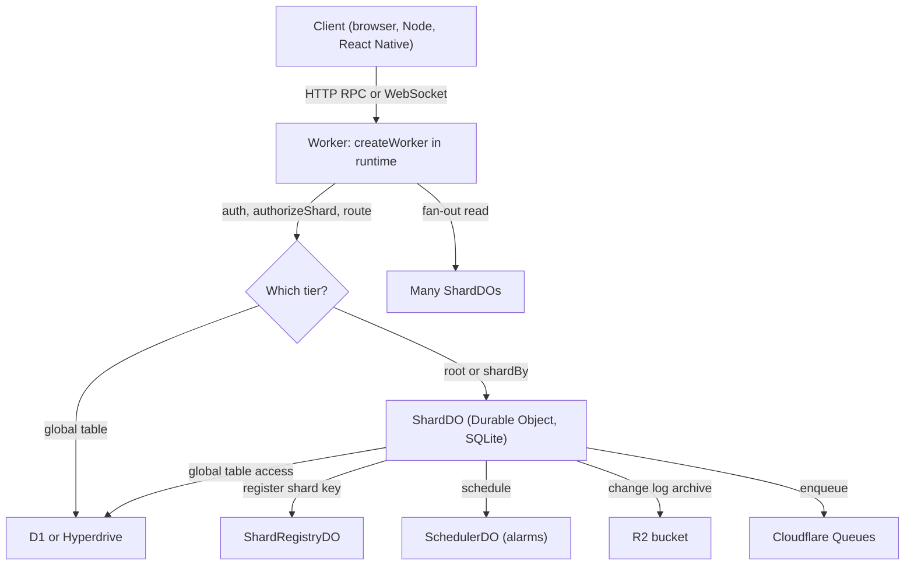
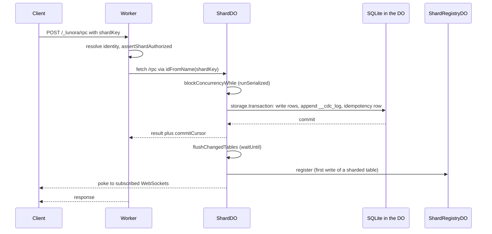

# Lunora Overview: a database that is also a Durable Object

Lunora is a backend framework for Cloudflare. A Durable Object (a single-threaded Cloudflare object with its own storage) is the database. The same Durable Object also holds the WebSocket connections of the clients that read that data.

This page explains what Lunora is, which packages it has, and how one request moves through the system. Later pages go deep on each Cloudflare service, the sharding design, and the change log.

Source: `README.md:37`, `AGENTS.md:9`, `architecture.mdx` (in `apps/docs/src/content/docs/architecture.mdx`).

## What Lunora is

Lunora gives a developer type-safe `query`, `mutation` and `action` functions. Codegen (a build step that writes TypeScript) turns the schema and the functions into a Cloudflare Worker. The Worker routes each call to a Durable Object. That Durable Object runs the function against its own SQLite database.

The project says it targets "Convex-style developer experience on your own Cloudflare account" (`README.md:37`). The code is licensed FSL-1.1-Apache-2.0 (`package.json`, field `license`). The packages are in alpha. The root `package.json` has version `0.0.0`.

The repository is a pnpm monorepo. The clone has 59 directories under `packages/` and 59 `package.json` files there. The file `AGENTS.md` says "58 packages", so that number is one behind the code. The clone has 6,226 files with a `.ts` or `.tsx` extension.

## The three data tiers

The schema picks where a table lives. Each tier uses a different Cloudflare service.

| Tier | Schema modifier | Cloudflare service | Consistency |
|------|-----------------|--------------------|-------------|
| Root shard | none | one Durable Object named `__root__` | strong, one writer |
| Sharded | `.shardBy("field")` | one Durable Object per field value | strong inside one shard |
| Global | `.global()` | D1 (Cloudflare Structured Query Language (SQL) database) or Postgres/MySQL through Hyperdrive | read-your-writes with a bookmark |
| Blob | `.storage()` and the `ctx.storage` facade | R2 (object storage) | per object |

Source: `apps/docs/src/content/docs/concepts/sharding.mdx`, `packages/do/src/shard-do.ts:1598` (`ROOT_SHARD_NAME = "__root__"`).

## Package map

The packages fall into groups. Only the first three groups matter for sharding and storage.

| Group | Packages | Job |
|-------|----------|-----|
| Contracts | `platform`, `platform-cloudflare` | Host-neutral interfaces and the Cloudflare adapter |
| Engine | `shard-engine`, `sql-store`, `d1`, `hyperdrive` | SQL, change log, replicas, relays, global tables |
| Runtime | `do`, `runtime`, `server`, `values`, `wire`, `errors` | Durable Object class, Worker, builders, validators |
| Async | `scheduler`, `queue`, `workflow`, `dispatch` | Alarms, Queues, Workflows, at-least-once dispatch |
| Storage and bindings | `storage`, `bindings`, `ai`, `container`, `browser` | R2, Workers KV (key-value store), Analytics Engine, Vectorize, AI, Containers |
| Tooling | `codegen`, `cli`, `vite`, `config`, `advisor`, `studio`, `testing` | Build, deploy, lint, local admin, tests |
| Clients | `client`, `react`, `vue`, `solid`, `svelte`, `angular`, `react-native` | Browser and mobile SDKs |
| Add-ons | `auth`, `mail`, `payment`, `notify`, `ratelimit`, `flags`, `privacy` and more | Optional features |

Lines of TypeScript, without test files, for the packages that matter most: `do` 24,249; `shard-engine` 36,967; `runtime` 22,385; `sql-store` 10,082; `replica` 5,428; `scheduler` 4,272; `queue` 1,764; `d1` 2,649; `hyperdrive` 1,559; `platform-cloudflare` 992 (counted with `wc -l` on `src/**/*.ts` excluding `*.test.ts`).

The file `packages/do/src/shard-do.ts` alone has 18,454 lines. It holds the `ShardDO` class. Most behaviour in this document lives in that class or in the helpers it calls.

## Request flow at a glance

Source: `README.md:150`, `packages/runtime/src/create-worker.ts:2970` (`forwardToShard`).

## One mutation, end to end

Source: `packages/do/src/shard-do.ts:8525` (`handleFetchCloudflare`), `shard-do.ts:4288` (`runInTransaction`), `shard-do.ts:13193` (`registerWrittenShard`), `shard-do.ts:5811` (`mutationCommitCursor`).

## Aha moments

**Aha: the writer is also the broadcaster.** One Durable Object runs one event at a time. The commit order of its writes is the consistency order. The same object holds the WebSocket connections. So a change never crosses a process boundary to reach a subscriber.

**Aha: sharding is an address, not a database feature.** There is no hash ring and no rebalancer. A shard is a Durable Object name. The caller chooses the name. Cloudflare turns the name into an object with `idFromName`. See [Sharding design](04-sharding-design.md).

**Aha: Lunora records its own known limits.** The code uses a comment tag, `ponytail:`, for a limit the authors accept and have not fixed. The clone has 46 such comments in `packages/*/src`. They are a useful list of known weak points.

## Where the code and the documentation disagree

| Topic | Documentation says | Code shows |
|-------|--------------------|------------|
| Package count | 58 (`AGENTS.md`) | 59 directories in `packages/` |
| Shard routing | "codegen re-addresses `ctx.db.messages.*`" (`concepts/sharding.mdx`) | The client sends `shardKey` in the remote procedure call (RPC) envelope. The Durable Object does not check that a row field equals its own name. See [Sharding design](04-sharding-design.md) |
| Analytics blob size | "5120 bytes" in the sink comment (`packages/runtime/src/observability-sinks.ts:430`) | 16 KB in `bindings/src/analytics/create-analytics.ts` |

## Where to go next

Read [Architecture](01-architecture.md) for layers and contracts. Read [Cloudflare services](02-cloudflare-services.md) for each service. Read [Critical assessment](15-critical-assessment.md) for the verdict.
