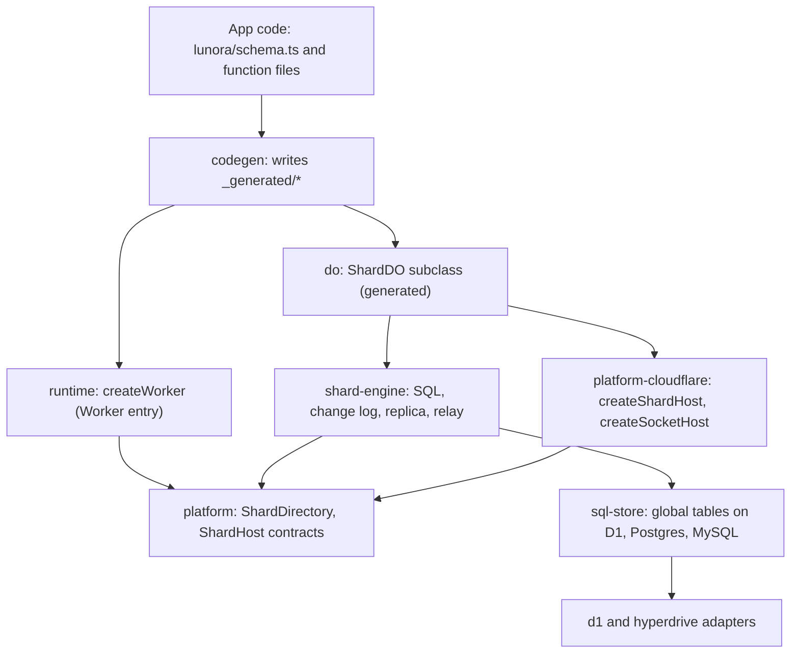
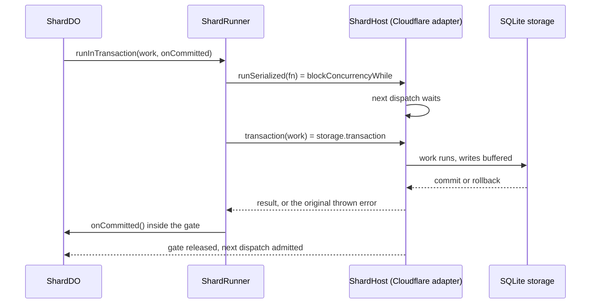

# Architecture: host-neutral engine, thin Cloudflare adapter

Lunora splits the engine from Cloudflare. The engine talks to small interfaces. One adapter package maps those interfaces onto Cloudflare primitives. This page shows the layers, the interfaces, and the code generator that joins them.

## Words on this page

- **Host.** The platform that runs the engine. Cloudflare is one host. A Node process and the `celld` daemon are others.
- **Contract.** A TypeScript interface that says what a host must do, for example "run one event at a time".
- **Adapter.** Code that maps a contract onto the calls of one host. `platform-cloudflare` is the Cloudflare adapter.
- **Gate.** The `blockConcurrencyWhile` call of a Durable Object. It holds back all other events until its callback ends. [Cloudflare services](02-cloudflare-services.md), section "Durable Objects from first principles", explains the call and the input and output gates around it.
- **Cold start.** The first request after the object or Worker loads from nothing. Code that runs in a cold start is paid for again after each wake.
- **Capability matrix.** A table that rates each feature as `native`, `emulated` or `unsupported` on each host.
- **Codegen.** The build step that writes TypeScript from the schema and the function files.
- **`celld`.** A self-hosted daemon that runs Wrangler bundles ([Testing, observability and deployment](14-testing-observability-deployment.md)).

## The layers



Source: `packages/platform/src/index.ts:1`, `packages/platform-cloudflare/src/cloudflare-host.ts:1`, `packages/shard-engine/src/shard-runner.ts:1`.

The rule is simple. `@lunora/platform` has types and capability data only. It has no runtime dependency (`packages/platform/src/index.ts:1`, comment block). Every other package may import it, so no cycle forms.

## The four host contracts

`@lunora/platform` defines four groups of interface. They are the seam where a second host (Node, or the `celld` daemon) can replace Cloudflare.

| Contract | Cloudflare implementation | Meaning |
|----------|---------------------------|---------|
| `ShardHost` | `createShardHost(state)` | One writer, a transaction, local Structured Query Language (SQL), alarms, `waitUntil` |
| `SocketHost` | `createSocketHost(state)` | Hibernating WebSockets with durable attachments and tags |
| `ShardDirectory` | `createShardDirectory(namespace)` | Shard key to stub, with jurisdiction and region hint |
| `SchedulerHost` | `SchedulerDO` | Durable delayed jobs |

Source: `packages/platform/src/shard-host.ts:133` (`ShardHost`), `packages/platform-cloudflare/src/cloudflare-host.ts:130,610,755`.

The `ShardHost` interface states a hard rule. There must be at most one live instance per shard key at any moment. The comment says Cloudflare Durable Objects give this natively and "every other host must enforce it" (`shard-host.ts:122-132`).

```ts
// packages/platform/src/shard-host.ts:149
runSerialized: <T>(function_: () => Promise<T>) => Promise<T>;
// packages/platform/src/shard-host.ts:175
transaction: <T>(function_: () => Promise<T>) => Promise<T>;
```

### The capability matrix

The matrix rates each feature as `native`, `emulated`, or `unsupported` for each host. The Cloudflare matrix has 60 features. 45 are native and 15 are emulated (`packages/platform/src/capabilities/cloudflare.ts:12`, counted with `grep -o 'level: "..."'`). The Node matrix has 4 native, 24 emulated and 32 unsupported. The `celld` matrix has 19 native, 14 emulated and 27 unsupported.

Codegen reads the matrix. If a host does not support a feature, codegen leaves out the surface and writes a `platform_unsupported_feature` diagnostic (`AGENTS.md:108-125`).

The 15 Cloudflare features marked `emulated` are the ones Lunora builds itself. They show where the framework adds value over raw Cloudflare:

- `durableStreams`, `deliveryAuthorization`, `serverReactors`, `memoryTables`
- `alarmRearmBreaker`, `scheduleRateBreaker`
- `shardReadReplicas`, `crossShardFanout`, `relationGraph`
- `scheduler`, `objectStorageBackups`, `objectStorageCdcArchive`
- `agents`, `mail`, `topics`

Source: `cloudflare.ts:28-193`.

## The ShardRunner: one gate plus one transaction

`ShardRunner` composes two host calls. The gate runs first. The transaction runs inside it.

```ts
// packages/shard-engine/src/shard-runner.ts:136
public async runInTransaction<T>(work: () => Promise<T>, onCommitted?: () => void): Promise<T> {
    return this.shardHost.runSerialized(async () => {
        const result = await this.shardHost.transaction(work);
        onCommitted?.();
        return result;
    });
}
```

The `onCommitted` hook runs inside the gate, after the commit. It is the only point where "this transaction committed" and "no other transaction has committed since" are both true. The `ShardDO` uses it to put after-commit side effects in commit order (`shard-runner.ts:125-135`).

## How Cloudflare maps onto the contracts

The adapter is short (792 lines). Three tricks are worth reading.

**Trick 1: the gate never rejects.** The platform call `blockConcurrencyWhile` treats a rejected callback as fatal. Cloudflare says: "If the callback throws an exception, the object will be terminated and reset" (`durable-objects/api/state.mdx`, `blockConcurrencyWhile`). The code comment adds that the abort discards the in-memory state and "every hibernating WebSocket subscription" (`packages/platform-cloudflare/src/cloudflare-host.ts:145-156`). A normal application error must not do that. So the adapter turns the result into a value and re-throws it outside the gate.

```ts
// packages/platform-cloudflare/src/cloudflare-host.ts:161
const runSerialized: ShardHost["runSerialized"] = async (function_) => {
    if (typeof state.blockConcurrencyWhile === "function") {
        const settled = await state.blockConcurrencyWhile(async () => {
            try { return { ok: true as const, value: await function_() }; }
            catch (error) { return { error, ok: false as const }; }
        });
        if (!settled.ok) { throw settled.error; }
        return settled.value;
    }
    return function_();
};
```

**Trick 2: the original error survives.** The platform rolls back correctly but hands back a flattened copy of the error. A `LunoraError` copy would look like an unknown fault and be hidden from the client. The adapter saves the original, and re-throws it. It attaches the platform error as `cause` (`cloudflare-host.ts:114,202`).

**Trick 3: no raw transaction Structured Query Language (SQL).** The Workers runtime forbids transaction statements such as `BEGIN` and `SAVEPOINT` in `sql.exec` inside a Durable Object. Cloudflare names `BEGIN TRANSACTION` and `SAVEPOINT` and points to `storage.transaction()` and `transactionSync()` (`durable-objects/api/sqlite-storage-api.mdx:239`). The code comment lists `COMMIT` too. The adapter always uses `storage.transaction` (`cloudflare-host.ts:185-201`, and the explanation at `shard-do.ts:4160-4185`). The synchronous variant `transactionSync` does not wait for an async handler, so it is not used.

### Gate and transaction in order



Source: `shard-runner.ts:136`, `cloudflare-host.ts:161,202`.

## Code generation

Codegen writes a subclass of `ShardDO` for each app. The base class cannot see the schema. The subclass overrides hooks such as `ensureMigrated`, `handleRpc`, `executeSubscription`, and `isMutationFunction`.

```ts
// packages/codegen/src/emit/shard.ts:1176 (text of the emitted class)
protected override ensureMigrated(): void {
    if (this.migrated) { return; }
    ...
    this.blockedUniqueIndexes = runShardMigrations(this.sql as SqlExec, schema as unknown as SchemaLike, { cdc: config.cdc ?? false, deferBlockedUniqueIndexes: true ... });
    this.migrated = this.blockedUniqueIndexes.length === 0;
}
```

The generated code runs the idempotent schema migration on the first request after each cold start. See [Migrations](13-migrations-and-schema.md).

## Code shared without a package edge

The top-level `shared/` directory has small helper files that several packages need. The bundler inlines them into each package. This keeps the dependency graph free of new edges. Examples: `shared/relay-name.ts`, `shared/replica-name.ts`, `shared/region-hint.ts`, `shared/relay-signature.ts`, `shared/shard-registry-frame.ts` (`AGENTS.md`, section "Top-level shared").

The `relay-name.ts` header gives the reason: the Worker mints names and the Durable Object parses them. A shared file means the two sides "can never drift on the format" without a runtime dependency (`shared/relay-name.ts:1-10`).

## One class, three roles

A Cloudflare account has a limit on Durable Object classes. Lunora can merge three roles into one class: shard, scheduler, and shard registry. The constructor reads the role from the instance name.

```ts
// packages/do/src/merge-durable-objects.ts:63
const mergeDurableObjects = <Env = unknown>(roles: MergedRoles): MergedDurableObject<Env> =>
    class LunoraDO implements Required<DurableObjectHandlers> {
        public constructor(state: DurableObjectState, env: Env) {
            const role = roleOf(state.id.name);
            ...
            this.#role = new Role(state as never, env as never);
```

A `Proxy` is a JavaScript object that intercepts reads of its properties. Here it adds a prefix to a name before the real call happens. Names for the non-shard roles carry the prefix `__lunora_do__:<role>:` (`LUNORA_ROLE_PREFIX`, `packages/platform/src/shard-directory.ts:126`). `roleNamespace` is a `Proxy` that adds the prefix (`merge-durable-objects.ts:119`). The directory refuses any user shard key that starts with the prefix (`shard-directory.ts:138`).

**Aha: the role is a name.** A Durable Object has no way to be told its role at creation. So Lunora puts the role in the name, and the name is fixed for the life of the object. The same trick marks relays (`::relay::`) and replicas (`::replica::`). See [Replication](07-replication-and-read-scaling.md).

## Where to go next

Read [Cloudflare services](02-cloudflare-services.md) for the full service list. Read [Worker runtime](03-worker-runtime.md) for the request gate.
