# Cloudflare services: what Lunora uses, how, and why

Lunora uses Cloudflare Workers and Durable Objects as its core. It adds D1, R2, Queues, Workflows, Hyperdrive and more around that core. This page lists every service found in the code. Each section says how Lunora uses the service, why, and where the code is.

This page is also the place where the Cloudflare ideas are explained. You do not need to know Cloudflare before you read it. Each product section has two parts. The part "What it is" explains the product in plain words and names the one property that Lunora relies on. The part "How Lunora uses it" lists the code. Every Cloudflare claim names the Cloudflare documentation file that supports it. The paths are relative to the `src/content/docs` folder of the `cloudflare/cloudflare-docs` repository. Durable Objects have their own long section, "Durable Objects from first principles". D1 has its full explanation in [D1 and global tables](09-d1-global-and-hyperdrive.md).

The authority for this list is the Cloudflare capability matrix (`packages/platform/src/capabilities/cloudflare.ts:12`). The wrangler binding manifest (`packages/config/src/cloudflare/binding-manifest.ts`) lists 25 binding types: `ai`, `ai_search`, `ai_search_namespace`, `analytics_engine`, `analytics_sql`, `artifacts`, `assets`, `browser`, `container`, `d1`, `durable_object`, `hyperdrive`, `images`, `kv`, `media`, `pipeline`, `queue_consumer`, `queue_producer`, `r2`, `service`, `stream`, `vectorize`, `vpc_network`, `vpc_service`, `workflow`.

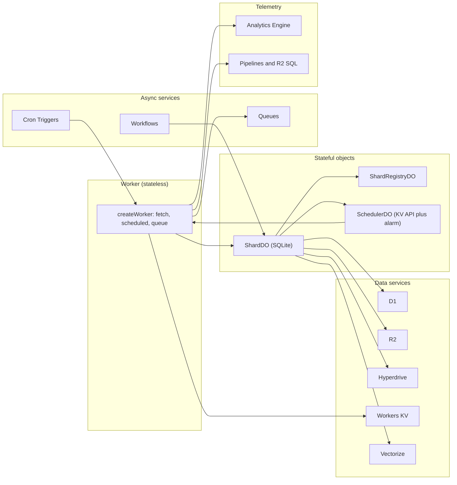

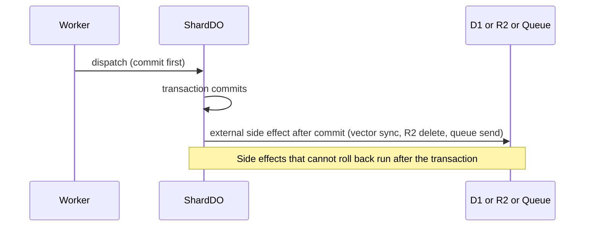

## Summary table

| Service | Lunora package | Used for | Core or optional |
|---------|----------------|----------|------------------|
| Workers | `runtime` | Entry, routing, auth, fan-out, cron and queue entries | Core |
| Durable Objects | `do`, `scheduler`, `shard-engine` | Shards, registry, scheduler, relays, replicas | Core |
| Durable Object SQLite | `shard-engine` | Every shard-local table and the change log | Core |
| D1 | `d1`, `sql-store` | `.global()` tables | Core when `.global()` is used |
| R2 | `storage`, `shard-engine`, `runtime` | Files, change log archive, backups, uploads | Optional |
| Workers KV (a key-value store) | `bindings` | `ctx.kv` facade for apps | Optional |
| Queues | `queue` | Background work, topics, requeue | Optional |
| Hyperdrive | `hyperdrive` | Postgres or MySQL as a `.global()` backend | Optional |
| Workflows | `workflow`, `agent` | Durable multi-step jobs and agents | Optional |
| Cron Triggers | `runtime`, `config` | Scheduled functions and backups | Optional |
| Analytics Engine | `bindings`, `runtime` | App events and function metrics | Optional |
| Service bindings | `config`, `do` | Shared shard registry across Workers | Optional |
| Vectorize | `bindings`, `ai` | Vector search | Optional |
| Workers AI (artificial intelligence) and AI Gateway | `ai`, `agent` | Models and cost telemetry | Optional |
| Pipelines, R2 SQL (Structured Query Language) | `bindings`, `runtime` | Log archive | Optional |
| Others | see end of page | Images, Browser, Containers, Email, Access, Secrets Store | Optional |

## Workers

### What a Worker is

A Worker is a JavaScript program that Cloudflare runs close to the user. It runs inside an isolate. An isolate is a light sandbox inside the V8 engine. Chromium and Node.js use the same engine. One runtime process hosts hundreds or thousands of isolates and switches between them. An isolate starts inside a process that already runs. So there is no virtual machine start and the cold start is small (`workers/reference/how-workers-works.mdx`, "Isolates", and `src/content/partials/workers/isolate-description.mdx`).

A Worker handles many requests in a single-threaded event loop. Cloudflare may evict an isolate at any time. It may send two requests of one user to two different isolates. So a Worker must not keep mutable state in global variables (`how-workers-works.mdx`, "Distributed execution"). This is why Lunora says the Worker is stateless and keeps all state in Durable Objects, D1 and R2.

### Limits that shape Lunora

| Limit | Value | Source |
|-------|-------|--------|
| Central processing unit (CPU) time per request | 30 seconds by default, up to 5 minutes on the Paid plan | `workers/platform/limits.mdx`, "CPU time" |
| Memory per isolate | 128 megabytes | same file, "Memory" |
| Subrequests per request | 50 (Free), 10,000 (Paid, can go higher) | same file, "Subrequests" |
| Simultaneous outgoing connections | 6 | same file, account table |
| Start-up time | 1 second, for the top-level code of the Worker. A deploy that is too slow fails with error `10021` | same file, "Worker startup time" |
| Worker size | 64 mebibytes uncompressed | same file, "Worker size" |
| Environment variables | 64 (Free) or 128 (Paid) per Worker. Each value may be 5 kilobytes | same file, "Environment variables" |

A subrequest is any request that a Worker sends with `fetch` or to a Cloudflare service such as R2, Workers KV or D1.

### Two Worker tools that the docs use often

- **`waitUntil`.** `ctx.waitUntil(promise)` keeps the Worker alive until a promise ends, even after the response went out. Without it, work that is not awaited can be cancelled when the request ends (`workers/runtime-apis/context.mdx`, `waitUntil`). Lunora uses it to push changes to sockets after the response.
- **`request.cf`.** Cloudflare adds a `cf` object to each incoming request. It holds data such as the continent, the data center code (`colo`) and the country (`workers/runtime-apis/request.mdx`, `IncomingRequestCfProperties`). Lunora reads it to pick a region hint.

### How Lunora uses Workers

The Worker is a stateless front. The function `createWorker` returns an object with `fetch`, `scheduled` and `queue` entries (`packages/runtime/src/create-worker.ts:2756` for `scheduled`). It parses the remote procedure call (RPC) envelope, checks identity, and forwards to a shard. It also runs fan-out reads and serves the admin routes.

Why: the Worker scales horizontally for free. All state lives in Durable Objects, D1 and R2. See [Worker runtime](03-worker-runtime.md).

A limit Lunora tracks: a Worker must parse and run its top-level code within 1 second. A deploy that is too slow fails with error 10021 (`workers/platform/limits.mdx`, "Worker startup time"). The repository commits a baseline in `worker-startup.json` (300 procedures, 60 tables, 915 eager modules, 6,046,937 eager bytes) and a size baseline in `worker-size.json` (1,348,884 raw bytes, 344,186 gzip bytes). Scripts check both in continuous integration.

## Durable Objects

The Durable Object (DO) is the heart of Lunora. The code uses the platform features in the table. The next section, "Durable Objects from first principles", explains each feature from the beginning.

| Platform feature | Where Lunora uses it |
|------------------|----------------------|
| `idFromName`, `getByName`, `get` | `packages/runtime/src/resolve-shard.ts:69-115` |
| `namespace.jurisdiction("eu")` | `resolve-shard.ts:198`, `cloudflare-host.ts:785` |
| `locationHint` on creation | `resolve-shard.ts:58` |
| `blockConcurrencyWhile` | `cloudflare-host.ts:161`, `shard-registry-do.ts:296` |
| `storage.transaction` | `cloudflare-host.ts:202` |
| `storage.sql.exec` | `cloudflare-host.ts:52` |
| `setAlarm`, `getAlarm`, `deleteAlarm` | `cloudflare-host.ts:75` |
| `acceptWebSocket`, `getWebSockets`, `getTags` | `cloudflare-host.ts:684` |
| `serializeAttachment` | `shard-do.ts:18400` (`writeAttachment`) |
| `setWebSocketAutoResponse` | `shard-do.ts:16404` |
| `waitUntil` | `cloudflare-host.ts:247` |
| `abort` | `shard-do.ts:12242` (point-in-time restore) |
| `getCurrentBookmark`, `onNextSessionRestoreBookmark` | `shard-engine/src/pitr.ts:98,118` |
| `state.id.name`, `state.id.jurisdiction` | `cloudflare-host.ts:244`, `shard-do.ts:3271` |

At least seven Durable Object classes appear in the code: `ShardDO`, `ShardRegistryDO`, `SchedulerDO`, `SessionDO`, the auth object, the container object, and the event log object in `packages/replica`. A merged class can host the shard, scheduler and registry roles (`merge-durable-objects.ts:63`).

## Durable Objects from first principles

A Durable Object is a small server program with its own disk. Cloudflare runs at most one copy of it for each name. Lunora builds its database on this fact. This section explains the ideas one by one. Each idea has a Cloudflare source and the Lunora code that depends on it.

### One named instance, anywhere in the world

A Durable Object class is a JavaScript class. A namespace is the set of all objects of one class. You turn a name into an identifier with `idFromName`. You turn the identifier into a stub with `get`. A stub is a client handle. You call methods on the stub, and the call travels to the object, wherever it runs (`durable-objects/api/namespace.mdx`, `idFromName` and the example at the top).

Cloudflare creates the object late. Making an identifier or a stub does not create the object. The first call on the stub does (`durable-objects/concepts/durable-object-lifecycle.mdx`, first section).

Cloudflare promises that one identifier maps to one live instance in the whole world. The docs call each object "globally unique" (`durable-objects/platform/known-issues.mdx:25`). This promise has a price. The first time a Worker uses a name, the system must check that no other Worker created the same object a moment earlier. The check "can take up to a few hundred milliseconds". After that, the location is cached. A random identifier from `newUniqueId` skips the check (`durable-objects/api/namespace.mdx`, note after `newUniqueId`).

This model is the actor model. An actor receives messages, runs in its own single-threaded context, uses its own storage, and sends messages out. Erlang, Akka and Microsoft Orleans use the same model (`durable-objects/concepts/what-are-durable-objects.mdx`, "Actor programming model").

Lunora turns the promise into a rule for every host. The `ShardHost` contract says there must be "at most one LIVE instance per shard key, at any moment". Lunora keeps state in memory that is correct only under this rule, for example the in-flight claim for actions (`packages/platform/src/shard-host.ts:122-132`). Lunora names each shard and resolves the name with `getByName` or `idFromName` (`packages/runtime/src/resolve-shard.ts:69-115`). So the first request to a new shard key pays the uniqueness check. This is my reading of the Cloudflare note and the resolve code.

### Lifecycle: active, idle, hibernated, inactive

An object is not always in memory. The Cloudflare docs list five states (`durable-objects/concepts/durable-object-lifecycle.mdx`, "Durable Object Lifecycle state transitions"):

| State | Meaning |
|-------|---------|
| Active, in-memory | The object runs and handles events |
| Idle, in-memory, non-hibernateable | The object waits, but something blocks hibernation |
| Idle, in-memory, hibernateable | The object waits and may hibernate. The runtime hibernates it after 10 seconds of inactivity |
| Hibernated | The object is out of memory. Its WebSockets stay connected |
| Inactive | The object is fully removed from the host process. This is the first state of every object |

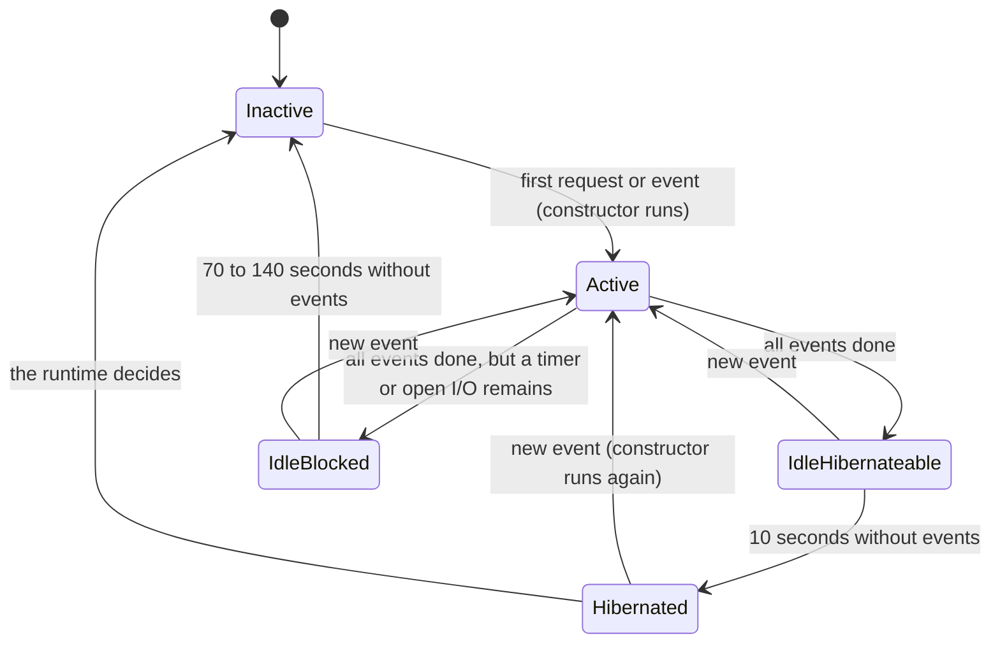

Hibernation needs four things. No `setTimeout` or `setInterval` callback may be set. No unfinished input or output (I/O) or `waitUntil` promise may remain, and no outbound connection may stay open. The standard WebSocket application programming interface (API) must not be in use. No request may be in progress. When the object hibernates, its in-memory state is discarded. On the next event the constructor runs again.

A promise passed to `waitUntil` prevents eviction for up to 15 minutes. Each pending operation has its own 15-minute window (`durable-objects/api/state.mdx`, `waitUntil`, and the lifecycle page note "Pending operations prevent eviction").

What this means for Lunora: every in-memory value is a cache that can vanish. The flag `migrated` resets on wake, so the schema migration runs again ([Migrations](13-migrations-and-schema.md)). The reactive query cache dies on hibernation ([Replication](07-replication-and-read-scaling.md)). The registry sees a shard register again after each wake ([Sharding design](04-sharding-design.md)).

### One event at a time: input gates and output gates

JavaScript runs one piece of code at a time. But `await` lets another request run while the first one waits. This can cause races. The Durable Object runtime adds two rules to prevent them (`durable-objects/best-practices/rules-of-durable-objects.mdx`, "Understand how input and output gates work").

- **Input gate.** While a storage operation runs, the runtime delivers no new event to the object, except storage completions. The runtime holds the other events until the gate opens. An `await` on `fetch()` opens the gate. An `await` on a storage call does not.
- **Output gate.** While a storage write is pending, the runtime holds back every outgoing message, such as a response or a `fetch`. The client never sees a confirmation of data that is not yet saved. If the write fails, the runtime drops the held messages, replaces them with errors, and restarts the object (`src/content/glossary/durable-objects.yaml`, terms "input gate" and "output gate").
- **Write coalescing.** Several writes with no `await` between them commit together as one atomic implicit transaction.

SQLite calls on the object are synchronous. They do not yield the event loop. So they run atomically with no extra step (`durable-objects/api/state.mdx`, note "When to use `blockConcurrencyWhile`").

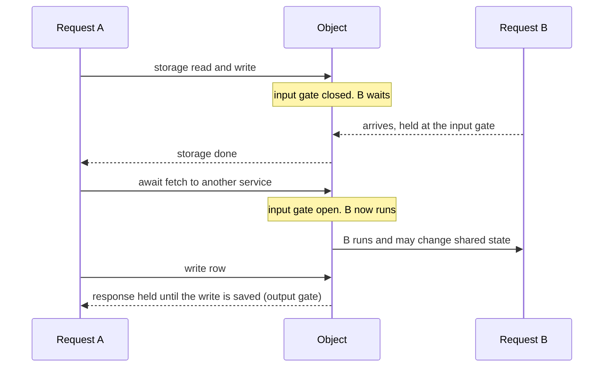

The gates protect storage calls only. A call to another service, such as D1, opens the input gate. Other requests then run inside the object. Lunora has three tools for this case. It wraps each mutation in `blockConcurrencyWhile`. It saves and restores per-request fields after each `await` (see [The ShardDO](05-shard-durable-object.md)). It uses a compare-and-set write for D1 (see [D1 and global tables](09-d1-global-and-hyperdrive.md)).

### blockConcurrencyWhile

`blockConcurrencyWhile(callback)` runs an async callback and delivers no other event to the object until the callback ends. The docs name two uses: set-up in the constructor, and any async work that must not see state change under it (`durable-objects/api/state.mdx`, `blockConcurrencyWhile`).

Two rules matter:

- If the callback throws, Cloudflare terminates the object and resets it. The docs advise a `try...catch` around the whole body.
- A callback has a 30-second timeout. If it runs longer, the object resets.

Lunora calls this method `runSerialized` and uses it as a gate. The adapter catches every error inside the callback, returns it as a value, and throws it again after the gate. An ordinary application error then cannot reset the object and drop its hibernating sockets (`packages/platform-cloudflare/src/cloudflare-host.ts:161-183`). Every mutation runs inside this gate (`packages/shard-engine/src/shard-runner.ts:136`). I found no Lunora code that changes the 30-second platform timeout. So 30 seconds is the upper bound of one mutation. This is an inference from the Cloudflare docs and the code.

### SQLite storage and the transaction model

A SQLite-backed object has a private SQLite database. The object reads and writes it with `ctx.storage.sql.exec(query, ...bindings)`. The storage is "durable, transactional, and strongly consistent", up to 10 gigabytes for one object (`durable-objects/concepts/what-are-durable-objects.mdx`, "Storage API"; `durable-objects/platform/limits.mdx`). Lunora calls `sql.exec` in `cloudflare-host.ts:52`.

Transactions work in three ways:

1. **Automatic.** Writes with no `await` between them commit together (write coalescing).
2. **`transactionSync(callback)`.** The callback must be synchronous. It must not be `async` and must not return a promise. If it throws, the transaction rolls back.
3. **`transaction(closure)`.** This is the async form. The closure runs as one transaction that commits or aborts. On a SQLite-backed object, every storage call inside it is part of the transaction.

`sql.exec` cannot run `BEGIN TRANSACTION` or `SAVEPOINT`. You must use the two methods above (`durable-objects/api/sqlite-storage-api.mdx:239` and `src/content/partials/durable-objects/api-storage-other-methods.mdx`, `transactionSync` and `transaction`).

Lunora uses `storage.transaction` and never `transactionSync`. The reason, from the code comment: `transactionSync` does not wait for the result of an async handler. An async handler could then finish after the commit (`packages/do/src/shard-do.ts:4160-4185`). The adapter also keeps the original error object, because the platform returns a flattened copy of a thrown error (`cloudflare-host.ts:185-202`).

Limits that Lunora designs around (`durable-objects/platform/limits.mdx`, SQLite-backed tables):

| Limit | Value |
|-------|-------|
| Storage per object | 10 gigabytes |
| Row, string, blob, and key plus value | 2 megabytes |
| Columns per table | 100 |
| Length of one Structured Query Language (SQL) statement | 100 kilobytes |
| Bound parameters per query | 100 |
| Bytes in a `LIKE` or `GLOB` pattern | 50 |
| Simultaneous outgoing connections per request | 6 |
| Soft request rate for one object | 1,000 per second (`src/content/partials/durable-objects/do-faq-limits.mdx`) |

SQLite-backed storage bills rows read and rows written. Key-value calls count too, because they use a hidden SQLite table. Deletes count as rows written (`src/content/partials/durable-objects/durable-objects-pricing.mdx`, footnotes 1 to 4). Lunora's write count per request matters for this reason (see [Critical assessment](15-critical-assessment.md)).

### Alarms

An alarm is a timer that wakes the object. Each object has one alarm slot, set with `setAlarm()`. When the time comes, the runtime calls the `alarm()` handler (`durable-objects/api/alarms.mdx`, "Background").

- **At-least-once.** If the handler throws, the runtime retries it with exponential backoff, starting at 2 seconds, for up to 6 retries.
- **One at a time.** Only one `alarm()` call runs for an object at any moment.
- **Wall time.** An alarm handler may run for at most 15 minutes (`src/content/partials/workers/wall-time-limits.mdx`).
- **Many events, one slot.** To run many scheduled jobs, store the schedule in storage. Let the handler process the due jobs and set the alarm to the next due time.

Alarms differ from Cron Triggers. An alarm belongs to one object and is set by code. A Cron Trigger belongs to a Worker and is set by configuration.

Lunora uses exactly the "many events, one slot" pattern. The shard alarm serves four tiers, and the scheduler object stores jobs with a time index. See [Alarms, queues, workflows](11-alarms-queues-workflows.md).

### WebSocket hibernation

A WebSocket is a long-lived two-way connection. A server object can hold thousands of them. With the standard API (`ws.accept()`), the object must stay in memory as long as a socket is open. That costs money. The Hibernation API changes this (`durable-objects/best-practices/websockets.mdx`, "Why use Hibernation?").

With `ctx.acceptWebSocket(server)`, the runtime keeps the connection open while the object is out of memory. When a message arrives, the runtime builds the object again, runs its constructor, and calls `webSocketMessage`. Billable duration does not accrue during hibernation. In-memory state is lost. To keep per-connection state, the code calls `serializeAttachment(value)` on the socket. It reads the value back with `deserializeAttachment()`.

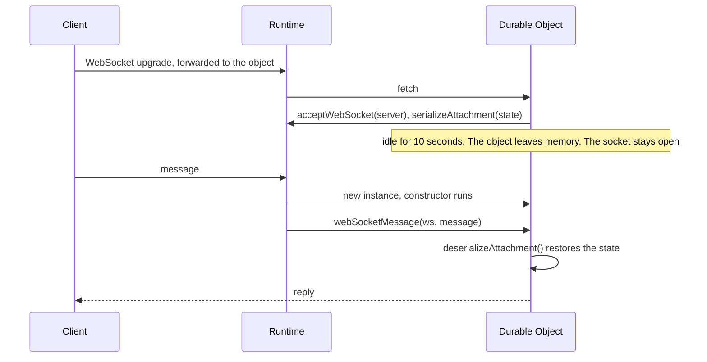

More facts from the same source and from `durable-objects/api/state.mdx`:

- A WebSocket may carry up to 10 tags of 256 characters each. `getWebSockets(tag)` finds sockets by tag. Lunora keeps 9 usable tags and reserves one tag slot for identity (`packages/platform/src/socket-host.ts:55-64`).
- One object may hold at most 32,768 hibernating WebSocket connections. Central processing unit (CPU) time and memory limit the practical number lower.
- The runtime can answer a fixed ping with a fixed pong without waking the object. This is the `setWebSocketAutoResponse` call (`durable-objects/api/state.mdx`). Lunora uses it as a keep-alive (`shard-do.ts:16404`).

Lunora stores each socket's subscriptions in the attachment. So a woken shard can resume every subscription. See [Realtime engine](10-realtime-engine.md).

### Point-in-time recovery

Point-in-time recovery (PITR) restores the SQLite database of one object to any moment in the past 30 days. It covers all stored data, including key-value data. It does not work in local development (`durable-objects/api/sqlite-storage-api.mdx`, "PITR (Point In Time Recovery) API").

PITR uses bookmarks. A PITR bookmark is "a mostly alphanumeric string". Bookmarks compare as plain strings. A smaller bookmark is an earlier time. Three calls matter:

- `getCurrentBookmark()` returns the bookmark of now.
- `getBookmarkForTime(timestamp)` returns the bookmark near a time inside the last 30 days.
- `onNextSessionRestoreBookmark(bookmark)` arms a restore. The object restores its storage the next time it restarts. The call returns an undo bookmark for the point just before the restore. The code then usually calls `ctx.abort()` to restart the object at once.

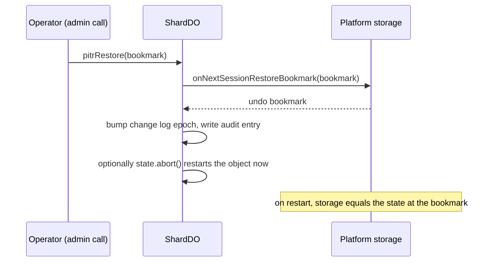

Lunora wraps these calls in `packages/shard-engine/src/pitr.ts:98,118` and uses `abort` in `shard-do.ts:12242`. The restore reverts the whole SQLite file, including Lunora's own epoch row. So Lunora must detect the "fork" from outside the file. See [Change log](06-change-log-cdc.md).

### Location hints and jurisdictions

By default, Cloudflare creates an object in a data center near the first request. Cloudflare does not move an object after that (`durable-objects/reference/data-location.mdx`).

- **Location hint.** A hint is advice about where to create the object. It goes in the `locationHint` option of `get()`. Only the first `get()` for an object uses it. It is best effort. The object may start in a different place that has lower latency from the hint. The values are `wnam`, `enam`, `sam`, `weur`, `eeur`, `apac`, `apac-ne`, `apac-se`, `oc`, `afr` and `me`. Some of these do not host objects yet. The runtime then picks a nearby place.
- **Jurisdiction.** A jurisdiction is a hard rule. The object runs and stores data only inside the region. The values are `eu`, `us` and `fedramp`. You apply it with `namespace.jurisdiction("eu")`. The same name gives a different identifier in each jurisdiction. A Worker anywhere in the world may still call the object.

Lunora derives a hint from the region of the request, and drops hints when a jurisdiction is set. See [Sharding design](04-sharding-design.md) and `packages/runtime/src/resolve-shard.ts:58,127-133,198`.

### Why a Durable Object is a natural shard

A shard is one slice of the data that one server owns. A Durable Object has the properties of a good shard:

| Property of a Durable Object | Consequence for a shard |
|------------------------------|-------------------------|
| The name maps to one instance worldwide | The shard key is the address. No hash ring or lookup table is needed |
| One event runs at a time | The shard has one writer. Commit order is the consistency order |
| Private storage next to the code | Reads and writes need no network hop |
| WebSockets terminate in the same object | The writer can push changes to its own subscribers |
| An idle object hibernates | A shard that nobody uses costs almost nothing |
| Creation on first use | A new tenant needs no provisioning step |

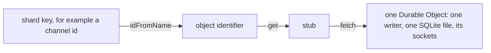

The same properties set the limits. One object is one machine's worth of work: about 1,000 requests per second as a soft limit, and 10 gigabytes of storage. There is no transaction across two objects. Work that needs to cross shards must use fan-out, a registry, or a global table. [Sharding design](04-sharding-design.md) shows how Lunora handles this.

**Aha: the name is the whole routing layer.** Most databases need a router that maps keys to servers and moves keys when servers change. A Durable Object needs only a string. Cloudflare keeps the map from name to place.

## Durable Object SQLite storage

Durable Object SQLite is the storage that sits inside each Durable Object. The full explanation of the storage application programming interface (API), transactions and limits is in the section "SQLite storage and the transaction model" above.

Every shard table has three columns: `id`, `_creationTime`, and a JavaScript Object Notation (JSON) document column `__doc__`.

```ts
// packages/shard-engine/src/ctx-db-migrations.ts:638
CREATE TABLE IF NOT EXISTS <table> (
    id TEXT PRIMARY KEY,
    _creationTime REAL NOT NULL,
    __doc__ TEXT NOT NULL
)
```

Fields are read with `json_extract(__doc__, '$.field')`. Secondary indexes are expression indexes on those paths. A second index on `(_creationTime, id)` serves the default sort order (`ctx-db-migrations.ts:664-684`). The comment reports 1317.9 microseconds without it and 7.3 microseconds with it, over 50,000 rows.

Why a JSON column: a schema change that adds a field needs no `ALTER TABLE`. The cost is that indexes need expression paths and big documents cost more bytes per write. See [Tricks](12-optimizations-and-tricks.md).

The shard Structured Query Language (SQL) layer works around Cloudflare statement limits. The documentation table lists them (`apps/docs/src/content/docs/limits.mdx`). The limits are: 5 terms in a compound `SELECT`, 100 bound parameters, a 50-byte `LIKE` pattern, 100 columns, 2 megabytes (MB) per row, and 100 kilobytes (KB) per statement. Cloudflare documents all of them except the compound `SELECT` limit (`durable-objects/platform/limits.mdx`, SQL storage limits). The change log code chunks `IN` lists at 90 names (`ctx-db-cdc.ts:174`).

## D1

### What D1 is

D1 is the managed SQLite database of Cloudflare. It has one primary copy in one place. It can add read-only copies near users. [D1 and global tables](09-d1-global-and-hyperdrive.md) explains read replicas, sessions and the bookmark from the beginning. That page owns the topic. This page gives only the short form.

**The property Lunora relies on.** A client that writes a `.global()` row must read it back. The D1 Sessions application programming interface (API) gives this guarantee when the client passes the bookmark of its last write. A bookmark is a string that stands for one point in the history of the database. A replica that gets a bookmark waits until it has caught up to that point, then answers. See the sequence diagrams in the D1 page.

### How Lunora uses D1

D1 is a Cloudflare Structured Query Language (SQL) database. Lunora uses it for `.global()` tables: data that must be readable from every shard. The adapter uses the D1 Sessions application programming interface (API) with a bookmark.

```ts
// packages/d1/src/d1-client.ts:195
public withSession(bookmark?: string): D1Session {
    const session = this.db.withSession(bookmark ?? D1_FIRST_UNCONSTRAINED);
    return new D1Session(session);
}
```

The constant `D1_FIRST_UNCONSTRAINED` is `"first-unconstrained"` (`d1-client.ts:67`). It lets the first read use any replica. Details are in [D1 and global tables](09-d1-global-and-hyperdrive.md).

## R2

### What R2 is

R2 is object storage that speaks the S3 protocol and charges no egress fees. An object is a key, a body, and metadata such as the ETag (a fingerprint of the body), Hypertext Transfer Protocol (HTTP) metadata and custom metadata. R2 has four parts: a gateway that authenticates, a metadata service built on Durable Objects, a read cache, and the storage that holds encrypted bytes (`r2/how-r2-works.mdx`, "Architecture").

A write is visible only after the metadata service commits it. R2 sends the success response after that commit. So R2 is strongly consistent: every client sees the effect of a write, update or delete at once, everywhere (`r2/reference/consistency.mdx`).

Three R2 properties matter for Lunora:

1. **Conditional writes.** A `put` can carry an `onlyIf` condition, such as `etagMatches`. If the condition fails, `put` returns `null` and writes nothing (`r2/api/workers/workers-api-reference.mdx`, "Conditional operations"). This is a compare-and-swap. It lets two writers agree on one winner with no lock service.
2. **Ordered listing.** `list` returns keys in lexicographic order, with a `prefix` and a `cursor`, up to 1,000 per call (same file, `R2ListOptions`). Lunora relies on this order for the change log archive.
3. **Multipart upload.** A large object is uploaded in parts. Each part must be at least 5 mebibytes, except the last. All parts except the last must have the same size. A multipart upload may have up to 10,000 parts. R2 aborts an unfinished upload after 7 days by default (`r2/objects/upload-objects.mdx`, "Multipart upload details").

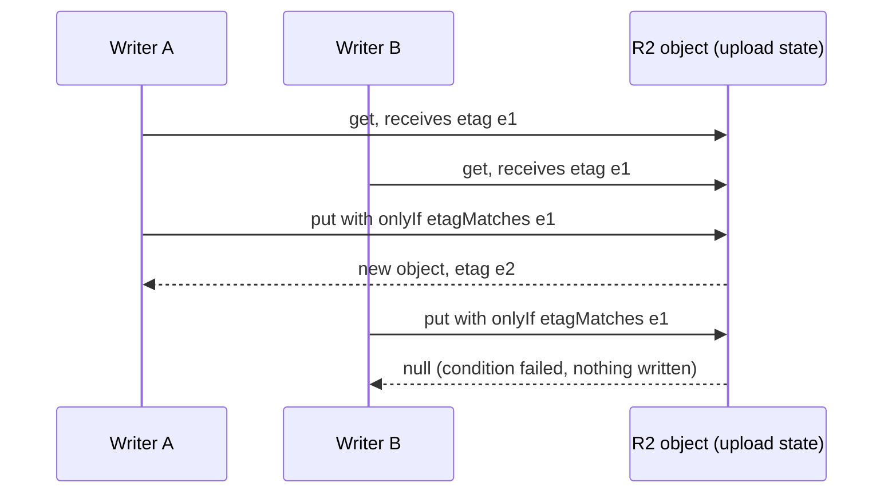

R2 does not delete anything by itself unless an operator sets a lifecycle rule. Lunora relies on that: its archive and upload state have no delete job (see [Storage tiers](08-storage-tiers-and-archive.md)).

### How Lunora uses R2

R2 is Cloudflare object storage. Lunora uses it in four ways.

1. File storage with signed uniform resource locators (URLs) (`packages/storage`). A 16 MiB cap exists for buffered streams (`create-storage.ts:58`).
2. Resumable uploads, with upload state kept as conditional-put objects in the same bucket (`r2-binding-upload-storage.ts:1-60`). Parts are 5 MiB (`R2_PART_SIZE`, `r2-upload-part-writer.ts`).
3. The change log archive under `cdc/{shard}/{epoch}/{seq}.json` (`ctx-db-cdc-archive.ts:106,116`). See [Change log](06-change-log-cdc.md) and [Storage tiers](08-storage-tiers-and-archive.md).
4. Snapshot backups under `backups/` (`packages/runtime/src/backup-layout.ts:18`).

## Workers KV

### What Workers KV is

Workers KV is a global key-value store. It writes data to a small number of central data centers. It caches the data in each data center after the first read there. Hot reads are fast. Cold reads must go to the center (`kv/concepts/how-kv-works.mdx`).

Workers KV is eventually consistent. "Eventually consistent" means that readers may see old data for a while, and then all readers see the new data. A change is usually visible at once in the location where it was made. In other locations it can take 60 seconds or more, because those locations keep a cached copy until it expires. The `cacheTtl` option sets this time. Its default is 60 seconds and its minimum is 30 seconds. A lookup for a missing key is cached too, so a new key can also take that long to appear (`how-kv-works.mdx`, "Performance" and "Consistency"; `kv/platform/limits.mdx`).

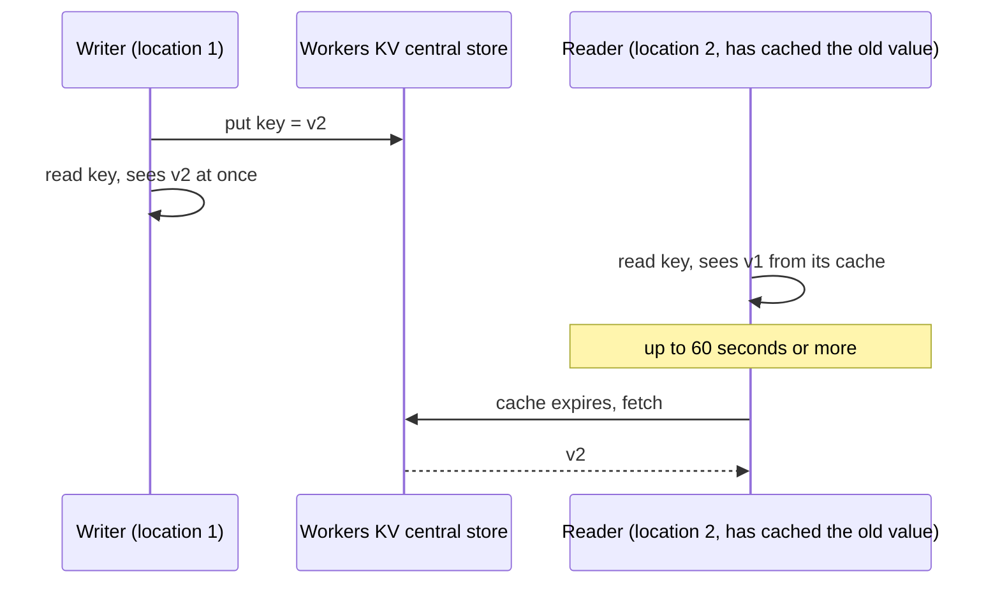

Two writes to the same key at nearly the same time can overwrite each other. A key may be written once per second at most. Workers KV does not suit atomic or transactional work (`kv/api/write-key-value-pairs.mdx`; `how-kv-works.mdx`, note under "Consistency").

**The property Lunora relies on.** None. Lunora does not use Workers KV on its core data path, because the data path needs stronger guarantees. Lunora only exposes `ctx.kv` to applications. An application that uses it must expect old reads for up to about a minute.

### How Lunora uses Workers KV

Lunora does not use Workers KV in the core data path. It exposes `ctx.kv` to applications through `createKv`. The wrapper checks the Workers KV limits before the call: 512-byte keys, 1000 keys per list page, 1,024 bytes of metadata (`packages/bindings/src/kv/create-kv.ts:17-27`).

Do not confuse this with the key-value application programming interface (API) of Durable Object storage. Lunora uses that API in `SchedulerDO`, `ShardRegistryDO` and the secret value store.

## Queues

### What Queues is

Queues is a message service. A producer sends messages to a queue with `send` or `sendBatch`. A consumer Worker receives batches of messages through its `queue()` handler. The service stores each message until the consumer acknowledges it (`queues/reference/how-queues-works.mdx`).

Rules from the Cloudflare docs:

- **At-least-once delivery.** A message is delivered at least once. In rare cases it is delivered more than once. The docs advise an idempotency key to remove duplicates (`queues/reference/delivery-guarantees.mdx`). Idempotency means that doing the same action twice has the same effect as doing it once.
- **No order guarantee.** Queues "does not guarantee that messages will be delivered to a consumer in the same order".
- **One consumer per queue.** A queue can have only one consumer Worker (`queues/get-started.mdx`).
- **Retries and dead letters.** If delivery fails, Queues retries up to `max_retries`, three by default. After that the message goes to a dead letter queue (DLQ) if one is set. Without a DLQ, Queues deletes it (`queues/configuration/batching-retries.mdx`; `dead-letter-queues.mdx`).
- **Limits.** A message may be 128 kilobytes. A batch holds up to 100 messages. A delay may be up to 24 hours. A consumer call may run 15 minutes of wall time (`queues/platform/limits.mdx`).

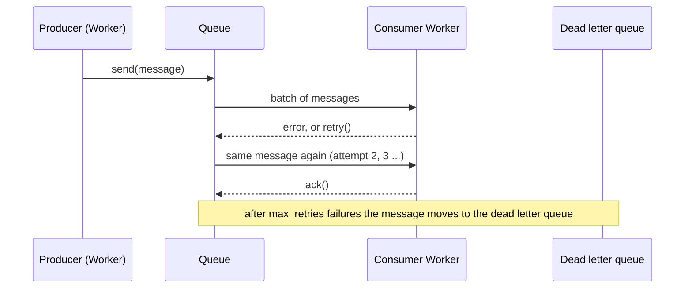

**The property Lunora relies on.** At-least-once delivery with retries. Lunora builds the missing exactly-once effect itself. It gives each queue message a stable identifier, and the shard's idempotency table removes the duplicates ([Alarms, queues, workflows](11-alarms-queues-workflows.md)).

### How Lunora uses Queues

Queues give at-least-once background delivery. The wrapper `createQueues` checks two limits before a send: 100 messages per batch (`MAX_QUEUE_BATCH`, `create-queues.ts:18`) and 43,200 seconds, which is 12 hours, of delay (`MAX_DELAY_SECONDS`, `create-queues.ts:27`). Longer delays go to the scheduler.

**Correction.** The code comment calls 12 hours "the Cloudflare Queues ceiling". The Cloudflare limits page lists 24 hours (86,400 seconds) for `delaySeconds` (`queues/platform/limits.mdx`; `queues/configuration/batching-retries.mdx`, "Messages can be delayed by up to 24 hours"). So the Lunora check is stricter than the platform. A delay between 12 and 24 hours is refused by Lunora although Cloudflare would accept it.

The consumer `dispatchQueueBatch` wraps every message in a `Proxy` so it can see `ack` and `retry`. It isolates a poison message and re-enqueues a declined one inside a signed envelope. A topic is a set of queues, one per subscription, because a queue has one consumer (`topics.ts:75`). See [Alarms, Queues and Workflows](11-alarms-queues-workflows.md).

## Hyperdrive

### What Hyperdrive is

Hyperdrive sits between a Worker and a Postgres or MySQL database. It does three jobs: it sets up connections near the Worker, it pools connections near the database, and it caches read-only query results (`hyperdrive/concepts/how-hyperdrive-works.mdx`). A pool is a set of open connections that many requests reuse. A database accepts only a limited number of connections, and a Worker is stateless. Without a pool, each Worker call would open a new connection.

**The property Lunora relies on.** A Durable Object can reach an ordinary Postgres or MySQL database without exhausting its connections. One warning comes with the caching job. Hyperdrive does not remove cached results when your code writes. A read right after a write can return the old result. [D1 and global tables](09-d1-global-and-hyperdrive.md) explains this in the part about Hyperdrive.

### How Lunora uses Hyperdrive

Hyperdrive is a connection pool in front of Postgres or MySQL. Lunora lets a `.global()` table use it as an alternative to D1.

```ts
// packages/hyperdrive/src/global.ts:50
export const createHyperdriveGlobalCtxDb = ({ engine, exec, ...rest }) =>
    createSqlCtxDb({ ...rest, dialect: engine === "postgres" ? postgresDialect : mysqlDialect, exec });
```

The same store core (`sql-store`) runs on three dialects. MySQL needs the `FOUND_ROWS` flag so the affected-rows check sees matched rows (`global.ts:19-22`).

## Workflows

### What Workflows is

Workflows runs a multi-step program that can last minutes, hours or weeks. Each step is a function that Workflows runs, retries and saves. When a later step fails, Workflows does not run the earlier steps again. It replays the saved results (`workflows/index.mdx`; `workflows/build/rules-of-workflows.mdx`). This style is called durable execution.

Facts from the docs:

- **Step results are saved.** A step result can be up to 1 mebibyte. The step name is the cache key, so names must be deterministic (`rules-of-workflows.mdx`, "Name steps deterministically").
- **Retries have defaults.** Without a setting, a step retries 5 times, with a 10-second exponential delay and a 10-minute timeout per attempt (`workflows/build/sleeping-and-retrying.mdx`).
- **Steps must be idempotent.** A step can run twice, for example when the service that it called died after it committed. Check whether the work is already done before a call that is not idempotent (`rules-of-workflows.mdx`, first rule).
- **Sleep is cheap.** `step.sleep` may last up to 365 days and does not count as a step.
- **Limits.** Up to 10,000 steps (Paid), 1 mebibyte per event payload, and 50,000 running instances per account (`workflows/reference/limits.mdx`).

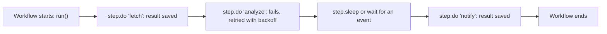

**The property Lunora relies on.** A saved step is not repeated. So a long job, such as an agent run, can survive an eviction or a deploy. Lunora's own code in a step must still be idempotent.

### How Lunora uses Workflows

Workflows are durable multi-step jobs. Lunora generates one `WorkflowEntrypoint` class per `defineWorkflow` and per `defineAgent` (`packages/codegen/src/emit/shard-runtime.ts:141,197`). The base class `LunoraWorkflow` applies a user definition onto the platform class (`packages/workflow/src/do/index.ts`). Instances are created through `ctx.exports.<Class>`; no `workflows[]` binding is needed (`cloudflare.ts:95`). Lunora also supports workflow cron schedules in wrangler (`cloudflare.ts:91`).

## Cron Triggers

### What a Cron Trigger is

A Cron Trigger runs a Worker on a schedule. You write a cron expression in the configuration and add a `scheduled()` handler to the Worker. Cron Triggers use Coordinated Universal Time (UTC) and run on machines that have spare capacity (`workers/configuration/cron-triggers.mdx`). A scheduled invocation may run up to 15 minutes of wall time (real elapsed time) (`src/content/partials/workers/wall-time-limits.mdx`).

A Cron Trigger belongs to a Worker, and the operator sets it in configuration. A Durable Object alarm belongs to one object and the code sets it. Lunora uses both: a Cron Trigger for app schedules, and alarms for per-shard work.

**The property Lunora relies on.** A reliable clock tick that needs no running object. The tick has no caller, so Lunora marks its internal call as trusted.

### How Lunora uses Cron Triggers

The generated Worker has a `scheduled()` entry. It walks a generated map named `LUNORA_CRONS` (`cloudflare.ts:100`). The build step writes `triggers.crons` into wrangler config and keeps a record of the entries it owns, so it never deletes a hand-written cron (`packages/config/src/cloudflare/reconcile-crons.ts:1-60`). A scheduled backup also runs on a cron (`packages/runtime/src/scheduled-backup.ts`).

## Analytics Engine

### What Analytics Engine is

Analytics Engine stores time-series data points. A Worker writes a point with `writeDataPoint({ blobs, doubles, indexes })`. The call returns at once, and the runtime writes in the background, so the Worker does not `await` it. A dataset is created on its first write. You read the data back with a Structured Query Language (SQL) application programming interface (API) (`analytics/analytics-engine/get-started.mdx`). The data is kept for three months (`analytics/analytics-engine/limits.mdx`).

A blob is a string dimension to group by. A double is a number to sum or average. The index is the sampling key. Reads use sampling: when data is large, a query may look at a subset (`analytics/analytics-engine/sampling.mdx`, `analytics/sampling.mdx`). So Analytics Engine is good for trends and not for exact counts.

Limits per data point: 20 blobs, 20 doubles, 1 index of at most 96 bytes, and 16 kilobytes in all blobs. A Worker invocation may write at most 250 data points (`analytics/analytics-engine/limits.mdx`).

**The property Lunora relies on.** A cheap, non-blocking write path for telemetry. A failed write must never fail a request.

### How Lunora uses Analytics Engine

Analytics Engine stores sampled time-series data. Lunora has two writers.

The first is `analyticsEngineSink`. It writes one data point for each remote procedure call (RPC) call: index `[functionPath]`, five string blobs, four numeric doubles (`packages/runtime/src/observability-sinks.ts:477-500`). The call is fire-and-forget and wrapped in `try/catch`.

The second is `ctx.analytics`. It enforces Analytics Engine limits before the write: 20 blobs, 20 doubles, 1 index, 16 kilobytes (KB) of blobs, 96 bytes of index (`packages/bindings/src/analytics/create-analytics.ts:3-30`). There is also an Analytics SQL (Structured Query Language) reader (`bindings/src/analytics-sql`).

## Service bindings

### What a service binding is

A service binding lets one Worker call another Worker without a public uniform resource locator (URL). Worker A can forward a request to Worker B or call a method on it. By default both Workers run on the same thread of the same server, so the call adds no network hop and no extra cost (`workers/runtime-apis/bindings/service-bindings/index.mdx`).

**The property Lunora relies on.** The binding is the permission. A Worker without the binding cannot reach the target. So the target needs no shared secret.

### How Lunora uses service bindings

A service binding lets one Worker call another Worker without the public internet. Lunora uses it for the shard registry. A second Worker can bind the first Worker's `ShardRegistryEntrypoint`. The binding is the permission, so the second Worker needs no secret (`packages/do/src/shard-registry-do.ts:480-542`). The build step writes `services[]` entries and records which ones it owns (`config/src/cloudflare/reconcile-services.ts:1-30`).

## Vectorize, Workers AI, AI Gateway, AI Search

### What these services are

Vectorize is a vector database. A vector, or embedding, is a list of numbers that represents the meaning of a text or an image. A query asks for the stored vectors that are nearest to a given vector (`vectorize/index.mdx`). Writes are not visible at once. Vectorize writes a change to a log, and a later asynchronous job builds the new index files in R2 and commits them. It groups many changes into one batch. A large insert can take minutes or more to become visible (`vectorize/best-practices/insert-vectors.mdx`, "Improve Write Throughput").

Workers AI runs machine learning models on serverless graphics processors (`workers-ai/index.mdx`). AI Gateway is a proxy in front of model calls. It adds analytics, caching, rate limits, retries and cost tracking (`ai-gateway/index.mdx`).

**The property Lunora relies on.** None of these can roll back. A vector write cannot be undone with a Lunora transaction. So Lunora starts these calls after the commit. Because Vectorize shows a write late, a search right after a write may miss it.

### How Lunora uses them

Vectorize stores embeddings. Lunora syncs vectors after a commit, never inside the transaction. The reason is that Vectorize cannot roll back (`shard-do.ts:4222-4254`, `deferAfterCommit`). Workers AI (artificial intelligence) runs models. When the gateway variables are set, calls go through AI Gateway, which adds token and cost telemetry (`packages/ai/src/gateway.ts:1-12`). AI Search is read through the `ai_search_namespaces` binding and is remote-only (`cloudflare.ts:133`).

## Pipelines and R2 SQL

### What these services are

Pipelines takes events from a Worker binding or a Hypertext Transfer Protocol (HTTP) endpoint. It transforms them with Structured Query Language (SQL) and writes them to R2 as Apache Iceberg tables or as Parquet or JavaScript Object Notation (JSON) files. It delivers with an exactly-once guarantee (`basin-pipelines/index.mdx`). Iceberg is an open table format for large analytic data in object storage. R2 Data Catalog keeps the table list inside the bucket. R2 SQL is a serverless engine that runs SQL queries over those tables (`basin-sql/index.mdx`, `basin-catalog/index.mdx`).

Note on names. The current Cloudflare docs call these products Basin Pipelines, Basin Catalog and Basin SQL. They say Basin SQL was formerly R2 SQL, and Basin Pipelines was formerly Cloudflare Pipelines. The Lunora code and the wrangler binding type still use the older names (`pipeline`). This document uses the Lunora names.

**The property Lunora relies on.** A durable, cheap place for logs that survive the shard, with a SQL reader. Logs are append-only and are not part of the data path.

### How Lunora uses them

`pipelineLogSink` sends log records to a Cloudflare Pipeline. The pipeline writes to R2 Data Catalog (Apache Iceberg). The admin route reads the logs back with R2 SQL (Structured Query Language) on the server, because the application programming interface (API) token must not reach a browser (`cloudflare.ts:172-176`, `observability-sinks.ts:563`). `ctx.pipelines.send` wraps the binding; it always passes an array (`bindings/src/pipelines/create-pipelines.ts`).

## Other services in the code

| Service | Evidence |
|---------|----------|
| Images | `bindings/src/images`, `cloudflare.ts:141` |
| Browser Run | `packages/browser`, `cloudflare.ts:137` |
| Containers | `packages/container`, `cloudflare.ts:142-153` |
| Email (`send_email`) | `packages/mail/src/cloudflare-transport.ts:1-45`. The binding sends to one verified recipient only |
| Cloudflare Access | `packages/cloudflare-access`, `cloudflare.ts:204` |
| Secrets Store | `cloudflare.ts:182`, `infer-bindings.ts:386` |
| Cache application programming interface (API) (`caches.default`) | `packages/runtime/src/rest-edge-cache.ts:1-40` |
| Version metadata | `CF_VERSION_METADATA` read in `shard-do.ts:12187` |
| Worker loaders | `cloudflare.ts:86` (a binding validated by config) |
| Artifacts | `bindings/src/artifacts`, `cloudflare.ts:160` |
| Workers for Platforms | `dispatch_namespaces` validated in `validate-bindings.ts:755`; no runtime use found |
| Smart Placement | `placement` validated in `validate-settings.ts`; no runtime use found |

The `dispatch` package is not Workers for Platforms. It is a runner for at-least-once calls between queue, scheduler and shard (`packages/dispatch/src/create-dispatch-runner.ts`).

## Aha moments

**Aha: the matrix is honest.** A feature Lunora builds on top of a primitive is marked `emulated`, not `native`. The comment says "a feature Lunora implements itself must not be reported as native even when it works flawlessly" (`cloudflare.ts:5-10`).

**Aha: Vectorize and R2 never run inside a transaction.** They cannot roll back. Lunora queues them until after commit, and defers R2 deletes behind the response. See `shard-dispatch.ts:285-296` in the generated code.

## Where to go next

Read [Worker runtime](03-worker-runtime.md) for the request gate. Read [Sharding design](04-sharding-design.md) for how shards are named.
