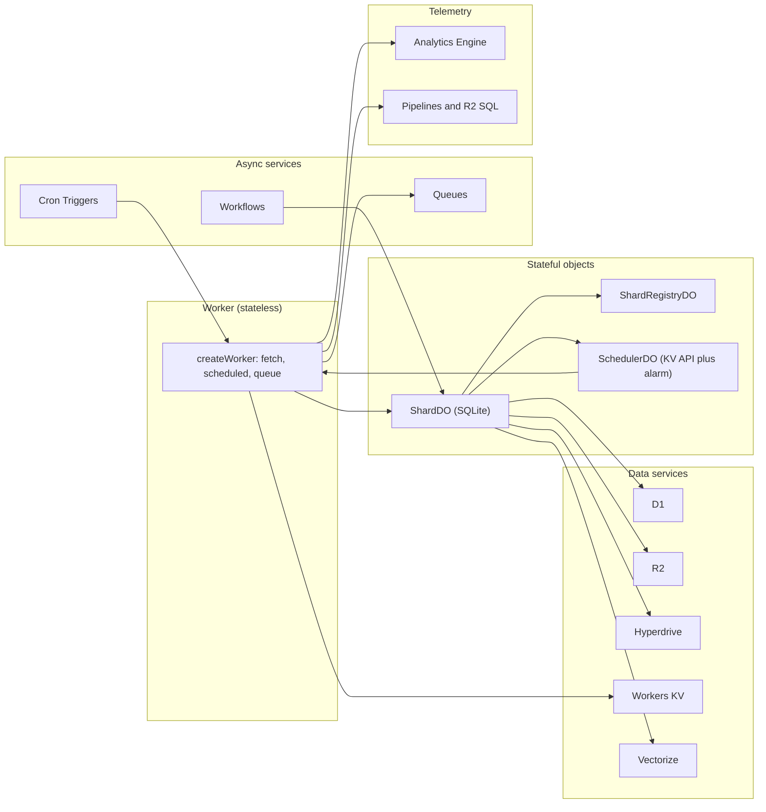
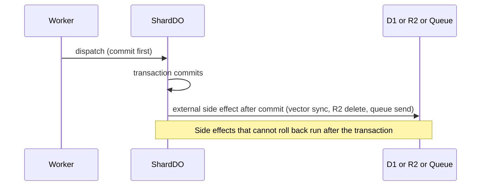

# Cloudflare services: what Lunora uses, how, and why

Lunora uses Cloudflare Workers and Durable Objects as its core. It adds D1, R2, Queues, Workflows, Hyperdrive and more around that core. This page lists every service found in the code. Each section says how Lunora uses the service, why, and where the code is.

The authority for this list is the Cloudflare capability matrix (`packages/platform/src/capabilities/cloudflare.ts:12`). The wrangler binding manifest (`packages/config/src/cloudflare/binding-manifest.ts`) lists 25 binding types: `ai`, `ai_search`, `ai_search_namespace`, `analytics_engine`, `analytics_sql`, `artifacts`, `assets`, `browser`, `container`, `d1`, `durable_object`, `hyperdrive`, `images`, `kv`, `media`, `pipeline`, `queue_consumer`, `queue_producer`, `r2`, `service`, `stream`, `vectorize`, `vpc_network`, `vpc_service`, `workflow`.





## Summary table

| Service | Lunora package | Used for | Core or optional |
|---------|----------------|----------|------------------|
| Workers | `runtime` | Entry, routing, auth, fan-out, cron and queue entries | Core |
| Durable Objects | `do`, `scheduler`, `shard-engine` | Shards, registry, scheduler, relays, replicas | Core |
| Durable Object SQLite | `shard-engine` | Every shard-local table and the change log | Core |
| D1 | `d1`, `sql-store` | `.global()` tables | Core when `.global()` is used |
| R2 | `storage`, `shard-engine`, `runtime` | Files, change log archive, backups, uploads | Optional |
| Workers KV (key-value store) | `bindings` | `ctx.kv` facade for apps | Optional |
| Queues | `queue` | Background work, topics, requeue | Optional |
| Hyperdrive | `hyperdrive` | Postgres or MySQL as a `.global()` backend | Optional |
| Workflows | `workflow`, `agent` | Durable multi-step jobs and agents | Optional |
| Cron Triggers | `runtime`, `config` | Scheduled functions and backups | Optional |
| Analytics Engine | `bindings`, `runtime` | App events and function metrics | Optional |
| Service bindings | `config`, `do` | Shared shard registry across Workers | Optional |
| Vectorize | `bindings`, `ai` | Vector search | Optional |
| Workers AI and AI Gateway | `ai`, `agent` | Models and cost telemetry | Optional |
| Pipelines, R2 SQL (Structured Query Language) | `bindings`, `runtime` | Log archive | Optional |
| Others | see end of page | Images, Browser, Containers, Email, Access, Secrets Store | Optional |

## Workers

The Worker is a stateless front. The function `createWorker` returns an object with `fetch`, `scheduled` and `queue` entries (`packages/runtime/src/create-worker.ts:2756` for `scheduled`). It parses the remote procedure call (RPC) envelope, checks identity, and forwards to a shard. It also runs fan-out reads and serves the admin routes.

Why: the Worker scales horizontally for free. All state lives in Durable Objects, D1 and R2. See [Worker runtime](03-worker-runtime.md).

A limit Lunora tracks: a Worker must start within 1 second of central processing unit (CPU) time (error 10021). The repository commits a baseline in `worker-startup.json` (300 procedures, 60 tables, 915 eager modules, 6,046,937 eager bytes) and a size baseline in `worker-size.json` (1,348,884 raw bytes, 344,186 gzip bytes). Scripts check both in continuous integration.

## Durable Objects

The Durable Object (DO) is the heart of Lunora. The code uses these platform features:

| Platform feature | Where Lunora uses it |
|------------------|----------------------|
| `idFromName`, `getByName`, `get` | `packages/runtime/src/resolve-shard.ts:69-115` |
| `namespace.jurisdiction("eu")` | `resolve-shard.ts:198`, `cloudflare-host.ts:785` |
| `locationHint` on creation | `resolve-shard.ts:58` |
| `blockConcurrencyWhile` | `cloudflare-host.ts:161`, `shard-registry-do.ts:296` |
| `storage.transaction` | `cloudflare-host.ts:202` |
| `storage.sql.exec` | `cloudflare-host.ts:52` |
| `setAlarm`, `getAlarm`, `deleteAlarm` | `cloudflare-host.ts:75` |
| `acceptWebSocket`, `getWebSockets`, `getTags` | `cloudflare-host.ts:684` |
| `serializeAttachment` | `shard-do.ts:18400` (`writeAttachment`) |
| `setWebSocketAutoResponse` | `shard-do.ts:16404` |
| `waitUntil` | `cloudflare-host.ts:247` |
| `abort` | `shard-do.ts:12242` (point-in-time restore) |
| `getCurrentBookmark`, `onNextSessionRestoreBookmark` | `shard-engine/src/pitr.ts:98,118` |
| `state.id.name`, `state.id.jurisdiction` | `cloudflare-host.ts:244`, `shard-do.ts:3271` |

At least seven Durable Object classes appear in the code: `ShardDO`, `ShardRegistryDO`, `SchedulerDO`, `SessionDO`, the auth object, the container object, and the event log object in `packages/replica`. A merged class can host the shard, scheduler and registry roles (`merge-durable-objects.ts:63`).

## Durable Object SQLite storage

Every shard table has three columns: `id`, `_creationTime`, and a JavaScript Object Notation (JSON) document column `__doc__`.

```ts
// packages/shard-engine/src/ctx-db-migrations.ts:638
CREATE TABLE IF NOT EXISTS <table> (
    id TEXT PRIMARY KEY,
    _creationTime REAL NOT NULL,
    __doc__ TEXT NOT NULL
)
```

Fields are read with `json_extract(__doc__, '$.field')`. Secondary indexes are expression indexes on those paths. A second index on `(_creationTime, id)` serves the default sort order (`ctx-db-migrations.ts:664-684`). The comment reports 1317.9 microseconds without it and 7.3 microseconds with it, over 50,000 rows.

Why a JSON column: a schema change that adds a field needs no `ALTER TABLE`. The cost is that indexes need expression paths and big documents cost more bytes per write. See [Tricks](12-optimizations-and-tricks.md).

The shard SQL layer works around Cloudflare statement limits. The documentation table lists them (`apps/docs/src/content/docs/limits.mdx`): 5 terms in a compound `SELECT`, 100 bound parameters, a 50-byte `LIKE` pattern, 100 columns, 2 MB per row, 100 KB per statement. The change log code chunks `IN` lists at 90 names (`ctx-db-cdc.ts:174`).

## D1

D1 is a Cloudflare SQL database. Lunora uses it for `.global()` tables: data that must be readable from every shard. The adapter uses the D1 Sessions application programming interface (API) with a bookmark.

```ts
// packages/d1/src/d1-client.ts:195
public withSession(bookmark?: string): D1Session {
    const session = this.db.withSession(bookmark ?? D1_FIRST_UNCONSTRAINED);
    return new D1Session(session);
}
```

The constant `D1_FIRST_UNCONSTRAINED` is `"first-unconstrained"` (`d1-client.ts:67`). It lets the first read use any replica. Details are in [D1 and global tables](09-d1-global-and-hyperdrive.md).

## R2

R2 is Cloudflare object storage. Lunora uses it in four ways.

1. File storage with signed URLs (`packages/storage`). A 16 MiB cap exists for buffered streams (`create-storage.ts:58`).
2. Resumable uploads, with upload state kept as conditional-put objects in the same bucket (`r2-binding-upload-storage.ts:1-60`). Parts are 5 MiB (`R2_PART_SIZE`, `r2-upload-part-writer.ts`).
3. The change log archive under `cdc/{shard}/{epoch}/{seq}.json` (`ctx-db-cdc-archive.ts:106,116`). See [Change log](06-change-log-cdc.md) and [Storage tiers](08-storage-tiers-and-archive.md).
4. Snapshot backups under `backups/` (`packages/runtime/src/backup-layout.ts:18`).

## Workers KV

KV is a global key-value store. Lunora does not use it in the core data path. It exposes `ctx.kv` to applications through `createKv`. The wrapper checks the KV limits before the call: 512-byte keys, 1000 keys per list page, 1,024 bytes of metadata (`packages/bindings/src/kv/create-kv.ts:17-27`).

Do not confuse this with the key-value API of Durable Object storage. Lunora uses that API in `SchedulerDO`, `ShardRegistryDO` and the secret value store.

## Queues

Queues give at-least-once background delivery. The wrapper `createQueues` checks two Cloudflare limits before a send: 100 messages per batch (`MAX_QUEUE_BATCH`, `create-queues.ts:18`) and 43,200 seconds of delay (`MAX_DELAY_SECONDS`, `create-queues.ts:27`). Longer delays go to the scheduler.

The consumer `dispatchQueueBatch` wraps every message in a `Proxy` so it can see `ack` and `retry`. It isolates a poison message and re-enqueues a declined one inside a signed envelope. A topic is a set of queues, one per subscription, because a queue has one consumer (`topics.ts:75`). See [Alarms, Queues and Workflows](11-alarms-queues-workflows.md).

## Hyperdrive

Hyperdrive is a connection pool in front of Postgres or MySQL. Lunora lets a `.global()` table use it as an alternative to D1.

```ts
// packages/hyperdrive/src/global.ts:50
export const createHyperdriveGlobalCtxDb = ({ engine, exec, ...rest }) =>
    createSqlCtxDb({ ...rest, dialect: engine === "postgres" ? postgresDialect : mysqlDialect, exec });
```

The same store core (`sql-store`) runs on three dialects. MySQL needs the `FOUND_ROWS` flag so the affected-rows check sees matched rows (`global.ts:19-22`).

## Workflows

Workflows are durable multi-step jobs. Lunora generates one `WorkflowEntrypoint` class per `defineWorkflow` and per `defineAgent` (`packages/codegen/src/emit/shard-runtime.ts:141,197`). The base class `LunoraWorkflow` applies a user definition onto the platform class (`packages/workflow/src/do/index.ts`). Instances are created through `ctx.exports.<Class>`; no `workflows[]` binding is needed (`cloudflare.ts:95`). Lunora also supports workflow cron schedules in wrangler (`cloudflare.ts:91`).

## Cron Triggers

The generated Worker has a `scheduled()` entry. It walks a generated map named `LUNORA_CRONS` (`cloudflare.ts:100`). The build step writes `triggers.crons` into wrangler config and keeps a record of the entries it owns, so it never deletes a hand-written cron (`packages/config/src/cloudflare/reconcile-crons.ts:1-60`). A scheduled backup also runs on a cron (`packages/runtime/src/scheduled-backup.ts`).

## Analytics Engine

Analytics Engine stores sampled time-series data. Lunora has two writers.

The first is `analyticsEngineSink`. It writes one data point for each RPC call: index `[functionPath]`, five string blobs, four numeric doubles (`packages/runtime/src/observability-sinks.ts:477-500`). The call is fire-and-forget and wrapped in `try/catch`.

The second is `ctx.analytics`. It enforces Analytics Engine limits before the write: 20 blobs, 20 doubles, 1 index, 16 KB of blobs, 96 bytes of index (`packages/bindings/src/analytics/create-analytics.ts:3-30`). There is also an Analytics SQL reader (`bindings/src/analytics-sql`).

## Service bindings

A service binding lets one Worker call another Worker without the public internet. Lunora uses it for the shard registry. A second Worker can bind the first Worker's `ShardRegistryEntrypoint`. The binding is the permission, so the second Worker needs no secret (`packages/do/src/shard-registry-do.ts:480-542`). The build step writes `services[]` entries and records which ones it owns (`config/src/cloudflare/reconcile-services.ts:1-30`).

## Vectorize, Workers AI, AI Gateway, AI Search

Vectorize stores embeddings. Lunora syncs vectors after a commit, never inside the transaction. The reason is that Vectorize cannot roll back (`shard-do.ts:4222-4254`, `deferAfterCommit`). Workers AI runs models. When the gateway variables are set, calls go through AI Gateway, which adds token and cost telemetry (`packages/ai/src/gateway.ts:1-12`). AI Search is read through the `ai_search_namespaces` binding and is remote-only (`cloudflare.ts:133`).

## Pipelines and R2 SQL

`pipelineLogSink` sends log records to a Cloudflare Pipeline. The pipeline writes to R2 Data Catalog (Apache Iceberg). The admin route reads the logs back with R2 SQL on the server, because the API token must not reach a browser (`cloudflare.ts:172-176`, `observability-sinks.ts:563`). `ctx.pipelines.send` wraps the binding; it always passes an array (`bindings/src/pipelines/create-pipelines.ts`).

## Other services in the code

| Service | Evidence |
|---------|----------|
| Images | `bindings/src/images`, `cloudflare.ts:141` |
| Browser Run | `packages/browser`, `cloudflare.ts:137` |
| Containers | `packages/container`, `cloudflare.ts:142-153` |
| Email (`send_email`) | `packages/mail/src/cloudflare-transport.ts:1-45`. The binding sends to one verified recipient only |
| Cloudflare Access | `packages/cloudflare-access`, `cloudflare.ts:204` |
| Secrets Store | `cloudflare.ts:182`, `infer-bindings.ts:386` |
| Cache API (`caches.default`) | `packages/runtime/src/rest-edge-cache.ts:1-40` |
| Version metadata | `CF_VERSION_METADATA` read in `shard-do.ts:12187` |
| Worker loaders | `cloudflare.ts:86` (a binding validated by config) |
| Artifacts | `bindings/src/artifacts`, `cloudflare.ts:160` |
| Workers for Platforms | `dispatch_namespaces` validated in `validate-bindings.ts:755`; no runtime use found |
| Smart Placement | `placement` validated in `validate-settings.ts`; no runtime use found |

The `dispatch` package is not Workers for Platforms. It is a runner for at-least-once calls between queue, scheduler and shard (`packages/dispatch/src/create-dispatch-runner.ts`).

## Aha moments

**Aha: the matrix is honest.** A feature Lunora builds on top of a primitive is marked `emulated`, not `native`. The comment says "a feature Lunora implements itself must not be reported as native even when it works flawlessly" (`cloudflare.ts:5-10`).

**Aha: Vectorize and R2 never run inside a transaction.** They cannot roll back. Lunora queues them until after commit, and defers R2 deletes behind the response. See `shard-dispatch.ts:285-296` in the generated code.

## Where to go next

Read [Worker runtime](03-worker-runtime.md) for the request gate. Read [Sharding design](04-sharding-design.md) for how shards are named.
