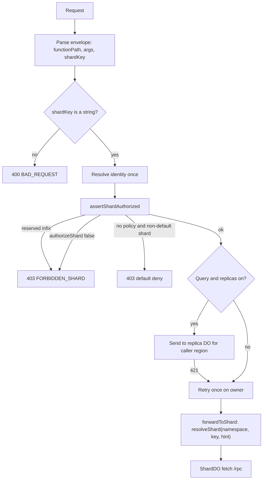
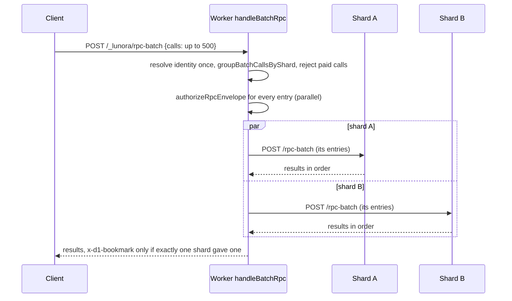

# The Worker runtime: authenticate, authorize, route

The Worker is the only public entry. It never stores data. It resolves who the caller is, decides which shard the call may reach, and forwards the call. It is built by `createWorker` in `packages/runtime/src/create-worker.ts`, a file with 6,407 lines.

## Words on this page

- **Handler.** A function that Cloudflare calls for one kind of event. A Worker has `fetch` for Hypertext Transfer Protocol (HTTP) requests, `scheduled` for Cron Triggers and `queue` for Queue batches.
- **Envelope.** The JavaScript Object Notation (JSON) body of a remote procedure call (RPC). It holds `functionPath`, `args` and `shardKey`.
- **Identity.** Who the caller is. The Worker reads the token or cookie and builds an identity once per request.
- **Stub.** A client handle for one Durable Object. A call on the stub travels to the object. See [Cloudflare services](02-cloudflare-services.md), section "Durable Objects from first principles".
- **Subrequest.** Any request that a Worker sends to another service. Workers have a cap on subrequests per request.
- **Isolate.** One running copy of a Worker. A cache "per isolate" is not shared with other copies. The Worker section of [Cloudflare services](02-cloudflare-services.md) explains isolates.
- **`waitUntil`.** A call that keeps the Worker alive after the response so that background work can finish.
- **`request.cf`.** An object that Cloudflare adds to each request. It holds the continent, the data center and the country of the caller.
- **Default deny.** A rule that refuses an action unless a rule allows it.

## Entry points

`createWorker` returns an object with `fetch`, `scheduled` and `queue` (`create-worker.ts:2756,6104`). A helper `composeWorker` builds the options per request from `env` (`create-worker.ts:6237`).

| Path | Handler | Purpose |
|------|---------|---------|
| `/_lunora/rpc` | `handleRpc` | One query, mutation or action |
| `/_lunora/rpc-batch` | `handleBatchRpc` (`create-worker.ts:5026`) | Many calls, grouped by shard |
| WebSocket upgrade | `handleWebSocketUpgrade` (`create-worker.ts:4403`) | Live subscriptions |
| `/_lunora/admin/*` | admin route modules | Export, import, backup, point-in-time recovery (PITR), introspection |
| `scheduled()` | cron dispatch | Cron Triggers |
| `queue()` | `dispatchQueueBatch` | Queue consumer |

## The request pipeline



### Step 1: the envelope check

The shard key must be a string. A number would reach `idFromName` and produce a wrong object, so the Worker rejects it (`create-worker.ts:2512-2517`).

### Step 2: the reserved-name guard

`assertShardAuthorized` is the one gate every client shard key crosses. It first refuses any key that contains `::relay::` or `::replica::`.

```ts
// packages/runtime/src/create-worker.ts:3202
const assertShardAuthorized = async (identity, shardKey, isAdmin = false) => {
    if (shardKey.includes(RELAY_NAME_INFIX) || shardKey.includes(REPLICA_NAME_INFIX)) {
        throw new LunoraError("Forbidden shard", { code: "FORBIDDEN_SHARD", status: 403 });
    }
    if (isAdmin) { return; }
    if (options.authorizeShard) {
        const allowed = await grants(options.authorizeShard({ identity, shardKey }));
        if (!allowed) { throw new LunoraError("Forbidden shard", { code: "FORBIDDEN_SHARD", status: 403 }); }
    } else if (shardKey !== defaultShard) {
        guardUnauthenticatedShardAccess("shard");
    }
};
```

The reason is in the comment: a Durable Object reads its own name to learn its role. A client key such as `other::relay::0` would reach an object that believes it is a relay of another shard (`create-worker.ts:3210-3216`, and `shared/relay-name.ts:12-20`).

### Step 3: default deny

With no `authorizeShard` callback, any shard other than the default shard (`__root__`, `create-worker.ts:2893`) is refused with code `FORBIDDEN_SHARD`. A fan-out is refused with `FORBIDDEN_FANOUT` (`create-worker.ts:3157-3165`). The option `allowUnauthenticatedShardAccess: true` opens it, and the Worker warns once (`create-worker.ts:3137`).

**Aha: the shard key is an address the client chooses.** Without this gate, tenant A could name tenant B's Durable Object. So Lunora fails closed. A single-Durable-Object app never names another shard, so it never sees the gate.

### Step 4: placement and jurisdiction

`forwardToShard` resolves the stub with an optional region hint.

```ts
// packages/runtime/src/create-worker.ts:2970
const forwardToShard = async (namespace, shardKey, request, locationHint = options.shardRegion?.(shardKey)) =>
    resolveShard(namespace, shardKey, placementUnderResidency(locationHint)).fetch(request);
```

If a jurisdiction is set, region hints are dropped and the Worker warns once: "Residency wins" (`create-worker.ts:2953-2966`). A jurisdiction is a hard rule. A region is only advice.

### Step 5: resolve the stub

`resolveShard` in the runtime wraps the platform function. It rejects keys with the `__lunora_do__:` prefix, then adapts a Cloudflare namespace to the `ShardDirectory` contract (`resolve-shard.ts:228`). The adapter is cached per namespace in a `WeakMap` (`resolve-shard.ts:38`). It wraps `getByName` in a closure, because passing the bare native method causes an "Illegal invocation" error (`resolve-shard.ts:96-102`).

```ts
// packages/platform/src/shard-directory.ts:138
export const resolveShard = (directory, name, locationHint) => {
    if (name.startsWith(LUNORA_ROLE_PREFIX)) { throw new Error(...); }
    if (directory.getByName !== undefined) { return directory.getByName(name, locationHint); }
    return directory.get(directory.idForName(name), locationHint);
};
```

## Headers the Worker adds or forwards

The Worker builds one set of headers for the shard request. The function is `resolveForwardContext` (`packages/runtime/src/create-worker.ts:2236-2345`). The Worker copies some headers from the client and mints others itself.

| Header | Source | Meaning |
|--------|--------|---------|
| `authorization`, `cookie` | Client, copied | Credentials for the shard to check again |
| `x-d1-bookmark` | Client, copied (line 2278) | The D1 position the client last saw. It makes the next read of a `.global()` table see the client's own writes. See [D1 and global tables](09-d1-global-and-hyperdrive.md) |
| `x-lunora-mutation-id` | Client, copied | Idempotency key. A retry with the same key returns the saved result |
| `x-lunora-client-id`, `x-lunora-client-seq` | Client, copied | Per-device identifier and a growing number for custom mutators. The shard compares the number with its client watermark |
| `x-lunora-base-seq` | Client, copied | The change log position at which the client composed the write. Only a `.dropStalePatches()` table uses it |
| `x-lunora-client-ip` | Worker, minted | The caller address, only where it can be trusted |
| `x-lunora-origin` | Worker, minted | The origin from the request uniform resource locator (URL). Used to sign object URLs |
| `x-lunora-userid`, `x-lunora-identity`, `x-lunora-identity-exp` | Worker, minted | The resolved identity. The Worker removes client copies first |
| `x-lunora-min-seq` | Client, set per shard | The change log position of the client's last write. Replica reads use it. See [Replication](07-replication-and-read-scaling.md) |

## Batching: one request, many shards

The client can send a batch of calls. The Worker checks the batch, groups the calls by shard, and sends one `/rpc-batch` request per shard. Limits and rules:

- A batch has at most 500 entries (`MAX_BATCH_ENTRIES`, `shared/batch-wire.ts:42`). The reason: a Durable Object runs entries one by one, so a large batch would block the shard.
- A paid procedure (`.x402`) cannot join a batch (`create-worker.ts:5049-5062`).
- Identity is resolved once for the whole batch. The shard check still runs for every entry.
- The Worker returns the `x-d1-bookmark` header only if exactly one shard produced a bookmark. Bookmarks from different shards cannot be compared (`create-worker.ts:5136-5142,5309-5312`).

Inside the Durable Object the entries run in order. The order keeps per-client watermarks and idempotency correct (`shard-do.ts:10539-10590`).



## Fan-out reads

A query on a `.shardBy()` table that does not pin a shard becomes a fan-out. The Worker asks a registry for the shard keys, calls all shards with bounded concurrency, and merges the answers. See [Sharding design](04-sharding-design.md) for the coordinator.

## Relay routing at WebSocket upgrade

When a shard has many sockets, new sockets go to relay objects. The Worker asks the owner for a relay count and caches the answer for 5,000 ms per isolate (`RELAY_PROBE_TTL_MS`, `create-worker.ts:2560`). The cache has 4,096 entries at most (`RELAY_PROBE_MAX_ENTRIES`, `create-worker.ts:2568`). On any error the count is `0`, so the owner serves the socket (`create-worker.ts:2576-2610`).

The relay is picked at random: `relayName(shardKey, Math.floor(Math.random() * relayCount))` (`create-worker.ts:4487`). The comment explains why not a hash of the region: a single-region app would put every socket on one relay and rebuild the same bottleneck. The location hint comes from the client region, so each relay is created near real traffic.

A route socket (`defineWebSocket`) always stays on the owner, because its handler writes to its own storage (`create-worker.ts:4470`).

## Replica routing for reads

`replicaTargetFor` picks a replica only if all of these hold (`create-worker.ts:4682-4715`):

1. `options.replicaReads === true`.
2. The function registry is present and the function kind is `query`.
3. The key has no `::replica::` or `::relay::` infix.
4. The request has Cloudflare geography so a region can be derived.

The Worker sends `x-lunora-replica-read: 1` and the caller bookmark `x-lunora-min-seq`. A `421` answer means the replica is not ready. The Worker then retries once on the owner (`create-worker.ts:4720-4752`). See [Replication](07-replication-and-read-scaling.md).

## Security and trust headers

The Worker strips client-supplied identity headers and sets its own. A comment states the rule: `x-lunora-userid` and `x-lunora-identity` are "server-minted and trusted verbatim by the Durable Object (DO)", so the Worker removes client copies first (`create-worker.ts:4449-4456`). Scheduler dispatch uses `x-lunora-system` to mark a trusted internal call (`create-worker.ts:3324`).

Internal control channels use a Hash-based Message Authentication Code (HMAC) over the body with the secret `LUNORA_RELAY_SECRET`. The header is `x-lunora-relay-sig` (`shared/relay-signature.ts:14,35`). The signature has no nonce and no time stamp, so a captured frame can be replayed by someone who can reach the namespace.

## Edge cache for the REST surface

For the opt-in Representational State Transfer (REST) routes, the Worker stores responses in `caches.default`. The cache key folds in the values of every header listed in `Vary`, because the platform cache honours only `Accept-Encoding`. A response with a `Vary` that the key does not cover is not stored. The write uses `waitUntil` (`rest-edge-cache.ts:1-45,254`).

## Where to go next

Read [Sharding design](04-sharding-design.md) and then [The shard Durable Object](05-shard-durable-object.md).
