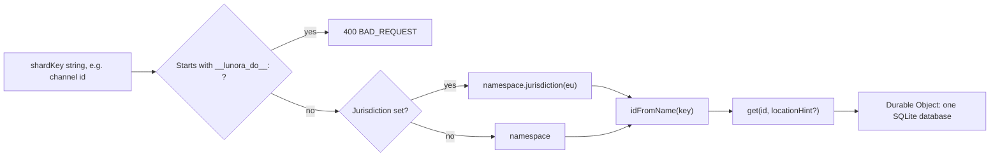
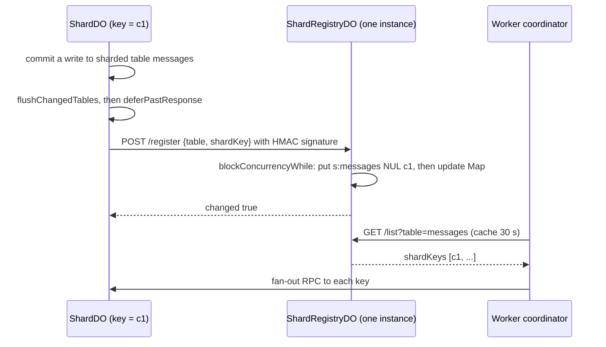

# Sharding design: a shard is a Durable Object name

Lunora does not hash keys into a ring. A shard is a Durable Object, and its identity is a string name. Cloudflare turns the name into an object with `idFromName`. The caller picks the name. Lunora adds a registry of live names, a fan-out coordinator, and an authorization gate around that idea.

This page covers naming, routing, the registry, fan-out reads, hot shards, and what happens when you want to change the shard key. It ends with the good and bad of the design.

## Three modes for a table

The schema builder has three tiers (`packages/server/src/types.ts:33`):

```ts
// packages/server/src/types.ts:33
type ShardMode = { backend?: GlobalBackend; kind: "global" } | { field: string; kind: "shardBy" } | { kind: "root" };
```

A table cannot be both `.shardBy()` and `.global()`. The builder throws (`packages/server/src/schema.ts:521-540`). Under `.shardBy()` a tenant mapper (`tenantBy`) is mandatory for sourced tables (`packages/server/src/schema.ts:1142`).

Example from the shipped sample app `examples/team-chat/lunora/schema.ts`: `messages` and `presence` use `.shardBy("channelId")`. `channels` stays in the root shard. `profiles` is `.global()`.

## How a key becomes a Durable Object



Source: `packages/runtime/src/resolve-shard.ts:228`, `packages/platform/src/shard-directory.ts:126,138`.

### Where the key comes from

The shard key is chosen by the caller. The client library takes it as an option on each call:

```tsx
// examples/team-chat/src/client/Channel.tsx:54
const messages = useQuery(api.messages.list, { channelId }, { shardKey: channelId });
```

The remote procedure call (RPC) envelope has an optional `shardKey` string. The WebSocket upgrade reads `?shard=` from the URL (`create-worker.ts:4422`). When nothing is given, the key is the default shard, `__root__` (`create-worker.ts:2893`). The import tool derives the key from the row: `String(doc[field])`, or `JSON.stringify` for a non-string value (`packages/runtime/src/import-stream.ts:73-83`).

### What the Durable Object does not check

I searched `packages/shard-engine/src` and `packages/do/src` for a check that a written row's shard field equals the object's own name. I found none. The word `shardMode` appears in the writer only for global tables, rank indexes (`packages/shard-engine/src/ctx-db.ts:2799-2811`), and relations. So the field named in `.shardBy("channelId")` is declared metadata. The caller routes. If a caller sends `shardKey: "a"` with a row for channel `b`, the row is stored in shard `a`.

This differs from the documentation sentence "After codegen, every call to `ctx.db.messages.*` routes by `channelId`" (`concepts/sharding.mdx`). In the code, routing happens at the call site through the `shardKey` option. Codegen types make the option available. They do not enforce it.

### What Cloudflare decides

Cloudflare maps the name to an object id. The object is created in the data center nearest the first request. A `locationHint` is honoured only by the call that creates the object (`resolve-shard.ts:127-133`). Lunora derives a hint from `request.cf` (`shared/region-hint.ts:71`): continent `AF` gives `afr`; `AS` gives `me` for 15 listed Middle East countries and `apac` otherwise; `EU` gives `eeur` east of longitude 15 and `weur` otherwise; `NA` gives `wnam` west of -100 and `enam` otherwise; `OC` gives `oc`; `SA` gives `sam`. The valid hints are `wnam, enam, sam, weur, eeur, apac, apac-ne, apac-se, oc, afr, me` (`region-hint.ts:26`).

A jurisdiction (`eu`, `fedramp`, `us`) is a hard rule. `jurisdiction("eu")` maps the same name to a different object id. So a sibling lookup inside a Durable Object must use the same subnamespace. The object reads `this.state.id?.jurisdiction` for that (`shard-do.ts:3271`, and the comment in `sibling-channel.ts:72-93`). If a jurisdiction is requested but the binding lacks the method, Lunora throws instead of falling back (`resolve-shard.ts:198-210`). This is "fail closed".

## Reserved names

| Name pattern | Meaning | Who may mint it |
|--------------|---------|-----------------|
| `__root__` | The default shard | Built in (`shard-do.ts:1598`) |
| `__lunora_do__:scheduler:<name>` | Scheduler role in a merged class | Framework |
| `__lunora_shard_registry__` | The single registry instance | Framework (`shard-registry-do.ts:73`) |
| `<key>::relay::<n>` | Fan-out relay of shard `key` | Worker (`shared/relay-name.ts:24`) |
| `<key>::replica::<region>` | Read replica of shard `key` in a region | Worker (`shared/replica-name.ts:23`) |

The Worker refuses client keys that contain `::relay::` or `::replica::`. The shard directory refuses the `__lunora_do__:` prefix. A relay or replica registers nothing with the registry (`shard-do.ts:13207`).

## The shard registry

A Durable Object namespace cannot list its objects. A fan-out needs a list. So each shard tells a registry when it first writes a sharded table.



Source: `shard-do.ts:13193-13246`, `shard-registry-do.ts:328-363`, `runtime/src/dynamic-shard-registry.ts:280-318`.

Design points:

- **One storage key per pair.** Each `(table, shardKey)` is stored under `s:<table>\0<shardKey>`. An earlier design stored the whole map in one value and hit the 2 MB value limit near 50,000 keys. The fix is explained in the class comment (`shard-registry-do.ts:28-39`).
- **Persist first.** `handleRegister` does `storage.put` before it changes the in-memory map (`shard-registry-do.ts:352`). A failed write cannot leave a false entry.
- **Key size.** A storage key above 2,048 bytes is refused with 400 (`MAX_STORAGE_KEY_BYTES`, `shard-registry-do.ts:94`).
- **Signed requests.** The registry refuses every request when `LUNORA_RELAY_SECRET` is unset. The signature covers method, path, query and body, because `GET /list` has no body (`shared/shard-registry-frame.ts:11-15`). The body is read with a 64 KiB cap before the signature check (`MAX_REQUEST_BYTES`, `shard-registry-do.ts:70`).
- **Once per table per wake.** The shard keeps `registeredTables` in memory (`shard-do.ts:3018`). After a hibernation it registers again, which costs one signed request per table. The call is idempotent.
- **Retry.** After a failed register, the shard waits `SHARD_REGISTRY_RETRY_MS = 30_000` before it tries again (`shard-do.ts:1601,13236`).
- **Worker cache.** The coordinator caches each table list for 30,000 ms (`DEFAULT_REGISTRY_CACHE_TTL_MS`, `dynamic-shard-registry.ts:66`). Concurrent misses share one request. A new shard can need up to 30 s to join a fan-out (`concepts/sharding.mdx`).
- **Pruning.** A key stays after its shard empties. `lunora shards prune` asks each shard whether it holds rows, then unregisters the empty ones (`shard-do.ts:13262-13300`).
- **One instance.** The registry is a single object named `__lunora_shard_registry__`. The class comment says one instance is enough "up to tens of thousands of distinct shard keys" (`shard-registry-do.ts:23-27`).

Without a registry, an export or backup of a sharded table fails with 400 and names the table (`query-coordinator.ts:68-103`). A shard written before the registry was bound is not listed until it is written again (`concepts/sharding.mdx`, and `cloudflare.ts:77-80`).

## Fan-out reads

The coordinator in `packages/runtime/src/query-coordinator.ts` runs a read on every shard of a table.

| Constant | Value | Source |
|----------|-------|--------|
| `DEFAULT_CONCURRENCY` | 16 shards in flight | `query-coordinator.ts:644` |
| `DEFAULT_TIMEOUT_MS` | 5,000 ms per shard | `query-coordinator.ts:645` |

Steps in `callOneShard` (`query-coordinator.ts:1248`):

1. Build the request once. The body and headers are the same for all shards, so they are prepared once (`prepareShardRpc`, line 1216).
2. Resolve the stub, start the fetch, and race it against a timer. On timeout the code aborts the fetch with an `AbortController`.
3. Never throw. A failed shard becomes data: `{ code, message, shardKey, timedOut }`. The merge step decides if it matters.
4. If the shard answers non-2xx, read the error envelope. Codes such as `CDC_TIMELINE_FORKED`, `CDC_LOG_TRIMMED` and `CDC_PAYLOAD_COMPACTED` are all Hypertext Transfer Protocol (HTTP) 409 but need different actions, so the code is kept (`query-coordinator.ts:1223-1246`).

`runBoundedJobs` is a work queue with a shared cursor, not fixed batches. A fast shard does not wait for a slow neighbour (`query-coordinator.ts:1348`).

Merge strategies are plain data, so the client can describe them: `concat`, `topK` by a field, `first`, `sum`, `max`, `min`, `groupBy`, and `rank` (`query-coordinator.ts:117-127`). `avg` is not offered. A correct average needs sum and count from each shard.

For a table that is not sharded, the default registry returns `[__root__]`, or `[]` for a global table (`query-coordinator.ts:68-103`). `withDefaultShard` makes sure an empty registry answer does not hide the root shard in an export (`query-coordinator.ts:1399`).

### The cost of fan-out

Each fan-out call is one Worker subrequest per shard. The limits page says the internal subrequest cap is 1,000 on the Free plan and 10,000 by default on the Paid plan (`limits.mdx`). The advisor lint `fan_out_breadth` warns at 500 shards (`advisor/src/lints/runtime/fan-out-breadth.ts:25`). The tutorial calls a 5,000-shard fan-out for 50 rows a mistake (`tutorial/scaling.mdx`).

## Authorization of shard access

Section "Step 3: default deny" in [Worker runtime](03-worker-runtime.md) covers the gate. The option `authorizeShard({identity, shardKey})` decides per shard. `authorizeFanOut(identity)` decides per fan-out. Both are default-deny.

## Hot shards

Lunora has three tools. None of them splits a shard.

| Tool | What it does | Source |
|------|--------------|--------|
| `hot_shard` advisor lint | Warns when one shard has at least 50% of its group's requests, with at least 50 requests in total | `hot-shard.ts:11,18` |
| Relay tier | Spreads WebSocket fan-out of one shard over up to 8 relay objects | `relay-hub.ts:74` |
| Read replicas | Serve queries from a region-local copy | `replica.ts` |

The `hot_shard` lint advice is "Re-shard on a higher-cardinality key" (`hot-shard.ts`). The traffic data comes from `orchestrateShardTraffic`, which reads each shard's recorded call totals (`query-coordinator.ts:2106`). See [Replication](07-replication-and-read-scaling.md) for the relay and replica tiers.

## Rebalancing and resharding

There is no rebalancer. The word `reshard` does not appear in the code (searched `packages/*/src` and `shared/`). A change of shard key is a manual export and import.

The documented steps are (`concepts/sharding.mdx`):

1. Stop writes to the table.
2. `lunora export --tables messages`.
3. Add `.shardBy()` and deploy with `--allow-schema-drift`.
4. `lunora import ... --verify`.
5. Resume writes.
6. Clear the old rows in the root shard from the Studio.

The page says: "This is not an online migration." The export is paginated live reads, not a snapshot, so a write made during the procedure can be lost. The schema drift gate treats a change of shard mode as breaking (`codegen/src/schema-drift.ts:1-30`). Plan 168 (`plans/168-cross-shard-transactions-spike.md`) lists cross-shard transactions as an undecided design spike.

**Aha: the real warning is in the root shard.** `maybeWarnRootSize` logs once when the `__root__` object reaches 1 GiB, which is 10% of the 10 GiB limit (`shard-do.ts:10473`, `ROOT_DO_SIZE_WARN_BYTES = 1_073_741_824` at `shard-do.ts:1441`). The warning flag is `static`, so one isolate warns at most once. Only the root shard is checked.

## Limits

| Limit | Value | Source |
|-------|-------|--------|
| SQLite per object | 10 GB | `limits.mdx` |
| Requests per object | about 1,000 per second | `limits.mdx` |
| WebSockets per object | about 32,000 hibernated | `limits.mdx` |
| Objects per account | unlimited | `limits.mdx` |
| Pending unauthenticated sockets | 1,024, with a 10,000 ms connect deadline | `shard-do.ts:567,575` |
| Subscriptions per socket | 32 | `shard-do.ts:2017` |
| Attachment size | 16,384 bytes | `shard-do.ts:1988` |
| Batch entries | 500 | `batch-wire.ts:42` |
| Batch rows per write | 500 default | `shared/batch-cap.ts` |
| Relays per shard | 8 | `relay-hub.ts:74` |

## Failure modes

| Failure | Effect | Defense in code |
|---------|--------|-----------------|
| Registry unreachable at register time | Shard missing from exports and fan-outs | Retry after 30 s; error logged (`shard-do.ts:13236-13241`) |
| Registry not bound | Fan-out on a sharded table fails with 400 | Explicit error text (`query-coordinator.ts:83-92`) |
| One shard times out | Partial result with an `errors` list | Failure is data (`query-coordinator.ts:1265-1277`) |
| Caller sends a wrong key | Row lands in the wrong shard | None found. The access gate limits who may name a shard |
| Client invents many keys | Many new objects and registry entries | `authorizeShard`; prune command |
| Cross-shard write | Not atomic | Documented non-goal (`architecture.mdx`) |
| Region hint ignored | Object created far from users | Hint is advice only; correctness does not depend on it |

## Why this design is good

- **No coordinator on the write path.** A write goes straight to one object. No lock manager, no consensus.
- **Strong order for free.** One object runs one event at a time.
- **Idle cost near zero.** An idle shard hibernates.
- **Escape hatches in the same application programming interface (API).** `.global()` and `.shardBy()` are schema edits.

## Why it is bad

- **The caller must route.** Wrong keys are not detected.
- **No online resharding.** A bad key choice is a downtime migration.
- **Hot keys cannot be split.** One tenant bigger than one object is out of scope.
- **The registry is a single object and a 30 s cache.** Fan-out lists are eventually consistent.
- **Fan-out is expensive.** It uses one subrequest per shard.

## Where to go next

Read [The shard Durable Object](05-shard-durable-object.md) to see what runs inside one shard.
