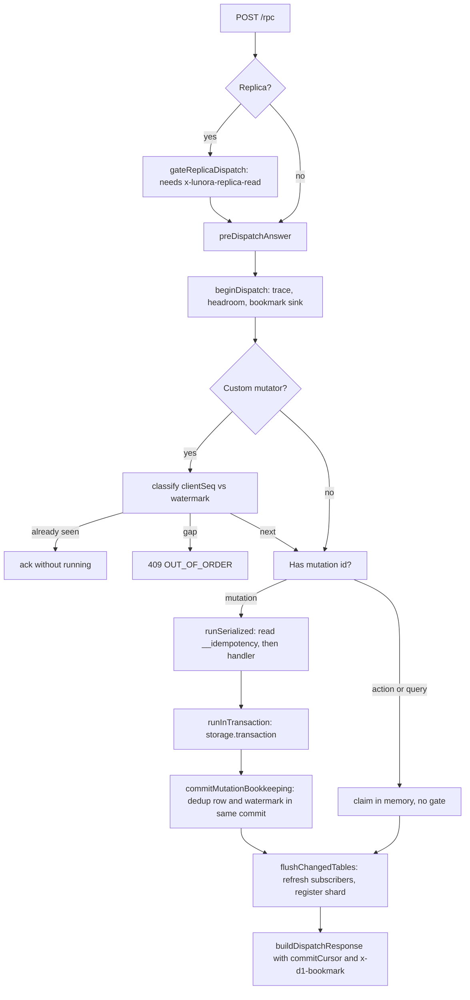
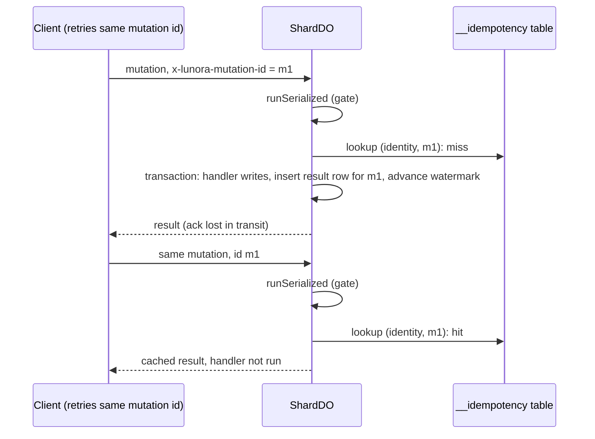

# The ShardDO: one SQLite database, one writer, many sockets

`ShardDO` is the abstract class that every shard runs. The file `packages/do/src/shard-do.ts` has 18,454 lines. Codegen writes a subclass that adds the schema. This page follows one request through the class and lists what the class stores.

## Words on this page

- **Dispatch.** One run of one function on the shard. A call to a query, a mutation or an action is one dispatch.
- **Query, mutation, action.** A query only reads. A mutation writes, and runs inside the gate and one transaction. An action may call outside services. It runs with no gate and no transaction, because an outside call cannot be rolled back.
- **Gate.** The `blockConcurrencyWhile` call. While a mutation holds it, no other event runs in the object. See [Cloudflare services](02-cloudflare-services.md), section "Durable Objects from first principles".
- **Interleave.** Two requests take turns inside one object. Each `await` is a point where another request can run.
- **Transaction.** A group of writes that all happen or none happen.
- **At-least-once delivery.** A message may arrive more than once, but it never gets lost. Retries cause this.
- **Idempotency.** Doing an action twice has the same effect as doing it once. At-least-once delivery plus idempotency gives an exactly-once effect. See [Replication and read scaling](07-replication-and-read-scaling.md), section "Consistency words used in these docs".
- **Attachment.** A small value that the runtime saves with a WebSocket. It survives hibernation.
- **Hibernation.** The object leaves memory while its sockets stay open. All in-memory state is lost.
- **Headroom.** The room that is left before a limit. A tracker counts reads and writes and refuses work before the shard runs out of memory.

## Construction

The constructor (`shard-do.ts:3210`) does five things.

1. It builds the Cloudflare adapters: `createShardHost`, `createSocketHost`, and a secret value host (`shard-do.ts:3232-3234`).
2. It mounts a `ShardRunner` with two handlers: `handleFetchCloudflare` and `handleAlarmCloudflare` (`shard-do.ts:3235-3240`).
3. It builds a relay link and a replica link. The role comes from the object name and never changes (`shard-do.ts:3301,3334`).
4. It reads its own jurisdiction from `state.id.jurisdiction`, so sibling lookups use the same subnamespace (`shard-do.ts:3271`).
5. It arms the WebSocket keep-alive: `setWebSocketAutoResponse(new WebSocketRequestResponsePair("lunora-ping", "lunora-pong"))` (`shard-do.ts:16404`, constants at `shard-do.ts:527-529`). The platform answers the ping while the object sleeps. So an idle socket stays alive with no billable wake-up.

Schema migration is not in the constructor. The generated `ensureMigrated` runs on the first dispatch after each wake (`codegen/src/emit/shard.ts:1176`). See [Migrations](13-migrations-and-schema.md).

## Anatomy of a mutation

`handleFetchCloudflare` (`shard-do.ts:8525`) is the main path. Its steps:



### Request scope re-pinning

A Durable Object serves concurrent `fetch` calls on one instance. Awaits let another request run. So per-request fields (identity, mutation id, trace) can be overwritten. The code captures them into a `RequestScope` and puts them back after every `await` that could interleave (`captureRequestScope` at `shard-do.ts:9173`, `restoreRequestScope` at `shard-do.ts:9201`; used at `shard-do.ts:8721-8830`).

**Aha: the gate does not protect instance fields.** `blockConcurrencyWhile` only delays entry. While one request waits for its turn, another request's prologue can overwrite the shared fields. The re-pin is the first statement inside the gate (`shard-do.ts:8707-8720`).

### Idempotency (exactly-once effect)

A client can send the header `x-lunora-mutation-id`. The shard keeps `(identity, mutation_id) -> result` in `__idempotency` (`ctx-db-idempotency.ts`). A repeated id returns the cached result without running the handler. Rows live 24 hours (`IDEMPOTENCY_RETENTION_MS = 86_400_000`, `shard-do.ts:1448`) and are cleaned at most every hour (`IDEMPOTENCY_GC_INTERVAL_MS = 3_600_000`, `shard-do.ts:1455`).

For a mutation the read and the handler share one gate. So two deliveries cannot both miss the cache (`shard-do.ts:8776-8781`). The dedup row is written inside the same transaction as the data: `commitMutationBookkeeping` runs before commit (`shard-do.ts:5850-5870`). A crash cannot leave data without its replay guard.

An action or query with a mutation id must not take the gate. The gate would let any caller freeze the shard for the length of an outbound call. So actions use `InFlightClaims`, an in-memory set. A second delivery of a live key gets Hypertext Transfer Protocol (HTTP) 409 with code `DISPATCH_IN_PROGRESS`. The claim has a 15-minute ceiling (`DISPATCH_CLAIM_CEILING_MS = 900_000`, `shared/dispatch-claim.ts:20`) which matches the 15-minute alarm limit (`do/src/in-flight-claims.ts:1-30`).

### Custom mutators and the client watermark

The poke protocol has a per-client watermark in `__client_watermark`. A push with `clientSeq <= watermark` is acknowledged without running. A push with `clientSeq > watermark + 1` is rejected with `409 OUT_OF_ORDER` (`architecture.mdx`, failure modes). The watermark advances in the same commit as the writes (`shard-do.ts:5850`).

The comment at `shard-do.ts:8852-8860` says the watermark write is "NOT atomic with the handler". That is stale for mutations. `commitMutationBookkeeping` writes it inside the transaction with `strict: true` (`shard-do.ts:5912-5937`). The comment is accurate only for the best-effort recovery path in `recordPostDispatchBookkeeping` (`shard-do.ts:5890`).

### The transaction

`runInTransaction` refuses nesting (`NESTED_TRANSACTION`, `shard-do.ts:4288-4295`). It calls the runner. The runner takes the gate, then the transaction. After the commit, it links the after-commit hooks on a chain inside the gate and runs them outside the gate:

```ts
// packages/do/src/shard-do.ts:4361 (inside runInTransaction)
flushed = this.linkAfterCommit(async () => flushAfterCommit(queued));
```

Hooks include the Vectorize sync. They run in commit order but do not block the next transaction. The wait is capped at `AFTER_COMMIT_WAIT_MS = 15_000` (`shard-do.ts:1326`). If the wait times out once, `afterCommitStalled` is set and later calls skip the wait (`shard-do.ts:4402`).

### Transaction headroom

A Durable Object has about 128 MiB of memory. One unbounded loop would kill the shard. `TransactionHeadroomTracker` counts reads and writes per transaction and throws `TRANSACTION_LIMIT_EXCEEDED`.

| Limit | Default | Source |
|-------|---------|--------|
| Documents read | 100,000 | `transaction-headroom.ts:59` |
| Bytes written | 32 MiB | `transaction-headroom.ts:60` |
| Documents written | 50,000 | `transaction-headroom.ts:61` |

The tracker is passed by value into each dispatch, subscription refresh and alarm job. An instance field would be wrong under interleaving (`shard-do.ts:7380-7420`).



## What the shard stores

Beyond user tables, the engine creates reserved tables. At least 38 names exist (`grep` for `_TABLE = "__`). The important ones:

| Table | Purpose | File |
|-------|---------|------|
| `__cdc_log`, `__cdc_meta`, `__cdc_archive` | Change log, epoch, archive watermark | `ctx-db-cdc.ts`, `ctx-db-cdc-archive.ts` |
| `__commit_seq` | Commit counter for `commitOrdered` tables | `ctx-db-commit-seq.ts:84` |
| `__idempotency` | Mutation replay cache | `ctx-db-idempotency.ts` |
| `__client_watermark` | Per-client mutator watermark | `ctx-db-client-watermark.ts:46` |
| `__shape_poke_cursor` | Per-socket poke baseline | `ctx-db-shape-poke-cursor.ts` |
| `__schedule_outbox` | Deferred schedule custody | `ctx-db-schedule-outbox.ts` |
| `__replica_state` | Replica follow position | `replica.ts:98` |
| `__lunora_relay_shapes`, `__lunora_relay_memos` | Owner registry for relayed shapes | `ctx-db-relay-shapes.ts` |
| `__lunora_reqlog__` | Request log, 1,000 rows | `observability/src/request-log.ts:62` |
| `__lunora_metrics*` | Function and query metrics | `observability` |
| `__lunora_schema_history` | Schema version ledger, 50 versions | `schema-history.ts` |
| `__lunora_migrations` | Data migration progress | `data-migration.ts` |
| `__stream_runs`, `__stream_chunks` | Durable streams | `durable-stream.ts` |
| `__lunora_alarm_rearm_window` | Alarm breaker window | `alarm-rearm-breaker.ts` |

The data browser hides any table that starts with `__lunora`.

### A cost to know: every dispatch writes a log row

By default `LUNORA_REQUEST_LOG_SAMPLE` is unset, and `parseSampleRate` returns `1` (`do/src/admin-rpc-args.ts:1538`). `recordRequestLog` skips only sampled-out successes (`shard-do.ts:12102`). So each dispatch, including a query, inserts one row into `__lunora_reqlog__` (`packages/observability/src/request-log.ts:983`). A trim runs once per 60-second window (`REQUEST_LOG_PRUNE_WINDOW_MS = 60_000`, `packages/observability/src/request-log.ts:59`). Metrics flush to Structured Query Language (SQL) every 8 dispatches (`DEFAULT_METRICS_FLUSH_EVERY = 8`, `shard-do.ts:1740`). The Durable Object SQLite price counts rows written. So a read-heavy shard pays for log writes unless the operator lowers the sample rate. See [Critical assessment](15-critical-assessment.md).

## Sockets and hibernation

The platform feature behind this section is the WebSocket Hibernation application programming interface (API). [Cloudflare services](02-cloudflare-services.md), section "WebSocket hibernation", explains it with a diagram. In short: the runtime keeps the socket open while the object is out of memory, and it builds the object again when a message arrives. Subscriptions live in the socket attachment so they survive hibernation. Limits:

| Item | Value | Source |
|------|-------|--------|
| Attachment | 16,384 bytes (measured against workerd) | `shard-do.ts:1988` |
| Subscriptions and shapes per socket | 32 | `shard-do.ts:2017` |
| Streams per socket | 8 | `shard-do.ts:1966` |
| Whisper topics per socket | 64 | `shard-do.ts` (`MAX_WHISPER_TOPICS_PER_SOCKET`) |
| Whisper payload | 4,096 bytes; burst 50, 25 per second | `shard-do.ts:2115,2182` |
| Inbound frame | 1,048,576 units | `shard-do.ts:557` |
| Live (SSE) connections | 1,024; 25 s keep-alive; 256 KiB queue | `shard-do.ts:2145,2152,2172` |
| Socket tags | 9 usable, 256 characters each | `platform/src/socket-host.ts:61` |

The attachment cache wraps `serializeAttachment` so writes by subclasses still update the cache (`shard-do.ts:18358`). Every socket frame would otherwise decode the attachment. The socket host has a `WeakSet` of foreign sockets and a membership set keyed by generation, to avoid an O(n) scan per frame (`cloudflare-host.ts:627-651`).

When a socket errors, the runtime calls `webSocketError` and no `webSocketClose`. The class forwards to `webSocketClose` so cursor rows are removed. One orphan row in `__shape_poke_cursor` would pin the change log retention floor forever (`shard-do.ts:3585-3618`).

## Point-in-time recovery

Point-in-time recovery (PITR) restores the SQLite database of one Durable Object to a moment in the past 30 days. Cloudflare names the moments with bookmarks. A PITR bookmark is not a D1 bookmark. [Cloudflare services](02-cloudflare-services.md), section "Point-in-time recovery", explains the three platform calls and the restart that completes a restore. SQLite-backed Durable Objects keep 30 days of history. Admin operations `getPitrBookmark` and `pitrRestore` wrap the platform application programming interface (API) (`shard-engine/src/pitr.ts:98,118`). `pitrRestore` arms a restore with `onNextSessionRestoreBookmark`, bumps the change log epoch, records an audit entry, and optionally calls `state.abort()` (`shard-do.ts:12242-12310`). The restore also reverts the epoch row, which is the main subtlety in [Change log](06-change-log-cdc.md).

## Where to go next

Read [Change log](06-change-log-cdc.md) for `__cdc_log` and the epoch.
