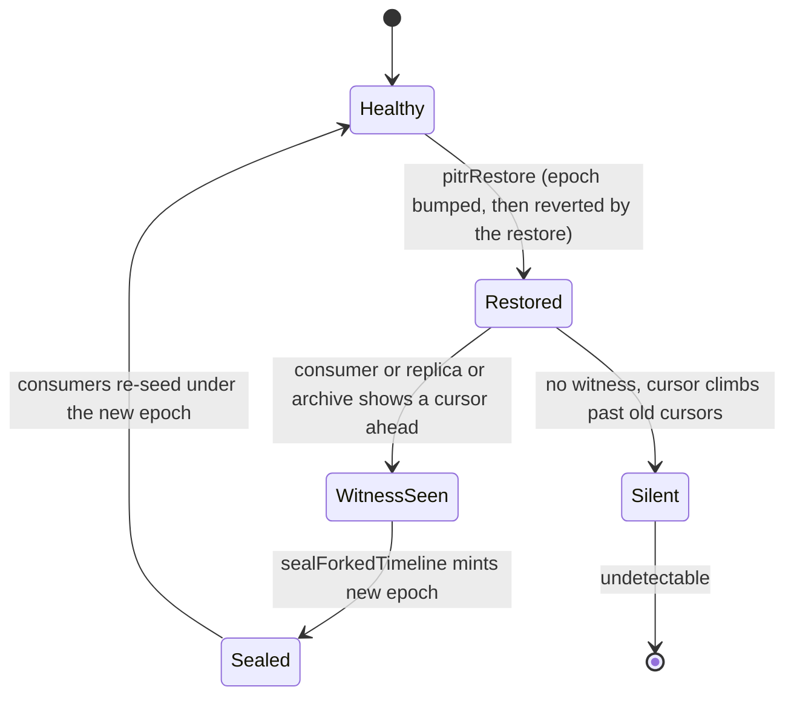
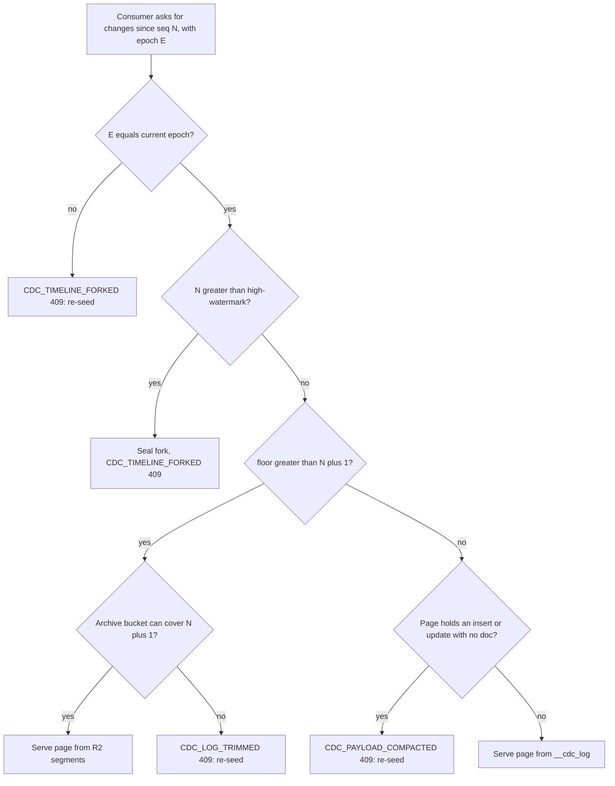

# The change log: one append-only table per shard

Every shard can keep an append-only log of its writes. The table is `__cdc_log`. The log feeds subscriptions, read replicas, warehouse connectors, point-in-time replay and the archive in R2. This page explains the table, its cursors, the epoch that detects a forked timeline, the commit sequence `_commitSeq`, and the retention rules. The R2 archive and the order of writes are in [Storage tiers](08-storage-tiers-and-archive.md).

## It is opt-in

Change data capture (CDC) is off by default. The app builder has `.cdc(enabled = true)`. The comment says it "costs a changelog row per write, which an app using none of the above should not pay" (`packages/codegen/src/emit/app-builder.ts:140-147`). A shard-local `defineShape` needs it. Without it, `shape_subscribe` is refused with `SHAPE_REQUIRES_CDC`. Replicas need it too: a shard with no log refuses the replica control channel with 409 (`replica.ts:325`).

## The table

```ts
// packages/shard-engine/src/ctx-db-cdc.ts:99
CREATE TABLE IF NOT EXISTS __cdc_log (
    seq INTEGER PRIMARY KEY AUTOINCREMENT,
    ts REAL NOT NULL,
    "table" TEXT NOT NULL,
    id TEXT NOT NULL,
    op TEXT NOT NULL,
    doc TEXT
)
```

The type for one entry is `CdcChange` (`ctx-db-cdc.ts:40`): `seq`, `ts`, `table`, `id`, `op` (`insert`, `update` or `delete`) and an optional post-image `doc`. A delete has `doc = NULL`.

`recordCdc` appends one row. It runs inside the same transaction as the row write, so the change is durable if and only if the write is (`ctx-db-cdc.ts:158-167`). Callers: insert (`ctx-db-companions.ts:800`), update and replace (`packages/shard-engine/src/ctx-db.ts:3359,4287,4793`), delete (`ctx-db.ts:3394`). The function skips `.memory()` tables, because their rows do not survive eviction (`ctx-db.ts:2335-2358`).

The append statement is a constant string, not a query builder call. It runs once per commit, so the builder cost was removed (`ctx-db-cdc.ts:28-37`).

### Indexes

| Index | Columns | Purpose | Line |
|-------|---------|---------|------|
| `__cdc_log_table_seq` | `("table", seq)` | Reads for one table, in order. Without it, a busy table taxes every quiet table | `ctx-db-cdc.ts:53` |
| `__cdc_log_payload_gap` | `(seq) WHERE op <> 'delete' AND doc IS NULL` | Find compacted rows. Empty until compaction runs | `ctx-db-cdc.ts:73,81` |
| `__cdc_log_table_id_seq` | `("table", id, seq)` | Row history. Built only if some table uses `.dropStalePatches()` | `ctx-db-cdc.ts:65` |

Each `CREATE INDEX` sits in its own `try/catch` (`ctx-db-cdc.ts:122-155`). The comment explains: on a big old log, the first build can run long. If it killed the migration, "EVERY subsequent request restarts from scratch and the shard is bricked rather than slow". Failing alone gives a slow read path that the next cold start retries.

## Cursors and floors

The cursor is `seq`. `AUTOINCREMENT` makes it strictly increasing and never reused, even after rows are deleted. The high-watermark comes from `sqlite_sequence`, not from `MAX(seq)`, so a trim cannot lower it (`readCdcCursor`, `ctx-db-cdc.ts:568-583`).

There are two floors.

- **Key floor**: `minCdcSeq`, the smallest retained `seq` (`ctx-db-cdc.ts:662`). Shape diffs need only keys.
- **Payload floor**: `minCdcReplayableSeq`, the first `seq` that still has its post-image (`ctx-db-cdc.ts:688`). Replicas and connectors need documents.

The test for "your cursor is too old" is one function:

```ts
// packages/shard-engine/src/ctx-db-cdc.ts:607
const cursorBelowRetainedFloor = (floor: number | undefined, sinceSeq: number): boolean => floor !== undefined && floor > sinceSeq + 1;
```

The `+ 1` matters. A consumer at `sinceSeq` has seen that entry. It expects `sinceSeq + 1` next. A floor of exactly `sinceSeq + 1` means nothing was missed (`ctx-db-cdc.ts:585-607`). Six call sites use this predicate.

### Errors

| Code | Hypertext Transfer Protocol (HTTP) | When | Source |
|------|------|------|--------|
| `CDC_LOG_TRIMMED` | 409 | Cursor below the key floor | `ctx-db-cdc.ts:617` |
| `CDC_PAYLOAD_COMPACTED` | 409 | A page holds an insert or update with no post-image | `shard-do.ts:5206-5214` |
| `CDC_TIMELINE_FORKED` | 409 | Cursor above the high-watermark, or epoch mismatch | `ctx-db-cdc.ts:649`, `shard-do.ts:5162` |

A compacted row is refused rather than served because "a doc-less insert/update is indistinguishable on the wire from a delete" (`shard-do.ts:5191-5197`). Serving it would delete rows in a warehouse.

## The epoch: detecting a forked timeline

`__cdc_meta` holds one row with an `epoch` string (a random UUID). A consumer stores `(epoch, cursor)`. It resumes only when both match (`ctx-db-cdc.ts:714-757`).

Why the cursor alone is not enough: after a reset or a restore, `AUTOINCREMENT` starts low again. A client with a high old cursor would be told "resumable" on an unrelated timeline.

The hard case is native point-in-time recovery (PITR). A restore reverts the whole SQLite file. That includes `__cdc_meta`. So the epoch comes back to its old value, and nothing inside the shard can see the fork. Lunora uses witnesses from outside SQLite:

1. **A consumer cursor** above the high-watermark on the same epoch. Handled in `evaluateResume` (`shard-do.ts:5399`) and `runShardCdcSync` (`shard-do.ts:5170`).
2. **A replica cursor**: `rewoundBeneathUs = page.cursor < state.appliedSeq` (`replica.ts:514`).
3. **The R2 archive**: a segment above the stored watermark proves a timeline the shard forgot (`cdcArchiveRewound`, `ctx-db-cdc-archive.ts:240`).

Any witness calls `sealForkedTimeline`, which mints a new epoch (`shard-do.ts:5310`).



**Aha: a latch caps the cost of a forged cursor.** The proof is client-supplied. So `sealForkedTimeline` runs at most once per wake (`forkSealed`, `shard-do.ts:5338-5346`). The comment says a forged frame can still force every subscriber to re-snapshot, once per wake. The code states the trade-off in plain words.

The `Silent` state is real. The comment lists it: a shard with no subscribers, no connector, no follower and no archive bucket cannot detect a rollback (`shard-do.ts:5295-5299`).



Source: `shard-do.ts:5106-5217`, `cdc-retention.ts:428-482`.

## Retention

`CdcRetentionRunner.sweep` (`packages/do/src/cdc-retention.ts:226`) runs on a write dispatch, not on a timer. It runs at most once per 60,000 ms per instance (`CDC_SWEEP_INTERVAL_MS`, line 79).

| Setting | Default | Meaning |
|---------|---------|---------|
| `LUNORA_CDC_LOG_RETENTION` | 1,000,000 rows (`DEFAULT_CDC_LOG_RETENTION_ROWS`, line 49) | Rows kept. `off` keeps all |
| `LUNORA_CDC_PAYLOAD_RETENTION` | unset (off) | Strip post-images past this many rows, keep keys |
| `LUNORA_CDC_ARCHIVE` binding | unset | R2 bucket for segments |
| `SHARD_CDC_SWEEP_MAX_ROWS` | 50,000 per pass (line 98) | Bound for one trim or compact |
| `CDC_ARCHIVE_SEGMENT_MAX_ROWS` | 10,000 (line 115) | Rows per archive segment |

Parsing is strict. `envOptionalPositiveInt` needs the whole string to be an integer. The comment says the lenient `parseInt` turns `10k` into "keep 10 rows" (`cdc-retention.ts:239-246`). A typo must not delete a log.

Two steps destroy data. `compactCdcDocs` sets `doc = NULL` for old rows (cheap tier: keys stay). `trimCdcChanges` deletes rows (`ctx-db-cdc.ts:479,511`). Both are bounded by `LIMIT maxRows` inside a sub-select. The first sweep after a setting change faces the whole backlog. An unbounded `DELETE` could abort and retry forever without progress (`ctx-db-cdc.ts:466-478`).

The sweep never crosses the retention floor. `retentionFloor` is the minimum of the head, every `__shape_poke_cursor` row, and the relay shape registry (`shard-do.ts:14399-14404`). A cursor that cannot be read adds nothing. The floor can only go down, so a bug leaves extra rows rather than deleting needed ones.

**Aha: empty diffs advance cursors.** One subscriber to a quiet table used to hold the floor of the whole log for ever. So `collectShapePokeParts` advances every shape's cursor on every flush, even when its table did not change (`shard-do.ts:14446-14477`). Without it, an operator who set a retention window saw the log grow "with no error, no metric".

A known ceiling remains: a relayed cohort on a quiet table pins the floor, because its cursor must stay where the last delivered poke reached (`shard-do.ts:14382-14396`).

## Vouching: when "nothing changed" is a lie

`evaluateResume` lets a reconnecting client keep its cached query result if no table it read changed. The log can only vouch for tables in this shard's SQLite. A `.global()` table lives in D1. A flag provider, `ctx.kv` and wall-clock filters leave no row. So `cdcCanVouchFor` defines the safe set by a positive rule: a dependency is vouchable only if a table of that name exists in this shard's SQLite (`ctx-db-cdc.ts:332`). Memory tables stamp a sentinel dependency `UNVOUCHABLE_DEP` to fail this check (`ctx-db.ts:2229-2245`). The answer is cached per Structured Query Language (SQL) handle, and only positive answers are cached.

The resume check uses `cdcTouchesTables`: one indexed probe `SELECT 1 ... LIMIT 1`, chunked at 90 names for the 100-parameter limit (`ctx-db-cdc.ts:174,248`). It never decodes a document.

## The two-stage shape diff

A poke tells a client which rows entered or left a shape. `readCdcChangeKeys` returns distinct ids with the latest op, using `MAX(seq)` with bare columns (SQLite picks them from the max row) (`ctx-db-cdc.ts:446-463`). A group with more than one operation never reports `insert`. A delete and re-insert of one id in one window would otherwise look like a plain insert and leave the old row on the client. The code reports `update` instead (`ctx-db-cdc.ts:458-462`).

Stage two selects the surviving documents from the table with `id IN (changed) AND predicate`. So no post-image is read from the log. This is why payload compaction does not hurt shapes. A per-flush `ShapeDiffCache` shares the key scan and the membership probe between sockets. It is created for each flush and discarded, because a longer life would serve stale keys (`shape-diff-cache.ts:1-30`).

## The commit sequence `_commitSeq`

`_creationTime` is wall-clock time. Two mutations can be stamped in one order and commit in the other. A consumer that pages by `_creationTime` can skip a row for ever. `.commitOrdered()` on a table adds a per-shard integer `_commitSeq`.

```ts
// packages/shard-engine/src/ctx-db-commit-seq.ts:144
const allocateCommitSeq = (sql: SqlExec): number => {
    runDrizzle(sql, dsql`UPDATE ${dsql.identifier(COMMIT_SEQ_TABLE)} SET value = value + 1 WHERE id = 0`);
    return readCommitSeq(sql);
};
```

Facts from the file header (`ctx-db-commit-seq.ts:1-80`):

- One value per atomic write boundary. All rows a mutation writes share it (`commitSeqFields`, `ctx-db.ts:2123`).
- An action is not in a transaction. Each of its writes gets its own value.
- It is stored inside `__doc__`, not as a column, so no `ALTER TABLE` is needed (`COMMIT_SEQ_FIELD = "_commitSeq"`, line 94).
- It is ordered, not gapless.
- It is per shard. `.global()` tables reject `.commitOrdered()`.
- It does not survive a PITR restore. The counter row rolls back with the data. A consumer at 5 can skip writes 3, 4, 5 after the restore. The file says to use `cdcSync` for a feed that must survive a restore.
- A hard delete is invisible. Pair the table with `.softDelete()`.
- A bounded page can end inside a commit group, so a consumer must checkpoint only on a sequence it has seen whole.

The bump and the read are two statements, not one `UPDATE ... RETURNING`. Nothing awaits between them, and the engine avoids `RETURNING` on workerd (`ctx-db-commit-seq.ts:130-143`).

## The global log in D1

A `.global()` table has its own `__cdc_log` in D1 or in the Hyperdrive database. It is shared by all shards. Nobody owns it, so trimming uses a lease. See [D1 and global tables](09-d1-global-and-hyperdrive.md).

## Consumers of the log

| Consumer | Path |
|----------|------|
| Live subscribers (`shape_subscribe`) | `pokeShapeSubscribers`, `shard-do.ts:14219` |
| Reconnecting subscribers | `evaluateResume`, `shard-do.ts:5366` |
| Read replicas | `servePull`, `replica.ts:398` |
| Warehouse connectors | `/_lunora/admin/connector/sync`, `data-movement-admin-routes.ts` |
| Export tap with durable cursor | `runExportTap`, `export-tap.ts` |
| Replay for PITR | `applyCdcChanges`, `ctx-db-cdc.ts:819` |

The connector cursor is an opaque base64url token with `{v: 1, s: {shard: seq}, g: globalSeq}` (`connector-cdc.ts:19-30`). It carries no per-shard epoch. The handler comment says why: the connector page has no error channel, so an epoch refusal would look like "caught up" (`data-movement-admin-routes.ts:253-262`). The handler folds only `shard.changes` and ignores `shard.error` (`data-movement-admin-routes.ts:290-310`). So a shard that times out or refuses a forked cursor adds no changes, keeps its old cursor, and can leave the page with `hasMore: false`. The export tap is stricter: it records a failure and sets `hasMore = true` (`export-tap.ts:221-240`).

## Where to go next

Read [Storage tiers](08-storage-tiers-and-archive.md) for the R2 archive.
