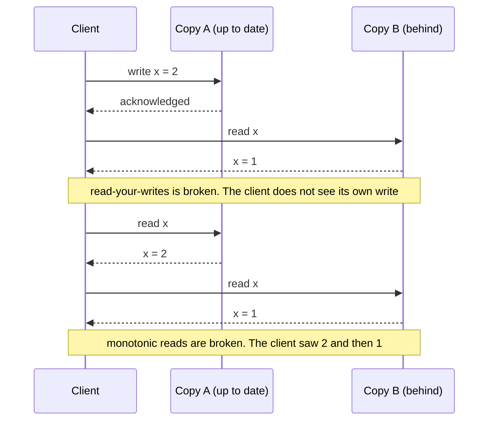
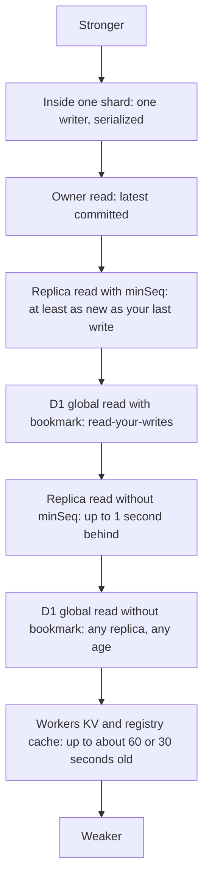
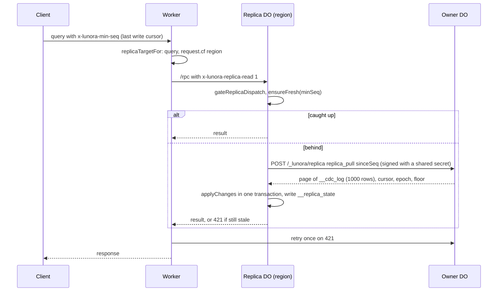
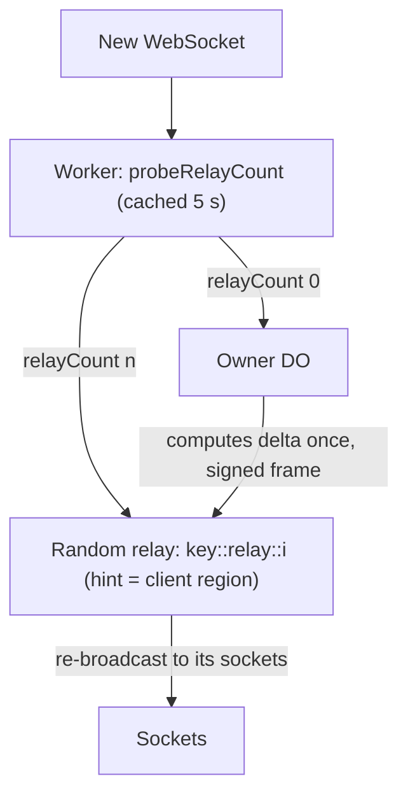
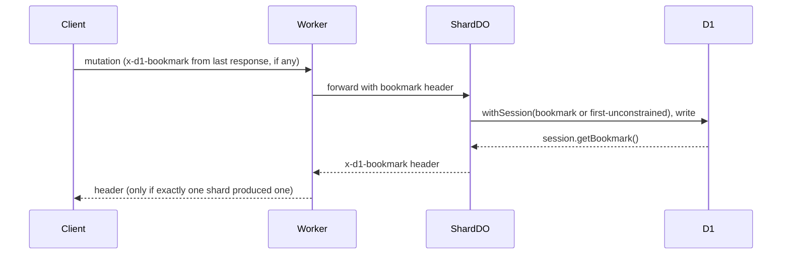

# Replication and read scaling

One shard is one writer. That limits reads and socket count. Lunora adds four tools. Read replicas copy a shard into another region. Relays share the WebSocket fan-out of one hot shard. D1 sessions give read-your-writes for global tables. Caches avoid repeated work. This page explains each, with the consistency each one gives.

## Consistency words used in these docs

Many pages use words from the study of distributed data. This section defines each word once, in plain terms. Each entry says where Lunora uses the idea. Read it first if words such as "watermark" or "epoch" are new to you.

### The anomalies in one picture

Two copies of the same data can disagree for a short time. A client that reads from the wrong copy sees two kinds of surprise.



### Word list

| Word | Plain meaning | Where Lunora uses it |
|------|---------------|----------------------|
| Primary and replica | The primary takes all writes. A replica is a copy that only serves reads and follows the primary. | D1 has its own primary and replicas ([D1 and global tables](09-d1-global-and-hyperdrive.md)). Lunora's shard replica is a second Durable Object that follows the owner shard. In this document the owner plays the part of the primary |
| Replication lag | The time between a commit on the primary and the arrival of that commit on a replica. | `isFreshEnough` bounds it to 1,000 milliseconds when no `minSeq` is sent (`replica.ts:910`). D1 gives no bound |
| Eventual consistency | After writes stop, all copies will agree. Until then a read can return old data. | Workers KV (about 60 seconds), D1 replicas without a bookmark, the shard registry list (30 seconds), and the edge cache for Representational State Transfer (REST) routes |
| Strong consistency | A read returns the latest committed write. | Inside one shard: one writer, one transaction at a time. R2 is strongly consistent too |
| Read-your-writes | A client always sees its own earlier writes. | D1 bookmark for `.global()` tables. Commit cursor `x-lunora-min-seq` for shard replicas |
| Monotonic reads | A client never sees data go back in time. | Inside one D1 session. Across separate requests Lunora gives it only after the client holds a bookmark (see [D1 and global tables](09-d1-global-and-hyperdrive.md), "Limits of the design") |
| Sequential consistency | All clients see the operations in one agreed order, and each client sees its own operations in program order. D1 offers this inside a session. | D1 Sessions application programming interface (API) |
| Idempotency | Doing an action twice has the same effect as doing it once. | A mutation carries `x-lunora-mutation-id`. The shard stores `(identity, mutation id) -> result` in `__idempotency` for 24 hours (`shard-do.ts:1448`). A retry returns the saved result |
| Watermark | A number that marks how far something has progressed. Lunora uses the word for three different numbers. | See the next table |
| Epoch | A random label for one timeline of the change log. A new epoch means "the history before this point may not match". | `__cdc_meta.epoch` ([Change log](06-change-log-cdc.md)) |
| Commit sequence | A number that grows with each commit and gives the order of commits. Lunora has two: `seq` in the change log, and `_commitSeq` on tables. | `__cdc_log.seq`, `_commitSeq` ([Change log](06-change-log-cdc.md)) |
| Outbox | A table in the same transaction as the data. It holds a message that must be sent after the commit. A crash cannot lose the message. | `__schedule_outbox` ([Alarms, queues, workflows](11-alarms-queues-workflows.md)) |
| Fork after restore | A restore moves the database back in time. New writes then make a second history that differs from the history that clients remember. | Detected with the epoch and outside witnesses ([Change log](06-change-log-cdc.md)) |

### Three kinds of watermark

| Name | Where | Meaning |
|------|-------|---------|
| Change log high-watermark | `sqlite_sequence` for `__cdc_log` (`ctx-db-cdc.ts:568-583`) | The largest `seq` ever issued. It never goes down, even after a trim |
| Client watermark | `__client_watermark` (`ctx-db-client-watermark.ts:46`) | The last mutation number of one client that the shard applied. It drops duplicates and detects gaps |
| Archive watermark | `__cdc_archive` (`ctx-db-cdc-archive.ts:119-133`) | The last `seq` that is safe in R2. Nothing newer than it may be deleted |

### The commit cursor: read-your-writes for shard replicas

The D1 bookmark is for global tables. Shard replicas use a different token with the same job.

1. A mutation commits on the owner shard. The response carries `commitCursor`. It is the change log `seq` after the write (`shard-do.ts:5811`, `mutationCommitCursor`). The shard sends it only for a mutation with a mutation identifier, on a shard that has the change log on.
2. The client keeps the highest cursor per shard in memory (`packages/client/src/lunora-client.ts:738-747`, recorded at line 9984).
3. On later calls the client sends the cursor as the header `x-lunora-min-seq` (`lunora-client.ts:6700-6710`).
4. A replica answers only if its `appliedSeq` is at least that number. Otherwise it fetches the missing changes from the owner. If it still cannot catch up, it answers `421` and the Worker retries on the owner (`replica.ts:910`).

So `minSeq` plays the role that the bookmark plays in D1. Both are a position in a history. Both make the copy catch up or wait before it answers.

### Where each guarantee holds

Roughly from stronger to weaker:



## Tool 1: region-local read replicas

A replica is a second Durable Object named `<owner>::replica::<region>`. It follows the owner's change log and answers queries near the reader. It is opt-in (`options.replicaReads === true`, `create-worker.ts:4682`). The package comment calls it "the platform replicates for durability, not for reads, so the follow loop is ours" (`cloudflare.ts:73-76`).

### Words in this part

- **Owner.** The shard that holds the true data. A replica copies it.
- **Bootstrap.** The first full copy of the owner's rows into a new replica.
- **Catch up.** Pull pages of changes from the owner's change log and apply them.
- **Floor.** The oldest change log position the owner can still serve. See [Change log](06-change-log-cdc.md).
- **Snapshot.** A full copy of the owner's rows at one moment.
- **Latch.** A flag that stays set once it is set. A divergent replica stays divergent for the life of the object.
- **Single-flight.** Many callers that need the same slow work share one running copy of it.

### Roles are fixed by name

The replica role is read once from the object name by `createReplicaLink` (`replica.ts:962`). `parseReplicaName` checks the region against the 11 valid hints. The comment calls this a trust boundary: replica names come from client-supplied shard keys, so an unvalidated region would let a caller create an unbounded set of replicas (`shared/replica-name.ts:36-60`).

### Read path



Source: `create-worker.ts:4720-4752`, `replica.ts:570,991`.

### The follow loop

`ShardReplica.ensureFresh(minSeq)` returns `fresh`, `stale` or `unavailable` (`replica.ts:570`).

1. If divergent, return `unavailable`.
2. If the stored position already satisfies the read, return `fresh` with no fetch.
3. Otherwise join the single in-flight `advance`. The latch exists because the input gate does not hold other requests across an `await`. Without it, a burst of first reads would start many bootstraps and write `__replica_state` out of order (`replica.ts:540-551`).
4. After a joined run, re-check against the durable cursor. "Joining can delay a read, never under-serve it" (`replica.ts:587-592`).

`advance` bootstraps if there is no state. Then `catchUp` pulls pages. Constants:

| Constant | Value | Source |
|----------|-------|--------|
| `PULL_PAGE_SIZE` | 1,000 changes | `replica.ts:68` |
| `MAX_PULL_ROUNDS` | 10 per read | `replica.ts:82` |
| `DEFAULT_MAX_STALENESS_MS` | 1,000 ms, env `LUNORA_REPLICA_MAX_STALENESS_MS` | `replica.ts:65` |
| `DEFAULT_MAX_BOOTSTRAP_ROWS` | 50,000, env `LUNORA_REPLICA_MAX_BOOTSTRAP_ROWS` | `replica.ts:93` |

`isFreshEnough` is the consistency rule:

```ts
// packages/shard-engine/src/replica.ts:910
private isFreshEnough(state: ReplicaState, minSeq: number | undefined): boolean {
    if (minSeq !== undefined) { return state.appliedSeq >= minSeq; }
    return Date.now() - state.syncedAtMs <= envPositiveInt(this.host.env(), "LUNORA_REPLICA_MAX_STALENESS_MS", DEFAULT_MAX_STALENESS_MS);
}
```

With a bookmark the read is at least as new as the caller's last write. Without one, the read can be 1 second old.

### Divergence handling

`divergenceOf` (`replica.ts:492`) compares the page with the replica state.

- A new epoch, or an owner cursor below the replica cursor, is a `fork`. The replica latches `divergent` for the life of the object and sends reads to the owner. The code says this is a dead end, not a self-heal (`replica.ts:42-46`).
- A floor above `appliedSeq + 1` is `compacted`. The replica takes a fresh snapshot. It upserts every snapshot row and deletes every local row the snapshot lacks, in one transaction. It checks the write budget first (`resnapshot`, `replica.ts:810`).
- A page that cannot be applied latches `divergent`, unless the platform flags the error as `retryable` or `overloaded` (`replica.ts:761-779`).

The owner answers floor and rollback cases in the response body, not with an error. A thrown error would look like "owner unreachable", and the replica would retry the same failing request for ever (`replica.ts:386-426`).

### Safety rules

- A replica refuses any call without `x-lunora-replica-read: 1`. A mutation sent by mistake gets `421 REPLICA_READ_ONLY` (`replica.ts:991-997`).
- A replica cannot serve replicas (409). A shard with no log is refused (409). A shard without `LUNORA_RELAY_SECRET` is refused (403) because a forged frame would return every row (`replica.ts:318-334`).
- Background alarms do not run on a replica. They would run against a copy (`shard-do.ts:9070-9072`).
- A replica does not register with the shard registry (`shard-do.ts:13207`).

### Costs and gaps

- Bootstrap is one response. The owner counts rows first and refuses above the cap. The code marks it with `ponytail:` (`replica.ts:91`).
- A re-snapshot rewrites every row (`replica.ts:807`).
- A follower below the floor pays a full bootstrap. The archive does not help replicas. The comment calls this a tracked follow-up (`shard-do.ts:5226-5235`).
- No `minSeq` means up to 1 second of staleness by design.

## Tool 2: the relay tier for socket fan-out

Fan-out here means one change that must reach many WebSocket clients. A relay is an extra Durable Object that holds some of the sockets and repeats the owner's messages to them. The owner then sends one message to each relay and not one to each socket.

One object spends 10 to 15 microseconds per socket per flush. The measured figure is about 120 ms per flush at 8,000 sockets (`relay.ts:80-90`). So the owner promotes a shard to use relays.



Promotion has hysteresis (`nextPromotionState`, `relay.ts:97`). Hysteresis means two thresholds: a high one to switch on and a lower one to switch off. The system does not flip back and forth near one edge.

| Setting | Default | Env var |
|---------|---------|---------|
| Promote at | 8,000 sockets (`tUp`) | `LUNORA_RELAY_THRESHOLD` |
| Collapse below | 4,000 (`tDown`) | `LUNORA_RELAY_COLLAPSE_THRESHOLD` |
| Relays when promoted | 2 | `LUNORA_RELAY_FAN` (`relay-hub.ts:64`) |
| Hard cap | 8 | `LUNORA_MAX_RELAYS` (`relay-hub.ts:74`) |

`clampPromotionThresholds` keeps `tDown < tUp` even under a bad setting. Otherwise a bad value would throw on the routing path (`relay.ts:120`). Only admitted sockets count. A pending socket cannot trigger promotion (`relay-hub.ts:819-835`).

Frames between owner and relay (`relay.ts:152-336`) include these:

- `relay_attach` and `relay_detach`. Each has a sequence, so a late detach cannot remove a relay that has live sockets again.
- `relay_frame` for whispers.
- `relay_shape_poke` for shape deltas.
- `relay_shape_subscribe`. The relay forwards the subscribe, so the owner computes the seed under the verified identity of the socket.
- `relay_room_event` and the `relay_live_*` frames.

**Aha: only identity-uniform shapes are multicast.** One delta is correct for all subscribers only if row-level security gives every subscriber the same view. `isShapeRelayUniform` probes the shape with a `Proxy` identity that returns a distinct value for any claim the `where` reads. A shape that is not uniform gets a per-socket proxy poke instead (`relay-hub.ts:863`, `relay.ts:266-282`).

The control channel is `/_lunora/relay`, signed with the hash-based message authentication code (HMAC) secret. If `LUNORA_RELAY_SECRET` is unset, the relay channel falls back to legacy network trust (`shared/relay-signature.ts:44-58`). The replica and registry channels refuse instead.

Gaps marked `ponytail:` in `relay-hub.ts`:

- Fixed time limits for relay calls (lines 79 and 86).
- Fan-out to every relay on a miss (line 706).
- A publish that lands while the first subscribe of a relay is in flight can be missed (line 720).
- In-memory entries are lost on hibernation (line 2154).

## Tool 3: D1 sessions and bookmarks

For `.global()` tables D1 can serve reads from regional read replicas. D1 copies the database to its replicas asynchronously, so a replica can be behind the primary. The Sessions application programming interface (API) fixes this. A session bookmark is a string that names one point in the history of the D1 database. The Worker binding creates it. Lunora gives it to the client after a write. The client sends it back with later reads. A replica that receives a bookmark waits until it has reached that point, and then it answers.

This page keeps only the flow. [D1 and global tables](09-d1-global-and-hyperdrive.md) owns the topic and explains primary, replica, session, bookmark, `first-unconstrained` and `first-primary` from the beginning, with file references and the limits of the design.



The generated `buildExec` opens `database.withSession(bookmark ?? "first-unconstrained")` and reports `session.getBookmark()` after every `all`, `run` and `batch`. The comment says `all` carries writes too (`UPDATE ... RETURNING`), so skipping it would "lose read-your-writes on the exact path the bookmark exists for" (`codegen/src/emit/app-helpers.ts:364-446`).

The bookmark sink is per dispatch (`DispatchBookmark`, `shard-do.ts:1158-1170`). A shared field could be cleared by a concurrent action. Details are in [D1 and global tables](09-d1-global-and-hyperdrive.md).

## Tool 4: caches

| Cache | Scope | Size or time to live (TTL) | Invalidation | Source |
|-------|-------|-------------|--------------|--------|
| Reactive query cache | One shard, in memory | 1,000 entries, 4 megabytes (MB) | Row dependencies; never evicts a watched entry | `reactive-cache.ts:30-34` |
| Per-socket result memo | One socket | 8 MB per result, 32 MB memo total, env overrides | Byte-equal results are not pushed | `shard-do.ts:1420,1428` |
| Shape diff cache | One flush | Discarded after the flush | New every flush | `shape-diff-cache.ts` |
| Relay probe cache | One Worker isolate | 5 s, 4,096 entries | TTL | `create-worker.ts:2560,2568` |
| Registry list cache | One Worker isolate | 30 s per table | `register` busts the local entry only | `dynamic-shard-registry.ts:66` |
| Statement cache | One D1 client | 256 statements, least recently used (LRU) | Eviction | `d1-client.ts:28` |
| Colo cache | Cloudflare data center | `Cache-Control` policy | Key folds in `Vary` headers | `rest-edge-cache.ts` |
| Point-read batcher | One tick | 50 ids per fetch | Microtask flush | `point-read-batcher.ts:32` |

The reactive cache lives in object memory and dies on hibernation. The comment says that is intended: recomputing a query on a fresh shard costs one handler run, and a persistent cache would cost more than it saves (`reactive-cache.ts:12-20`).

## Consistency guarantees

| Scope | Guarantee | Mechanism |
|-------|-----------|-----------|
| Inside one shard | Serializable, strong | Gate plus transaction |
| Owner read | Latest committed | Same object |
| Replica read with `minSeq` | At least as new as the caller's last write | `appliedSeq >= minSeq`, else 421 |
| Replica read without `minSeq` | Up to `LUNORA_REPLICA_MAX_STALENESS_MS` (1,000 ms) behind | `syncedAtMs` |
| Global table in D1, with bookmark | Read-your-writes | Sessions application programming interface (API) |
| Global table in D1, without bookmark | May read an older replica | `first-unconstrained` |
| Global table in Postgres or MySQL through Hyperdrive | No bookmark. Cached reads can be old for the Hyperdrive `max_age` (60 seconds by default) | See [D1 and global tables](09-d1-global-and-hyperdrive.md) |
| Across shards | No transaction, no atomic multi-shard write | Non-goal |
| Live client | Monotonic, gap detected | Poke checkpoints, watermark |
| Batch across shards | No single bookmark returned | `create-worker.ts:5309` |

A cross-shard live join is rejected at registration, because no single serialized cut exists (`architecture.mdx`, consistency model).

## Where to go next

Read [Storage tiers](08-storage-tiers-and-archive.md).
