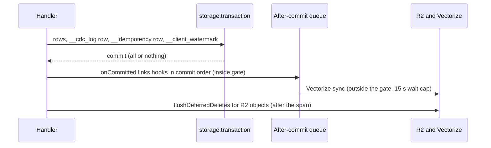
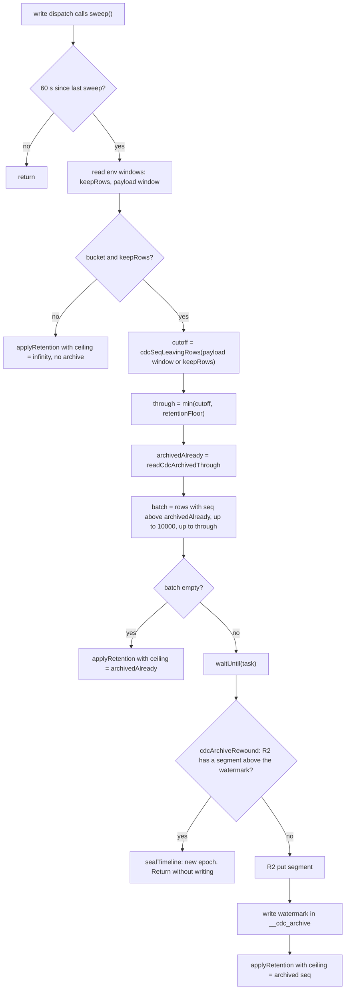

# Storage tiers: what lives where, and how data moves

Lunora keeps data in four places: Durable Object SQLite, D1 or Hyperdrive, R2, and short-lived queues. The schema picks the tier for each table. Data does not move between tiers by itself, with one exception: the change log moves from SQLite to R2 before it is deleted. This page shows the tiers, the exact order of the archive steps, and every crash window.

## Words on this page

- **Tier.** A kind of storage with its own speed, cost and rules. Hot data is fast and small. Cold data is cheap and large.
- **R2 bucket, object, key.** R2 stores objects in a bucket. Each object has a key (its name), a body and metadata. R2 lists keys in lexicographic order. See [Cloudflare services](02-cloudflare-services.md), section "R2".
- **Strongly consistent.** After R2 confirms a write, every reader sees it. R2 is strongly consistent (`r2/reference/consistency.mdx`).
- **Segment.** One R2 object that holds a batch of change log rows.
- **Sweep.** One cleanup pass over the log. It archives old rows first and deletes them after.
- **Watermark (archive).** The last `seq` that is safely in R2. See the three kinds of watermark in [Replication and read scaling](07-replication-and-read-scaling.md).
- **Lifecycle rule.** An R2 rule that deletes or moves objects by age. R2 applies it by itself, usually within 24 hours (`r2/buckets/object-lifecycles.mdx`). Lunora never deletes archive segments, so the operator must set a rule.
- **Crash window.** A short span between two steps in which a crash leaves a half-done state. The tables below list each window and its recovery.
- **Compare-and-swap.** A write that succeeds only if the current value is still the one the writer read. R2 supports this through conditional writes.

## The tiers

| Tier | Holds | Written by | Moves to another tier? |
|------|-------|-----------|------------------------|
| Shard SQLite (hot) | Root and `.shardBy()` tables, change log, caches, idempotency, metrics | Mutations inside a transaction | Change log rows move to R2 (archive). Tables move only by manual export and import |
| D1 or Postgres/MySQL | `.global()` tables and the global change log | Writes from any shard, one statement or one `batch` | No automatic move. Log rows are deleted by time |
| R2 (cold) | Files, upload state, change log segments, newline-delimited JavaScript Object Notation (NDJSON) backups, log archive | Storage facade, retention sweep, backup cron, Pipelines | Segments are never deleted by Lunora |
| Queues | In-flight background messages | `ctx.queues.send` | Dead letter queue after retries |
| Durable Object Workers KV (a key-value store) application programming interface (API) | Scheduler jobs, registry entries, secret values | Scheduler, registry | No |
| Workers KV | App data through `ctx.kv` | The app | No |

Source: `architecture.mdx` (data tiers), `cloudflare.ts:112-124`.

A mutation that writes a sharded table and a global table is not atomic. The shard commit and the D1 write are separate calls. Going global is "a one-way trip for atomicity" (`concepts/sharding.mdx`). The global write can fail alone.

## Write order inside one mutation



R2 object deletes happen after the transaction. The generated code comment says: "an R2 delete cannot roll back, so a delete issued from within a transaction that later aborts destroys data the surviving row still points at". A failed cleanup is logged with the object key, not turned into a failed response (`codegen/src/emit/shard-dispatch.ts:285-296`).

## The change log archive in R2

Without an archive, retention is a cliff. A connector that is offline over a weekend must re-seed the whole shard, because a few megabytes of log were deleted to keep SQLite small (`ctx-db-cdc-archive.ts:1-22`). The archive turns the cliff into a tier: hot rows in SQLite, cold rows in R2.

Archiving is on when the binding `LUNORA_CDC_ARCHIVE` is a bucket with `get`, `list` and `put` (`cdcArchiveBucket`, `cdc-retention.ts:154`). Row retention defaults on, so binding a bucket is the switch.

### Key layout

```ts
// packages/shard-engine/src/ctx-db-cdc-archive.ts:106 and :116
const scopePrefix = (scope) => `cdc/${encodeURIComponent(scope.shard)}/${encodeURIComponent(scope.epoch)}/`;
const segmentKey = (scope, to) => `${scopePrefix(scope)}${padSeq(to)}.json`;
```

A key looks like `cdc/channel-7/3f2a.../0000000000012345.json`. The last part is the last `seq` of the segment, padded to 16 digits (`SEQ_KEY_WIDTH = 16`, line 44). The body is `{ changes, from, to }` (`CdcSegment`, line 72).

| Design choice | Reason (from the comments) |
|---------------|----------------------------|
| Key by the last `seq` | One `list({ startAfter })` call finds every segment a consumer still needs. No manifest to keep consistent |
| Zero padding | R2 compares keys as strings, so `9` would sort after `10` |
| 16 digits | `Number.MAX_SAFE_INTEGER` has 16 digits |
| Epoch in the prefix | A forked timeline gets an empty archive by construction. Old segments become unreachable |
| Shard name in the prefix | Each shard has its own timeline |

### The sweep, step by step

Code: `CdcRetentionRunner.sweep`, `packages/do/src/cdc-retention.ts:226-411`.



`applyRetention` (`cdc-retention.ts:506`) runs two bounded steps. First, `compactCdcDocs` strips post-images past the payload window. Then `trimCdcChanges` deletes rows past the row window. Both take `Math.min(cutoff, floor, maxSeq)`. The floor is read again after the `await`, because a subscriber may have advanced or arrived during the upload (`cdc-retention.ts:484-505`).

The core rule is written in the comments of `writeCdcArchivedThrough` and `archiveCdcSegment`: **archive first, destroy second, and never in the same turn**. The watermark advances only after the `put` resolves, and before anything destructive runs (`ctx-db-cdc-archive.ts:159-171`).

### Why the watermark lives in SQLite

The table `__cdc_archive` has one row, `seq INTEGER` (`ctx-db-cdc-archive.ts:119-133`). It is shard state, not something derived from R2. R2 lists in ascending order only. Finding "the newest segment" would be a walk to the end of the archive on a write path (`ctx-db-cdc-archive.ts:135-150`).

The sweep reads from the watermark, not from the oldest live row. The reason is a key collision. Two segments that end at the same `seq` are one object, and the second `put` wins. If a floor stopped a trim, rows would be archived and still be the oldest rows next time. Re-archiving them would overwrite the earlier segment with a shorter one whose payloads compaction already stripped. The rows would then be gone from both SQLite and R2 (`cdc-retention.ts:312-323`, `ctx-db-cdc-archive.ts:173-193`).

### Read-back

When a consumer's cursor is below the live floor, `syncPage` catches only `CDC_LOG_TRIMMED`. It reads the archive and answers from there (`cdc-retention.ts:428-482`). `CDC_PAYLOAD_COMPACTED` is not recoverable, because the archive holds the same doc-less rows.

`readArchivedCdcChanges` (`ctx-db-cdc-archive.ts:368-432`):

1. Clamp the page to between 1 and 10,000 rows (default 1,000).
2. `list({ limit: 32, prefix, startAfter: prefix + pad(sinceSeq) + ".json" })`. The constant is `MAX_SEGMENTS_PER_READ = 32`. A segment ending exactly at the cursor sorts equal to `startAfter` and is excluded.
3. Fetch segments one by one. Stop at the first hole or when the page is full.
4. Take coverage from the rows present, not from the declared `from` and `to`. A foreign object with `from: 1, to: 1000` and one row must not move the cursor over 999 changes. `appendContiguousRun` checks `change.seq === reached + 1` for each row (line 321).
5. Stop at the first doc-less insert or update (`serveableChanges`, line 291).
6. If the first returned row is not `sinceSeq + 1`, return `undefined`. The caller then re-throws the original refusal. The consumer re-seeds.

If R2 fails, the original 409 is thrown, not an opaque 500 (`cdc-retention.ts:459-470`).

Not verified: the call uses the option `startAfter` of the R2 binding. The S3-compatible listing of R2 documents `start-after` (`r2/api/s3/api.mdx`). The reference of the Workers binding in the documentation snapshot that I read lists `limit`, `prefix`, `cursor`, `delimiter` and `include`, and not `startAfter` (`r2/api/workers/workers-api-reference.mdx`, `R2ListOptions`). I could not confirm the option for the binding from the docs.

**Aha: the segment `from` and `to` are claims, not facts.** The bucket is operator-supplied. Nothing forces it to be dedicated. So the reader trusts only the rows it holds.

### Crash and failure windows

| Failure point | State after | Recovery |
|---------------|-------------|----------|
| Crash before the `put` | Nothing changed | Next sweep repeats |
| `put` fails (R2 error) | Watermark unchanged. Retention for this pass is skipped | Error recorded as `cdc:archive`. Log stays larger until a later sweep |
| Crash after `put`, before the watermark write | A segment sits above the watermark | Next sweep sees it as a rewind: `cdcArchiveRewound` is true. The shard mints a new epoch and skips that cycle. All consumers re-seed once. The comment calls this "the benign false positive" (`ctx-db-cdc-archive.ts:229-238`). The orphan segment stays in R2 under the old epoch |
| Crash after the watermark, before the trim | Rows archived and still in SQLite | Next sweep trims, bounded by the watermark |
| point-in-time recovery (PITR) restore | Watermark and epoch roll back. R2 keeps segments | `cdcArchiveRewound` is true. Epoch is re-minted. The new timeline writes under a new prefix |
| R2 lifecycle rule deletes a segment | A hole | Read-back returns a prefix and then stops. The consumer re-seeds if its next row is missing |
| R2 unreachable on read | Original 409 returned | Consumer re-seeds |
| Writes faster than archive | Log grows | See below |

### The throughput ceiling

One segment is written per sweep, and a sweep runs once per 60 seconds, with at most 10,000 rows per segment. That is about 166 changes per second per shard. The code says so: "a shard committing more than 10k changes per sweep interval archives more slowly than it writes and its log grows" (`cdc-retention.ts:326-331`, a `ponytail:` note).

With a bucket bound, the delete ceiling is the archive watermark. So when writes outpace archiving, the log keeps growing past the row window and nothing trims it. The size warning only covers the `__root__` shard. This is a risk for busy shards (see [Critical assessment](15-critical-assessment.md)).

R2 is never cleaned by Lunora. "The archive grows without bound by design". The operator sets a lifecycle rule (`ctx-db-cdc-archive.ts:189-192`).

## Other R2 data

### Backups

The cron backup streams every shard's rows into one newline-delimited JavaScript Object Notation (NDJSON) object under `backups/lunora-backup-<id>.ndjson`. A sidecar `.manifest.json` holds the bytes, the rows, a Secure Hash Algorithm 256-bit (SHA-256) checksum and the table list (`backup-layout.ts:60-91`). Facts:

- The snapshot is capped at 24 MiB of NDJSON (`MAX_SCHEDULED_BACKUP_BYTES`, `scheduled-backup.ts`). The comment admits the rows are already in memory before the first check, so this is not a memory bound.
- Retention removes at most 200 snapshots per run, 8 deletions at a time (`MAX_PRUNE_DELETES`, `PRUNE_DELETE_CONCURRENCY`), and only sidecars that carry its own cron expression in metadata.
- The command line tool writes the same layout to the same bucket.

For anything larger, the answer is the change data capture (CDC) tap, the replay path, or native point-in-time recovery (PITR) (30 days).

### Resumable uploads

State is a JavaScript Object Notation (JSON) object per upload under `_lunora/uploads/`. R2 is strongly consistent and supports conditional puts (`r2/api/workers/workers-api-reference.mdx`, "Conditional operations"), so a compare-and-swap lease works without a Durable Object. Chunks are coalesced into 5 MiB parts. R2 multipart needs equal parts except the last. Each part except the last must be at least 5 MiB (`r2/objects/upload-objects.mdx`, "Part size limits"). A lease lasts 60,000 ms (`LEASE_MS`, `r2-binding-upload-storage.ts:102`). State objects are never deleted. The operator must set a lifecycle rule (`r2-binding-upload-storage.ts:80-95`).

### Log archive

`pipelineLogSink` sends records to a Pipeline that writes Iceberg tables in R2. The admin route queries with R2 SQL (Structured Query Language) on the server (`cloudflare.ts:172`).

## Where to go next

Read [D1 and global tables](09-d1-global-and-hyperdrive.md) for the other half of the data tiers.
