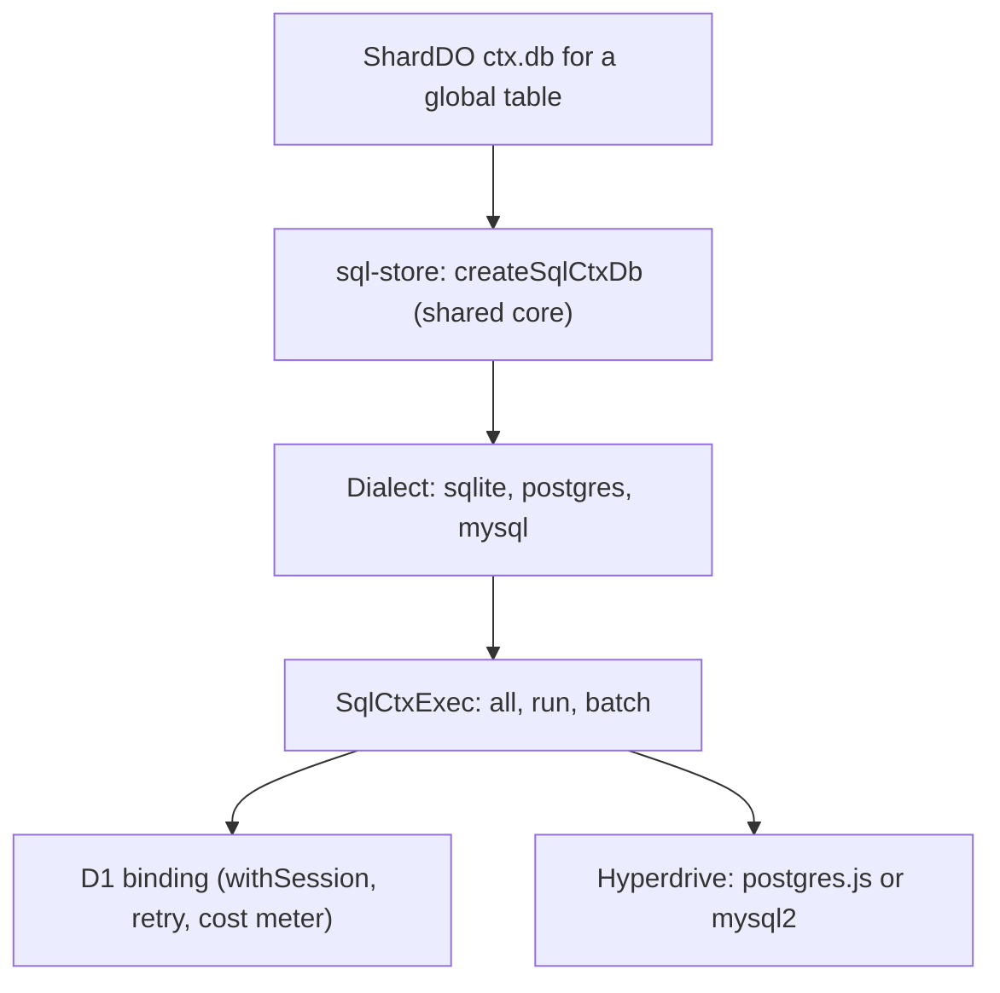
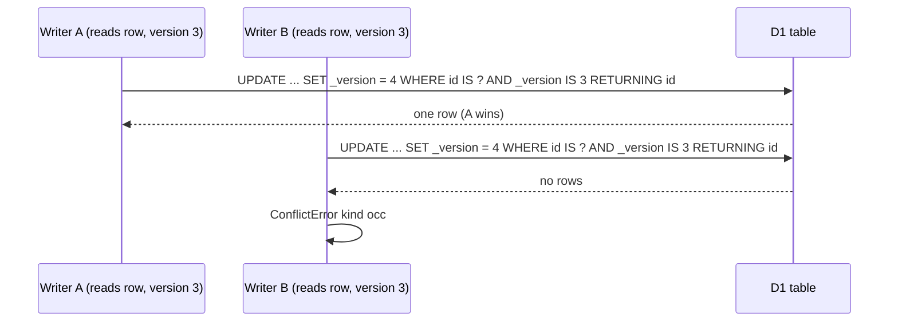

# Global tables: D1 and Hyperdrive behind one store core

A `.global()` table is readable from every shard. It cannot live in one shard's SQLite. Lunora stores it in D1 (a Cloudflare Structured Query Language (SQL) database built on SQLite) or, as an option, in Postgres or MySQL reached through Hyperdrive. One store core, `@lunora/sql-store`, runs on all three engines through a dialect object.

## Layers

Source: `packages/d1/src/d1-ctx-db.ts:1-20`, `packages/hyperdrive/src/global.ts:50-60`, `packages/sql-store/src/dialect.ts`.

The D1 module is thin. It calls `createSqlCtxDb({ ...options, dialect: sqliteDialect })` (`d1-ctx-db.ts:32`). The Hyperdrive module does the same with `postgresDialect` or `mysqlDialect` (`global.ts:50`).

## Storage layout

A global table has one column per declared field. This differs from shard tables, which use a JavaScript Object Notation (JSON) document column. The limit is 100 columns per D1 table. The advisor lint `global_table_near_column_limit` warns at 90 (`limits.mdx`). Every global table also has a `_version` column for optimistic concurrency (`shared/occ-version-column.ts:27`).

## Optimistic concurrency without transactions

D1 has no interactive transactions. So a write is one conditional statement. Patch, replace and delete use `UPDATE ... SET ..., _version = COALESCE(_version, 0) + 1 WHERE id IS ? AND _version IS ? RETURNING id`. The `IS` compare is NULL-safe. An empty `RETURNING` set means a concurrent writer won, and the store raises `ConflictError` of kind `occ` (`sql-store/src/ctx-db.ts:2586-2650`). MySQL has no `RETURNING`, so it reads the affected-row count. The retry loop for `patchIf` and operator patches is bounded: `OCC_RETRY_ATTEMPTS = 16` (`packages/sql-store/src/ctx-db.ts:1520`).

The guard column is one parameter wide. An earlier design bound one parameter per column and crossed D1's 100-parameter limit at 50 fields (`shared/occ-version-column.ts:1-26`). The version is bumped in SQL: `COALESCE(_version, 0) + 1`. Inserts leave it NULL.

D1 is the single writer for each of its databases. The comment in the capability matrix says "concurrent callers stay atomic although D1 calls do not hold the Durable Object's input gate" (`cloudflare.ts:39-42`).

**Aha: the input gate does not help on D1.** A Durable Object's input gate keeps events in order only for storage calls. A D1 call is a network call. During it, other requests run. So a read-then-write on D1 needs a compare-and-set in SQL.

## Sessions, bookmarks and retry

`D1Client.withSession(bookmark)` opens a session pinned to a bookmark. The first request has none and uses `"first-unconstrained"`. `getBookmark()` returns the position after a write (`d1-client.ts:86-148,195`).

The code splits reads from writes for retry:

- `all` and `first` retry, but only if the SQL starts with `select`, `pragma` or `explain` (`READ_ONLY_STATEMENT`, `retry.ts:112-122`). A `WITH` statement is excluded.
- `run` never retries. D1 errors do not say whether the write applied.
- `all` also runs `UPDATE ... RETURNING`, so the test is on the SQL text, not the method name.

Retry rules (`retry.ts:75-195`):

| Rule | Value |
|------|-------|
| Attempts, including the first | 3 (`DEFAULT_ATTEMPTS`) |
| Backoff | full jitter, base 50 ms, doubling, cap 1,000 ms |
| A failure slower than 2,000 ms | not retried when no timeout or deadline is set (`SLOW_FAILURE_MS`) |
| Retried messages | `storage operation exceeded timeout`, `network connection lost`, `internal error while starting up d1 db storage`, `exceeded its memory limit`, `caused object to be reset` |

The message list is "deliberately specific". A generic "internal error" also matches `too many SQL variables`, which fails the same way every time (`retry.ts:60-70`).

The generated `buildExec` wraps the exec in `retryingExec`. It reports the bookmark after every call, including a read, because the bookmark only moves forward (`app-helpers.ts:364-446`).

## Per-query cost metering

D1 bills rows scanned, not rows returned. A missing index can raise the bill a thousand times with no deploy. So every query records `rows_read`, `rows_written` and `duration` from `meta`, tagged `verb:table` such as `select:users`. The tag has low cardinality on purpose (`d1/src/query-metrics.ts:1-30`).

## Provisioning

Creating tables one statement at a time cost about nine round trips per table. A 42-table schema needed 368 calls, and the first request waited about a minute. `ctx-db-global-provisioning.ts` reads the catalog in at most two queries, plans DDL in memory and sends it through `batch`, which is atomic on D1. Anything it cannot decide in memory goes to the sequential path (`ctx-db-global-provisioning.ts:1-30`). The result is memoized per `provisionScope`, an object that outlives the request, such as the D1 binding (`sql-store/src/ctx-db.ts:369`). The comment warns that a per-request object shares nothing and "looks exactly like not passing it".

## Point-read batching

`Promise.all(ids.map(id => ctx.db.get("authors", id)))` is one network round trip per id against D1. The batcher collects ids requested in the same tick, per table, and sends one `WHERE id IN (...)` query for up to 50 ids (`DEFAULT_MAX_BATCH = 50`, `point-read-batcher.ts:32`). It uses `queueMicrotask`. Chunks run one after another to avoid a flood of queries.

## The global change log

D1 stores a `__cdc_log` too. It is shared by all shards. No shard owns it, so retention uses a lease row.

| Item | Value | Source |
|------|-------|--------|
| Lease table | `__cdc_sweep`, one row, `lease_until` | `sql-store/src/ctx-db.ts:957` |
| Lease length | 60,000 ms, which also sets the fleet-wide sweep rate | line 970 |
| Attempt throttle | 30,000 ms per isolate | line 993 |
| Rows per sweep | 10,000, a fifth of the shard limit of 50,000 | line 982 |
| Late-commit window | 10,000 ms | line 1313 |

A writer wins the lease by an `UPDATE ... WHERE lease_until <= now` with `RETURNING`, or by affected rows on MySQL (`acquireSqlCdcSweepLease`, line 1080). Retention is by time (`ts <= cutoff`), not by rows. A row count means nothing to any single consumer of a shared log (`sweepSqlCdcRetention`, line 1120). The delete wraps its sub-select in a derived table because MySQL rejects `LIMIT` inside `IN (subquery)`.

On Postgres and MySQL, a sequence can have holes: a transaction takes a `seq` and commits later. The change feed holds its cursor below a hole while the next row is younger than 10 seconds (`CDC_LATE_COMMIT_WINDOW_MS`). D1 skips this, because it has a single writer (`packages/sql-store/src/ctx-db.ts:1370-1385`).

A shard learns about global changes by polling. A `.global()` shape cannot be poke-live, because the log is not in the shard. An alarm runs every 2,000 ms (`GLOBAL_SHAPE_POLL_INTERVAL_MS`, `shard-do.ts:2046`). It asks the global log which tables changed and re-reads only those shapes. Every 30,000 ms it resyncs regardless (`GLOBAL_SHAPE_RESYNC_MS`, line 2069), in case another system wrote the same database. A membership above 50,000 rows fails closed (`GLOBAL_SHAPE_MAX_ROWS`, line 2060). Sockets on the same shape share one read per tick (`global-poll-tick.ts`).

The global log is the one place where a hard delete is silent for some readers. If a poller's cursor falls below the floor, it re-reads every shape. This is "slow for one tick, not wrong" (`packages/sql-store/src/ctx-db.ts:1100-1112`).

## Hyperdrive as a global backend

`.global({ backend: "hyperdrive" })` stores the table in Postgres or MySQL. The schema snapshot encodes the backend (`global:d1` or `global:hyperdrive`), so switching counts as a breaking change (`codegen/src/schema-drift.ts:50-70`). Drivers are optional peer dependencies. The writer is cached on the Durable Object and rebuilt after hibernation (`hyperdrive/src/global.ts:15-18`).

Hyperdrive also offers `ctx.sql` for action code and a `pgvector` index helper (`hyperdrive/src/pg-vector.ts`). Neither is reactive.

## Trade-offs

Good:

- One store core, three engines.
- Atomic conditional writes with no lock.
- Provisioning in a few batches.
- Retry only where safe.

Bad:

- `.global()` shapes poll at 2 s and are not poke-live.
- A write to a shard table and a global table is two separate commits.
- D1 allows 100 bound parameters and 5 compound select terms. Lunora must work around both (`limits.mdx`).
- A hot global table has one D1 primary. Replicas help reads only.

## Where to go next

Read [Realtime engine](10-realtime-engine.md).
