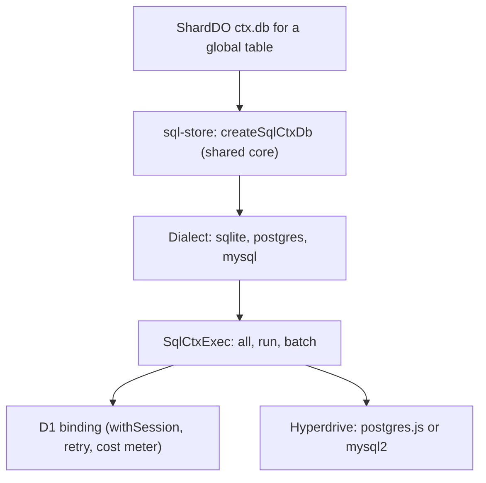
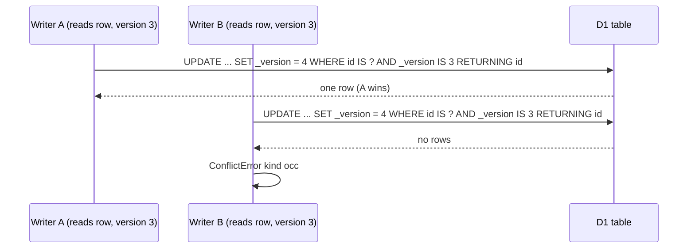
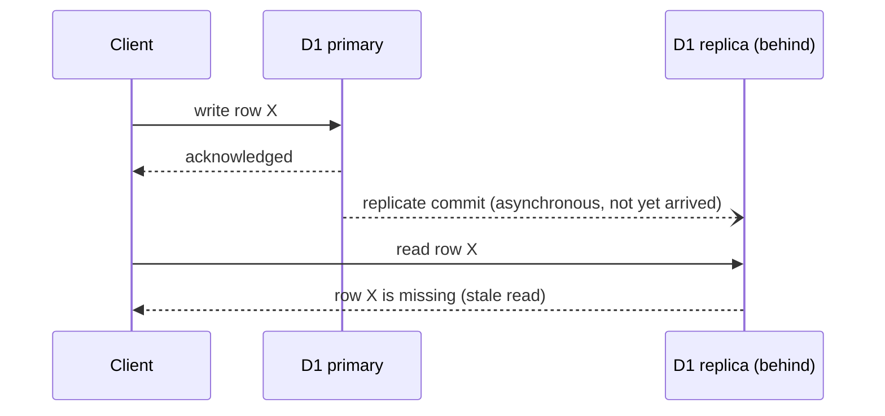
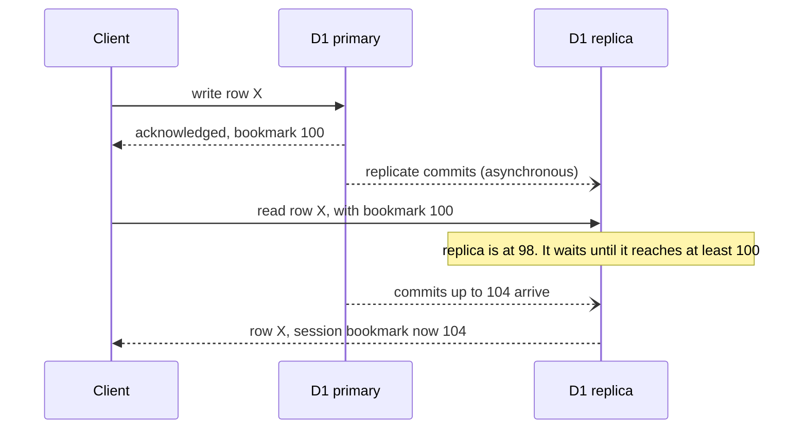
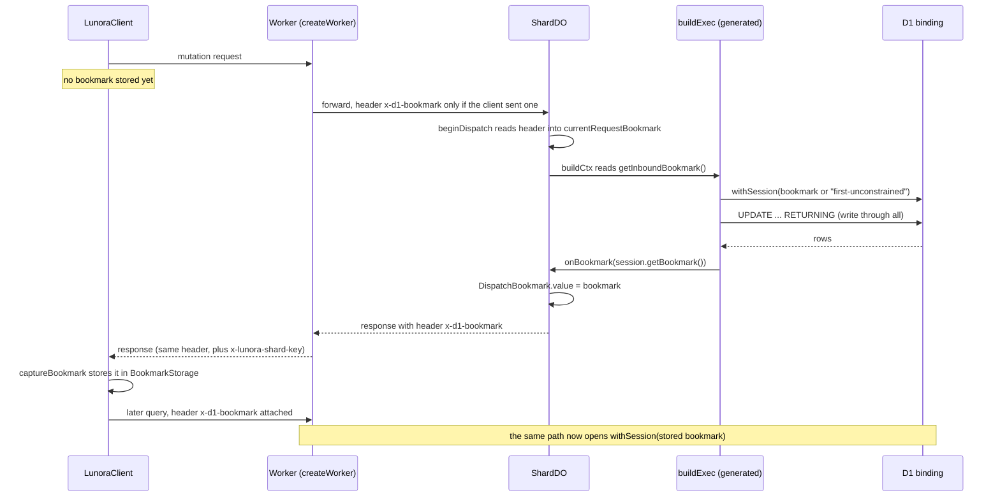
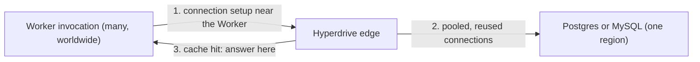

# Global tables: D1 and Hyperdrive behind one store core

A `.global()` table is readable from every shard. It cannot live in one shard's SQLite. Lunora stores it in D1 (a Cloudflare Structured Query Language (SQL) database built on SQLite) or, as an option, in Postgres or MySQL reached through Hyperdrive. One store core, `@lunora/sql-store`, runs on all three engines through a dialect object.

This page also owns the explanation of D1 read replication and the **bookmark**. Other pages only point here. Jump to the section named "D1 read replication, sessions and bookmarks" if you only need that part.

## What D1 is, in short

D1 is the managed SQLite database of Cloudflare. A Worker talks to it through a binding. The binding has three calls that matter here: `prepare` for one statement, `batch` for many statements, and `withSession` for read replication.

Each D1 database runs inside one Durable Object. The database is single-threaded and runs one query at a time. So its throughput depends on how long each query takes. One database holds at most 10 gigabytes, and Cloudflare cannot raise this limit (`src/content/partials/d1/faq-limits.mdx`, "Concurrency and throughput").

D1 runs the statements of one `batch` call as one Structured Query Language (SQL) transaction. If one statement fails, D1 rolls back the whole batch (`d1/worker-api/d1-database.mdx`, `batch()`). The binding has no call that opens a transaction and keeps it open across several calls. This fact drives the write design below.

D1 bills by rows read and rows written. A query that scans a whole table is billed for every row it scans, not for the rows it returns (`d1/best-practices/use-indexes.mdx`, "Indexes and your bill").

Two words come back often on this page. A **global table** is a table that every shard can read. A **dialect** is a small object that tells the shared store how one database engine differs from another. It covers column types, how to read the number of changed rows, and how to spot a unique-key violation. The shared store builds the statements themselves (`packages/sql-store/src/dialect.ts:1-17`).

## Layers

Source: `packages/d1/src/d1-ctx-db.ts:1-20`, `packages/hyperdrive/src/global.ts:50-60`, `packages/sql-store/src/dialect.ts`.

The D1 module is thin. It calls `createSqlCtxDb({ ...options, dialect: sqliteDialect })` (`d1-ctx-db.ts:32`). The Hyperdrive module does the same with `postgresDialect` or `mysqlDialect` (`global.ts:50`).

## Storage layout

A global table has one column per declared field. This differs from shard tables, which use a JavaScript Object Notation (JSON) document column. The limit is 100 columns per D1 table. The advisor lint `global_table_near_column_limit` warns at 90 (`limits.mdx`). Every global table also has a `_version` column for optimistic concurrency (`shared/occ-version-column.ts:27`).

## Optimistic concurrency without transactions

Optimistic concurrency control (OCC) lets many writers work without locks. Each writer reads a row and its version number. Each writer then writes only if the version has not changed. If the version changed, another writer won, and this writer must retry or fail.

A Worker cannot hold a D1 transaction open across several calls. The atomic unit is one `batch` call. So a write is one conditional statement. Patch, replace and delete use `UPDATE ... SET ..., _version = COALESCE(_version, 0) + 1 WHERE id IS ? AND _version IS ? RETURNING id`. The `IS` compare is NULL-safe. An empty `RETURNING` set means a concurrent writer won, and the store raises `ConflictError` of kind `occ` (`sql-store/src/ctx-db.ts:2586-2650`). MySQL has no `RETURNING`, so it reads the affected-row count. The retry loop for `patchIf` and operator patches is bounded: `OCC_RETRY_ATTEMPTS = 16` (`packages/sql-store/src/ctx-db.ts:1520`).

The guard column is one parameter wide. An earlier design bound one parameter per column and crossed D1's 100-parameter limit at 50 fields (`shared/occ-version-column.ts:1-26`). The version is bumped in Structured Query Language (SQL): `COALESCE(_version, 0) + 1`. Inserts leave it NULL.

D1 is the single writer for each of its databases. The comment in the capability matrix says "concurrent callers stay atomic although D1 calls do not hold the Durable Object's input gate" (`cloudflare.ts:39-42`).

**Aha: the input gate does not help on D1.** An input gate is the Cloudflare rule that holds back new events while a Durable Object waits for its own storage. See [Cloudflare services](02-cloudflare-services.md) for the full explanation. The gate covers storage calls only. A D1 call is a network call to another object. During it, other requests run. So a read-then-write on D1 needs a compare-and-set in SQL.

## D1 read replication, sessions and bookmarks

A bookmark is a string that names one position in the commit history of one D1 database. Lunora gives the bookmark to the client after a write. The client sends it back with later reads. D1 then makes sure the read sees that write, even when a copy of the database answers the read. This guarantee is called read-your-writes.

This section explains the idea from the beginning. Read it in order. Each part uses words from the part before it.

### Primary and read replicas

D1 without read replication has one database instance in one place. Cloudflare calls it the primary database instance. Every query, read or write, goes to that instance. A user far from the primary waits for the network round trip (`d1/best-practices/read-replication.mdx`, "Primary database instance vs read replicas").

D1 with read replication adds read-only copies of the database. Cloudflare calls them read replicas. D1 creates a replica in every supported region. The docs list six: Eastern North America (ENAM), Western North America (WNAM), Western Europe (WEUR), Eastern Europe (EEUR), Asia-Pacific (APAC) and Oceania (OC). The docs add that the list can change (`read-replication.mdx`, "Read replica locations").

Three rules follow from the Cloudflare documentation:

1. **Writes always go to the primary.** A replica forwards a write to the primary. Replicas only speed up reads (`read-replication.mdx`, note after the first diagram).
2. **Replication is asynchronous.** The primary sends changes to each replica after it commits them. A replica "may be arbitrarily out of date" at any moment.
3. **Replication lag is the delay.** It is the time between a commit on the primary and the arrival of that commit on one replica (`d1/best-practices/read-replication.mdx` and `src/content/glossary/d1.yaml`, term "replica lag").

Read replication is a setting of the database. An operator turns it on in the Cloudflare dashboard (Settings, Enable Read Replication) or with the Representational State Transfer (REST) call `read_replication.mode: auto`. Lunora does not turn it on. A search of `packages/*/src` and `apps/docs/src` for `read_replication` finds nothing. Lunora only uses the Sessions application programming interface (API), which is the client side of the feature.

The Cloudflare docs also say that the Sessions API works on a database that has no replicas. In that case every query goes to the primary, and the bookmark has no visible effect (`read-replication.mdx`, "Disable read replication via REST API"). So the Lunora code is safe with replication on or off.

### The problem a bookmark solves

Without any extra information, a read that follows a write can go to a replica that has not yet received the write. The client sees old data. The Cloudflare docs show four steps. The client writes to the primary. It receives the acknowledgement. It reads from a replica. It gets a result without the write (`read-replication.mdx`, "Without a consistency model framework").

### Sessions and bookmarks

A **session** is one logical series of queries, for example all queries of one browser session. The Worker binding creates a session with `env.DB.withSession(...)`. All queries in one session get sequential consistency (`d1/worker-api/d1-database.mdx`, `withSession()`).

A **bookmark** is a string that stands for the state of the database at one point in time. The Cloudflare glossary says it "represents the state of a database at a specific point in time". The docs add three facts (`d1/reference/time-travel.mdx`, "Bookmarks" and `src/content/glossary/d1.yaml`):

- Bookmarks sort as plain strings. A smaller bookmark is an older state.
- A bookmark can be derived from a time stamp.
- D1 Time Travel (restore to a past time) uses the same bookmarks. Time Travel refuses a bookmark older than 30 days.

Lunora treats the bookmark as an opaque string. The client stores it and sends it back. No Lunora code parses it or compares two bookmarks. The Worker even refuses to pick the "latest" of two bookmarks from different shards, because it cannot compare them (`packages/runtime/src/create-worker.ts:5136-5142`).

A bookmark comes from the session. After a query, `session.getBookmark()` returns "the latest version of the database seen by the last query executed within the Session". It returns `null` when the session ran no query (`d1-database.mdx`, `getBookmark`). Lunora wraps this call as `D1Session.getBookmark()`, which maps `null` to `undefined` (`packages/d1/src/d1-client.ts:145`).

### The three ways to start a session

`withSession` takes one optional argument. The argument decides where the first query of the session goes (`d1-database.mdx`, `withSession()`).

| Argument | First query goes to | Later queries | Best for |
|----------|--------------------|---------------|----------|
| `first-unconstrained` (the default when no argument is given) | Any instance: the primary or any replica | Sequentially consistent with the first | Lowest latency from the first query. The data may be old |
| `first-primary` | The primary | May use replicas, sequentially consistent | The very first read must be current |
| A bookmark string | An instance at least as new as the bookmark | Sequentially consistent | Continuing a session from an earlier request |

**What happens with no bookmark.** Lunora passes `first-unconstrained` on purpose, and does not rely on the default. The first query may reach any replica, and that replica may be behind. This is correct for a client that has not written anything yet: there is no write of its own to miss. The code comment says so (`packages/d1/src/d1-client.ts:61-67` for the constant, `d1-client.ts:195-198` and `packages/codegen/src/emit/app-helpers.ts:370` for the two call sites).

Lunora never uses `first-primary`. The only mention is a comment that tells a caller who needs a strongly consistent first read to pass `"first-primary"` as the bookmark (`d1-client.ts:188-193`). A search for the string in `packages`, `shared` and `apps` finds no other use.

### How a replica uses the bookmark

When a replica gets a query with a bookmark, it compares the bookmark with its own position. If the replica is behind, it waits until replication brings it up to the bookmark. Then it serves the query. The Cloudflare docs give an example with bookmarks 100 and 104 (`read-replication.mdx`, "With Sessions API"):

The bookmark that comes back (104) can be larger than the bookmark that went in (100). The reason is that other clients also wrote to the primary, and the replica applied their commits too. The session bookmark only moves forward.

The docs say the replica "will wait". They do not say how long it waits. They do not say whether D1 may send the read to the primary instead. Lunora does not depend on either detail.

D1 calls the resulting guarantee **sequential consistency**. D1 builds one global order of all operations on the database. A session never goes back in that order. The docs list four properties (`read-replication.mdx`, "Sessions API provides sequential consistency"):

- **Monotonic reads.** A later read never sees an older version than an earlier read in the same session.
- **Monotonic writes.** If you write A and then B, every observer sees A before B.
- **Writes follow reads.** A write is based on the value that the session just read.
- **Read my own writes.** After you write, all later reads in the session see the write.

The Sessions application programming interface (API) exists only in the Worker binding. It is not available through the Representational State Transfer (REST) API (`read-replication.mdx`, "Known limitations"). Lunora runs inside a Worker, so this limit does not affect it.

### How Lunora carries the bookmark from request to request

One session lives for one request. A Durable Object builds a new D1 session for each dispatch. A session cannot cross two requests. So Lunora moves the bookmark in a Hypertext Transfer Protocol (HTTP) header named `x-d1-bookmark`. The client plays the part of the browser session in the Cloudflare example.

Each hop, with its source:

| Step | What happens | Source |
|------|--------------|--------|
| 1 | The client keeps one bookmark in a `BookmarkStorage` object. The default store is a variable in memory. A caller can pass another store with the option `bookmarkStorage` | `packages/client/src/types.ts:92-95`, `client/src/bookmark.ts:4-17`, `client/src/lunora-client.ts:1236` |
| 2 | A `query` call attaches the stored bookmark as the header. Nothing else is needed | `lunora-client.ts:2932-2942`, `rpcRequestHeaders` at `lunora-client.ts:6749-6754` |
| 3 | A `mutation`, an `action` and a batch call read the header from the response and store it. A plain `query` does not store it | mutation `lunora-client.ts:5119-5121`, action `lunora-client.ts:3036-3041`, batch `lunora-client.ts:4932-4936`, capture code `lunora-client.ts:6815-6821` |
| 4 | The Worker copies the inbound header to the shard request | `packages/runtime/src/create-worker.ts:2252` and `2278-2280` (`resolveForwardContext`) |
| 5 | The shard reads the header at the start of each dispatch | `packages/do/src/shard-do.ts:15437` (`beginDispatch`) |
| 6 | The generated context passes it to the global database as `request.bookmark` | `packages/codegen/src/emit/shard.ts:662-668` |
| 7 | `buildExec` opens the D1 session with the bookmark, or with `first-unconstrained` | `app-helpers.ts:370` |
| 8 | After each `all`, `run` and `batch` call, `buildExec` reads `session.getBookmark()` and calls `onBookmark` | `app-helpers.ts:399,436,446` |
| 9 | `onBookmark` writes the value to the dispatch's own sink | `shard.ts:667`, `shard-do.ts:1175-1177` (`DispatchBookmark`) |
| 10 | The shard puts the sink value in the response header | `shard-do.ts:8838` and `bookmarkHeaders` at `shard-do.ts:5829,8657` |
| 11 | The Worker passes the header on. For a request from another origin, it lists `X-D1-Bookmark` in the headers that Cross-Origin Resource Sharing (CORS) exposes, so the browser lets the script read it | `create-worker.ts:4845-4861`, `packages/runtime/src/security-headers.ts:590-591` |

CORS is the browser rule that hides most response headers from a script on another origin. If the exposed list did not name the header, `response.headers.get` would return `null` and nothing would warn you (`security-headers.ts:575-589`).

### Why the writes report the bookmark, not only the reads

The function `buildExec` reports the bookmark after `all`, after `run` and after `batch`. The first one is the surprise. D1 runs `UPDATE ... RETURNING` through `all`. The compare-and-set write that Lunora uses for `patch`, `replace` and `delete` is such a statement. If `all` did not report, the bookmark of those writes would be lost. The comment says the next read could pin a replica "that has not seen them: read-your-writes lost on the exact path the bookmark exists for" (`app-helpers.ts:388-398`).

Reporting after a plain `SELECT` is harmless. The session bookmark only moves forward, and the sink keeps the last value.

### The per-dispatch sink

The shard keeps the outbound bookmark in a small object that is created for each dispatch. The type is `DispatchBookmark` with one field, `value` (`shard-do.ts:1156-1177`). The object is passed down the call chain by value.

A field on the shard instance would not work. A mutation holds the gate, so no other request runs. An action does not hold the gate. An action writes a global row, then waits for a third party. During that wait other requests run. They clear a shared field. The action then answers with no bookmark, and the client's next read is unpinned. The comment describes this bug and its fix (`shard-do.ts:1156-1174`).

The inbound bookmark follows the same rule. It is part of the `RequestScope` that the shard saves and restores around each `await`. Without it, a queued mutation could read the D1 pin of another request (`shard-do.ts:1031-1038`, `captureRequestScope` at `shard-do.ts:9173-9177`, `restoreRequestScope` at `shard-do.ts:9201-9204`).

### A batch of calls

A batch holds many calls. The shard runs them in order. It keeps the bookmark of the last call that produced one (`shard-do.ts:10560-10589`). The Worker may send entries to several shards. Each shard has its own D1 sessions and its own bookmark. The Worker returns a bookmark only when exactly one shard produced one. Otherwise it returns none. The reason is that a bookmark from the wrong shard would pin the client to a position that may be older (`create-worker.ts:5136-5142`, `5256-5259`, `5309-5312`).

### Limits of the design

These are places where the bookmark does not protect the client. Items 1, 3 and 5 are my reading of the code. I did not run the code.

1. **Two plain reads can go backwards.** A `query` does not store the bookmark that it receives (`lunora-client.ts:2932-2942`). Suppose a client has no bookmark and calls `query` twice. Each call opens a fresh `first-unconstrained` session. The second call can reach an older replica. The Cloudflare guarantee of monotonic reads holds inside one session, and Lunora's session lasts for one request.
2. **A page reload drops the bookmark.** The default store is in memory (`client/src/bookmark.ts:4`). After a reload the client has none, and its first read is unpinned. A caller who needs more can pass a persistent `bookmarkStorage`.
3. **A replayed mutation returns no bookmark.** Suppose the response to a mutation is lost, and the client retries with the same mutation identifier. The shard returns the saved result and does not run the handler. The sink stays empty, so no bookmark is sent (`shard-do.ts:8831-8838`). The first attempt did write. The client never learned its bookmark.
4. **Server-side callers send none.** The client for service bindings sends only `content-type`. The comment says read-your-writes across the binding "would need a bookmark the caller owns" (`packages/client/src/service.ts:110-118`).
5. **Live sockets carry none.** The code assigns `currentRequestBookmark` only in `beginDispatch` and when it restores a request scope (`shard-do.ts:15437`, `9203`). I found no bookmark in the WebSocket frames. A global shape that the alarm polls every 2,000 milliseconds reads through `getInboundBookmark()` (`shard-shapes.ts:183,230`). That value is empty on an alarm tick. The shard drops the bookmark on paths without an Hypertext Transfer Protocol (HTTP) response, such as an alarm or a lifecycle dispatch (`shard-do.ts:1171-1174`).
6. **No bookmark for Hyperdrive.** A global table in Postgres or MySQL has no Sessions application programming interface (API). See the next part.
7. **The edge cache must not replay it.** The Representational State Transfer (REST) cache removes `x-d1-bookmark` and `x-lunora-shard-key` from stored responses. A stored copy would hold an older bookmark than the client has, and would roll the client back (`packages/runtime/src/rest-edge-cache.ts:61-69`).
8. **Lunora's architecture page states a bound that Cloudflare does not.** `architecture.mdx` (lines 292, 350 and 440) says replicas converge "within the ~24h window". The Cloudflare D1 docs give no such bound. They say only that a replica can be arbitrarily out of date. The 24-hour figure in the Cloudflare docs is the time that replicas need to stop serving after an operator disables replication (`read-replication.mdx`, "Disable read replication via REST API"). Do not rely on a 24-hour convergence bound.

### Three tokens with the same job

Lunora has three tokens that all read like "a position". They are not the same thing.

| Token | Comes from | Travels in | Used for | Explained in |
|-------|-----------|-----------|----------|--------------|
| D1 bookmark | D1 session (`getBookmark`) | Header `x-d1-bookmark` | Read-your-writes on `.global()` tables in D1 | This page |
| Commit cursor | The `seq` of the shard's change log after a mutation (`commitCursor`) | Header `x-lunora-min-seq` | Read-your-writes on region replicas of one shard | [Replication](07-replication-and-read-scaling.md) |
| Point-in-time recovery (PITR) bookmark | Durable Object storage (`getCurrentBookmark`) | Admin calls only | Restore a shard to a past state | [Durable Object background](02-cloudflare-services.md) |

The first and the third share a word only. The D1 bookmark names a position in a D1 database. The point-in-time recovery bookmark names a position in the SQLite file of one Durable Object. The two are different products with different formats.

## Retry for transient D1 errors

D1 sometimes fails for a short time, for example when its storage object restarts. Lunora retries reads that are safe to repeat. It never retries a write. The rules below show how.

The code splits reads from writes for retry:

- `all` and `first` retry, but only if the Structured Query Language (SQL) starts with `select`, `pragma` or `explain` (`READ_ONLY_STATEMENT`, `retry.ts:112-122`). A `WITH` statement is excluded.
- `run` never retries. D1 errors do not say whether the write applied.
- `all` also runs `UPDATE ... RETURNING`, so the test is on the SQL text, not the method name.

Retry rules (`retry.ts:75-195`):

| Rule | Value |
|------|-------|
| Attempts, including the first | 3 (`DEFAULT_ATTEMPTS`) |
| Backoff | full jitter, base 50 ms, doubling, cap 1,000 ms |
| A failure slower than 2,000 ms | not retried when no timeout or deadline is set (`SLOW_FAILURE_MS`) |
| Retried messages | `storage operation exceeded timeout`, `network connection lost`, `internal error while starting up d1 db storage`, `exceeded its memory limit`, `caused object to be reset` |

The message list is "deliberately specific". A generic "internal error" also matches `too many SQL variables`, which fails the same way every time (`retry.ts:60-70`).

The generated `buildExec` wraps the exec in `retryingExec`. It reports the bookmark after every call, including a read, because the bookmark only moves forward (`app-helpers.ts:364-446`).

## Per-query cost metering

D1 bills rows scanned, not rows returned. A missing index can raise the bill a thousand times with no deploy. So every query records `rows_read`, `rows_written` and `duration` from `meta`, tagged `verb:table` such as `select:users`. The tag has low cardinality on purpose (`d1/src/query-metrics.ts:1-30`).

## Provisioning

Creating tables one statement at a time cost about nine round trips per table. A 42-table schema needed 368 calls, and the first request waited about a minute. `ctx-db-global-provisioning.ts` reads the catalog in at most two queries. The catalog is the set of system tables that list the existing tables and columns. The code plans data definition language (DDL) in memory. It sends the plan through `batch`, which is atomic on D1. Anything it cannot decide in memory goes to the sequential path (`ctx-db-global-provisioning.ts:1-30`). The result is memoized per `provisionScope`, an object that outlives the request, such as the D1 binding (`sql-store/src/ctx-db.ts:369`). The comment warns that a per-request object shares nothing and "looks exactly like not passing it".

## Point-read batching

`Promise.all(ids.map(id => ctx.db.get("authors", id)))` is one network round trip per id against D1. The batcher collects ids requested in the same tick, per table, and sends one `WHERE id IN (...)` query for up to 50 ids (`DEFAULT_MAX_BATCH = 50`, `point-read-batcher.ts:32`). It uses `queueMicrotask`. Chunks run one after another to avoid a flood of queries.

## The global change log

D1 stores a `__cdc_log` too. It is the change data capture (CDC) log of the global tables. See [Change log](06-change-log-cdc.md) for the idea. This copy is shared by all shards. No shard owns it, so retention uses a lease row.

A lease is a row that says "this writer may do the cleanup until time T". A writer takes the lease with one conditional `UPDATE`. Other writers see that the lease is still valid and skip the cleanup. A sweep is one cleanup pass that deletes old log rows. The table below lists the numbers.

| Item | Value | Source |
|------|-------|--------|
| Lease table | `__cdc_sweep`, one row, `lease_until` | `sql-store/src/ctx-db.ts:957` |
| Lease length | 60,000 ms, which also sets the fleet-wide sweep rate | line 970 |
| Attempt throttle | 30,000 ms per isolate | line 993 |
| Rows per sweep | 10,000, a fifth of the shard limit of 50,000 | line 982 |
| Late-commit window | 10,000 ms | line 1313 |

A writer wins the lease by an `UPDATE ... WHERE lease_until <= now` with `RETURNING`, or by affected rows on MySQL (`acquireSqlCdcSweepLease`, line 1080). Retention is by time (`ts <= cutoff`), not by rows. A row count means nothing to any single consumer of a shared log (`sweepSqlCdcRetention`, line 1120). The delete wraps its sub-select in a derived table because MySQL rejects `LIMIT` inside `IN (subquery)`.

On Postgres and MySQL, a sequence can have holes: a transaction takes a `seq` and commits later. The change feed holds its cursor below a hole while the next row is younger than 10 seconds (`CDC_LATE_COMMIT_WINDOW_MS`). D1 skips this, because it has a single writer (`packages/sql-store/src/ctx-db.ts:1370-1385`).

A shard learns about global changes by polling. A `.global()` shape cannot be poke-live, because the log is not in the shard. An alarm runs every 2,000 ms (`GLOBAL_SHAPE_POLL_INTERVAL_MS`, `shard-do.ts:2046`). It asks the global log which tables changed and re-reads only those shapes. Every 30,000 ms it resyncs regardless (`GLOBAL_SHAPE_RESYNC_MS`, line 2069), in case another system wrote the same database. A membership above 50,000 rows fails closed (`GLOBAL_SHAPE_MAX_ROWS`, line 2060). Sockets on the same shape share one read per tick (`global-poll-tick.ts`).

The global log is the one place where a hard delete is silent for some readers. If a poller's cursor falls below the floor, it re-reads every shape. This is "slow for one tick, not wrong" (`packages/sql-store/src/ctx-db.ts:1100-1112`).

## Hyperdrive as a global backend

Hyperdrive is a Cloudflare service that sits between a Worker and a Postgres or MySQL database. The Cloudflare docs name three jobs (`hyperdrive/concepts/how-hyperdrive-works.mdx`):

1. **Connection setup near the Worker.** A new database connection needs several round trips. Hyperdrive does this handshake close to the Worker, so the Worker pays little latency.
2. **Connection pooling near the database.** Hyperdrive keeps a pool of open connections to the database and reuses them. A database accepts only a limited number of connections. A Worker is stateless and would open a new connection per invocation. The pool prevents that.
3. **Query caching.** Hyperdrive caches the result of read-only queries. Caching is on by default.

`.global({ backend: "hyperdrive" })` stores the table in Postgres or MySQL. The schema snapshot encodes the backend (`global:d1` or `global:hyperdrive`), so switching counts as a breaking change (`codegen/src/schema-drift.ts:50-70`). Drivers are optional peer dependencies. The writer is cached on the Durable Object and rebuilt after hibernation (`hyperdrive/src/global.ts:15-18`).

Hyperdrive also offers `ctx.sql` for action code and a `pgvector` index helper (`hyperdrive/src/pg-vector.ts`). Neither is reactive.

### Read-your-writes on Hyperdrive is not the same as on D1

A Hyperdrive global table has no Sessions application programming interface (API) and no bookmark. The Cloudflare docs add a warning about the query cache. Hyperdrive "does not purge or invalidate cached read query results when your application writes to your database". A later `SELECT` can return the cached result until `max_age` runs out. The default is 60 seconds, with 15 more seconds of `stale_while_revalidate`. The maximum is one hour. For reads that must be fresh, the docs advise a second Hyperdrive configuration with caching disabled (`hyperdrive/concepts/query-caching.mdx`, sections on defaults and best practices).

What the Lunora code does about this:

- It has no option that turns query caching on or off. A search for `caching` in `packages/hyperdrive/src` finds one unrelated comment (`pg-vector.ts:355`).
- It writes its full-text search so that Hyperdrive can cache reads. The code uses the `simple` text-search configuration. That keeps `to_tsvector` and `to_tsquery` immutable, "which is what lets Hyperdrive cache the read" (`packages/hyperdrive/src/global-dialect.ts:49-56`).

So the operator decides, through the Hyperdrive configuration that is bound to the Worker. With the default configuration, a client can read a stale value from a Hyperdrive global table soon after it wrote the value. This is my reading of the Cloudflare docs and the Lunora code. I did not run it. The statement "Global table with bookmark: read-your-writes" in other pages applies to the D1 backend only.

## Trade-offs

Good:

- One store core, three engines.
- Atomic conditional writes with no lock.
- Provisioning in a few batches.
- Retry only where safe.

Bad:

- `.global()` shapes poll at 2 s and are not poke-live.
- A write to a shard table and a global table is two separate commits.
- D1 allows 100 bound parameters and 5 compound select terms. Lunora must work around both (`limits.mdx`).
- A hot global table has one D1 primary. Replicas help reads only.

## Where to go next

Read [Realtime engine](10-realtime-engine.md).
