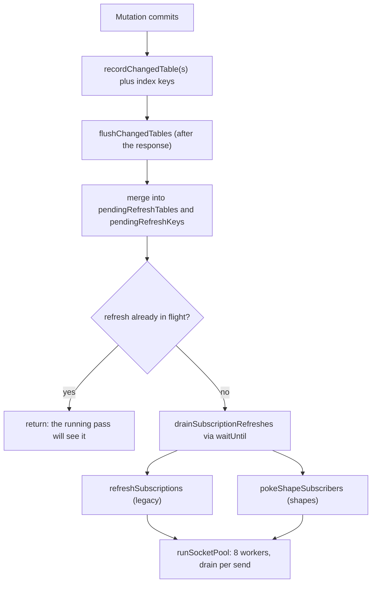
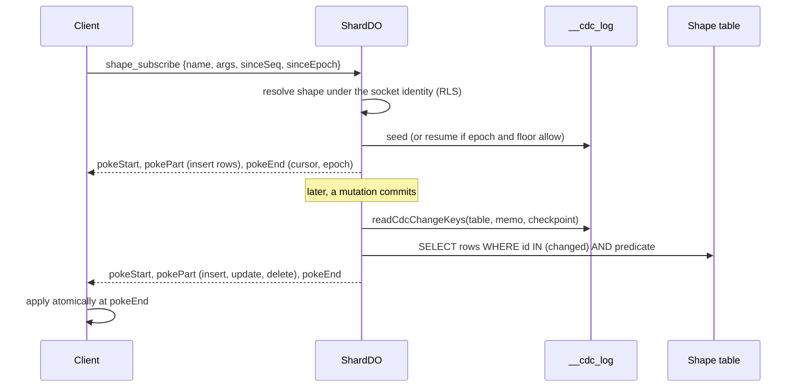

# The realtime engine: the writer pushes to its own sockets

When a mutation commits, the shard that wrote the rows pushes the result to the clients that watch them. No broker is involved. This page shows the two push protocols, the tricks that avoid needless work, and the limits that protect the shard.

## Two protocols on one WebSocket

| Protocol | What the shard does after a write | Cost |
|----------|-----------------------------------|------|
| Legacy `subscribe` | Re-runs the query and sends a delta of the result | One query run per distinct (function, arguments, identity) |
| Shape `shape_subscribe` (poke) | Reads the change log once, computes membership diff, sends `pokeStart`, `pokePart`, `pokeEnd` | One indexed scan per range, shared by all sockets |

Inbound frame types handled in `handleWebSocketMessage` (`shard-do.ts:7921`): `connect`, `subscribe`, `unsubscribe`, `shape_subscribe`, `shape_unsubscribe`, `stream`, `whisper`, `whisper_subscribe`, `whisper_unsubscribe`. An unauthenticated socket may send only `connect` (`shard-do.ts:7998`).

## After a write: the flush pipeline

Source: `shard-do.ts:13326-13400` (`flushChangedTables`), `13410` (`drainSubscriptionRefreshes`), `13612` (`refreshSubscriptions`), `14219` (`pokeShapeSubscribers`).

### Tricks that avoid work

1. **Coalescing.** A burst of writes merges into one pending set. One extra pass handles them all (`shard-do.ts:13351-13370`).
2. **After the response.** The refresh runs under `waitUntil`, so the writer's latency does not include the fan-out. If the host has no `waitUntil`, the drain is awaited inline (`shard-do.ts:13394-13400`).
3. **Table gate.** `socketIndex.mayCare(ws, changed)` skips a socket whose subscriptions read none of the changed tables (`shard-do.ts:13613`).
4. **Range gate.** A query read through index ranges only (no scan, no by-id read) records its ranges. A write outside every range does not re-run it (`subscription-range-gate.ts`, `read-footprint.ts`). The gate is pessimistic: "Narrowing is an optimization; under-invalidating serves a live subscriber stale data forever". At most 1,000 written positions are tracked per table (`MAX_TRACKED_KEYS_PER_TABLE`, `subscription-range-gate.ts`). Past that, the table counts as unknown and every subscription on it re-runs.
5. **Run sharing.** Sockets with the same function, arguments and full identity share one query run per flush, kept in `reactiveRunCache`. The map is created for each flush (`shard-do.ts:13625-13633`).
6. **Memo skip.** A per-socket memo of the last JSON result suppresses a push whose result is byte-equal. A generation number drops a push whose read is older than the baseline (`socket-table-index.ts:6-35`).
7. **Backoff.** A subscription that throws every time is retried at once after its first failure, then after 1 s, 2 s, 4 s, up to 60 s. A new identity ends the wait (`subscription-backoff.ts`).
8. **Result caps.** A pushed result may hold 8 MiB of characters and the memos together 32 MiB. Environment variables `LUNORA_SUBSCRIPTION_MAX_RESULT_CHARS` override the first (`shard-do.ts:1420,1428,15986`).

### Backpressure

`awaitWsDrain` checks `bufferedAmount`. If it is above 1,048,576 bytes it sleeps 20 ms, up to 100 times (about 2 seconds), then continues (`subscription-delivery.ts:515-537`). `runSocketPool` runs 8 workers. Each worker visits sockets one by one, so the drain gate really paces each socket (`socket-pool.ts`). One throwing socket never stops the others.

## The poke protocol

A poke is a membership diff for one shape.

Rules:

- **Atomic apply.** The client applies a poke at `pokeEnd`. A socket that dies mid-poke applied nothing (`architecture.mdx`, failure modes).
- **Base checkpoint.** Each part carries `baseCheckpoint`, the cursor of the last poke that carried rows for that shape. The client can detect a gap. Empty diffs do not move it, so no false gap appears (`shard-do.ts:14483-14491`).
- **Owed rows.** A shape that failed to deliver is marked owed before the send. It is diffed again on the next flush even if its table did not change. After hibernation the in-memory memo is gone, and one unconditional diff replaces the shortcut (`shard-do.ts:14446-14477`).
- **Durable baselines.** `__shape_poke_cursor` holds one row per (connection, subscription). Baselines are written in batches after the fan-out, about 33 rows per statement (`shard-do.ts:14327-14339`). If that write fails, the baseline falls back to the subscribe-time cursor, which only means a re-scan, never a skipped row.
- **Refusals.** A shape over a table that is not in the log is refused. A `.memory()` table cannot back a shape. A join across two `.shardBy()` tables is rejected at registration (`relation-predicates.ts:692`, `architecture.mdx`).

The cost model, from the architecture page: the client keeps the live views with an incremental dataflow library. The shard never runs a dataflow pipeline.

### Global shapes

A shape on a `.global()` table cannot use the log. The alarm poll (2 s) compares membership snapshots per socket. Snapshots are saved in `__global_shape_snapshot` so they survive hibernation (`shard-do.ts:14715-14825`). See [D1 and global tables](09-d1-global-and-hyperdrive.md).

## Hibernation

Idle sockets cost no compute. State lives in the socket attachment, with limits in [The ShardDO](05-shard-durable-object.md). Four details:

- **Auto ping.** The `lunora-ping` to `lunora-pong` pair is answered by the runtime without waking the object (`shard-do.ts:16404`).
- **Attachment cache.** `serializeAttachment` is wrapped so the decoded attachment is cached per socket. Every write refreshes the cache (`shard-do.ts:18358-18400`).
- **Pending sockets.** Behind the bearer gate (`LUNORA_WS_BEARER`), an upgrade may be accepted before its `connect` frame. At most 1,024 are pending, each for 10 seconds. The deadline is enforced on the next upgrade, not by a timer, because a sleeping object has no timers (`shard-do.ts:567-575,3683-3721`). A `ponytail:` note says a pending socket on a quiet shard lingers until the next upgrade.
- **Expired credentials.** Every outbound refresh checks `expiresAt`. A passive subscriber sends no frames, so the outbound check is the load-bearing one (`shard-do.ts:13644-13658`).

## Whispers, rooms and live streams

- **Whisper.** Small ephemeral messages: payload up to 4,096 bytes, a token bucket of 50 burst and 25 per second per socket, 64 topics per socket (`shard-do.ts:2115,2182`). Verdicts are memoized with a cap of 256 pairs per socket. The slot is reserved with its in-flight promise before the first await, so concurrent frames cannot exceed the cap (`shard-do.ts` `authorizeWhisper`).
- **Rooms and socket routes.** `defineWebSocket` routes run handlers per frame, with a queue of 64 events per socket (`MAX_QUEUED_ROOM_EVENTS`).
- **Live streams (Server-Sent Events).** Up to 1,024 connections per shard, 32 per caller, a 25 s comment keep-alive, and a 256 KiB queue limit. A slow reader is dropped (`shard-do.ts:2145-2180`).
- **Durable streams.** Each chunk is saved in `__stream_chunks` with a sequence, so a stream can resume after eviction. A run whose object is evicted ends as `STREAM_INTERRUPTED` (`cloudflare.ts:27-30`). `waitUntil` keeps the object alive up to 15 minutes from compatibility date 2026-10-01.

## Reactors

A reactor is a server-side subscription. It reuses the flush drain. A reactor that keeps changing its own read stops after 8 runs in one drain (`MAX_REACTOR_RUNS_PER_DRAIN = 8`, `shard-do.ts:2036`). Each new drain restarts the budget, so steady write load is never throttled.

**Aha: the convergence bound is per drain.** A per-instance counter would throttle a busy app. A per-drain counter catches only loops inside one drain, which is the loop signature.

## Where to go next

Read [Alarms, queues, workflows](11-alarms-queues-workflows.md).
