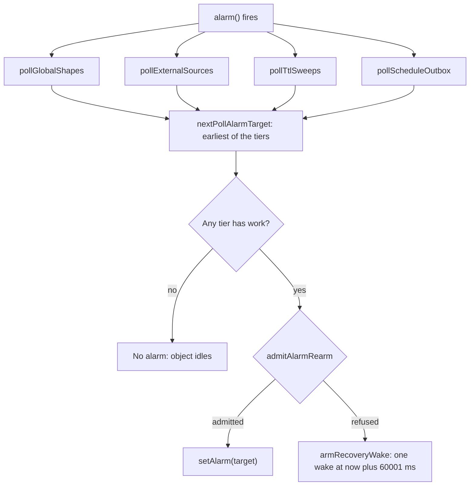
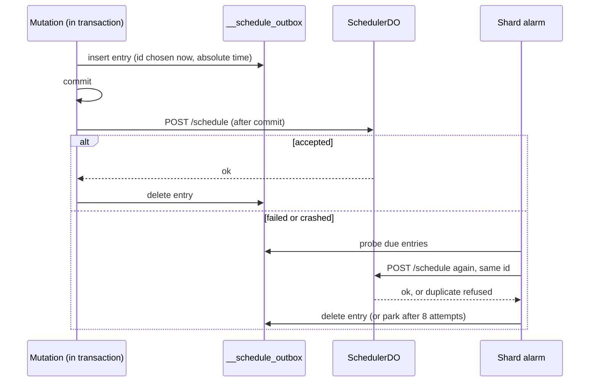

# Background work: one alarm per object, and four ways to defer

A Durable Object has exactly one alarm slot. Lunora shares that slot between several jobs. It also runs a separate scheduler object, uses Queues for background messages, Workflows for multi-step jobs and Cron Triggers for time. This page explains each, and the guards against runaway loops.

## One alarm, four tiers

The shard alarm (`ShardDO.alarm`, `shard-do.ts:3633`) serves four tiers in one handler (`handleAlarmCloudflare`, `shard-do.ts:9062`).

| Tier | What it does | Next wake |
|------|--------------|-----------|
| Global shapes | Poll D1 for membership changes | now + 2,000 ms while any global shape is subscribed |
| External sources | Pull from an outside system into a local table | earliest next-due time of any source |
| TTL sweep | Delete expired rows (`.ttl()`) | next expiry |
| Schedule outbox | Retry a deferred `ctx.scheduler` call | next retry time |

The next alarm time is the earliest of the tier times, never later than now (`nextPollAlarmTarget`, `shard-do.ts:2214`). If no tier has work, no alarm is set, and the object goes fully idle. A replica never runs the alarm, because it holds a copy (`shard-do.ts:9070`).

TTL sweeps work in batches: 200 rows per batch, up to 20 batches per pass, with a 30 s interval (`TTL_SWEEP_BATCH`, `TTL_SWEEP_MAX_BATCHES`, `TTL_SWEEP_INTERVAL_MS`, `shard-do.ts:1702-1705`).

### The re-arm breaker

A tier that always reports "due now" turns the alarm into a tight loop, and each wake is billed. The breaker (`alarm-rearm-breaker.ts`) limits it.

- A sliding window of 60,000 ms, kept as two counters and a timestamp in one SQLite row (`ALARM_REARM_WINDOW_MS`, `__lunora_alarm_rearm_window`).
- Default limit: 300 sub-floor re-arms per window, env `LUNORA_ALARM_REARM_LIMIT`; `0` turns it off (`DEFAULT_ALARM_REARM_LIMIT = 300`, line 60).
- A re-arm at least 2 s after the tick start is "floor-paced". Such re-arms are only checked, never recorded. A healthy poll writes no row. The floor is measured from the tick start, because the clock moves during the tick.
- When refused, the shard arms one recovery wake at `now + 60,001 ms`. The extra millisecond prevents a refusal loop under a frozen clock (`recoveryWakeAt`).
- The schedule outbox is exempt. It holds jobs the scheduler has not accepted.
- A storage fault admits the re-arm. A breaker that cannot read its row must not stall a shard.

The sliding estimate is `current + previous * (1 - elapsed / window)`.

A second breaker covers `ctx.scheduler` loops. It counts one unit per (invocation, target), with limit 600 per window, env `LUNORA_SCHEDULE_RATE_LIMIT` (`schedule-rate-breaker.ts:65-68`). A schedule over the budget is deferred one window. It is not refused or dropped.



## The schedule outbox

A mutation that calls `ctx.scheduler.runAfter` must not lose the job if a crash falls between commit and the scheduler call. The deferred call is written to `__schedule_outbox` inside the transaction. It is deleted when the scheduler accepts it.

```ts
// packages/shard-engine/src/ctx-db-schedule-outbox.ts:1 (header, summarised)
// A row is written INSIDE the transaction: durable exactly when the writes are,
// gone with them on a rollback. Deleted once the scheduler accepts the job.
```

Rules:

- The job id is chosen before the call, so a retry of an accepted job is refused as a duplicate (`resolveScheduleId`).
- The retry ladder is 5 s, 15 s, 45 s, 2 min, 6 min, 18 min, 30 min, 30 min. Eight attempts, a little over an hour (`SCHEDULE_OUTBOX_BACKOFF_MS`, `shard-do.ts:1487-1500`).
- A parked entry is kept for 7 days (`SCHEDULE_OUTBOX_RETENTION_MS`, line 1514).
- The stored time is absolute. A delay replayed after an hour in custody would fire an hour late.

**Aha: the dedup row is why the outbox must exist.** The idempotency row says "this mutation succeeded". Without the outbox, it could say that about a mutation whose job never reached the scheduler. The client retry would short-circuit and the job would be lost with nothing reported.



## SchedulerDO

`SchedulerDO` is a separate Durable Object. The client resolves it with `idFromName(options.instanceName ?? "default")` (`scheduler/src/do-client.ts:28-31`). So an app has one scheduler object unless it names more. All schedule traffic for an app reaches that object.

Storage uses the key-value API with prefixes: `id:` (job header), `t:` (time index), `retry:`, `dead:`, `pool:`, `pq:` (`scheduler-do.ts:83-92`).

### The time index

The index key is `t:<15-digit zero-padded time>:<id>`. Zero padding makes string order equal to number order. The maximum time is `999_999_999_999_999` so every value pads to 15 digits (`TIME_PAD`, `MAX_SCHEDULED_FOR_MS`, lines 223-227). The comment explains the failure for a 16-digit time: it sorts above every bound, so the job never fires, and a value at or above 1e21 prints as `8.6e+21` and parses back as `8`, which arms the alarm at a past time in a tight loop. A retry ladder can produce such a time after about 36 doublings, so the same check guards retries (`isIndexableTime`, line 248).

### The alarm

`alarm()` (`scheduler-do.ts:636`):

1. Repair orphans (`reindexOrphanedRecords`).
2. List up to 100 index entries with `end: t:<now>:~` (`~` sorts after digits). This is one range read.
3. Read all headers in parallel.
4. Delete dangling index entries. A dangling entry would make `rescheduleAlarm` arm a past time for ever.
5. Drain at most 6 records at once (`MAX_CONCURRENT_DISPATCHES = 6`). Six is the platform limit of simultaneous connections waiting for response headers. More would only queue.
6. Always re-arm in `finally`, even if a record threw.

### The lease

A claimed record is not unindexed. It is re-armed 15 minutes ahead (`DISPATCH_LEASE_MS = 900_000`). The number is the alarm wall-clock ceiling. A claim made by this object cannot be alive 15 minutes later. A shorter lease would allow a double run. A longer one only delays recovery. If the scheduler dies mid-dispatch, the job is delayed up to 15 minutes, never lost (`scheduler-do.ts:178-214`).

The receiver backs this up. The shard declines a second delivery of a live dedup key with 409 `DISPATCH_IN_PROGRESS` (`shared/dispatch-claim.ts:23`). The scheduler treats that answer as "in progress" and re-arms without using up an attempt (`dispatch`, line 769; `recordRetry(record, inProgress)`, line 1432).

### Retry and dead letters

A dispatch counts as success only on an explicit 2xx. A 404 or 401 retries, because the receiver may be missing or restarting. Defaults: 5 retries (`MAX_RETRY_ATTEMPTS`), first backoff 30,000 ms doubling (`RETRY_BASE_DELAY_MS`). After that the record moves under `dead:`. It is never deleted silently (`scheduler-do.ts:128-144`).

The dispatch target comes from `env.LUNORA_ORIGIN_URL`, never from the request body, to prevent server-side request forgery. The body is signed with HMAC `x-lunora-scheduler-signature` when `LUNORA_SCHEDULER_SECRET` is set, else bearer-authenticated by the admin token (`scheduler-do.ts:769-800,1397`).

### Workpools

A pool name with `maxConcurrency` limits parallel jobs. The count is in a `pool:<name>` row. It is read fresh for every record. The comment explains: an outbound fetch opens the input gate, so a cached copy written back after a `/complete` call would bring the finished job's slot back and leak pool capacity for ever. A pooled job at the limit is re-armed 1,000 ms later (`POOL_BACKPRESSURE_DELAY_MS`).

## Queues

`@lunora/queue` is a typed layer over the platform producer and consumer.

### Producer checks

Before any call: batch at most 100 messages, delay at most 43,200 s, and the body may not carry the key `$lunora.requeued$` (`create-queues.ts:18,27,40-50`; `requeue-envelope.ts:21`). Cloudflare's byte limits (128 KB per message, 256 KB per batch) are left to the platform. Measuring them would serialize every body twice.

### Consumer: `dispatchQueueBatch`

The consumer wraps every message and the batch in a `Proxy` (`queue/src/dispatch.ts:270-340`).

- `ack` and `retry` are recorded and then forwarded. Any other property is read with `Reflect.get(target, property, target)`. A host object throws "illegal invocation" if read with a proxy as `this`.
- Each message gets `message.run`, pinned to that message. A call carries `messageId` and `dedupId = <messageId>#<n>`. The counter `n` restarts for every delivery, so a redelivery reproduces the same ids and the dedup table serves a call already done. The two ids must differ, because the table is keyed by identity and mutation id without the function path. Two calls with one id would return the first call's cached result for the second (`packages/queue/src/dispatch.ts:215-243`).
- A deterministic failure is attributed to its message, so a poison message leaves the batch without sinking the others.
- A declined delivery (409 from the claim) on the last attempt is re-enqueued as a copy inside a sealed envelope. The body is under 128 KiB. It is signed with a MAC keyed by the admin token. A copy is unwrapped only if the MAC verifies. The copy keeps the original id and body, so deduplication still works (`requeue-envelope.ts:21-72`, `packages/queue/src/dispatch.ts:196`).

Defaults from `@lunora/dispatch`: dispatch timeout 30,000 ms, queue max retries 3, decline retry delay 900 s (`create-dispatch-runner.ts:31,226,223`).

### Topics

A Cloudflare queue has one consumer. A topic with N subscriptions is N queues, one per subscription, each with its own retries and dead letter queue. A publish sends to all in parallel (`topics.ts:75`). It is not atomic: a failed send rejects the publish, and a retry delivers again to the subscriptions that already got it. There is no ordering key (`cloudflare.ts:191-194`).

## Workflows

`defineWorkflow` becomes a `WorkflowEntrypoint` subclass in `_generated/workflows.ts`. An instance is created through `ctx.exports.<Class>`. The scheduler can start a workflow at a time. Branches (`ctx.parallel`) stamp a callback marker into the params, so the child signals the parent when done (`workflow/src/do/index.ts`, `fan-out.ts`). Platform limits recorded in `limits.mdx`: 10,000 steps (Paid), 1 MiB per step output, 1 MiB per event, 50,000 concurrent instances.

## Cron Triggers

The generated `scheduled()` entry walks `LUNORA_CRONS`. The build step writes `triggers.crons`, keeping a list of the cron strings it owns in `package.json` so it does not remove a cron added by hand (`reconcile-crons.ts:1-60`). A cron target dispatches to a shard through `dispatchToShard`, which marks the call with the trusted `x-lunora-system` header (`create-worker.ts:3311-3340`). The cron path skips `authorizeShard` on purpose. The comment records the bug it avoids: the natural gate `identity?.userId !== undefined` would reject every cron, and the scheduler would retry for ever with nothing in the app logs.

## Where to go next

Read [Tricks and optimizations](12-optimizations-and-tricks.md).
