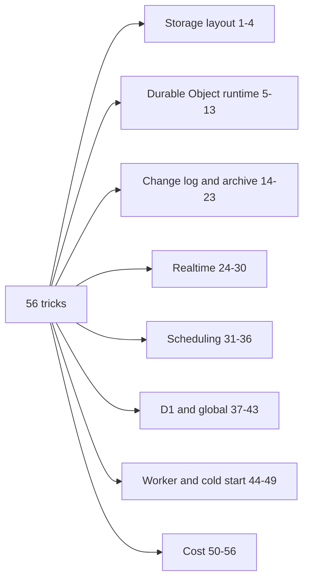
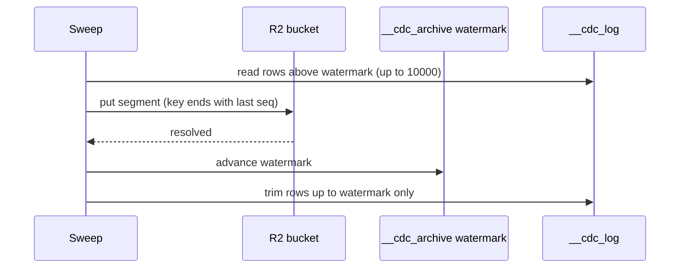

# Every trick, one by one

This page lists the optimizations and workarounds found in the code. Each entry says what problem it solves, how, and where. Entries are grouped by theme: storage layout, Durable Object runtime, change log and archive, realtime, scheduling, D1, Worker and cold start, and cost.



The next picture shows the one rule that links many entries (14, 15, 16, 18): archive first, destroy second.



**Aha: most tricks are one pattern.** The code finds a platform limit, sets a constant equal to that limit, and writes the reason in a comment.

## Storage layout

### 1. Documents as JSON text, fields through `json_extract`

Each shard table has `id`, `_creationTime` and one `__doc__` text column (`packages/shard-engine/src/ctx-db-migrations.ts:638`). Field reads use `json_extract`. Indexes are expression indexes on those paths. Adding a field needs no `ALTER TABLE`. System fields such as `_commitSeq` live in the blob for the same reason (`ctx-db-commit-seq.ts:94`).

### 2. A real index for the default sort

A read with no index and no `orderBy` sorts by `_creationTime, id`. The row table had only `id` as key, so SQLite built a temporary B-tree on every page. The migration adds an index on those two stored columns. The comment gives 1317.9 microseconds without it and 7.3 microseconds with it, over 50,000 rows. Cold-start cost to build it on a 1,000,000 row table: 369 ms, once (`packages/shard-engine/src/ctx-db-migrations.ts:664-684`).

### 3. Sortable keys for big numbers

SQLite cannot compare a bigint stored as JavaScript Object Notation (JSON). Lunora projects a `bigint` to an order-preserving text key and parks the exact original under the reserved key `__originals__`.

```ts
// packages/shard-engine/src/sql-projection.ts:45
const BIGINT_KEY_DIGITS = 39;
const NEGATIVE = "0";
const NON_NEGATIVE = "1";
const ninesComplement = (digits: string): string => Array.from(digits, (digit) => String(9 - Number(digit))).join("");
```

Non-negative values are zero-padded under prefix `1`. Negative values use the nines' complement under prefix `0`, so `-200` sorts below `-9`. A value over 39 digits is refused, not mis-sorted (`ponytail:` note). A document that already uses the key `__originals__` is rejected on write (`do-sql.ts:96`).

### 4. Work around statement limits

Documented limits: 5 compound `SELECT` terms, 100 bound parameters, 50-byte `LIKE` pattern (`limits.mdx`). Lunora nests compound selects five at a time, binds a long `in` list as one `json_each` parameter (`where-sql.ts:71`), chunks multi-row inserts, and compiles `contains` to a position function. The change log chunks table names at 90 (`ctx-db-cdc.ts:174`).

## Durable Object runtime

### 5. A gate that never rejects

`blockConcurrencyWhile` resets the object when its callback rejects. The adapter returns `{ok, value}` or `{ok:false, error}` and re-throws outside (`cloudflare-host.ts:161-183`). An ordinary application error no longer drops every hibernating socket.

### 6. Keep the original error object

The platform returns a flattened copy of a thrown error. A copy of a `LunoraError` would look like an unknown fault and be hidden. The adapter saves the original and re-throws it, with the platform error as `cause` (`cloudflare-host.ts:202-236`). `attachCause` itself is guarded, because a frozen error rejects a `cause` write (line 114).

### 7. After-commit work in commit order, outside the gate

Vector sync cannot be rolled back, so it runs after commit. Run loose, a slow hook for `v1` could land after the fast hook for `v2`, and the vector would stay stale. So the hooks are linked on a chain inside the gate, where order is known. They run outside the gate (`shard-do.ts:4288-4410`).

```ts
// packages/do/src/shard-do.ts (inside runInTransaction)
flushed = this.linkAfterCommit(async () => flushAfterCommit(queued));
```

The wait is capped at 15 s; later calls skip it once stalled (`AFTER_COMMIT_WAIT_MS`).

### 8. Re-pin request fields after every await

See [The ShardDO](05-shard-durable-object.md). `captureRequestScope` and `restoreRequestScope` stop identity and trace leaking between interleaved requests.

### 9. No gate for actions

An action under the gate would let any caller freeze the shard by sending a mutation id header. Actions use an in-memory `InFlightClaims` set with a 15-minute ceiling (`in-flight-claims.ts`).

### 10. Meter reads and writes per transaction

100,000 documents read, 32 MiB written, 50,000 documents written (`transaction-headroom.ts:58-62`). The tracker is passed by value to each dispatch, refresh and alarm job.

### 11. Attachment cache and auto-response

The decoded socket attachment is cached by wrapping `serializeAttachment` (`shard-do.ts:18358`). The keep-alive ping uses `setWebSocketAutoResponse`, so an idle socket never wakes the object (`shard-do.ts:16404`).

### 12. Foreign-socket negative cache

`handleFor` is called on every frame. A `WeakSet` of sockets known not to be ours and a membership set keyed by a generation counter replace a linear scan (`cloudflare-host.ts:627-651`).

### 13. One class for three roles

`mergeDurableObjects` hosts shard, scheduler and registry in one class, chosen by instance name prefix (`merge-durable-objects.ts:63`). It spends one account class instead of three.

## Change log and archive

### 14. Archive first, destroy second, via a watermark

See [Storage tiers](08-storage-tiers-and-archive.md). `__cdc_archive` (one row) is advanced only after the R2 `put` resolves (`ctx-db-cdc-archive.ts:167`).

### 15. Epoch in the R2 prefix

A fork gets a new prefix, so old segments become unreachable by construction, not by a check (`ctx-db-cdc-archive.ts:81-101`).

### 16. Key by last sequence, padded to 16 digits

One `list` with `startAfter` finds every needed segment. No manifest (`ctx-db-cdc-archive.ts:103-116`).

### 17. Isolated index creation

Each `CREATE INDEX` on the log sits in its own `try/catch`. A long first build must not brick a shard (`ctx-db-cdc.ts:122-155`).

### 18. Bounded destructive statements

`DELETE ... WHERE seq IN (SELECT seq ... ORDER BY seq LIMIT n)`. A first sweep over millions of rows would otherwise abort and repeat for ever (`ctx-db-cdc.ts:479-486`).

### 19. Count-free window probe

`cdcSeqLeavingRows` uses `ORDER BY seq DESC LIMIT 1 OFFSET keep-1`. It replaced a `COUNT(*)` that walked the whole B-tree each minute on a write path (`cdc-retention.ts:509-514`, `ctx-db-cdc.ts:540`).

### 20. Cursor from `sqlite_sequence`

`AUTOINCREMENT` keeps the high-watermark even after the newest row is trimmed (`ctx-db-cdc.ts:568-583`).

### 21. Strict number parsing for destructive knobs

`10k` must not become 10 (`cdc-retention.ts:239-246`).

### 22. Row history index only on demand

`("table", id, seq)` is built only when some table uses `.dropStalePatches()` (`ctx-db-cdc.ts:141`).

### 23. Partial index for compacted rows

`WHERE op <> 'delete' AND doc IS NULL` is empty until compaction runs. SQLite uses a partial index only when the query repeats the predicate, so one constant serves both (`ctx-db-cdc.ts:73`).

## Realtime

### 24. Range-gated invalidation

A write re-runs only subscriptions whose recorded index ranges contain the written position. Pessimistic by design (`subscription-range-gate.ts`).

### 25. Per-flush diff cache

One changed-key scan per (table, range). One membership probe per resolved predicate. Keys joined by length prefix so `["a","bc"]` and `["ab","c"]` cannot collide (`shape-diff-cache.ts`).

### 26. Poke baselines written in batches

About 33 baselines per statement, after the fan-out (`shard-do.ts:14327-14339`).

### 27. Backpressure and bounded fan-out

`awaitWsDrain` plus `runSocketPool(…, 8)`.

### 28. Relay tier with hysteresis

Promote at 8,000 sockets, collapse below 4,000, 2 relays, cap 8. Relays are random, so a one-region app does not pile onto one relay. See [Replication](07-replication-and-read-scaling.md).

### 29. Uniform-shape probe

A `Proxy` identity that returns a distinct value for any claim reveals whether a shape's `where` reads identity (`relay-hub.ts:863`).

### 30. Replica single-flight latch

One in-flight catch-up joined by all readers. The joined verdict is re-checked against the durable cursor (`replica.ts:583-592`).

## Scheduling

### 31. One alarm, four tiers, earliest wins

`nextPollAlarmTarget` (`shard-do.ts:2214`).

### 32. Sliding-window breaker in one row

Two counters and a timestamp. Floor-paced re-arms are read-only (`alarm-rearm-breaker.ts`).

### 33. Zero-padded time index

String order equals number order. The upper bound is chosen so every value has 15 digits (`scheduler-do.ts:223-248`).

### 34. Lease equal to the platform ceiling

15 minutes, because an alarm cannot outlive 15 minutes (`scheduler-do.ts:214`).

### 35. Concurrency equal to the connection limit

Six dispatches at once, the number of connections a request may wait on (`scheduler-do.ts:173`).

### 36. Outbox inside the transaction

See [Alarms, queues, workflows](11-alarms-queues-workflows.md).

## D1 and global tables

### 37. Retry only what is provably a read

`READ_ONLY_STATEMENT = /^[\s(]*(?:select|pragma|explain)\b/iu` (`retry.ts:119`). `WITH` is excluded.

### 38. Full-jitter backoff

`Math.round(Math.random() * min(1000, 50 * 2 ** (attempt - 1)))` (`retry.ts:190-194`). It stops a synchronized wave against a recovering database.

### 39. Two-parameter OCC guard

Compare `id` and `_version` only, so wide tables stay under 100 parameters (`shared/occ-version-column.ts`).

### 40. Batched provisioning

368 statements for 42 tables became a few `batch` calls (`ctx-db-global-provisioning.ts:1-5`).

### 41. Point-read coalescing in one microtask

`queueMicrotask(flush)` (`point-read-batcher.ts:135`).

### 42. Query cost tags

`select:users` style tags from D1 `meta` (`d1/src/query-metrics.ts`).

### 43. Lease row for fleet-wide sweep

One compare-and-set row stops N shards trimming one shared log (`sql-store/src/ctx-db.ts:957-1100`).

## Worker, batching and cold start

### 44. Batch RPC grouped by shard

Calls are validated, grouped by shard and sent as one `/rpc-batch` each. The body and headers of a fan-out are built once (`create-worker.ts:5026`, `query-coordinator.ts:1216`).

### 45. Directory adapter cached in a WeakMap

One object per namespace, not three closures per request (`resolve-shard.ts:38`).

### 46. Edge cache keyed by `Vary`

The key contains the values of every `Vary` header, because the platform cache honours only `Accept-Encoding` (`rest-edge-cache.ts`).

### 47. Lazy function registry

Opt-in `--lazy-functions`. A real app of about 1,000 functions and 130 tables fell from median 421 ms to 290 ms of startup central processing unit (CPU), about 31% (`plans/490-lazy-function-registry.md`). The Worker limit is 1 s (error 10021).

### 48. Size and startup budgets in continuous integration

`worker-size.json` and `worker-startup.json` store baselines. The startup file gates on module count and bytes (deterministic) and prints central processing unit (CPU) time as advice only.

### 49. Lazy schema migration

`ensureMigrated` runs on first use after a wake, not in the constructor (`packages/codegen/src/emit/shard.ts:1176`). A unique index blocked by duplicate rows is deferred, so the data migration that fixes the duplicates can still run.

## Cost tricks

### 50. Change log off by default

`.cdc()` costs one row per write (`app-builder.ts:140`).

### 51. Memory tables stay out of the log

A heartbeat-rate presence table would fill the log window with rows nobody can replay (`ctx-db.ts:2335`).

### 52. Batched metrics

Metrics are written every 8 dispatches, at a minute boundary, or after an error (`shard-do.ts:10311`).

### 53. Windowed pruning

The request log is trimmed at most once per 60 s window (`request-log.ts:59,1027`).

### 54. Bounded histories

Schema history keeps 50 versions (`schema-history.ts`). Request log keeps 1,000 rows (`request-log.ts:62`). Idempotency rows last 24 hours.

### 55. Hibernation as the idle strategy

Subscriptions sit in attachments. Idle sockets cost storage, not compute.

### 56. Row-write cost to know

One mutation can write: the row, the default-sort index entry, each declared index entry, a log row (if on), an idempotency row (if a mutation id is sent), the client watermark, plus a request-log row. This is an inference from the migration and dispatch code, not a measured count.

## Where to go next

Read [Migrations](13-migrations-and-schema.md).
