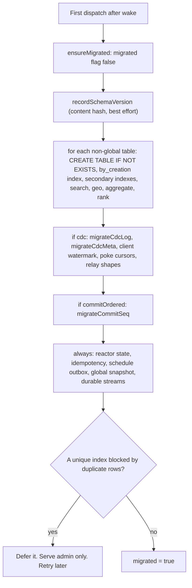
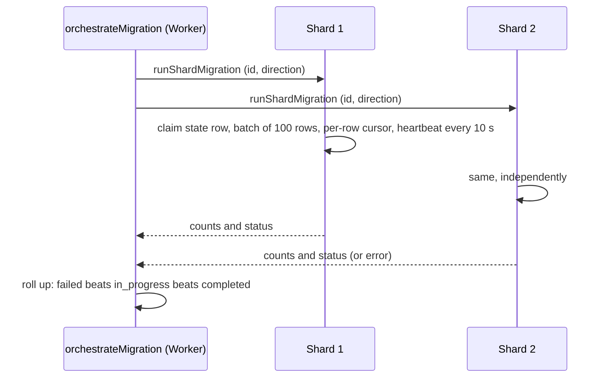

# Migrations: schema is applied lazily, data is moved by hand

Lunora has four kinds of migration. Each runs in a different place. This page explains them, the drift gate that guards deploys, and what happens when many shards must change together.

| Kind | Runs where | Triggered by | Code |
|------|-----------|--------------|------|
| Shard schema | Inside each shard, on first use after a wake | Any dispatch | `runShardMigrations`, `ctx-db-migrations.ts` |
| Data migration (`defineMigration`) | Inside each shard, resumable | Admin call, fanned out | `data-migration.ts:643` |
| Global tables | D1 or Hyperdrive, batched data definition language (DDL) | First access | `ctx-db-global-provisioning.ts` |
| D1 Structured Query Language (SQL) migration files | D1, by a runner | `lunora migrate` | `d1/src/migration-runner.ts:377` |
| Durable Object classes | Cloudflare | `wrangler deploy` | `reconcile-bindings.ts:190-205` |

## Shard schema: idempotent and lazy

There is no migration file for a shard table. The schema is code. On the first request after a cold start, `ensureMigrated` runs `runShardMigrations`. It uses `CREATE TABLE IF NOT EXISTS` and `CREATE INDEX IF NOT EXISTS`. A Durable Object runs one event at a time, so no locking is needed.

Source: `packages/shard-engine/src/ctx-db-migrations.ts:590-751`, `codegen/src/emit/shard.ts:1176-1195`.

Details:

- Adding a field or a table needs nothing. The JavaScript Object Notation (JSON) document column absorbs it.
- A removed index is dropped from a ledger table `__lunora_framework_indexes`. Framework indexes are tracked, so an index the schema no longer declares can be dropped without touching a user's own index (`ctx-db-migrations.ts:288`).
- Companion tables (`__agg_*`, `__rank_*`, `__fts_*`, geo) are created with `IF NOT EXISTS`. They never reshape an existing table, so a rebuild marker table `__lunora_companion_state` records when a rebuild is needed (`ctx-db-migrations.ts:513-560`).
- A unique index over existing duplicates cannot be created. The code returns the blocked indexes, keeps going, and refuses user dispatch with an error naming them. The retry is limited to once per `BLOCKED_MIGRATION_RETRY_MS` (5,000 ms, `packages/codegen/src/emit/shard.ts:1027`). An admin data migration that removes the duplicates resets the clock (`packages/codegen/src/emit/shard.ts:1160-1195`).
- Each cold start re-runs the idempotent data definition language (DDL). The flag `migrated` is in memory and resets on hibernation. This costs catalog reads on every wake.
- Index creation on the change log is isolated so that a slow build cannot block boot.

### The schema ledger

`recordSchemaVersion` writes one row per distinct schema shape into `__lunora_schema_history`. The identity is the hash of the snapshot, so a revert re-links to the old row. Insert is `INSERT ... ON CONFLICT DO NOTHING`. The ledger keeps 50 versions (`SCHEMA_HISTORY_MAX_VERSIONS`, `schema-history.ts:43`). It is best effort: a failure must never stop a shard from booting (`schema-history.ts:20-28`). Studio draws a timeline from it.

## The drift gate

The shard schema is applied at runtime, so the deploy needs a guard for changes that require data work. The gate compares the current schema with a committed baseline file `lunora/.lunora-schema.json` (`codegen/src/schema-drift.ts:1-30`, `shared/schema-snapshot.ts:279`). A snapshot covers each field's validator shape, indexes, relations, shard mode and the set of declared migration ids.

| Class | Examples |
|-------|----------|
| Safe (additive) | New table, new optional field, added index, a required field made optional |
| Breaking | Dropped table or field, field kind change, optional to required, new required field on an existing table, changed shard mode, removed or renamed index or relation |

`lunora deploy`, `verify` and `prepare` block a breaking change that no new migration covers. The message names `lunora migrate create` for each table that is owed one. The shard mode is encoded with the backend: `global:d1` and `global:hyperdrive` differ (`schema-drift.ts:50-70`). Moving a table to `.shardBy()` is breaking, so the deploy needs `--allow-schema-drift`.

## Data migrations across shards

A `defineMigration` transform runs inside one shard. The runner walks one table's live documents in keyset batches and rewrites changed rows through the normal writer, so triggers fire and subscribers hear about them.

| Property | Value | Source |
|----------|-------|--------|
| State table | `__lunora_migrations` | `data-migration.ts:47` |
| Default batch | 100 rows | line 50 |
| Stale claim timeout | 30,000 ms | line 64 |
| Heartbeat inside a batch | every 10,000 ms | line 75 |
| Order | `_creationTime ASC, id ASC` | header |
| Cursor | persisted per row, not per batch | header |

The properties that make it safe to stop and start:

1. **Resumable.** The cursor, counts and status are saved. A repeat run of the same id and direction continues.
2. **Idempotent on completion.** A completed run is a no-op that returns the saved counts.
3. **Stable cursor.** `replace` keeps `_id` and `_creationTime`, so a rewritten row does not move relative to the cursor.
4. **Per-row cursor.** After a failure in the middle of a batch, a page-start cursor would re-apply a non-idempotent transform such as `version + 1` to rows already done.
5. **Re-read before write.** A page is up to `batchSize` awaits old by its last row. Without a fresh read, a mutation that landed in the meantime would be overwritten.
6. **Claim heartbeat.** A live runner refreshes `updated_at`. A crashed runner's claim is reclaimed after 30 s.

The orchestrator `orchestrateMigration` calls every shard from the registry in the coordinator (`query-coordinator.ts:1981`). The roll-up (`rollUpMigration`, line 680) sums counts and gives `failed` when any shard failed, `in_progress` when any shard is incomplete or unreachable, else `completed`.

A migration cannot write another shard or delete a row. It can only `replace` the row it was given. Moving rows between shards is a different tool: export and import. See [Sharding design](04-sharding-design.md).

## D1 migration files

For D1, `MigrationRunner` applies ordered Structured Query Language (SQL) files.

- Tracking table `__drizzle_migrations` with `hash` (UNIQUE) and `version` (a unique index). The table shape is borrowed from Drizzle, but the runner decides by version, not by Drizzle's timestamp rule, so the two are not interchangeable (`migration-runner.ts:30-50`).
- Every refusal is decided before the first migration runs. If a migration was already applied from different SQL, the run throws `MIGRATION_DRIFT` (the recorded and current SHA-256 are in the message). Nothing is half applied.
- Two runners that race lose on the unique hash. The loser's batch rolls back and the migration counts as skipped (`migration-runner.ts:432-460`).
- Applied SQL runs in an atomic batch with its tracking row.

Global tables themselves are provisioned automatically, so the migration files only keep history in step with the schema. The docs say `migrate generate` is bookkeeping for a table that became `.global()` (`concepts/sharding.mdx`).

## Durable Object class migrations

Cloudflare needs a `migrations` entry to create a SQLite-backed class. The build step reconciles it. It replays `deleted_classes`, `renamed_classes`, `new_classes` and `new_sqlite_classes` the way wrangler does, then appends a new `new_sqlite_classes` tag for missing classes (`reconcile-bindings.ts:140-205`). The comment records a bug: counting only the `new_*` lists made a renamed class look unregistered, and wrangler then refused the config for ever. The class set comes from the Worker entry exports, not from imports, because wrangler refuses a binding whose class is not exported (`infer-bindings.ts:1-20`).

## Shard key change

Covered in [Sharding design](04-sharding-design.md). The data move is manual, with a write window.

## Point-in-time recovery as a migration safety net

Native recovery reaches back 30 days, in place. `lunora backup` writes newline-delimited JavaScript Object Notation (NDJSON) snapshots to R2 for off-platform recovery. The docs advise a snapshot before a shard key change.

## Aha moments

**Aha: the schema ledger is in the database, not the repo.** The committed baseline holds only one blessed state and lives on a developer disk. A deployed Studio cannot see it. The database knows what actually ran.

**Aha: one bad index must not take down the shard.** Unique-index failures are deferred and reported, so the very migration that would repair the data stays reachable.

## Where to go next

Read [Testing, observability and deployment](14-testing-observability-deployment.md).
