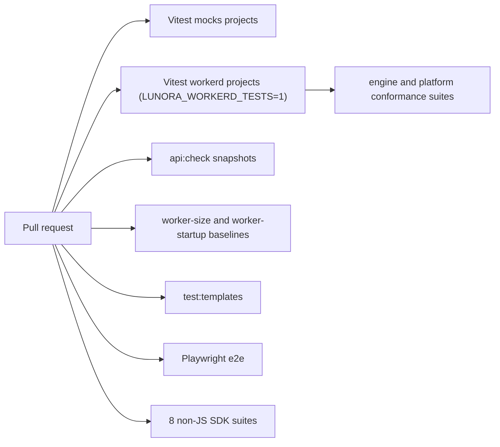
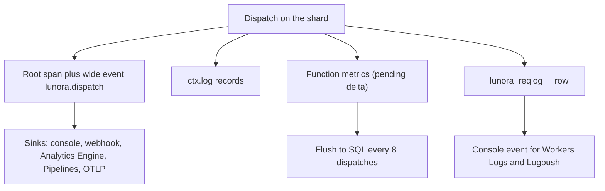

# Testing, observability and deployment

Lunora runs its tests on the real Cloudflare runtime, not only in mocks. It records traces, wide events, metrics and a request log, and ships them to several sinks. It deploys by inferring the wrangler configuration from the code. This page covers each part with numbers.

## Words on this page

- **workerd.** The open-source runtime that runs Workers and Durable Objects. Tests on workerd use the real platform behavior.
- **Vitest and Playwright.** Vitest is a test runner for TypeScript. Playwright drives a real browser for end-to-end tests.
- **Double.** A plain-object stand-in for a platform object in a test.
- **Coverage floor.** The lowest test coverage that a build may have. A build below the floor fails.
- **Conformance suite.** A set of tests that every host must pass.
- **Span and trace.** A span is one timed step of a request. A trace is the tree of spans for one request.
- **Wide event.** One span with many attributes. It carries the facts of a whole request in one record.
- **Sink.** A destination that receives events.
- **Workers Logs.** The Cloudflare service that stores and searches the console logs of a Worker (`workers/observability/logs/workers-logs.mdx`).
- **Logpush.** The Cloudflare service that sends Workers trace event logs to an outside storage or logging provider (`workers/observability/logs/logpush.mdx`).
- **OpenTelemetry Protocol (OTLP).** An open format for traces, metrics and logs. Workers can export OpenTelemetry-compliant logs and traces (`workers/observability/opentelemetry-export.mdx`).
- **Compatibility date.** A date in the Wrangler configuration that opts a Worker into the runtime behavior changes up to that date (`workers/configuration/compatibility-dates.mdx`).
- **Secret.** An encrypted text value attached to a Worker as a binding (`workers/configuration/secrets.mdx`).
- **Wrangler and binding.** Wrangler is the command-line tool of Cloudflare that builds and deploys Worker projects (`workers/wrangler/index.mdx`). A binding is a named link from a Worker to a resource, such as a D1 database or an R2 bucket. The binding appears on the `env` object.
- **Binding inference.** Lunora reads the code and writes the matching bindings into the Wrangler configuration.

## Testing strategy

### Two kinds of suite

The shard package has two Vitest projects (`packages/do/vitest.config.ts`):

- `mocks`: plain Node, plain-object doubles of `DurableObjectState`. Always on.
- `workerd`: the real runtime through `@cloudflare/vitest-plugin`. It needs the environment variable `LUNORA_WORKERD_TESTS=1`. It exercises hibernation, `acceptWebSocket`, `serializeAttachment` round trips and SQLite in a Durable Object.

The gate is permanent because coverage collects through `node:inspector`, which workerd does not implement, so coverage hangs with it on. A sandbox also cannot open the loopback port workerd needs (`AGENTS.md`, gotchas).

The repository holds 1,875 test files whose names end in `.test.ts` under `packages/`. 97 of them end in `.workerd.test.ts` (counted with `find`). The do package alone has 34 workerd test files, for example `eviction`, `alarm-rearm-breaker`, `relay-shape`, `relay-whisper`, `sql-limits`, `shard-do-idempotency`, `subscription-seed-race`, `room-recovery` and a `random-replay` directory (`packages/do/__tests__/workerd/`).

The AGENTS file explains why the workerd suite matters: `node:sqlite` is built with `SQLITE_DQS=0`, so a bare double-quoted column that resolves to nothing raises on Node, while on workerd it is a silent string literal. A full local test run can go green over a broken Durable Object or D1 path.

### Coverage floors

The do package ratchets the mocks project: branches 71, functions 75, lines 82, statements 82 (`do/vitest.config.ts`). The comment says to raise them when tests land and never lower them.

### Conformance suites

Two suites define what a host must do: `packages/platform/src/conformance/suite.ts` with a `reference-host.ts`, and `packages/shard-engine/src/conformance/suite.ts`. The command `test:celld` runs both against a live `celld` binary. The engine conformance test runs on workerd too (`engine-conformance.workerd.test.ts`).

### Other gates

| Gate | Script | What it checks |
|------|--------|----------------|
| Public application programming interface (API) | `api:check` | `api-snapshots/*.api.md` against built output |
| Dist | `dist:check` | built output is production clean |
| Worker size | `worker-size` | baseline in `worker-size.json`; Cloudflare limit 64 MiB uncompressed |
| Startup | `worker-startup` | modules and bytes, not central processing unit (CPU), in `worker-startup.json` |
| Batch cap | `lint:batch-cap` | drift of the shared batch limit |
| Templates | `test:templates` | scaffolds install, build, typecheck |
| End to end | `e2e` | Playwright |
| Non-JavaScript software development kits (SDKs) | `sdks/run-all.sh` | 8 software development kit (SDK) conformance suites |

The unit tests use fakes from `@lunora/testing`: `fake-scheduler`, `fake-queues`, `fake-topics`, `fake-secret-values`, `node-sqlite`, and a recorded model for agents.

Rules from `AGENTS.md`: tests wait on a milestone, never on a clock. A new test must fail without the fix. Never run all packages' tests in parallel with `pnpm -r`, because contention fails random suites.



## Observability

### What a dispatch records



Source: `shard-do.ts:9604` (`recordDispatchRootSpan`), `shard-do.ts:12086` (`recordRequestLog`), `shard-do.ts:10311` (`maybeFlushMetrics`).

- **Trace.** The Worker opens a trace with `beginDispatchTrace`. The sampled flag, `traceparent` and tail-bias flag are forwarded, so a sampled-out trace that errors is still kept whole (`create-worker.ts:4783`). A trace id is shared by the whole batch, but each shard gets its own span id so unrelated work does not merge in a collector (`create-worker.ts:5100-5125`).
- **Trust.** An inbound trace context is ignored unless the app opts in with `trustInboundTraceContext: true`, `"mtls"` or a function (`create-worker.ts:1726`). The `"mtls"` form reads the verified client certificate from `request.cf`, which a client cannot forge.
- **Wide event.** `ctx.span` attaches attributes to the dispatch's own span. The root span carries them. The code states the reason: with nowhere to put a fact, people reach for `ctx.log` and create noise (`shard-do.ts:9150-9165`).
- **Ray id.** The `cf-ray` id is stamped as `cloudflare.ray_id`, so Lunora spans and Cloudflare traces can be joined (`cloudflare.ts:168-171`).
- **Version.** The `CF_VERSION_METADATA` binding adds the deployment id and version tag to every request log row, so "did this start with a deploy?" is a group-by (`shard-do.ts:12187-12220`).

### Sinks

All in `packages/runtime/src/observability-sinks.ts`:

| Sink | Line | Notes |
|------|------|-------|
| `consoleSink` | 287 | Workers Logs |
| `webhookSink` | 382 | Hypertext Transfer Protocol (HTTP) post |
| `analyticsEngineSink` | 477 | index `[functionPath]`, blobs `[path, ok or error, shardKey, error code, fan-out table]`, doubles `[durationMs, errorCount, shards, failed]` |
| `pipelineLogSink` | 563 | to R2 through Pipelines |
| `otlpSink` | 832 | OpenTelemetry Protocol, batched |
| `combineSinks` | 1094 | fan out to many |

### The request log

Default behaviour writes one Structured Query Language (SQL) row per dispatch. Knobs: `LUNORA_REQUEST_LOG_SAMPLE` (0 to 1, default 1), `LUNORA_REQUEST_LOG_RETENTION` (default 1,000 rows), `LUNORA_REQUEST_LOG_EMIT` (default on in development, off in production; errors always emit). Arguments and identity are redacted unless the environment is development (`shard-do.ts:12223-12234`, `request-log.ts`). Sensitive arguments marked `v.sensitive` are masked before every sink (`shard-do.ts:12102`).

### Metrics

Per function: calls, errors, conflicts, latency, scanned tables, index hits. The delta is held in memory and written every 8 dispatches (`LUNORA_METRICS_FLUSH_EVERY` overrides), after an error, at a minute boundary, or when 200 distinct statements are pending (`MAX_STMT_SAMPLES_PER_DISPATCH = 200`). At most N-1 dispatches of counters are lost on eviction. A write failure drops the delta and logs one warning, because a retry after a partial write would double count (`shard-do.ts:10300-10345`).

### Studio and advisors

`pnpm dev` serves Studio: data browser, Structured Query Language (SQL) console, logs, traces, Issues (errors grouped by fingerprint), time travel, architecture view, and advisors. The advisor package ships static lints and runtime lints. The runtime lints include `hot_shard` and `fan_out_breadth`. The Studio's shard-traffic read uses `orchestrateShardTraffic`.

## Deployment

### The wrangler template

```jsonc
// wrangler.jsonc:1 (template at the repository root)
{
    "name": "lunora-app",
    "main": "src/index.ts",
    "compatibility_date": "2026-10-01",
    "compatibility_flags": ["nodejs_compat"],
    "durable_objects": { "bindings": [ { "name": "SHARD", "class_name": "ShardDO" }, { "name": "SESSION", "class_name": "SessionDO" } ] },
    "migrations": [{ "tag": "v1", "new_sqlite_classes": ["ShardDO", "SessionDO"] }],
    "d1_databases": [{ "binding": "DB", "database_name": "lunora-global", "database_id": "<replace>" }],
    "r2_buckets": [{ "binding": "FILES", "bucket_name": "lunora-files" }]
}
```

The sample app `examples/team-chat/wrangler.jsonc` adds `"observability": { "enabled": true, "head_sampling_rate": 1 }`. The compatibility date 2026-10-01 matters: from that date, a pending `waitUntil` holds off idle eviction for up to 15 minutes (`cloudflare.ts:29`). Cloudflare confirms this. The flag `durable_object_io_tasks_prevent_eviction` is on by default from that date (`src/content/compatibility-flags/durable-object-io-tasks-prevent-eviction.md`).

### Binding inference

`lunora deploy` and `lunora dev` read the Worker entry exports with a lexer and reconcile `wrangler.jsonc` (`config/src/infer-bindings.ts:1-20`). Rules:

- A Durable Object binding appears when the entry exports the class, because wrangler refuses a binding for a class that is not exported.
- Imports of `@lunora/auth`, `scheduler`, `storage`, `payment` are only hints.
- A `.global()` schema drives the `DB` binding.
- Lunora writes only what it can create. Workers KV (a key-value store) ids, Hyperdrive ids and Vectorize indexes need the operator.
- It records what it wrote in `package.json` under `lunora` (`queueTuning`, `crons`, `services`), so it can take its own entries out again and never touches hand-written ones.
- It adds a Durable Object migration tag for missing classes.

`lunora build --emit-bindings` writes a manifest of what the bundle needs, for an infrastructure-as-code tool. There is a converter to an Alchemy program (`wrangler-to-alchemy.ts`).

### Secrets and settings

| Name | Where | Purpose |
|------|-------|---------|
| `LUNORA_RELAY_SECRET` | Worker secret on Worker and all Durable Objects | hash-based message authentication code (HMAC) for relay, replica, registry channels |
| `LUNORA_ADMIN_TOKEN` | Worker secret | Admin routes, scheduler fallback auth |
| `LUNORA_SCHEDULER_SECRET` | Worker secret | Sign scheduler dispatch |
| `LUNORA_ORIGIN_URL` | var | Scheduler callback target |
| `LUNORA_WS_BEARER` | secret | Gate WebSocket upgrades |
| `LUNORA_SECRET_VALUE_KEY` | secret | Advanced Encryption Standard 256-bit Galois/Counter Mode (AES-256-GCM) key for secret values |
| `LUNORA_CDC_ARCHIVE` | R2 binding | Archive bucket |
| `LUNORA_CDC_LOG_RETENTION`, `LUNORA_CDC_PAYLOAD_RETENTION` | vars | Retention |
| `LUNORA_RELAY_*`, `LUNORA_MAX_RELAYS` | vars | Relay tuning |
| `LUNORA_REPLICA_*` | vars | Replica tuning |
| `LUNORA_ALARM_REARM_LIMIT`, `LUNORA_SCHEDULE_RATE_LIMIT` | vars | Breakers |

`lunora dev` generates the relay secret into `.dev.vars`. For production use `lunora env push` or `wrangler secret put`. Cloudflare limits each environment variable and each secret to 5 kilobytes (KB), with 64 variables on Free and 128 on Paid for each Worker (`workers/platform/limits.mdx`, "Environment variables"). Lunora's own `limits.mdx` (line 86) says "5 KB total", which the Cloudflare page does not support.

### Jurisdiction and residency

`validate-jurisdiction.ts` checks that bindings fit the chosen jurisdiction. A jurisdiction pins the namespace, drops region hints, and requires siblings (scheduler, registry, relays, replicas) to use the same subnamespace. The auth object can be moved between pinned and unpinned namespaces by admin operations (`cloudflare.ts:104`).

### The portability story

The same engine runs on `platform-node` (SQLite through `better-sqlite3`) and `platform-celld` (`celld`, a self-hosted daemon that runs Wrangler bundles; the package recomposes the Cloudflare adapters under the `celld` capability matrix). Capability matrices: Cloudflare 45 native of 60, Node 4 native, `celld` 19 native. Both are marked experimental in the roadmap tiers (`ROADMAP.md`).

## Where to go next

Read [Critical assessment](15-critical-assessment.md).
